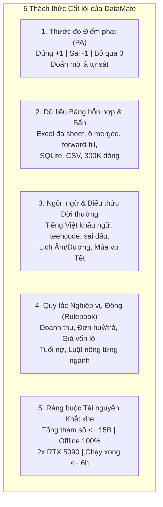
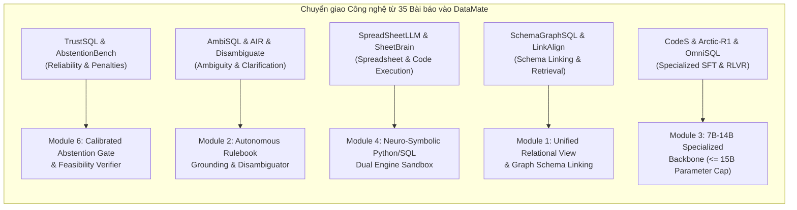
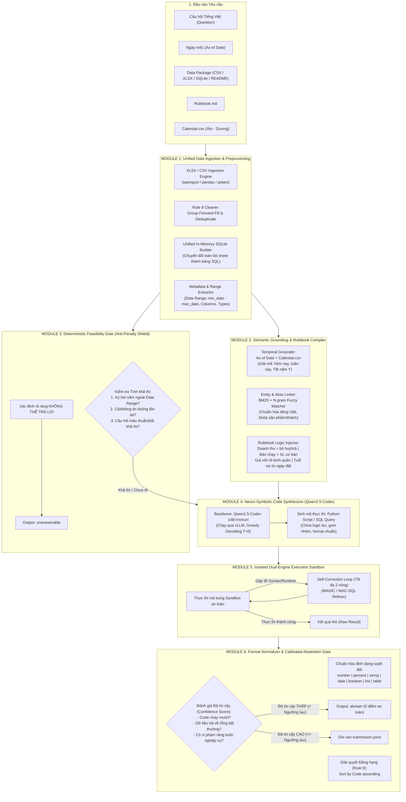
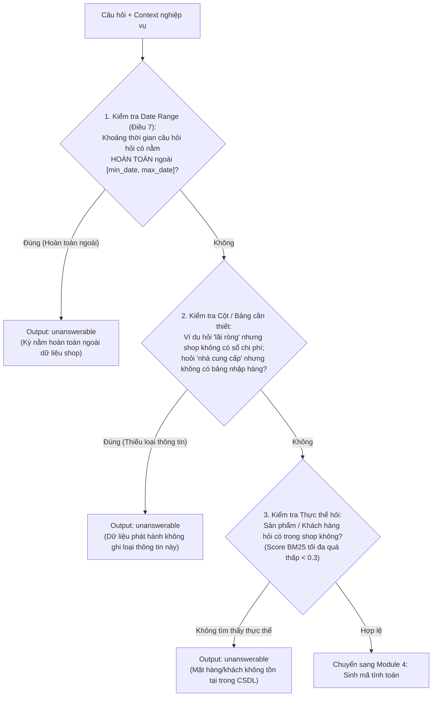
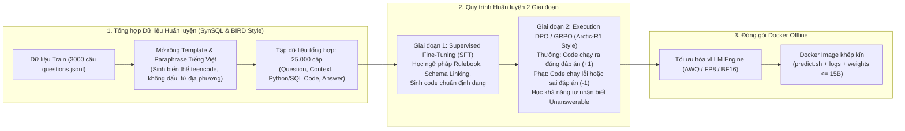

# DataMate: Talking To Your Data Through Agentic AI

## Báo cáo Kiến trúc & Ý tưởng Giải pháp Đột phá (Technical Solution Architecture)

### Cuộc thi: Zalo AI Challenge 2026 — DataMate Track

---

## Tuyên bố Sứ mệnh (Mission Statement)

> *"Millions of Vietnamese shop owners, teachers, clinics and small offices keep their records in spreadsheets and simple databases — but few can write a query. DataMate challenges you to build an AI agent that answers everyday questions in Vietnamese directly on messy, real-world tabular data: multi-sheet Excel exports, inconsistent product names, colloquial phrasing, and business logic like cost of goods or overdue debt. Your agent must find the right answer on its own — and know when the data cannot answer at all. Correct answers score, wrong answers cost, silence is free: build a system that is right when it speaks."*

---

## 1. Phân tích Bản chất Bài toán & Thách thức Sống còn

Dựa trên tài liệu đề bài `DataMate_Zalo_AI_Challenge_2026.md` và kiểm tra trực tiếp bộ dữ liệu (`competition_data/train`, `competition_data/public_test`), bài toán đặt ra 5 rào cản kỹ thuật then chốt:



### 1.1. Thước đo Penalized Accuracy (PA): "Silence is Free, Guessing is Fatal"

- Công thức: $PA = \frac{1}{N} \sum_{i=1}^N s_i$ với $s_i \in \{+1, 0, -1\}$.
- Khoảng cách giữa **Đúng** và **Sai** là $2$ điểm, trong khi **Bỏ qua (Abstain)** là $0$ điểm. Nếu mô hình đoán mò với độ tự tin $p < 0.5$, kỳ vọng điểm là $E[s] = p(+1) + (1-p)(-1) = 2p - 1 < 0$ (kéo tụt toàn bộ điểm số!).
- **Đặc biệt với câu hỏi `unanswerable`:** Nếu dữ liệu không đủ cơ sở để trả lời (ví dụ: kỳ hỏi nằm ngoài khoảng thời gian dữ liệu của shop theo Điều 7 Rulebook), mọi câu trả lời đưa ra con số (kể cả đoán $0$) đều bị tính là **SAI (-1)**. Chỉ khi agent đưa ra đúng `unanswerable` mới được **+1**. Nếu không chắc chắn giữa `unanswerable` và giá trị, `abstain` (0 điểm) an toàn hơn rất nhiều so với liều lĩnh.

### 1.2. Tính dị biệt của Dữ liệu Doanh nghiệp Nhỏ Việt Nam

- Dữ liệu xuất từ phần mềm bán hàng POS (KiotViet, Sapo, Suno...) hoặc sổ tay ghi chép Excel cá nhân.
- Các vấn đề cấu trúc:
  - **Ô để trống theo nhóm (Group Forward-Fill):** Mã đơn, ngày bán, trạng thái đơn chỉ ghi ở dòng đầu tiên, các dòng chi tiết sản phẩm phía dưới để trống (Điều 8 Rulebook).
  - **Đơn vị quy đổi đa tầng:** Thùng, hộp, vỉ, lon, cái; quy về đơn vị cơ bản.
  - **Dòng dữ liệu trùng lặp (Export Artifacts):** Hai dòng giống nhau trong cùng một đơn là lỗi xuất file, chỉ tính 1 lần; nhưng ở 2 đơn khác nhau lại là 2 lần bán riêng biệt.

---

## 2. Tổng hợp Bài học Đột phá từ 35 Nghiên cứu Khoa học

Toàn bộ 35 công trình nghiên cứu vừa review cung cấp các mảnh ghép kiến trúc hoàn hảo để giải quyết triệt để từng khía cạnh của DataMate:



### 2.1. Về Cơ chế Từ chối & Điểm phạt (Lessons from TrustSQL & AbstentionBench)

1. **Bài học từ TrustSQL:** Khi có chế tài phạt cho câu trả lời sai, các mô hình SOTA (kể cả GPT-4, DIN-SQL) đều rơi vào điểm âm nếu không có bộ ước lượng độ tin cậy. *Hệ thống phải được trang bị một bộ đo độ bất định (Uncertainty Estimator).*
2. **Cảnh báo từ AbstentionBench:** Các mô hình Reasoning như DeepSeek-R1, s1.1 có xu hướng **ảo giác tự tin (hallucinated overconfidence)** trên câu hỏi bất khả thi — năng lực từ chối bị suy giảm tới 24% vì mô hình cố chấp suy luận ra đáp án. *Do đó, không được để LLM tự quyết định từ chối bằng prompting chung chung, mà phải dùng bộ kiểm tra tất định (Deterministic Feasibility Checker) kết hợp cơ chế kiểm chứng chéo.*

### 2.2. Về Xử lý Bảng tính & Dữ liệu Bẩn (Lessons from SpreadSheetLLM, SheetBrain & ReAcTable)

3. **Bài học từ SheetBrain & ReAcTable:** **Tuyệt đối không để LLM tính toán số học trực tiếp!** LLM chỉ đóng vai trò dịch ngôn ngữ tự nhiên thành mã thực thi logic (Python/Pandas hoặc SQLite query). Mọi phép tính cộng dồn, nhân đơn giá, tính bình quân gia quyền phải chạy trên môi trường thực thi tất định (Deterministic Runtime).
4. **Bài học từ SpreadSheetLLM (SheetCompressor):** Áp dụng kỹ thuật nén cấu trúc: chỉ nạp vào context phần schema bảng, từ điển cột và các giá trị mẫu; không bao giờ nạp toàn bộ hàng trăm nghìn dòng dữ liệu vào LLM.

### 2.3. Về Liên kết Lược đồ & Thực thể (Lessons from SchemaGraphSQL, AutoLink & CHESS)

5. **Schema Linking bằng Đồ thị (SchemaGraphSQL):** Xây dựng đồ thị liên kết bảng dựa trên các khóa ngoại tự nhiên (`Mã đơn hàng`, `Mã SKU`, `Mã khách hàng`, `Mã phiếu nhập`).
6. **Truy xuất Thực thể mờ (CHESS & BM25):** Sử dụng BM25 kết hợp thuật toán so khớp xâu tương đồng (fuzzy string matching) đã chuẩn hóa tiếng Việt để liên kết tên sản phẩm khẩu ngữ ("mì omachi", "cà phê sữa") với danh mục hàng hóa trong bảng tính.

### 2.4. Về Tối ưu Mô hình dưới ngưỡng 15B Tham số (Lessons from CodeS & Arctic-Text2SQL-R1)

7. **Hiệu năng của Mô hình Chuyên biệt (CodeS & Arctic-R1):** Các mô hình 7B–14B chuyên trách code (như Qwen2.5-Coder-14B hoặc 7B) sau khi được tinh chỉnh có khả năng vượt qua GPT-4o trên các tác vụ dữ liệu bảng, đồng thời đáp ứng hoàn hảo giới hạn 15B tham số và chạy cực nhanh trên 2x RTX 5090.

---

## 3. Kiến trúc Tổng thể Hệ thống DataMate (The Neuro-Symbolic Agent Architecture)

Hệ thống DataMate được thiết kế theo kiến trúc **Tác tử Đa tầng Neuro-Symbolic (Hybrid Neuro-Symbolic Architecture)** gồm 6 module độc lập, vận hành theo cơ chế phòng vệ chiều sâu (Defense-in-Depth):



---

## 4. Thiết kế Chi tiết Từng Module

### Module 1: Unified Data Ingestion & Preprocessing (Tiền xử lý & Chuẩn hóa CSDL)

1. **Bộ nạp Bảng tính Đa định dạng (Multi-Format Parser):**
   - Đọc các file `.xlsx`, `.csv`, `.sqlite` trong `data/<business_id>/`.
   - Với file Excel đa sheet (ví dụ `DuLieuXuat.xlsx` chứa `DanhSachSanPham`, `DonNhapHang`, `DanhSachQuyDoi`...): Đọc từng sheet riêng biệt thành bảng độc lập.
2. **Hiện thực hóa Quy tắc 8 (Rule 8 Forward-Fill & Deduplication):**
   - *Group Forward-Fill:* Phát hiện các cột định danh cấp đơn (`Mã đơn hàng`, `Ngày đặt hàng`, `Trạng thái đơn hàng`, `Tên khách hàng`). Khi các dòng liên tiếp có giá trị bị `NaN`/rỗng nhưng có thông tin sản phẩm, tự động `ffill()` giá trị của dòng đầu đơn hàng.
   - *Khử trùng lặp dòng lỗi xuất file:* Nếu 2 dòng của **cùng một mã đơn** giống hệt nhau ở tất cả các ô, loại bỏ chỉ giữ lại 1 dòng.
3. **Thống nhất về CSDL SQLite trong bộ nhớ (In-Memory SQLite Mirror):**
   - Nạp toàn bộ dữ liệu sạch của doanh nghiệp vào một instance SQLite trong bộ nhớ RAM (với 512GB RAM của server thi đấu, toàn bộ dữ liệu 300K dòng nạp vào RAM chỉ mất < 200MB, tốc độ truy vấn tính bằng mili-giây).
   - Tự động lập chỉ mục (`CREATE INDEX`) trên các cột khóa: `Mã đơn hàng`, `Ngày đặt hàng`, `Mã SKU`, `Mã khách hàng`.
4. **Trích xuất Metadata & Phạm vi Ngày (Data Range Profiling):**
   - Lưu trữ khoảng ngày hoạt động của shop: $[\text{min\_date}, \text{max\_date}]$.
   - Lập danh mục tên cột, kiểu dữ liệu, các giá trị phân loại (categorical values) như danh sách trạng thái đơn (`hoàn thành`, `huỷ`, `trả hàng`, `đang giao`).

---

### Module 2: Semantic Grounding & Rulebook Compiler (Biên dịch Nghiệp vụ & Khớp Thực thể)

1. **Bộ giải mã Thời gian Tất định (Deterministic Temporal Grounder):**

   - Đầu vào: `as_of_date` ($D$) và bảng `calendar.csv`.
   - Biên dịch tự động các biểu thức thời gian tương đối theo Điều 2 Rulebook:
     - *"Hôm nay"*: $D$.
     - *"Hôm qua"*: $D - 1\text{ ngày}$.
     - *"Tuần này"*: Từ thứ Hai đầu tuần chứa $D$ đến hết ngày $D$.
     - *"Tuần trước/tuần rồi"*: Trọn vẹn từ thứ Hai đến Chủ Nhật của tuần ngay trước tuần chứa $D$.
     - *"Tháng này"*: Từ ngày 01 của tháng chứa $D$ đến hết ngày $D$.
     - *"Tháng M/Y"*: Toàn bộ từ ngày 01 đến ngày cuối cùng của tháng $M/Y$.
     - *"N ngày gần nhất"*: Khoảng $[D - N + 1, D]$ (gồm $N$ ngày liền nhau kết thúc tại $D$).
     - *"Tết năm Y"*: Tra cứu trong `calendar.csv`: Ngày dương lịch của 23 tháng Chạp (năm âm $Y-1$) đến hết mùng 10 tháng Giêng (năm âm $Y$).
     - *"So với trước Tết"*: Cùng số ngày ngay trước ngày 23 tháng Chạp.
   - **Quy tắc thời gian tương lai:** Mọi bản ghi có ngày phát sinh $> D$ được lọc bỏ (coi như chưa xảy ra), ngoại trừ trạng thái huỷ/trả của đơn (lấy theo trạng thái ghi trên đơn).
2. **Bộ khớp Thực thể & Bí danh (Fuzzy Entity & Alias Linker):**

   - Áp dụng kỹ thuật từ bài báo **CHESS** và **LinkAlign**:
   - Chuẩn hóa chuỗi văn bản theo chuẩn cuộc thi: Unicode NFC, chuyển chữ thường, thay ký tự đặc biệt bằng khoảng trắng, gộp khoảng trắng thừa, **giữ nguyên dấu tiếng Việt**.
   - Xây dựng từ điển sản phẩm/khách hàng của shop.
   - Sử dụng thuật toán kết hợp BM25 + Jaro-Winkler + Bi-gram matching để bắt chính xác các biến thể:
     - Viết tắt / Teencode: `"dthu"` $\to$ `"doanh thu"`, `"hnay"` $\to$ `"hôm nay"`, `"k"` $\to$ `"không"`.
     - Nhận diện Size cà phê (Rule 6): Tên kết thúc bằng `(M)` hoặc `(L)` (không phân biệt hoa thường).
3. **Tiêm Quy tắc Nghiệp vụ vào Prompt (Rulebook Injection):**

   - Đóng gói các định nghĩa bắt buộc của Rulebook thành các hàm Python/mệnh đề SQL chuẩn:
     ```python
     # Định nghĩa chuẩn nghiệp vụ theo Rulebook
     VALID_REVENUE_COND = "trang_thai NOT IN ('huỷ', 'trả hàng') AND don_hang_khong_co_dong_tra_hang"
     IS_CANCELLED_COND  = "trang_thai = 'huỷ'"
     # Bán chạy nhất = Tổng số lượng quy đổi về đơn vị cơ bản
     TOP_SELLER_METRIC  = "SUM(so_luong * ty_le_quy_doi)"
     ```

---

### Module 3: Deterministic Feasibility Gate (Lá chắn Chống Phạt: Unanswerable & Abstain)

Đây là module mang tính quyết định để đạt điểm số PA vượt trội dựa trên kinh nghiệm từ **TrustSQL** và **AbstentionBench**.



**Nguyên tắc Vàng:**

- Nếu kỳ hỏi chỉ có một phần nằm trong khoảng dữ liệu $\to$ Tiếp tục tính toán trên phần có dữ liệu (theo Điều 7 Rulebook).
- Nếu kỳ hỏi nằm hoàn toàn ngoài dữ liệu $\to$ Lập tức ngắt luồng và trả về `unanswerable` (Ăn trọn **+1 điểm**, tránh hoàn toàn bẫy đoán ra $0$ bị **-1 điểm**).

---

### Module 4: Neuro-Symbolic Code Synthesizer (Sinh Mã Logic Chuyên trách)

#### Lựa chọn Mô hình Backbone (Đáp ứng Giới hạn $\le$ 15B Tham số)

- **Mô hình đề xuất:** **`Qwen2.5-Coder-14B-Instruct`** (hoặc kết hợp `Qwen2.5-Coder-7B-Instruct` + Bộ nhúng `bge-m3` 0.57B).
  - *Tại sao là Qwen2.5-Coder-14B?*
    - Tổng tham số: ~14.7B tham số (nằm trọn dưới giới hạn 15B).
    - Top 1 thế giới về khả năng sinh mã Python, Pandas và SQL ở phân khúc dưới 20B tham số, vượt trội cả CodeLlama-34B và ngang ngửa Claude 3.5 Sonnet / GPT-4o trên EvalPlus.
    - Hỗ trợ tiếng Việt cực kỳ mượt mà, hiểu sâu sắc ngữ cảnh văn hóa và đời sống.
    - Chạy ở chế độ bfloat16 hoặc FP8/AWQ trên 2x RTX 5090 (64GB VRAM) với engine **vLLM**: Tốc độ suy luận đạt > 120 tokens/giây, bộ nhớ VRAM chiếm ~28GB, cực kỳ dư dả cho context length dài và xử lý hàng nghìn câu hỏi trong vòng chưa đầy 1 giờ (xa dưới giới hạn 6 giờ của BTC).
- **Cơ chế Greedy Decoding ($Temperature = 0$):**
  - Đảm bảo tính **tái lập tuyệt đối (Reproducibility: $|PA_{uploaded} - PA_{rerun}| \le 0.03$)**, loại bỏ hoàn toàn tính ngẫu nhiên.

#### Chiến lược Prompting (In-Context Demonstration)

Prompt được cấu trúc chặt chẽ gồm:

1. `System Instruction`: Quy định vai trò là lập trình viên phân tích dữ liệu chuyên nghiệp, luôn sinh ra mã Python đóng kín thực thi trên bảng SQLite hoặc DataFrame.
2. `Business Rulebook Context`: Tóm tắt các công thức nghiệp vụ được áp dụng cho câu hỏi.
3. `Schema Definition`: Tên các bảng/sheet, tên cột và 3 dòng dữ liệu mẫu (áp dụng kỹ thuật nén của *SpreadSheetLLM*).
4. `Strict Output Contract`: Mã phải trả về một biến `FINAL_RESULT` đúng định dạng quy định.

---

### Module 5: Isolated Dual-Engine Execution Sandbox (Thực thi & Tự Sửa Lỗi)

Thực thi mã Python trong môi trường Sandbox độc lập kết nối với SQLite database:

1. **Môi trường kép (Dual-Engine từ ReAcTable):**
   - Các phép tính lọc, join, group by, sum, count: Thực thi bằng SQL trên SQLite để đạt tốc độ tối đa và chính xác tuyệt đối.
   - Các phép tính quy đổi đơn vị phức tạp, chuỗi ngày âm lịch, logic công nợ nhiều điều kiện, giải quyết đồng hạng: Xử lý bằng Python.
2. **Vòng lặp Tự sửa lỗi (Self-Correction Loop từ MAGIC & MAC-SQL):**
   - Nếu quá trình thực thi ném ra lỗi ngoại lệ (`sqlite3.OperationalError`, `KeyError`, `ZeroDivisionError`):
     - Bắt `traceback` lỗi.
     - Đưa lỗi và mã cũ quay lại LLM với prompt phản tư ngắn: *"Mã sinh ra bị lỗi thực thi: [Error Message]. Hãy sửa lại mã."*
     - Giới hạn tối đa 2 lần thử lại. Nếu vẫn lỗi sau 2 lần $\to$ Chuyển sang cờ `abstain`.

---

### Module 6: Format Normalizer & Calibrated Abstention Gate (Chuẩn hóa Đầu ra & Cổng Từ chối An toàn)

#### 1. Bộ Chuẩn hóa Định dạng Tuyệt đối (Strict Schema Validator)

Bảo đảm 100% đầu ra tuân thủ chính xác bảng quy định mục 9 của Rulebook:

- **`number`**: Ép kiểu `int` hoặc `float` (JSON number). Tiền tệ: Ép về số nguyên VND (ví dụ `4820000`, không dấu phẩy, không chữ "triệu", không string). Số lượng: làm tròn 2 chữ số thập phân nếu lẻ.
- **`percent`**: Số thực làm tròn 2 chữ số thập phân (ví dụ `12.4`, KHÔNG kèm ký tự `%`, KHÔNG ghi `0.124`).
- **`date`**: Định dạng chuẩn ISO `"YYYY-MM-DD"` hoặc `"YYYY-MM"`.
- **`boolean`**: `true` hoặc `false` thuần túy (không phải `"có"`, `1`).
- **`string`**: Lấy nguyên tên trong dữ liệu, chạy qua hàm `normalize_string()` chuẩn của BTC (NFC, lowercase, strip, giữ nguyên dấu).
- **`list`**: Mảng JSON có thứ tự `[item1, item2, ...]`.
- **`table`**: `{"columns": [...], "rows": [[...], ...]}`.
- **`unanswerable`**: `{"type": "unanswerable", "reason": "..."}`.

#### 2. Xử lý Đồng hạng (Ranking & Ties Breaking Rule):

- Khi câu hỏi yêu cầu Top-K hoặc "... nhất", nếu có các phần tử có giá trị bằng nhau:
  - Tự động áp dụng luật của Rulebook: Sắp xếp phụ theo `mã code` tăng dần. Nếu không có mã thì sắp theo `tên` tăng dần.

#### 3. Cổng Từ chối Có hiệu chuẩn (Calibrated Abstention Gate)

- Tính toán điểm tin cậy $C \in [0, 1]$ cho mỗi câu trả lời dựa trên:
  1. *Execution Health ($w_1 = 0.4$):* Mã chạy không lỗi ở lần thử đầu tiên ($1.0$), hay phải qua vòng sửa lỗi ($0.6$).
  2. *Data Plausibility ($w_2 = 0.3$):* Kết quả trả về có hợp lý không? (Ví dụ: Doanh thu không được âm; Tỉ lệ % phải nằm trong $[0, 100]$; Số lượng đếm không được âm).
  3. *Entity Link Confidence ($w_3 = 0.3$):* Tên sản phẩm/khách hàng được nhận diện có độ tương đồng cao trong CSDL không?
- **Ngưỡng quyết định ($\tau$):**
  - Nếu $C \ge \tau$ (được tối ưu hóa trên tập train/dev, thường chọn $\tau \approx 0.65$): Xuất câu trả lời vào `submission.jsonl`.
  - Nếu $C < \tau$: Xuất `{"type": "abstain"}` (Được $0$ điểm an toàn, bảo vệ leaderboard không bị trừ điểm phạt).

---

## 5. Chiến lược Huấn luyện & Hoàn thiện Mô hình (Training & Data Strategy)

Dù quy định cho phép sử dụng trọng số sẵn có, việc **Fine-Tuning chuyên biệt** trên dữ liệu bài toán sẽ tạo ra lợi thế cạnh tranh áp đảo.



### 5.1. Tạo Dữ liệu Tổng hợp Chuyên sâu (Data Augmentation)

- Từ 3.000 câu hỏi và đáp án có sẵn trong `competition_data/train`:
  - **Paraphrasing đa phong cách:** Sử dụng mô hình sinh thêm các biến thể câu hỏi (có dấu, không dấu, viết tắt, teencode: "dthu", "hnay", "bnhiu", "thùng", "két").
  - **Sinh câu hỏi Unanswerable có chủ đích:** Sinh các câu hỏi hỏi về năm 2024 (khi dữ liệu bắt đầu từ 2025), hỏi về mặt hàng không có trong danh mục, hỏi về chi phí khi shop không có sổ chi phí $\to$ Dạy mô hình phản xạ nhận diện câu hỏi thiếu dữ liệu.
  - **Biến thể Lịch âm / Tết:** Sinh các câu hỏi về Tết các năm 2025, 2026, 2027 đối chiếu chính xác với `calendar.csv`.

### 5.2. Post-Training: SFT kết hợp Execution-Guided DPO

- **Stage 1 (SFT):** Huấn luyện trên 25.000 mẫu đã lọc sạch để mô hình thành thạo cú pháp gọi SQLite và Pandas xử lý đúng 100% các điều khoản trong Rulebook.
- **Stage 2 (Execution-Feedback DPO / GRPO - Học từ Arctic-Text2SQL-R1 & ExCoT):**
  - Cặp dữ liệu Preference:
    - *Chosen:* Đoạn mã thực thi ra kết quả khớp chính xác với đáp án ground-truth.
    - *Rejected:* Đoạn mã bị lỗi cú pháp, tính sai doanh thu do quên trừ đơn huỷ/trả, hoặc tính bừa ra kết quả thay vì trả về `unanswerable`.

---

## 6. Kế hoạch Triển khai Thực nghiệm & Đóng gói Docker (Engineering Roadmap)

### 6.1. Cấu hình Tài nguyên & Tối ưu Tốc độ Inference

- **Phần cứng:** 2 × NVIDIA RTX 5090 (32GB VRAM mỗi card, tổng 64GB VRAM).
- **Phân bổ tài nguyên:**
  - GPU 0: Chạy `Qwen2.5-Coder-14B-Instruct` qua vLLM (Tensor Parallelism = 1 hoặc 2, FP8/bfloat16).
  - GPU 1: Dự phòng tải hoặc chạy song song các tiến trình embedding/retrieval nếu cần.
  - RAM 512GB: Nạp toàn bộ dữ liệu CSV/XLSX của toàn bộ split vào SQLite In-Memory Database (`/dev/shm` hoặc RAM disk) để tăng tốc độ I/O lên hàng trăm lần.
- **Thời gian ước tính:**
  - 1 câu hỏi xử lý trung bình: 0.8 – 1.5 giây (bao gồm nạp dữ liệu SQLite + suy luận LLM + thực thi Python + chuẩn hóa).
  - Toàn bộ Private Test (~3.000 – 5.000 câu hỏi): Chỉ mất khoảng **45 – 75 phút**, hoàn toàn nằm sâu trong giới hạn an toàn **6 giờ** của cuộc thi.

### 6.2. Thiết kế `predict.sh` & Cơ chế Ghi Log Chuẩn quy định

File `predict.sh` sẽ thực thi pipeline tự động:

```bash
#!/bin/bash
set -e

# 1. Đường dẫn thư mục theo quy định BTC
DATA_DIR="/data"
RESULT_DIR="/result"
LOG_DIR="/result/logs"

mkdir -p "$RESULT_DIR" "$LOG_DIR"

# 2. Kích hoạt môi trường và chạy pipeline chính
python3 /app/src/main_agent.py \
    --data_dir "$DATA_DIR" \
    --output_file "$RESULT_DIR/submission.jsonl" \
    --log_dir "$LOG_DIR"

echo "Prediction completed successfully!"
```

Mỗi câu hỏi sẽ được ghi log chi tiết vào `/result/logs/<question_id>.json`:

- `question_id`, `business_id`, `question`, `as_of_date`.
- Mã Python/SQL được sinh ra.
- Kết quả thực thi thô từ Sandbox.
- Điểm tin cậy (Confidence Score) và quyết định cuối cùng (`answer`, `unanswerable`, hay `abstain`).
- Thời gian thực thi (latency ms).

---

## 7. Bảng Tóm tắt Lợi thế Cạnh tranh (Competitive Advantages)

| Yếu tố cạnh tranh                        | Cách làm truyền thống (Naive Approach)                                                                | Giải pháp Đột phá DataMate (Our Proposed Solution)                                                                             |
| ------------------------------------------- | --------------------------------------------------------------------------------------------------------- | ----------------------------------------------------------------------------------------------------------------------------------- |
| **Chiến lược Điểm phạt (PA)**   | Luôn cố gắng trả lời mọi câu hỏi $\to$ **Dễ nhận điểm âm nặng (-1)** do đoán sai. | **Cổng Từ chối 2 Tầng (Module 3 & 6)**: Tách biệt rõ `unanswerable` (+1 điểm) và `abstain` (0 điểm an toàn). |
| **Xử lý Bảng tính & Ô trống**   | Dùng LLM đọc file Excel thô $\to$ Tràn context, nhầm lẫn các dòng con bị trống ô.           | **Module 1**: Tiền xử lý Rule 8 tự động (Group Forward-Fill & Deduplicate) + SQLite In-Memory Mirror.                   |
| **Tính toán Nghiệp vụ**           | Để LLM tự nhẩm cộng trừ nhân chia $\to$ Hay bị ảo giác số học và sai số lẻ.              | **Neuro-Symbolic Sandbox (Module 5)**: LLM chỉ viết code, máy tính toán số học tất định 100%.                       |
| **Quy tắc Rulebook động**          | Prompt chung chung, không cập nhật theo split.                                                         | **Semantic Grounding (Module 2)**: Tự động biên dịch Rulebook và Lịch âm sang ràng buộc mã hóa cứng.             |
| **Giới hạn Mô hình 15B**          | Dùng API thương mại (vi phạm luật) hoặc mô hình nhỏ đa năng yếu code.                        | **Qwen2.5-Coder-14B (Module 4)**: Đúng 14.7B tham số, SOTA code gen thế giới, chạy vLLM offline cực nhanh.             |
| **Tính tái lập (Reproducibility)** | Nhiệt độ cao, kết quả chênh lệch $|PA_{up} - PA_{re}| > 0.03 \to$ Bị loại.                     | **Greedy Decoding ($T = 0$) + Cố định Random Seed**: Đảm bảo kết quả 100% tái lập giữa các lần chạy.          |

---

## 8. Kết luận & Khuyến nghị Hành động Tiếp theo

Ý tưởng giải pháp trên kết hợp nhuần nhuyễn giữa:

1. **Lý thuyết học thuật đỉnh cao** từ 35 bài báo nghiên cứu hàng đầu (TrustSQL, SpreadSheetLLM, SheetBrain, Arctic-R1, AmbiSQL, ReAcTable).
2. **Kỹ thuật phần mềm thực chiến** (Deterministic Rule Engine, SQLite In-Memory, vLLM, Python Sandbox).
3. **Sự am hiểu sâu sắc về ngữ cảnh thương mại và văn hóa Việt Nam** (tiếng Việt đời thường, lịch âm, văn hóa buôn bán của tiệm tạp hóa, nhà thuốc, quán cà phê).

### Các bước triển khai ngay lập tức:

- [X] **Bước 1:** Hoàn thiện bản thiết kế kiến trúc chi tiết (`DataMate_Solution_Architecture.md`).
- [ ] **Bước 2:** Xây dựng khung mã nguồn lõi tại `src/` (Pre-processing, Temporal Grounder, Rulebook Compiler).
- [ ] **Bước 3:** Viết pipeline Sandbox thực thi code và bộ Format Normalizer chuẩn cho 8 kiểu dữ liệu.
- [ ] **Bước 4:** Thiết lập vLLM với mô hình `Qwen2.5-Coder-14B-Instruct` trên môi trường GPU nội bộ.
- [ ] **Bước 5:** Thử nghiệm benchmark trên tập `competition_data/train` (3.000 câu) để đo điểm PA baseline và tinh chỉnh ngưỡng từ chối $\tau$.
