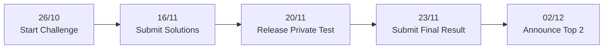
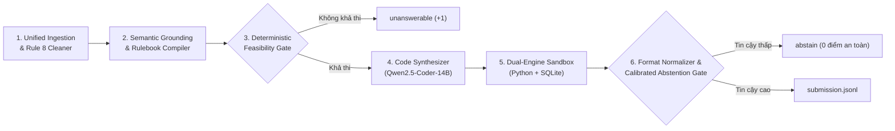

# DataMate: Talking To Your Data Through Agentic AI

> **Zalo AI Challenge 2026 — Track DataMate**
> Xây dựng hệ thống Agentic AI hỏi đáp ngôn ngữ tự nhiên tiếng Việt trên dữ liệu bảng phức tạp của doanh nghiệp nhỏ.

---

## 📌 1. Tổng quan Cuộc thi (Overview)

Bảng tính và các cơ sở dữ liệu đơn giản là những hệ sinh thái lưu trữ thông tin cực kỳ phổ biến đối với hàng triệu chủ tiệm tạp hóa, quán cà phê, nhà thuốc, phòng khám và cơ sở kinh doanh nhỏ tại Việt Nam. Dù sở hữu dữ liệu bán hàng và vận hành hàng ngày, rất ít người có kỹ năng lập trình hoặc viết câu lệnh truy vấn (SQL/code) để khai thác nguồn dữ liệu đó.

**DataMate** đặt ra thách thức xây dựng một **AI Agent tự hành (Agentic AI)** có khả năng:

- **Tiếp nhận dữ liệu bảng thực tế & đa dạng:** Đọc và liên kết các bảng tính Excel nhiều sheet, tệp CSV và SQLite.
- **Thấu hiểu ngôn ngữ tự nhiên:** Xử lý câu hỏi đời thường bằng tiếng Việt, từ ngữ khẩu ngữ, viết tắt, lịch âm/dương và mùa vụ Tết.
- **Suy luận logic nghiệp vụ chính xác:** Tự động tính toán doanh thu, chiết khấu, giá vốn lô hàng, tuổi nợ theo quy định của Rulebook.
- **Biết khi nào dữ liệu không thể trả lời:** Nhận diện các câu hỏi thiếu thông tin (`unanswerable`) và chủ động từ chối (`abstain`) khi độ tự tin thấp để bảo toàn điểm số.

> **Tôn chỉ sống còn:** *"Silence is Free, Guessing is Fatal"* — Đúng ghi điểm (+1), sai bị phạt nặng (-1), im lặng là an toàn (0).

---

## 🗓️ 2. Dòng thời gian Cuộc thi (Timeline)



| Mốc thời gian                        | Sự kiện                         | Chi tiết                                                                                                                                                                                                |
| -------------------------------------- | --------------------------------- | -------------------------------------------------------------------------------------------------------------------------------------------------------------------------------------------------------- |
| **26/10/2026**                   | **Start the challenge**     | Phát hành bộ Development kit, dữ liệu (`competition_data/train` & `public_test`) và phần mềm đánh giá. Mở nộp bài Public Test (tối đa 5 lần/ngày).                                 |
| **16/11/2026** *(23:59 GMT+7)* | **Submit solutions**        | Hạn chót nộp toàn bộ giải pháp Docker hoàn chỉnh (gồm training code, testing/inference code, model weights, Dockerfile và tài liệu). Tối đa 2 lần nộp; BTC đánh giá lần nộp cuối. |
| **20/11/2026** *(09:00 GMT+7)* | **Release private test**    | Ban tổ chức phát hành tập dữ liệu Private Test set. Leaderboard ở giai đoạn này là tạm thời dựa trên kết quả tự nộp của các đội.                                                 |
| **23/11/2026** *(23:59 GMT+7)* | **Submit the final result** | Hạn chót nộp file kết quả `submission.jsonl` chạy trên tập Private Test set. Hạn chót: 23:59 (GMT+7).                                                                                        |
| **02/12/2026**                   | **Announce Top 2**          | Ban tổ chức công bố Top 2 đội thắng cuộc sau khi chạy lại độc lập kiểm tra tính tái lập (Reproducibility) và xác minh source code.                                                    |

---

## 📊 3. Dữ liệu & Cấu trúc Gói Dữ liệu (Dataset Structure)

### 3.1. Đặc điểm Dữ liệu Doanh nghiệp

- **Loại hình kinh doanh:** Tiệm tạp hóa, quán cà phê/trà sữa, nhà hàng, nhà thuốc, vật liệu xây dựng, sửa xe máy, mẹ và bé...
- **Quy mô:** 12–30 tháng hoạt động, từ vài trăm đến ~300.000 dòng dữ liệu cho mỗi doanh nghiệp.
- **Tính chất dữ liệu thực tế:** Dữ liệu xuất từ phần mềm POS (KiotViet, Sapo...) có ô gộp/ô trống theo nhóm dòng (Group Forward-Fill), đơn vị tính quy đổi đa tầng (thùng, lốc, lon, cái), dòng xuất lỗi trùng lặp.

### 3.2. Cấu trúc thư mục dữ liệu chuẩn

```text
<split>/
├── data/<business_id>/
│   ├── *.csv | *.xlsx | *.sqlite     # Các file bảng dữ liệu của doanh nghiệp
│   └── README.md                     # Mô tả doanh nghiệp & từ điển cột
├── rulebook.md                       # Quy tắc nghiệp vụ mặc định của split
├── calendar.csv                      # Lịch đối chiếu Dương lịch - Âm lịch
├── questions.jsonl                   # Danh sách câu hỏi cần trả lời
└── answers.jsonl                     # Đáp án tham chiếu (chỉ có ở tập Train)
```

---

## 🎯 4. Thước đo Đánh giá: Penalized Accuracy (PA)

Điểm số xếp hạng trên Leaderboard được tính bằng **Penalized Accuracy (PA)** trên $N$ câu hỏi:

$$
PA = \frac{1}{N} \sum_{i=1}^N s_i
$$

Trong đó:

- **Đúng (Correct):** $s_i = +1$ (Khớp chính xác định dạng và nội dung đáp án).
- **Bỏ qua (Abstain):** $s_i = 0$ (Agent chủ động không trả lời khi thiếu tự tin).
- **Sai (Wrong):** $s_i = -1$ (Đoán sai giá trị, hoặc đoán số trên câu hỏi `unanswerable`).

> [!CAUTION]
> Khoảng cách giữa **Đúng (+1)** và **Sai (-1)** là 2 điểm. Việc đoán mò với xác suất tin cậy $< 50\%$ sẽ kéo tụt điểm nhanh chóng. Hệ thống cần ưu tiên từ chối (`abstain`) an toàn khi gặp rủi ro cao.

### Các loại định dạng đáp án hỗ trợ:

| Kiểu dữ liệu  | Mô tả & Quy tắc so khớp                                                                                                                   |
| ---------------- | --------------------------------------------------------------------------------------------------------------------------------------------- |
| `number`       | Số nguyên cho tiền tệ VND/số lượng đếm; hoặc làm tròn 2 chữ số thập phân.                                                     |
| `percent`      | Số thực làm tròn 2 chữ số thập phân (ví dụ `12.5`, không có dấu `%`).                                                        |
| `string`       | Chuỗi văn bản sau khi qua chuẩn hóa: Unicode NFC, chữ thường, bỏ ký tự đặc biệt, giữ nguyên dấu tiếng Việt.                |
| `date`         | Định dạng ISO `YYYY-MM-DD` (hoặc `YYYY-MM` đối với tháng).                                                                        |
| `boolean`      | Giá trị boolean thuần túy: `true` hoặc `false`.                                                                                      |
| `list`         | Mảng JSON có thứ tự: `["item1", "item2", ...]`.                                                                                         |
| `table`        | Bảng dữ liệu có tên cột và các dòng: `{"columns": [...], "rows": [...]}`.                                                          |
| `unanswerable` | Dữ liệu không đủ cơ sở để trả lời (ví dụ: kỳ hỏi ngoài phạm vi dữ liệu). Chỉ đúng khi đáp án cũng là unanswerable. |
| `abstain`      | Agent chủ động không trả lời để nhận 0 điểm an toàn.                                                                              |

---

## ⚙️ 5. Ràng buộc Kỹ thuật & Môi trường Thi đấu (Rules & Environment)

| Tiêu chí                                  | Ràng buộc từ Ban tổ chức                                                                                                               |
| ------------------------------------------- | ------------------------------------------------------------------------------------------------------------------------------------------- |
| **Giới hạn Mô hình**              | Tổng tham số của toàn bộ mô hình (LLM, Embeddings, Reranker, Classifiers) $\le$ **15 tỷ tham số (15B)**.                   |
| **Trọng số cho phép**              | Trọng số được công khai trước ngày **01/10/2026**. Được phép fine-tune.                                                  |
| **Chế độ thực thi**               | **100% Offline** bên trong Docker container. Không kết nối mạng, cấm gọi external LLM API thương mại.                       |
| **Không can thiệp thủ công**      | Cấm hard-code đáp án, không viết logic phụ thuộc vào `question_id` hoặc `business_id`.                                        |
| **Máy chủ tham chiếu**             | 2 × NVIDIA RTX 5090 (64 GB VRAM tổng), 512 GB RAM.                                                                                        |
| **Thời gian tối đa**               | $\le$ **6 giờ** wall-clock cho toàn bộ Private Test set (bao gồm cả thời gian nạp mô hình).                                |
| **Tính tái lập (Reproducibility)** | Chênh lệch điểm giữa kết quả nộp và lần chạy lại của BTC: $\lvert PA_{\text{uploaded}} - PA_{\text{rerun}} \rvert \le 0.03$. |
| **Cơ chế ghi log**                  | Ghi file log chi tiết cho từng câu hỏi vào `/result/logs/<question_id>.json`.                                                        |

---

## 🏗️ 6. Định hướng Kiến trúc Giải pháp (Neuro-Symbolic Agent)

Hệ thống DataMate áp dụng kiến trúc **Tác tử Đa tầng Neuro-Symbolic** gồm 6 module độc lập:



1. **Module 1 (Data Ingestion & Cleaning):** Tự động forward-fill ô trống theo nhóm dòng và khử trùng lặp (Rule 8), ánh xạ toàn bộ bảng Excel/CSV vào CSDL SQLite in-memory siêu tốc.
2. **Module 2 (Semantic Grounding):** Giải mã thời gian tương đối ("hôm nay", "tuần này", "Tết") đối chiếu với `as_of_date` và `calendar.csv`. Khớp tên sản phẩm/khách hàng bằng thuật toán BM25 và Fuzzy Matching tiếng Việt.
3. **Module 3 (Deterministic Feasibility Gate):** Lá chắn phát hiện câu hỏi ngoài khoảng thời gian dữ liệu shop để trả về `unanswerable` ngay lập tức, tránh bị phạt âm điểm.
4. **Module 4 (Neuro-Symbolic Synthesizer):** Sử dụng mô hình `Qwen2.5-Coder-14B-Instruct` qua vLLM với Greedy Decoding ($T=0$) để sinh mã Python/SQL chuẩn xác.
5. **Module 5 (Execution Sandbox):** Thực thi mã trong môi trường cô lập, hỗ trợ cơ chế phản tư tự sửa lỗi (Self-Correction Loop tối đa 2 vòng).
6. **Module 6 (Format Normalizer & Calibrated Gate):** Chuẩn hóa định dạng chuẩn 8 kiểu dữ liệu, giải quyết đồng hạng theo mã code tăng dần, và kích hoạt cơ chế `abstain` an toàn khi độ tin cậy thấp.

> **Lưu ý trạng thái:** đây là kiến trúc đích. Ở Phase 1, mã nguồn mới hiện thực các phần Module 1 (nạp dữ liệu thô), Module 4 (sinh mã bằng `Qwen2.5-Coder-3B-Instruct` lượng tử hóa 4-bit để phát triển trên GPU cá nhân), Module 5 (sandbox subprocess) và bước ghi `submission.jsonl`. Các module còn lại được triển khai ở Phase 2–4 (xem mục 9).

---

## 📁 7. Cấu trúc Dự án (Repository Structure)

Đề xuất triển khai mô hình, QueryPlan, từ điển tiếng Việt, benchmark và các điều kiện đóng gói được trình bày tại [docs/DataMate_Competitive_Solution.md](docs/DataMate_Competitive_Solution.md). Tài liệu phân biệt thông số do tác giả mô hình công bố với khuyến nghị và kết quả cần kiểm chứng riêng trên DataMate.

Mã nguồn được tổ chức theo **src-layout**: toàn bộ logic nằm trong package `datamate` (thư mục `src/datamate/`), cài bằng `pip install -e . --no-deps`.

```text
.
├── pyproject.toml                             # Khai báo package `datamate` và cấu hình pytest
├── requirements.txt                           # Thư viện cho môi trường phát triển
├── README.md                                  # Hướng dẫn và thông tin tổng quan
├── Dockerfile                                 # Môi trường container (hoàn thiện ở Phase 4)
├── predict.sh                                 # Entrypoint cho Docker (hoàn thiện ở Phase 4)
├── train.sh                                   # Script huấn luyện (hoàn thiện ở Phase 3)
├── docs/                                      # Tài liệu đặc tả và thiết kế
│   ├── DataMate_Zalo_AI_Challenge_2026.md     # Đặc tả chi tiết từ BTC
│   ├── DataMate_Solution_Architecture.md      # Thiết kế kiến trúc giải pháp 6 module
│   ├── Timeline_and_Contribution.md           # Kế hoạch triển khai & phân bổ 2 thành viên
│   └── DataMate_Source_Roadmap.md             # Cấu trúc source code đích theo từng phase
├── research/                                  # Tóm tắt các bài báo tham khảo
├── logs/                                      # Nhật ký phát triển
├── competition_data/                          # Dữ liệu cuộc thi
│   ├── train/                                 # Dữ liệu huấn luyện mẫu (3.000 câu)
│   └── public_test/                           # Dữ liệu thử nghiệm công khai
├── notebooks/
│   └── eda/                                   # Khám phá dữ liệu (không đóng vào Docker)
├── scripts/
│   └── phase1_loop.py                         # Vòng lặp Phase 1: câu hỏi → LLM → sandbox → submission
├── src/
│   └── datamate/                              # Package chính của Agent
│       ├── __init__.py                        # (để trống)
│       ├── ingestion/
│       │   └── loader.py                      # Đọc CSV/Excel/SQLite, to_sqlite, describe_schema
│       ├── llm/
│       │   ├── client.py                      # LLMClient: nạp model, sinh mã (greedy, T=0)
│       │   └── prompt_builder.py              # Ráp prompt: rulebook của split, few-shot, schema
│       ├── execution/
│       │   └── sandbox.py                     # run_code: thực thi mã trong subprocess, timeout
│       └── output/
│           └── submission.py                  # to_answer, SubmissionWriter, validate_submission
└── tests/                                     # Phản chiếu cấu trúc src/datamate/
    ├── ingestion/test_loader.py
    ├── llm/test_client.py
    ├── llm/test_prompt_builder.py
    ├── execution/test_sandbox.py
    └── output/test_submission.py
```

### Vai trò các module hiện có

| Module                 | Vai trò                                                                                                                                                                 |
| ---------------------- | ------------------------------------------------------------------------------------------------------------------------------------------------------------------------ |
| `ingestion.loader`   | Nạp dữ liệu thô của một doanh nghiệp (thử nhiều encoding, dò header Excel, gộp sheet cùng cấu trúc), nạp vào SQLite in-memory, mô tả schema cho prompt |
| `llm.client`         | Quản lý mô hình ngôn ngữ và sinh mã Python tất định (Greedy Decoding)                                                                                         |
| `llm.prompt_builder` | Xây prompt từ rulebook của đúng split, ví dụ mẫu, schema và câu hỏi                                                                                           |
| `execution.sandbox`  | Chạy mã do LLM sinh trong tiến trình con độc lập, trả `RunResult` an toàn (không raise, có timeout)                                                         |
| `output.submission`  | Chuyển kết quả thành đáp án chuẩn, ghi `submission.jsonl` kèm log từng câu, kiểm tra tính hợp lệ của file nộp                                         |

> Cấu trúc sẽ mở rộng theo từng phase (thêm `grounding/`, `gate/`, `benchmark/`, `config/`, `data_synth/`, `training/`...). Xem chi tiết tại [`docs/DataMate_Source_Roadmap.md`](docs/DataMate_Source_Roadmap.md).

---

## 🚀 8. Cài đặt & Chạy (Development)

**Yêu cầu:** Python 3.11; GPU NVIDIA có CUDA nếu chạy mô hình 4-bit (không có GPU vẫn chạy được ở chế độ CPU nhưng chậm).

```bash
# 1. Cài thư viện (PyTorch bản CUDA 12.1 được khai báo trong requirements.txt)
pip install -r requirements.txt

# 2. Cài package datamate ở chế độ chỉnh sửa (không cài lại thư viện ở bước 1)
pip install -e . --no-deps

# 3. Chạy toàn bộ test
pytest -q
```

Tóm tắt dữ liệu của các doanh nghiệp (không cần GPU):

```bash
python -m datamate.ingestion.loader --data_dir competition_data/train/data
```

Kiểm tra tính hợp lệ của một file nộp:

```bash
python -m datamate.output.submission --validate path/to/submission.jsonl --questions competition_data/public_test/questions.jsonl
```

Chạy vòng lặp Phase 1 (xem tham số bằng `--help`):

```bash
python scripts/phase1_loop.py --help
```

> **Lưu ý môi trường:** `requirements.txt` dùng bản PyTorch `cu121` cho máy phát triển. Máy chủ chấm của BTC dùng RTX 5090 (Blackwell) cần CUDA ≥ 12.8, nên môi trường Docker sẽ có file yêu cầu riêng ở Phase 4.

---

## 🗺️ 9. Lộ trình Phát triển (Roadmap)

| Phase                    | Thời gian     | Trọng tâm                                                                                       | Trạng thái       |
| ------------------------ | -------------- | ------------------------------------------------------------------------------------------------- | ------------------ |
| 1. Fast Pipeline         | 31/10 – 02/11 | Thông luồng đầu–cuối, nộp bài lần đầu, điểm baseline                                 | ✅ Hoàn thành    |
| Refactor                 | 03/11          | Chuyển sang package `datamate`, không đổi hành vi                                          | ✅ Hoàn thành    |
| 2. Deterministic Shields | 03/11 – 06/11 | Rule 8, SQLite mirror, Temporal Grounder, Feasibility Gate, Format Normalizer, Internal Benchmark | ⏳ Sắp bắt đầu |
| 3. Core Enhancement      | 07/11 – 12/11 | Dữ liệu tổng hợp, fine-tune mô hình ≤ 15B, entity linker, tự sửa lỗi                    | ⬜                 |
| 4. Polish & Submit       | 13/11 – 16/11 | Cổng abstain hiệu chuẩn, tái lập, Docker offline, nộp bài                                  | ⬜                 |

Cấu trúc source code đích và các thay đổi qua từng phase được mô tả trong [`docs/DataMate_Source_Roadmap.md`](docs/DataMate_Source_Roadmap.md).

---

*Tài liệu được tổng hợp và thiết kế cho đội thi phát triển giải pháp DataMate tại Zalo AI Challenge 2026.*
