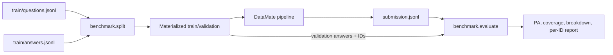

# DataMate Benchmark

Tài liệu này mô tả kiến trúc, dữ liệu, cách chia split và cách chấm benchmark nội bộ của DataMate. Benchmark giúp so sánh các phiên bản pipeline một cách có thể lặp lại; đây không phải thành phần inference và không chứa một mô hình AI riêng.

## 1. Mục đích và phạm vi

Benchmark dùng để:

- huấn luyện hoặc tinh chỉnh bằng một partition train xác định;
- đánh giá prediction bằng đúng output contract và cách chấm trong rulebook;
- đo riêng khả năng trả lời câu mới ở doanh nghiệp đã thấy và khả năng tổng quát hóa sang doanh nghiệp chưa thấy;
- lưu nguồn dữ liệu, seed, partition và phân bố mẫu để kết quả có thể kiểm tra lại.

Nguồn hiện tại là 3.000 cặp câu hỏi/đáp án trong `competition_data/train/`. Rulebook train và public_test có cùng hợp đồng chấm ở mục 9; luật nghiệp vụ để suy luận vẫn phải lấy từ rulebook đúng split. Benchmark không chọn model, gọi LLM hay thực hiện phép tính nghiệp vụ: nó tạo partition và chấm prediction đã sinh.

## 2. Kiến trúc tổng thể



| Thành phần | Trách nhiệm |
|---|---|
| `split.py` | Kiểm tra nguồn, tạo split xác định theo seed, ghi files và manifest. |
| `splits/` | Lưu các partition đã materialize, gồm IDs, questions, answers và manifest. |
| Pipeline DataMate | Dùng đúng files train; sinh prediction cho validation và giữ nguyên ID. |
| `evaluate.py` | Xác thực prediction/gold/IDs, tính PA và các chỉ số phụ. |
| `README.md` | Quy trình vận hành, output contract và giới hạn khi diễn giải điểm. |

## 3. Cấu trúc thư mục

```text
benchmark/
├── README.md
├── __init__.py
├── evaluate.py
├── split.py
└── splits/
    ├── within_business_v1/
    │   ├── train_ids.json
    │   ├── train_questions.jsonl
    │   ├── train_answers.jsonl
    │   ├── val_ids.json
    │   ├── val_questions.jsonl
    │   ├── val_answers.jsonl
    │   └── manifest.json
    └── business_holdout_v1/
        ├── fold_0/
        ├── fold_1/
        ├── fold_2/
        ├── fold_3/
        └── fold_4/
```

Mỗi `fold_N` có cùng bảy files như `within_business_v1`.

### Files split legacy ở thư mục gốc

Các files legacy từng được dùng ở gốc `benchmark/` gồm `train_ids.json`, `val_ids.json`, `val_questions.jsonl`, `val_answers.jsonl`. Trong working tree hiện tại, các files đó không có; các artifact có đủ train/validation hiện nằm dưới `benchmark/splits/`. Vì vậy khi chấm, hãy truyền tường minh `--gold` và `--val-ids`, không dựa vào đường dẫn mặc định tới files legacy.

`within_business_v1` được materialize theo cùng danh sách ID train/validation lịch sử đã đối chiếu trước đó. Nó bổ sung `train_questions.jsonl`, `train_answers.jsonl` và manifest để pipeline không phải tự lọc từ toàn bộ nguồn.

## 4. Hợp đồng dữ liệu

### Nguồn

- `competition_data/train/questions.jsonl`: mỗi dòng là JSON object; tối thiểu có `id`, `business_id`, `question`, `as_of_date`.
- `competition_data/train/answers.jsonl`: mỗi dòng có `id`, `type`, `answer`; `alias` có thể có tùy type.
- Ghép question với answer bằng `id`, không bằng số thứ tự dòng.
- Splitter yêu cầu ID không rỗng, không trùng; mỗi question phải có đúng một answer; type, answer và alias phải đúng schema.
- Files là JSONL UTF-8. JSON lỗi hoặc ID trùng khiến thao tác dừng với vị trí lỗi.

### Files trong mỗi partition

| File | Nội dung / cách dùng |
|---|---|
| `train_ids.json` | Mảng ID thuộc train; dùng để truy vết partition. |
| `train_questions.jsonl` | Câu hỏi train đã lọc; dùng làm input huấn luyện. |
| `train_answers.jsonl` | Gold train tương ứng; dùng làm nhãn huấn luyện. |
| `val_ids.json` | Mảng ID thuộc validation; xác định chính xác mẫu tính điểm. |
| `val_questions.jsonl` | Câu hỏi đưa vào pipeline để sinh prediction. |
| `val_answers.jsonl` | Gold chỉ dùng sau inference để chấm; không đưa vào train hoặc inference image. |
| `manifest.json` | Metadata, hash nguồn/IDs và thống kê partition. |

Questions và answers được lọc theo cùng danh sách IDs. Luôn ghép chúng bằng ID nguồn.

### Output prediction

Evaluator nhận JSONL, một object trên mỗi dòng, ví dụ:

```json
{"id":"question-id","type":"number","answer":4820000}
{"id":"another-id","type":"abstain"}
{"id":"unknown-id","type":"unanswerable","reason":"Dữ liệu phát hành không đủ"}
```

`reason` tùy chọn. Nếu có, phải là string; `reason` sai type làm record không đọc được và được tính abstain. Với `unanswerable`, evaluator chấp nhận `answer` vắng mặt hoặc null. Các type có đáp án cần trường `answer` đúng format.

## 5. Các chiến lược split

### `within_business_v1`

Chia ở cấp câu hỏi, riêng trong từng `business_id`: xáo trộn câu hỏi của mỗi doanh nghiệp, lấy xấp xỉ 20% vào validation và phần còn lại vào train. Mỗi doanh nghiệp có mặt ở cả hai phía. Split này đo câu mới ở doanh nghiệp mô hình đã thấy; nó không đo generalization sang doanh nghiệp mới.

- Seed mặc định: `42`; validation ratio mục tiêu: `0.20`.
- Kích thước hiện tại: **2.392 train / 608 validation** trên tổng 3.000.
- Số mẫu validation được làm tròn riêng từng doanh nghiệp bằng Python `round()` và chặn để mỗi phía có ít nhất một câu; do đó không nhất thiết đúng 2.400/600.
- Validation gồm 30 doanh nghiệp. Breakdown answer type: 388 `number`, 121 `percent`, 32 `date`, 28 `list`, 16 `string`, 16 `unanswerable`, 5 `boolean`, 2 `table`.

Boolean và table có rất ít mẫu; PA theo hai type này có độ bất định lớn. Luôn xem support count cùng điểm số.

### `business_holdout_v1`

Group holdout 5-fold theo `business_id`. Một fold giữ nguyên một nhóm doanh nghiệp cho validation; không câu nào của các doanh nghiệp đó được vào train cùng fold. Năm nhóm validation phân hoạch đủ 30 doanh nghiệp, mỗi doanh nghiệp được giữ lại đúng một lần.

| Fold | Train | Validation | Doanh nghiệp validation |
|---|---:|---:|---|
| `fold_0` | 2.406 | 594 | `biz_104`, `biz_106`, `biz_113`, `biz_122`, `biz_125`, `biz_126`, `biz_129` |
| `fold_1` | 2.409 | 591 | `biz_102`, `biz_121`, `biz_127`, `biz_128`, `biz_130` |
| `fold_2` | 2.407 | 593 | `biz_103`, `biz_107`, `biz_110`, `biz_114`, `biz_117`, `biz_120`, `biz_123` |
| `fold_3` | 2.409 | 591 | `biz_105`, `biz_109`, `biz_115`, `biz_116`, `biz_118` |
| `fold_4` | 2.369 | 631 | `biz_101`, `biz_108`, `biz_111`, `biz_112`, `biz_119`, `biz_124` |

Kích thước validation khác nhau vì doanh nghiệp có số câu khác nhau. Splitter ưu tiên giữ group nguyên vẹn; nó cân bằng gần đúng số câu và phân bố answer type. Đây là business holdout, không phải industry holdout: chưa dùng mapping ngành được xác thực.

Mỗi fold là một lượt huấn luyện riêng: train `fold_N` chỉ đi với validation của `fold_N`. Không gộp train của các fold vào một lần huấn luyện. Khi tổng hợp năm lượt, ghép prediction out-of-fold rồi tính metric trên toàn bộ ID; không lấy trung bình đều năm PA nếu muốn tính điểm theo từng câu, vì số lượng giữa các fold khác nhau.

### Chọn split

| Mục tiêu | Split |
|---|---|
| Phát triển prompt/parser và vòng lặp nhanh | `within_business_v1` |
| Đo khả năng trên doanh nghiệp chưa thấy | Chạy đủ năm `business_holdout_v1` folds |
| Kết luận cuối | Xem cả PA, coverage, breakdown/support count và ràng buộc challenge; không chọn theo một fold nhỏ |

## 6. Sinh split

Chạy từ thư mục gốc repository:

```powershell
python -m benchmark.split --strategy within_business
python -m benchmark.split --strategy business_holdout --folds 5
```

| Tham số | Ý nghĩa |
|---|---|
| `--questions` | Questions nguồn; mặc định `competition_data/train/questions.jsonl`. |
| `--answers` | Answers nguồn; mặc định `competition_data/train/answers.jsonl`. |
| `--output-dir` | Thư mục gốc output; mặc định `benchmark/splits`. Script thêm tên strategy/version. |
| `--seed` | Seed tái lập; mặc định `42`. |
| `--val-ratio` | Tỷ lệ mục tiêu của `within_business`; mặc định `0.20`. |
| `--folds` | Số fold của `business_holdout`; mặc định `5`. |

Output được ghi vào thư mục tạm rồi rename khi hoàn tất. Nếu đích đã tồn tại, splitter dừng thay vì ghi đè. Dùng output root khác để tạo thử nghiệm mới, ví dụ:

```powershell
python -m benchmark.split --strategy within_business --seed 123 --output-dir benchmark/splits/experiment_123
```

Kết quả sẽ nằm trong `benchmark/splits/experiment_123/within_business_v1/`.

## 7. Manifest và tái lập

Mỗi `manifest.json` ghi:

- `schema_version` và `generator_version`;
- `strategy`, `seed`, ratio hoặc thông tin fold;
- paths tương đối và SHA-256 của hai file nguồn;
- tổng số câu và số câu train/validation;
- SHA-256 của danh sách IDs train/validation theo đúng thứ tự ghi;
- phân bố số câu theo `business_id` và answer type;
- với group fold: `n_folds`, `fold_index`, `validation_business_ids`.

Hash nguồn phát hiện dữ liệu thay đổi; hash ID giúp nhận ra partition thay đổi. Cùng tên thư mục không đảm bảo cùng split nếu source, seed hoặc version generator khác nhau.

## 8. Chấm prediction

Chấm validation của `within_business_v1`:

```powershell
python -m benchmark.evaluate `
  --pred submission.jsonl `
  --gold benchmark/splits/within_business_v1/val_answers.jsonl `
  --val-ids benchmark/splits/within_business_v1/val_ids.json `
  --report-json results/within_business_report.json
```

Chấm một group fold:

```powershell
python -m benchmark.evaluate `
  --pred results/fold_0_submission.jsonl `
  --gold benchmark/splits/business_holdout_v1/fold_0/val_answers.jsonl `
  --val-ids benchmark/splits/business_holdout_v1/fold_0/val_ids.json `
  --report-json results/fold_0_report.json
```

`--pred` là bắt buộc. Luôn truyền đúng gold và IDs của partition đang đánh giá. JSONL lỗi, duplicate IDs, gold sai schema hoặc thiếu gold cho eval ID sẽ làm evaluator dừng, tránh tính điểm trên mẫu thiếu.

| Tình huống | Cách tính |
|---|---|
| Dự đoán đúng | `+1` |
| Sai giá trị hoặc sai type/format | `-1` |
| `type: "abstain"` | `0` |
| Không có prediction cho eval ID | `0`, tính là missing prediction/abstain |
| Prediction ID ngoài validation | Không vào PA; được báo trong report |
| `reason` không phải string | Record không đọc được; tính abstain |

Report JSON gồm tổng đúng/sai/abstain, số format sai, PA, accuracy, coverage, breakdown theo type, prediction IDs thừa và chi tiết từng ID với trạng thái/lý do. `details[].reason` là mã giải thích của evaluator, khác với trường `reason` trong submission.

## 9. Metric

```text
PA       = (correct - wrong) / total
Accuracy = correct / total
Coverage = (correct + wrong) / total
```

`total` là số eval IDs hợp lệ và tất cả phải có gold. Accuracy trong evaluator là số đúng chia tổng, có tính mẫu abstain ở mẫu số. Coverage đo tỷ lệ mẫu được chấm đúng hoặc sai. PA là metric chính theo rulebook; luôn báo kèm coverage và số mẫu. Tập rỗng không gây chia cho 0; report ghi không có câu để chấm.

## 10. Quy tắc theo answer type

Evaluator strict format trước khi so giá trị, dựa trên mục 9 rulebook train/public_test:

| Type | Cách so |
|---|---|
| `number` | JSON number; không nhận bool/string. So chính xác; số nguyên (tiền/số đếm) không có epsilon. Chỉ bỏ qua tối đa một ULP nếu sai số rất nhỏ dưới một đơn vị. JSON decimal được đọc bằng `Decimal`. |
| `percent` | JSON number theo thang 0–100, không nhận tỷ lệ 0–1 hay chuỗi có `%`. Làm tròn hai chữ số theo `ROUND_HALF_UP`. Rulebook không khóa mode ở tie; đây là quy ước nội bộ để điểm nhất quán. |
| `boolean` | Chỉ JSON `true` hoặc `false`. |
| `date` | ISO string hợp lệ `YYYY-MM-DD` hoặc `YYYY-MM` cho câu hỏi theo tháng; so chính xác. |
| `string` | NFC, không phân biệt hoa thường; bỏ qua dấu câu và khoảng trắng, giữ dấu tiếng Việt. Alias chỉ lấy từ gold. |
| `list` | JSON array, cùng độ dài và đúng thứ tự; so từng phần tử; alias theo vị trí. |
| `table` | `columns`/`rows` hợp lệ; số cột và độ rộng từng hàng phải khớp. Cột căn theo tên khi tên khớp, nếu không theo vị trí. Thứ tự hàng không ảnh hưởng nhưng số lần lặp được giữ; alias đi cùng hàng gold/tên ở cột đầu. |
| `unanswerable` | Type phải đúng; answer có thể vắng mặt hoặc null. `reason` tùy chọn, nội dung không chấm. |
| `abstain` | Luôn 0 điểm. |

Evaluator không suy diễn đơn vị hoặc luật nghiệp vụ. Nó chỉ kiểm tra output theo gold và contract.

## 11. Quy trình thí nghiệm đề xuất

1. Chọn strategy; lưu đường dẫn partition và manifest.
2. Huấn luyện chỉ bằng `train_questions.jsonl` và `train_answers.jsonl` của partition đang chạy.
3. Chạy inference trên `val_questions.jsonl`; giữ nguyên ID trong submission.
4. Không đọc/truyền `val_answers.jsonl` vào model trong lúc inference.
5. Chấm bằng `val_ids.json` và `val_answers.jsonl` đúng partition; lưu report JSON.
6. Ghi kèm commit/code version, model/checkpoint, prompt/parser, seed, manifest, PA, coverage, type breakdown và lỗi format.
7. Dùng within-business cho vòng lặp nhanh; chạy đủ business holdout folds trước khi kết luận về doanh nghiệp chưa thấy.

Validation gold của train split chỉ dùng đánh giá nội bộ. Khi đóng gói hoặc chạy challenge, chỉ dùng dữ liệu được phép của lượt đó; không đưa validation gold hay đáp án public/private vào inference image.

## 12. Giới hạn và lưu ý

- Validation 608 câu có type rất ít mẫu; PA theo type nhỏ dễ đổi mạnh chỉ từ một câu.
- Within-business có cùng doanh nghiệp ở train/validation, nên không đủ để khẳng định generalization sang doanh nghiệp mới.
- Business holdout giữ doanh nghiệp nhưng không giữ ngành; doanh nghiệp cùng ngành có thể ở nhiều fold.
- Train giữa các fold chồng lặp lớn; từng fold cần huấn luyện riêng.
- PA phạt câu sai `-1`; coverage thấp hoặc format sai ảnh hưởng điểm. Không nên tối ưu một metric phụ riêng lẻ.
- Benchmark nội bộ không mô phỏng toàn bộ giới hạn runtime, Docker, latency hoặc cấu trúc workbook của challenge; các điều kiện đó cần kiểm tra riêng theo rulebook/harness.
- Kết quả phụ thuộc gold, evaluator và quy ước làm tròn; lưu manifest và report cùng mỗi lần chạy.
