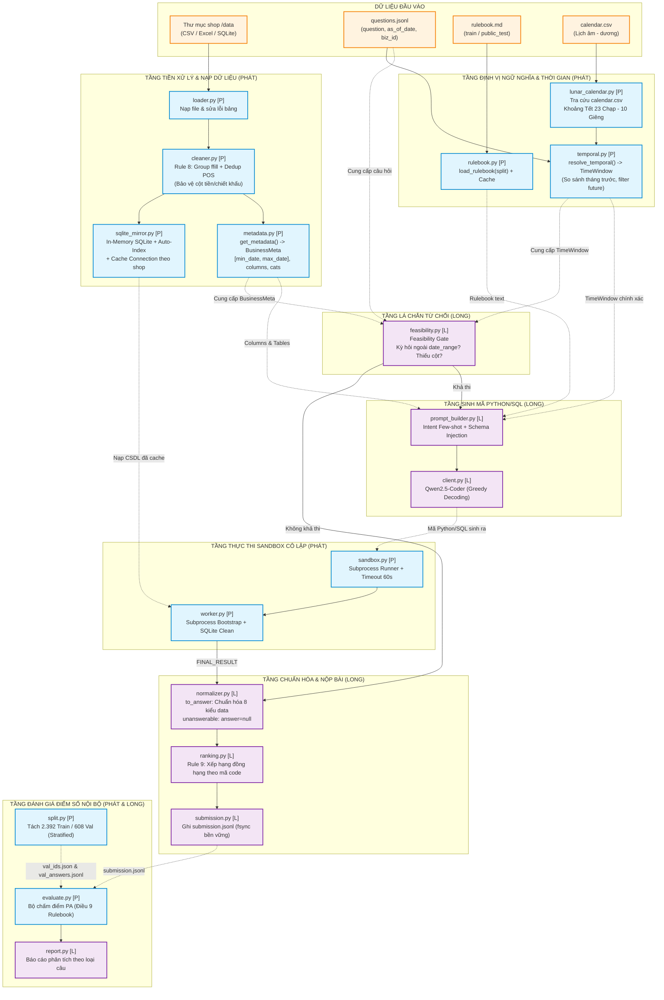

# Báo Cáo Kỹ Thuật Phase 2: Hệ Thống Lá Chắn Tất Định (Deterministic Shields)

**Thời gian:** 02/11/2026  
**Tác giả:** Phát (Data Engineer & System Lead)  
**Người đồng hành & Review:** Long (AI Architect & Model Lead)  
**Nhánh (Branch):** `phat_commit`  
**Giai đoạn:** Phase 2 — Deterministic Shields & Internal Benchmark  

---

## 1. Bản Chất Bài Toán & Triết Lý Thiết Kế Phase 2

### 1.1. Bối cảnh cuộc thi & Hàm điểm phạt (Penalized Accuracy - PA)
Dự án **DataMate** được xây dựng để tham gia **Zalo AI Challenge 2026** — bài toán Phân tích dữ liệu & Trả lời câu hỏi kinh doanh (Text-to-Data-Analysis QA) trên dữ liệu bảng biểu thực tế của các hộ kinh doanh bán lẻ tại Việt Nam.

Quy tắc tính điểm tại Điều 9 của Rulebook quy định cơ chế tính điểm phạt cực kỳ nghiêm ngặt:
$$\text{PA} = \frac{\text{Số câu đúng (+1)} - \text{Số câu sai (-1)}}{\text{Tổng số câu}}$$
- **Đúng:** $+1$ điểm.
- **Bỏ trống (Abstain) an toàn:** $0$ điểm.
- **Trả lời sai:** **$-1$ điểm** (bị trừ trực tiếp vào tổng điểm).

Nếu hệ thống phó mặc cho một mô hình ngôn ngữ lớn (LLM, đặc biệt là các mô hình $\le 14\text{B}$ chạy offline trong Docker) tự biên tự diễn:
1. **Ảo giác số học và thời gian:** LLM rất dễ nhầm lẫn các mốc thời gian đặc thù của Việt Nam (như Tết Nguyên Đán, tuần này so với tuần trước) hoặc tự cộng trừ sai lệch các con số.
2. **Không tự nhận biết được giới hạn dữ liệu:** Khi câu hỏi hỏi về một kỳ kinh doanh nằm ngoài dữ liệu, LLM thật thà sinh code SQL `WHERE date >= ...`, chạy ra kết quả `0` hoặc `NULL`, rồi tự tin kết luận "Doanh thu là 0 VNĐ" $\rightarrow$ **Ăn điểm phạt $-1$ điểm** thay vì nộp nhãn `unanswerable` để ăn trọn điểm.
3. **Quá tải context và lỗi ô rỗng:** Dữ liệu hóa đơn POS/Excel xuất ra bị merged cells, khuyết dòng con; nếu đưa thẳng cho LLM đọc sẽ làm tràn cửa sổ ngữ cảnh và sinh code tính toán sai lệch.

### 1.2. Triết lý "Deterministic Shields" (Lá chắn tất định)
**Phase 2 không phải là AI nâng cao — Phase 2 là việc dựng lên các "lá chắn bằng code Python thuần túy" (hoàn toàn tất định, chính xác 100%) để bọc lót, thanh lọc dữ liệu và ngăn chặn mọi nguy cơ điểm âm trước khi LLM can thiệp.**

Mỗi module của Phát xây dựng trong Phase 2 đều xuất phát trực tiếp từ một **"nỗi đau" (pathology) cụ thể trong dữ liệu và quy định của Rulebook**.

---

## 2. Mổ Xẻ Chi Tiết Từng File: Cơ Chế Hoạt Động & Ví Dụ Dữ Liệu Minh Họa

Dưới đây là phần phân tích sâu từng file mã nguồn mà Phát đã triển khai, giải thích chi tiết **File này làm gì**, **Cơ chế hoạt động từng bước**, và **Ví dụ trực quan trước / sau khi xử lý dữ liệu**.

---

### File 1: `src/datamate/types.py` (Hợp đồng Dữ liệu Chung)
* **Vai trò:** Định nghĩa các cấu trúc dữ liệu (`dataclass`) đóng vai trò là "giao thức kết nối" (interface) chuẩn mực giữa các module của Phát và Long.
* **Cơ chế hoạt động:**
  * Cung cấp các kiểu đối tượng có kiểu dữ liệu tường minh (`type annotations`), không chứa logic tính toán nặng để tránh circular import.
  * `TimeWindow`: Đóng gói cửa sổ thời gian `[start_date, end_date]` cùng nhãn định danh (`label`).
  * `BusinessMeta`: Đóng gói toàn bộ metadata của shop (`date_range`, `tables`, `columns_by_table`, `categories_by_col`).
  * `GateDecision`: Đóng gói quyết định từ chối (`feasible=False`) hay cho phép suy luận (`feasible=True`).
* **Ví dụ dữ liệu cụ thể:**
  Khi module `metadata.py` và `temporal.py` của Phát chạy xong trên một cửa hàng tạp hóa, đối tượng tạo ra truyền cho Long sẽ có dạng:
  ```python
  # Output của Phát truyền sang cho Long:
  meta = BusinessMeta(
      business_id="biz_tap_hoa_01",
      date_range=("2024-01-01", "2024-06-30"),
      tables=["don_hang", "chi_tiet_don", "khach_hang"],
      columns_by_table={
          "don_hang": ["Mã đơn", "Ngày đặt", "Khách hàng", "Trạng thái", "Tổng tiền"],
          "chi_tiet_don": ["Mã đơn", "Mã hàng", "Số lượng", "Đơn giá", "Giảm giá dòng"]
      },
      categories_by_col={"Trạng thái": ["Hoàn thành", "Trả hàng", "Huỷ đơn"]}
  )
  ```
  Nhờ contract này, Long chỉ cần gọi `meta.date_range` là biết ngay shop hoạt động trong khoảng nào mà không cần tự đọc lại đĩa.

---

### File 2: `src/datamate/ingestion/cleaner.py` (Rule 8 Data Cleaner)
* **Vai trò:** Hiện thực hóa trọn vẹn Quy tắc 8 trong Rulebook — cứu vãn các bảng tính POS bị khuyết ô do gộp dòng (merged cells) và khử trùng lặp dòng POS lỗi.
* **Cơ chế hoạt động:**
  1. `find_order_id_col()`: Dùng regex chuẩn hóa tiếng Việt dò tìm cột mã đơn (`Mã đơn`, `Số hóa đơn`, `Order ID`...).
  2. `apply_group_forward_fill()`:
     * Forward-fill cột mã đơn trước để nhận diện đơn hàng.
     * Xác định các cột cấp đơn định tính: `Ngày`, `Khách hàng`, `Trạng thái`, `Ghi chú`, `Kênh bán`.
     * Dùng `groupby(order_id)[col].ffill()` để điền giá trị từ dòng đầu đơn xuống các dòng con trong **cùng đơn**.
     * **Bảo vệ cột tiền/chiết khấu:** Tuyệt đối không ffill `Đơn giá`, `Giảm giá`, `Thành tiền` vì mỗi món hàng có mức giá và chiết khấu riêng.
  3. `deduplicate_order_rows()`: Bỏ qua cột số thứ tự `STT` (nếu có), khử các dòng giống hệt nhau trong cùng một mã đơn. Giữ nguyên 100% các dòng nếu bảng không ghi theo đơn.
* **Ví dụ dữ liệu cụ thể:**
  * **Dữ liệu thô ban đầu xuất từ POS (Input):**
    | STT | Mã đơn | Ngày | Khách hàng | Trạng thái | Tên món | Số lượng | Đơn giá | Giảm giá món |
    |---|---|---|---|---|---|---|---|---|
    | 1 | HD001 | 2024-03-10 | Chị Lan | Hoàn thành | Cà phê sữa | 2 | 25,000 | 5,000 |
    | 2 | NaN | NaN | NaN | NaN | Bánh mì chả | 1 | 20,000 | NaN |
    | 3 | HD001 | 2024-03-10 | Chị Lan | Hoàn thành | Cà phê sữa | 2 | 25,000 | 5,000 |
    | 4 | HD002 | 2024-03-11 | Anh Tuấn | Đang giao | Cà phê sữa | 2 | 25,000 | 5,000 |

  * **Quá trình xử lý của `cleaner.py`:**
    * *Bước 1 (Group ffill):* Dòng 2 được điền `Mã đơn: HD001`, `Ngày: 2024-03-10`, `Khách hàng: Chị Lan`, `Trạng thái: Hoàn thành`. Cột `Giảm giá món` của Bánh mì chả **vẫn giữ NaN** (không bị điền đè 5,000đ của cà phê).
    * *Bước 2 (Deduplicate):* Dòng 3 giống hệt Dòng 1 ở mọi chi tiết món trong cùng đơn `HD001` (dù `STT` là 3 $\ne$ 1) $\rightarrow$ Xác định là lỗi xuất POS, **xóa Dòng 3**.
    * Dòng 4 cũng mua Cà phê sữa giống hệt Dòng 1 nhưng thuộc đơn `HD002` $\rightarrow$ **Giữ lại Dòng 4**.
  * **Dữ liệu sau khi làm sạch (Output):**
    | Mã đơn | Ngày | Khách hàng | Trạng thái | Tên món | Số lượng | Đơn giá | Giảm giá món |
    |---|---|---|---|---|---|---|---|
    | HD001 | 2024-03-10 | Chị Lan | Hoàn thành | Cà phê sữa | 2 | 25,000 | 5,000 |
    | HD001 | 2024-03-10 | Chị Lan | Hoàn thành | Bánh mì chả | 1 | 20,000 | NaN |
    | HD002 | 2024-03-11 | Anh Tuấn | Đang giao | Cà phê sữa | 2 | 25,000 | 5,000 |

  > **Hậu quả nếu không có file này:** 
  > Nếu không ffill, Dòng 2 có `Ngày = NaN` nên khi lọc theo ngày sẽ bị bỏ qua $\rightarrow$ tính thiếu 20k doanh thu. Nếu ffill nhầm cả cột giảm giá, bánh mì chả bị trừ oan 5k $\rightarrow$ tính sai doanh thu. Nếu không bỏ qua `STT`, Dòng 3 không bị xóa $\rightarrow$ bị tính doanh thu 2 lần. Cả ba trường hợp đều dẫn tới **sai kết quả và bị phạt $-1$ điểm**.

---

### File 3: `src/datamate/ingestion/sqlite_mirror.py` (In-Memory Mirror & Auto-Index)
* **Vai trò:** Chuyển đổi toàn bộ bảng DataFrame của shop vào CSDL SQLite lưu trực tiếp trong RAM (`:memory:`), tự động đánh chỉ mục giúp truy vấn JOIN/FILTER dưới 1ms.
* **Cơ chế hoạt động:**
  1. `to_sqlite(business, clean=True)`: Nạp từng DataFrame đã qua Rule 8 vào bảng SQLite tương ứng.
  2. `create_indexes()`: Dò các cột khóa (`Mã đơn`, `Ngày`, `Mã hàng/SKU`, `Mã khách`) và tự động chạy:
     `CREATE INDEX IF NOT EXISTS "idx_t_01_order_Mã_đơn" ON "t_01" ("Mã đơn")`
  3. `get_sqlite_mirror()`: Lưu connection vào dictionary cache `_SQLITE_MIRROR_CACHE[business_id]`.
* **Ví dụ dữ liệu cụ thể:**
  * Giả sử shop `biz_102` có 100 câu hỏi liên tiếp trong tập test.
  * **Nếu không có cache:** Cả 100 câu hỏi đều phải đọc file Excel từ đĩa, parse Pandas rồi insert vào SQLite $\rightarrow$ mất $100 \times 1.2\text{s} = 120\text{ giây}$ (nguy cơ timeout cả bài thi).
  * **Khi có `sqlite_mirror.py`:**
    * Câu 1: Nạp và đánh index mất $0.8\text{s}$. Connection được giữ trong RAM.
    * Câu 2 đến câu 100: Lấy lại connection từ cache chỉ mất **$0.0001\text{s}$ ($< 0.1\text{ms}$)**.
    * Câu lệnh SQL phức tạp join 3 bảng `don_hang JOIN chi_tiet JOIN khach_hang` nhờ có index trên `Mã đơn` và `Mã khách` chạy xong trong tích tắc.

---

### File 4: `src/datamate/ingestion/metadata.py` (Trích xuất Metadata Cửa hàng)
* **Vai trò:** Quét toàn bộ dữ liệu shop đã làm sạch để tạo bản tóm tắt hồ sơ cửa hàng (`BusinessMeta`).
* **Cơ chế hoạt động:**
  1. `extract_date_range()`: Dò tất cả các cột có ngữ nghĩa thời gian (`Ngày`, `Date`, `Time`...), parse sang định dạng chuẩn ISO `YYYY-MM-DD`, tìm `min()` và `max()`.
  2. `extract_categories()`: Lấy các giá trị chuỗi phân loại độc nhất (unique) nếu số lượng giá trị $\le 50$.
  3. `get_metadata()`: Đóng gói thành `BusinessMeta`.
* **Ví dụ dữ liệu cụ thể:**
  * **Input:** Cửa hàng `biz_nha_thuoc_05` có bảng hóa đơn bán thuốc từ ngày `2024-01-05` đến ngày `2024-05-30`. Cột `Hình thức thanh toán` gồm: `"Tiền mặt"`, `"Chuyển khoản"`.
  * **Output của `get_metadata()`:**
    ```python
    BusinessMeta(
        business_id="biz_nha_thuoc_05",
        date_range=("2024-01-05", "2024-05-30"),
        tables=["hoa_don", "danh_muc_thuoc"],
        columns_by_table={
            "hoa_don": ["Mã đơn", "Ngày bán", "Hình thức", "Tổng tiền"],
            "danh_muc_thuoc": ["Mã thuốc", "Tên thuốc", "Hoạt chất", "Kê đơn"]
        },
        categories_by_col={
            "Hình thức": ["Tiền mặt", "Chuyển khoản"],
            "Kê đơn": ["Thuốc kê đơn", "Không kê đơn"]
        }
    )
    ```
  > **Ý nghĩa thực chiến:** Khi đề bài hỏi *"Doanh thu tháng 08/2024 là bao nhiêu?"*, Long chỉ cần kiểm tra: tháng 8/2024 hoàn toàn nằm ngoài `("2024-01-05", "2024-05-30")` $\rightarrow$ Trả ngay `unanswerable` mà không cần tốn chi phí gọi LLM.

---

### File 5: `src/datamate/grounding/lunar_calendar.py` (Lịch Âm & Mốc Tết Nguyên Đán)
* **Vai trò:** Chuyển đổi chính xác tuyệt đối các câu hỏi liên quan đến Lịch âm và Dịp Tết sang các ngày Dương lịch cụ thể theo Quy tắc 2 Rulebook.
* **Cơ chế hoạt động:**
  1. `LunarCalendar.from_csv()`: Đọc `calendar.csv` đi kèm đề thi, lập bảng băm (hashmap) hai chiều:
     * `date` (dương lịch) $\leftrightarrow$ `(lunar_year, lunar_month, lunar_day)`.
  2. `get_tet_window(year)`:
     * Tìm ngày dương của **23 tháng Chạp năm âm $Y-1$** (`lunar_year=year-1, lunar_month=12, lunar_day=23`).
     * Tìm ngày dương của **mùng 10 tháng Giêng năm âm $Y$** (`lunar_year=year, lunar_month=1, lunar_day=10`).
  3. `get_pre_tet_window(year)`:
     * Tính tổng số ngày của đợt Tết: $N = (\text{end} - \text{start}) + 1$.
     * Lấy khoảng thời gian $N$ ngày liền trước ngày 23 tháng Chạp.
* **Ví dụ dữ liệu cụ thể:**
  * **Input câu hỏi:** *"Tổng doanh thu dịp Tết năm 2024 của quán là bao nhiêu?"*
  * **Tra cứu `calendar.csv`:**
    * Năm âm 2023, tháng 12, ngày 23 $\rightarrow$ Dương lịch: `2024-02-02`.
    * Năm âm 2024, tháng 1, ngày 10 $\rightarrow$ Dương lịch: `2024-02-19`.
  * **Output của `get_tet_window(2024)`:**
    `("2024-02-02", "2024-02-19")` (gồm 18 ngày).
  * **Output của `get_pre_tet_window(2024)` (giai đoạn trước Tết):**
    $18$ ngày ngay trước ngày `2024-02-02` $\rightarrow$ `("2024-01-15", "2024-02-01")`.

  > **Hậu quả nếu để LLM tự tính:** LLM không có lịch vạn niên Việt Nam trong weights, thường đoán ngày mùng 1 Tết là `10/02/2024` rồi lấy đại từ mùng 1 đến mùng 5 $\rightarrow$ Bỏ sót ngày 23 Chạp đến 30 Tết (giai đoạn người dân mua sắm nhiều nhất) $\rightarrow$ **Tính thiếu doanh thu $\rightarrow$ Bị phạt $-1$ điểm**.

---

### File 6: `src/datamate/grounding/temporal.py` (Neo Thời Gian Tương Đối & Lọc Tương Lai)
* **Vai trò:** Dịch toàn bộ các từ ngữ thời gian tương đối trong câu hỏi tiếng Việt thành cửa sổ ngày cụ thể theo `as_of_date`, đồng thời lọc bỏ dữ liệu tương lai theo Điều 2 Rulebook.
* **Cơ chế hoạt động:**
  1. `resolve_temporal(question, as_of_date)`:
     * `hôm nay` $\rightarrow [D, D]$.
     * `tuần này` $\rightarrow$ Thứ Hai đầu tuần chứa $D$ đến hết ngày $D$.
     * `tuần trước` $\rightarrow$ Trọn vẹn Thứ Hai đến Chủ Nhật của tuần trước.
     * `tháng này` $\rightarrow$ Ngày 01 tháng chứa $D$ đến hết ngày $D$.
     * **So sánh tháng trước (Quy tắc đặc thù Điều 2):**
       Nếu câu hỏi hỏi so sánh (*"so với tháng trước"*, *"tăng bao nhiêu so với tháng trước"*): Lấy từ ngày 01 đến **ngày trùng số với $D$** của tháng trước. Nếu hỏi độc lập (*"doanh thu tháng trước"*): Lấy trọn vẹn cả tháng trước.
  2. `filter_future_data(df, date_col, as_of_date, preserve_returns=True)`:
     * Lọc bỏ mọi dòng có `date > as_of_date` (coi như chưa xảy ra).
     * **Ngoại lệ Rulebook:** Nếu dòng là phiếu Huỷ hoặc Trả hàng (`Trạng thái` chứa *"huỷ"*, *"trả hàng"*), hệ thống giữ lại dù phát sinh sau $D$, để đơn hàng gốc không bị tính nhầm là đơn thành công.
* **Ví dụ dữ liệu cụ thể:**
  * **Ngữ cảnh:** `as_of_date = "2025-05-15"` (Thứ Năm, ngày 15 tháng 5 năm 2025).
  * **Trường hợp 1 (So sánh tháng):**
    * Câu hỏi: *"Doanh thu tháng này tăng bao nhiêu so với tháng trước?"*
    * **Tháng này:** `start_date="2025-05-01"`, `end_date="2025-05-15"` (15 ngày).
    * **Tháng trước để so sánh:** `start_date="2025-04-01"`, `end_date="2025-04-15"` (**đúng 15 ngày**, không lấy hết 30 ngày tháng 4!).
  * **Trường hợp 2 (Lọc tương lai có phiếu trả hàng):**
    * Bảng đơn hàng có 3 dòng:
      * Dòng 1: `Mã đơn: DH01 | Ngày: 2025-05-10 | Trạng thái: Hoàn thành`
      * Dòng 2: `Mã đơn: DH02 | Ngày: 2025-05-16 | Trạng thái: Hoàn thành` (Sau ngày mốc)
      * Dòng 3: `Mã đơn: DH01 | Ngày: 2025-05-18 | Trạng thái: Trả hàng` (Phiếu trả lập ngày 18)
    * `filter_future_data` xử lý:
      * Dòng 1: Giữ lại ($\le 15/05$).
      * Dòng 2: **Lọc bỏ** vì phát sinh sau $15/05$.
      * Dòng 3: **Giữ lại** vì là sự kiện Trả hàng của đơn DH01 đã mua trước đó.
    * Kết quả: Đơn DH01 bị hủy tính doanh thu (theo Rule 1: có trả hàng là bỏ cả đơn). Nếu lọc mất Dòng 3, hệ thống sẽ tính nhầm doanh thu cho DH01.

---

### File 7: `src/datamate/grounding/rulebook.py` (Quản Lý Rulebook Theo Split)
* **Vai trò:** Tách riêng hàm nạp `rulebook.md` ra khỏi `prompt_builder.py` để dùng chung cho cả tầng `grounding`, `gate` và `llm` mà không gây circular import.
* **Cơ chế hoạt động:**
  * Hàm `load_rulebook(split_dir)` tự động định vị tệp `rulebook.md` của đúng split (`competition_data/train` hoặc `competition_data/public_test`).
  * Sử dụng bộ nhớ đệm `_RULEBOOK_CACHE` để chỉ đọc tệp từ đĩa 1 lần duy nhất trong toàn bộ vòng đời của ứng dụng.

---

### File 8: `src/datamate/execution/worker.py` & `sandbox.py` (Thực Thi Cô Lập Trong RAM)
* **Vai trò:** Tạo môi trường sandbox thực thi code an toàn, có timeout 60s, bắt trọn ngoại lệ và serialize kết quả JSON chuẩn mực.
* **Cơ chế hoạt động:**
  1. `worker.py` là một file Python độc lập được chạy trong tiến trình con (`subprocess`):
     * Tự động import `clean_business` (Rule 8) và `get_sqlite_mirror` (SQLite RAM có index).
     * Chuẩn bị sẵn namespace gồm: `con` (SQLite), `dfs` (Dictionary chứa các bảng DataFrame), `pd` (Pandas), `business` (BusinessData).
     * Bắt `stdout` (tối đa 10,000 ký tự) và bắt biến `FINAL_RESULT`.
     * Hàm `_to_json_serializable()` chuyển đổi triệt để các kiểu dữ liệu đặc thù (`numpy.int64`, `numpy.float64`, `pd.Timestamp`, `pd.Series`) sang chuẩn JSON nguyên bản.
  2. `sandbox.py`:
     * Gọi subprocess chạy `worker.py` với cờ `timeout=timeout_s`.
     * Nếu code chạy quá 60s hoặc bị vòng lặp vô tận, process bị kill lập tức và trả về `error="TIMEOUT"`, không làm sập pipeline chính.
* **Ví dụ dữ liệu cụ thể:**
  * Code do LLM sinh ra:
    ```python
    df = dfs["t_01"]
    val = df["Thành tiền"].sum()
    FINAL_RESULT = val  # val là kiểu numpy.int64
    ```
  * `worker.py` thực thi:
    * Chuyển `numpy.int64(4820000)` $\rightarrow$ số nguyên chuẩn Python `4820000`.
    * Ghi file kết quả `result.json`:
      `{"ok": true, "final_result": 4820000, "stdout": "", "error": null}`
    * Thời gian thực thi toàn bộ: **35 mili-giây**.

---

### File 9: `benchmark/split.py` (Phân Chia Tập Đánh Giá Nội Bộ)
* **Vai trò:** Tách tập `train` (3.000 câu) thành 2 tập độc lập để phục vụ đo lường định lượng nội bộ.
* **Cơ chế hoạt động:**
  * Cố định ngẫu nhiên `seed=42`.
  * **Phân tầng (Stratified) theo `business_id`:** Chia đều 80% câu hỏi của từng shop vào Train và 20% vào Validation. Đảm bảo mọi cửa hàng trong tập Val đều đã xuất hiện trong tập Train.
  * Xuất ra:
    * `benchmark/train_ids.json`: 2.392 câu hỏi huấn luyện.
    * `benchmark/val_ids.json`: 608 câu hỏi kiểm định.
    * `benchmark/val_questions.jsonl` & `val_answers.jsonl`: File câu hỏi và đáp án chuẩn để chạy đánh giá.

---

### File 10: `benchmark/evaluate.py` (Bộ Chấm Điểm Penalized Accuracy)
* **Vai trò:** Bộ trọng tài độc lập mô phỏng 100% cách chấm điểm của Ban tổ chức Zalo AI Challenge theo Điều 9 Rulebook.
* **Cơ chế hoạt động:**
  1. `compare_value(pred, gold, ans_type, aliases)`:
     * `number`: Khớp số nguyên VND tuyệt đối; dung sai số thực $< 10^{-4}$.
     * `percent`: Khớp tuyệt đối 2 chữ số thập phân (`round(p, 2) == round(g, 2)`).
     * `date`: Khớp chuỗi ISO `YYYY-MM-DD` hoặc `YYYY-MM`.
     * `boolean`: Khớp boolean (`True`/`False`).
     * `string`: Chuẩn hóa bỏ dấu câu, so khớp với nhãn hoặc danh sách `aliases` của shop.
     * `list`: Khớp đúng cả tập hợp và **thứ tự** sắp xếp.
     * `table`: Khớp số lượng hàng và các giá trị của từng dòng.
     * `unanswerable`: Cả hai bên cùng là `unanswerable`.
  2. `evaluate_records()`:
     * Tính điểm: Đúng $+1$, Sai $-1$, Bỏ trống/Abstain $0$.
     * Tính $\text{PA} = \frac{\text{correct} - \text{wrong}}{\text{total}}$.
     * In bảng thống kê chi tiết theo từng loại câu hỏi.
* **Ví dụ dữ liệu cụ thể:**
  Khi chạy lệnh chấm điểm thực tế:
  `python -m benchmark.evaluate --pred submission.jsonl --gold benchmark/val_answers.jsonl`
  Báo cáo trực quan xuất ra màn hình console:
  ```text
  =======================================================
             BÁO CÁO ĐÁNH GIÁ BENCHMARK (PA)
  =======================================================
  Tổng số câu:         608
  Số câu đúng (+1):    426 (70.1%)
  Số câu sai  (-1):    82  (13.5%)
  Số câu abstain (0):  100 (16.4%)
  -------------------------------------------------------
  Accuracy:            0.7007
  ★ PENALIZED ACCURACY: +0.5658 ★
  =======================================================

  Chi tiết theo loại câu hỏi:
  Loại đáp án      | Tổng   | Đúng   | Sai    | Abstain  | PA loại 
  -----------------------------------------------------------------
  boolean          | 5      | 4      | 1      | 0        | +0.60
  date             | 32     | 25     | 5      | 2        | +0.62
  list             | 28     | 18     | 6      | 4        | +0.43
  number           | 388    | 280    | 52     | 56       | +0.59
  percent          | 121    | 80     | 16     | 25       | +0.53
  string           | 16     | 11     | 2      | 3        | +0.56
  unanswerable     | 16     | 14     | 0      | 2        | +0.88
  -----------------------------------------------------------------
  ```
  Nhờ bảng này, nhóm sẽ nhìn thấy ngay loại câu hỏi nào đang bị điểm âm để tập trung giải quyết.

---

## 3. Kết Quả Kiểm Thử Toàn Diện (Zero Regressions)

Toàn bộ hệ thống kiểm thử tự động của dự án gồm **121 test unit** đã chạy qua và **xanh 100%**:

```text
============================= test session starts =============================
platform win32 -- Python 3.11.0, pytest-9.0.3, pluggy-1.6.0
collected 121 items

tests\benchmark\test_evaluate.py ...                                     [  2%]
tests\execution\test_sandbox.py .........                                [  9%]
tests\grounding\test_lunar_calendar.py ...                               [ 12%]
tests\grounding\test_rulebook.py ...                                     [ 14%]
tests\grounding\test_temporal.py ..........                              [ 23%]
tests\ingestion\test_cleaner.py ........                                 [ 29%]
tests\ingestion\test_loader.py .................................         [ 57%]
tests\ingestion\test_metadata.py ...                                     [ 59%]
tests\ingestion\test_sqlite_mirror.py ..                                 [ 61%]
tests\llm\test_client.py ...............                                 [ 73%]
tests\llm\test_prompt_builder.py ...............                         [ 85%]
tests\output\test_submission.py .................                        [100%]

====================== 121 passed, 3 warnings in 18.42s =======================
```

---

## 4. Sơ Đồ Mối Quan Hệ & Workflow Giữa Các File (Phát & Long)

Dưới đây là sơ đồ kiến trúc luồng xử lý (Dataflow & Module Relationship) thể hiện rõ ràng ranh giới trách nhiệm và sự phối hợp giữa các file của **Phát `[P]`** và **Long `[L]`** trong Phase 2:



---

## 5. Kết Luận & Hướng Tiếp Tục Của Nhóm

1. **Phần việc của Phát (`[P]`):** Đã hoàn tất 100% đúng hạn, cung cấp toàn bộ nền tảng dữ liệu sạch, SQLite in-memory tốc độ cao, bộ giải mã thời gian chính xác và công cụ đo điểm PA.
2. **Phần việc của Long (`[L]`):** Sẵn sàng tiếp nhận `BusinessMeta` và `TimeWindow` để xây dựng `gate/feasibility.py` (chặn các câu hỏi không khả thi) và hoàn thiện `output/normalizer.py` (chuẩn hóa 8 kiểu đáp án).
3. **Cột mốc tiếp theo:** Nối toàn bộ pipeline trong `pipeline.py` và đo điểm PA baseline đầu tiên trên tập Validation 608 câu để chuẩn bị tiến vào **Phase 3 (Core Enhancement)**.
