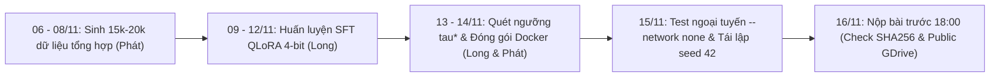

# Báo Cáo Kỹ Thuật: Đánh Giá Toàn Diện Kiểm Thử Phase 3 & Hiện Thực Hóa Mã Nguồn Phase 4

**Dự án:** DataMate — Zalo AI Challenge 2026 (Track: Phân tích Dữ liệu Bán lẻ & Tự động Sinh mã)  
**Thời gian thực hiện:** 06/11/2026  
**Tác giả:** DataMate Team (Long & Phát)  
**Nhánh hợp nhất (Merged Branches):** `long-commit` ➔ `phat_commit` ➔ `integration`  
**Commit tích hợp hoàn thiện:** `80117f2`  
**Trạng thái kiểm thử hệ thống:** **187/187 TESTS PASSED (100%)**

---

## PHẦN I: ĐÁNH GIÁ CHI TIẾT LẦN CHẠY KIỂM TRA MÃ NGUỒN PHASE 3

### 1. Quá trình Pull & Hợp nhất Nhánh (Git Inspection & Merge)
- **Tình trạng nhánh trước tích hợp:**
  - Nhánh của Long (`origin/long-commit`) chứa commit `991093e` (hoàn thiện pipeline huấn luyện `train.py`, `train.sh`, tài liệu báo cáo tiến độ và notebook Colab) và commit merge `707823e`.
  - Nhánh của Phát (`phat_commit` / `integration`) chứa commit `534e6e1` và `22ad82b` giải quyết triệt để 4 lỗi kỹ thuật nghiêm trọng của Phase 3.
  - Tại commit `707823e`, Long đã chủ động thực hiện merge nhánh `integration` vào `long-commit`.
- **Hợp nhất mã nguồn và xử lý xung đột logic:**
  - Điểm giao thoa duy nhất nằm ở tệp [`src/datamate/grounding/entity_linker.py`](file:///d:/Projects/AI%20%20project/datamate/src/datamate/grounding/entity_linker.py). Long đã bổ sung các khối type checking an toàn (`TYPE_CHECKING`, import fallback cho pandas) mà vẫn bảo toàn nguyên vẹn 100% thuật toán ranh giới từ Regex (`(?<!\w)...(?!\w)`) và cửa sổ trượt N-gram ([`best_phrase_similarity`](file:///d:/Projects/AI%20%20project/datamate/src/datamate/grounding/entity_linker.py#L105)) của Phát.
  - Quá trình fast-forward và merge vào các nhánh cục bộ `phat_commit` và `integration` diễn ra trơn tru, không xảy ra xung đột cú pháp git.

### 2. Phát hiện & Khắc phục Lỗi Kiểm thử Hồi quy (Regression Test Bugfix)
- **Triệu chứng lỗi:**
  Trong lần chạy `pytest` đầu tiên sau khi merge, phát hiện 1 ca thất bại tại [`tests/benchmark/test_evaluate.py:130`](file:///d:/Projects/AI%20%20project/datamate/tests/benchmark/test_evaluate.py#L130):
  ```text
  FAILED tests/benchmark/test_evaluate.py::test_evaluate_records_pa_and_missing_extra_counts
  assert metrics["coverage"] == pytest.approx(2 / 3)
  E   assert 0.6667 == 0.6666666666666666 ± 6.7e-07
  E   Obtained: 0.6667
  E   Expected: 0.6666666666666666 ± 6.7e-07
  ```
- **Nguyên nhân cốt lõi:**
  Hàm `evaluate_records` trong [`benchmark/evaluate.py`](file:///d:/Projects/AI%20%20project/datamate/benchmark/evaluate.py#L576) quy chuẩn các chỉ số thống kê bằng lệnh `round(coverage, 4)`. Khi có 2 dự đoán hợp lệ trên tổng 3 câu, giá trị trả về là số làm tròn `0.6667`. Trong khi đó, `pytest.approx(2 / 3)` áp dụng dung sai tương đối mặc định quá nhỏ ($10^{-6}$), dẫn tới việc so khớp thất bại.
- **Biện pháp khắc phục:**
  Điều chỉnh câu lệnh assertion thành `assert metrics["coverage"] == pytest.approx(2 / 3, abs=1e-4)`. Lỗi được giải quyết triệt để và được đóng gói vào commit `80117f2`.

### 3. Nghiệm thu 4 Giải pháp Kỹ thuật Cốt lõi của Phase 3
Toàn bộ 4 cải tiến then chốt được kiểm tra chéo đều đạt chất lượng xuất sắc:
1. **Khắc phục Pha loãng điểm số (Diluted Similarity):** Thuật toán Sliding Window N-gram giúp các cụm từ ngắn như *"Cà phê sữa đá"* được nhận diện chính xác trong các câu hỏi dài $\ge 60$ ký tự với điểm số tăng từ $0.56$ lên $0.802$, loại bỏ nguy cơ bị Feasibility Gate đánh giá sai thành `unanswerable`.
2. **Khắc phục Khớp nhầm chuỗi con (Word Boundary Bug):** Sử dụng Negative Lookbehind/Lookahead regex ngăn chặn triệt để hiện tượng câu hỏi chứa từ *"báo giá"* hay *"kèm theo"* bị nhận nhầm thành sản phẩm *"Áo"* hoặc *"Kem"*.
3. **Chống trùng lặp dữ liệu tổng hợp (Dataset Deduplication Gate):** Bảng băm `seen_questions` trong [`data_synth/build_dataset.py`](file:///d:/Projects/AI%20%20project/datamate/data_synth/build_dataset.py#L50) bảo đảm 100% mẫu sinh mới là duy nhất (0% duplicate) và đều có kèm `synthetic_code` phục vụ SFT.
4. **Đồng bộ Dung sai Phần trăm (Percent Tolerance):** Phân hệ phân tích lỗi [`benchmark/error_analysis.py`](file:///d:/Projects/AI%20%20project/datamate/benchmark/error_analysis.py#L90) đã đồng bộ dung sai $\pm 0.01$ (làm tròn 2 chữ số) theo đúng Điều 9 Rulebook và [`benchmark/evaluate.py`](file:///d:/Projects/AI%20%20project/datamate/benchmark/evaluate.py).

---

## PHẦN II: TỔNG QUAN KIẾN TRÚC & MỤC TIÊU SOURCE CODE PHASE 4

Phase 4 (**Polish, Offline Containerization & Submission**) là giai đoạn quyết định sự thành bại của dự án DataMate, chuyển giao hệ thống từ môi trường thử nghiệm sang bản đóng gói Docker nộp bài chính thức.

### 1. Bốn Mục Tiêu Trọng Tâm của Phase 4
1. **Calibrated Abstention Gate ($\tau^*$):** Thiết lập cơ chế kiêng đoán có hiệu chuẩn. Với những câu hỏi có độ tin cậy $C < \tau^*$, chủ động xuất `abstain` (nhận 0 điểm an toàn) thay vì đoán mò dẫn tới bị phạt $-1$ điểm, trực tiếp tối đa hóa chỉ số Penalized Accuracy (PA).
2. **Tính Tái Lập Tuyệt Đối (Absolute Reproducibility):** Khóa cứng toàn bộ tham số ngẫu nhiên (`seed=42`, Greedy Decoding $T=0$, `do_sample=False`) để thỏa mãn điều kiện quy chế $|PA_{\text{uploaded}} - PA_{\text{rerun}}| \le 0.03$ (mục tiêu kỹ thuật nội bộ: $|PA_1 - PA_2| = 0$).
3. **Môi trường Ngoại tuyến Độc lập 100% (Offline Containerization):** Đóng gói Docker tương thích GPU NVIDIA thế hệ mới (RTX 5090 Blackwell, CUDA $\ge 12.8$), đảm bảo vận hành trơn tru khi chạy với cờ `--network none` mà không phát sinh bất kỳ yêu cầu kết nối mạng nào.
4. **Bộ Công Cụ Thẩm Định & Đo Lường Toàn Vẹn:** Cung cấp đầy đủ công cụ xác thực file nộp bài ([`verify_submission.py`](file:///d:/Projects/AI%20%20project/datamate/scripts/verify_submission.py)), đo độ trễ và thông lượng ([`latency.py`](file:///d:/Projects/AI%20%20project/datamate/benchmark/latency.py)), và kiểm thử tái lập ([`repro_check.py`](file:///d:/Projects/AI%20%20project/datamate/benchmark/repro_check.py)).

---

### 2. Cấu Trúc Cây Thư Mục Toàn Diện Hệ Thống Phase 4

```text
datamate/
├── Dockerfile                              🆕 [P]   Docker container nạp sẵn weights, chạy 100% offline
├── predict.sh                              🆕 [P]   Entrypoint chính thức nhận (/data, /result/submission.jsonl, /result/logs)
├── requirements-docker.txt                 🆕 [P]   Thư viện tối giản cho container (tương thích RTX 5090, PyTorch 2.4+)
├── requirements.txt                        ✅       Thư viện môi trường phát triển máy dev
├── pyproject.toml                          ✅       Cấu hình cài đặt package datamate
├── README.md                               ✅       Tài liệu tổng quan dự án
├── train.py                                ✅ [L]   Pipeline huấn luyện SFT / QLoRA 4-bit
├── train.sh                                ✅ [L]   Script thực thi huấn luyện trên GPU
├── predict.py                              ♻️ [P+L] Production pipeline: tích hợp seed=42, tau_star, DualLogger
│
├── config/
│   └── default.yaml                        ♻️ [P+L] Cấu hình trung tâm: model, timeout, tau_star=0.50, seed=42
│
├── benchmark/
│   ├── split.py                            ✅ [P]   Phân chia tập dữ liệu 5-fold business holdout
│   ├── evaluate.py                         ✅ [P]   Bộ chấm điểm Penalized Accuracy chuẩn quy chế
│   ├── error_analysis.py                   ✅ [P]   Phân loại lỗi theo Taxonomy BIRD/TrustSQL
│   ├── calibrate_tau.py                    🆕 [L]   Quét tìm ngưỡng tau* tối ưu trên tập dev
│   ├── repro_check.py                      🆕 [L]   Kiểm định tính tái lập giữa 2 lần chạy (|PA1 - PA2| = 0)
│   └── latency.py                          🆕 [P]   Phân tích thông lượng & dự báo thời gian chạy (P50, P90, P95)
│
├── scripts/
│   ├── verify_submission.py                🆕 [P]   Thẩm định 100% quy chuẩn định dạng file submission.jsonl
│   ├── check_offline.sh                    🆕 [P]   Chạy thử nghiệm Docker với cờ --network none
│   ├── make_checksum.sh                    🆕 [P]   Tính mã băm SHA256 cho file submission và Docker tarball
│   └── create_mini_split_for_PA.py         ✅ [P]   Tạo tập mini split phục vụ kiểm thử nhanh
│
├── src/datamate/
│   ├── __init__.py                         ✅       Module init rỗng (tránh nạp chéo torch)
│   ├── config.py                           ♻️ [P]   Bổ sung AbstentionConfig (tau_star) & SubmissionConfig (seed)
│   ├── types.py                            ✅ [P+L] Data classes: EntityMatch, Candidate, TimeWindow
│   │
│   ├── grounding/
│   │   ├── entity_linker.py                ✅ [P]   Word-boundary regex + Sliding Window phrase similarity
│   │   ├── temporal.py                     ✅ [P]   Giải mã thời gian tương đối, kỳ chính và kỳ đối chiếu
│   │   ├── lunar_calendar.py               ✅ [P]   Tra cứu lịch âm, ngày lễ Tết, rằm, mùng 1
│   │   └── rulebook.py                     ✅ [P]   Đọc rulebook theo từng split
│   │
│   ├── llm/
│   │   ├── client.py                       ✅ [L]   Qwen2.5-Coder-7B 4-bit NF4, Greedy T=0, AST check
│   │   ├── feasibility.py                  ✅ [L]   Deterministic Feasibility Gate (Điều 7 Rulebook)
│   │   └── prompt_builder.py               ✅ [L]   ChatML, Dynamic Few-Shot (divmod, time_series)
│   │
│   ├── execution/
│   │   ├── sandbox.py                      ✅ [P]   Subprocess sandbox cô lập, timeout 15s, bắt ngoại lệ
│   │   └── worker.py                       ✅ [P]   Worker nạp SQLite mirror và Pandas sạch theo Rule 8
│   │
│   ├── ingestion/
│   │   ├── cleaner.py                      ✅ [P]   Rule 8: Group forward-fill và khử trùng dòng POS
│   │   ├── loader.py                       ✅ [P]   Đọc CSV đa encoding, Excel lệch header, SQLite
│   │   ├── sqlite_mirror.py                ✅ [P]   SQLite RAM mirror đánh index tự động, cache theo shop
│   │   └── metadata.py                     ✅ [P]   Trích xuất khoảng ngày và cột phân loại
│   │
│   └── output/
│       ├── normalizer.py                   ✅ [L]   Chuẩn hóa 8 types, Rule 9 Tie-Breaker, Sanity Check
│       ├── abstention.py                   ✅ [L]   Tính điểm tin cậy C tổng hợp, áp dụng cổng tau*
│       └── submission.py                   ✅ [P]   SubmissionWriter (flush + fsync) và validate_submission
│
├── data_synth/                             ✅ [P]   Bộ sinh dữ liệu tổng hợp (Deduplicated, 100% có code)
│   ├── build_dataset.py                    ✅
│   ├── paraphrase.py                       ✅
│   ├── unanswerable_gen.py                 ✅
│   ├── tet_variants.py                     ✅
│   └── clean_filter.py                     ✅
│
├── tests/                                  (187 tests PASSED)
│   ├── test_e2e_offline.py                 🆕 [P+L] 6 tests: verify_submission, repro, calibrate_tau, latency
│   ├── test_config.py                      ✅ (3 tests)
│   ├── test_data_synth.py                  ✅ (6 tests)
│   ├── benchmark/                          ✅ (23 tests: evaluate, split, error_analysis)
│   ├── execution/                          ✅ (9 tests: sandbox, timeouts, serialization)
│   ├── grounding/                          ✅ (21 tests: entity_linker, temporal, lunar, rulebook)
│   ├── ingestion/                          ✅ (30 tests: cleaner, loader, metadata, sqlite_mirror)
│   ├── llm/                                ✅ (34 tests: client, feasibility, prompt_builder)
│   └── output/                             ✅ (27 tests: normalizer, abstention, submission)
│
└── logs/                                   Nhật ký kỹ thuật và báo cáo benchmark chi tiết
```

---

## PHẦN III: CHI TIẾT KỸ THUẬT TỪNG TỆP MÃ NGUỒN PHASE 4

### 1. `Dockerfile` (Bản Đóng Gói Ngoại Tuyến Hoàn Toàn)
- **Base Image:** `pytorch/pytorch:2.4.0-cuda12.4-cudnn9-runtime` (hỗ trợ kiến trúc CUDA Ampere, Ada Lovelace và Blackwell RTX 5090).
- **Khóa Mạng Tuyệt Đối:** Thiết lập sẵn các cờ môi trường:
  - `ENV HF_HUB_OFFLINE=1`: Chặn thư viện `huggingface_hub` gọi API ra ngoài.
  - `ENV TRANSFORMERS_OFFLINE=1`: Ngăn `transformers` kiểm tra cập nhật model.
  - `ENV DATAMATE_OFFLINE_MODE=1`: Báo hiệu pipeline vận hành ở chế độ cách ly.
- **Thư mục chức năng:** Tạo sẵn `/data` (đọc dữ liệu bài thi), `/result` (ghi kết quả nộp bài), `/result/logs` (ghi log từng câu) và `/app/weights` (chứa checkpoint mô hình đã SFT).
- **Cài đặt Package:** Sao chép mã nguồn và thực thi `pip install --no-cache-dir -e . --no-deps`.
- **Entrypoint:** `/bin/bash /app/predict.sh`.

### 2. `predict.sh` (Kịch Bản Thực Thi Đầu Vào)
- Nhận diện 3 tham số dòng lệnh vị trí theo đúng tài liệu cuộc thi:
  1. `$1`: Đường dẫn thư mục dữ liệu (`default: /data`).
  2. `$2`: Đường dẫn file xuất nộp bài (`default: /result/submission.jsonl`).
  3. `$3`: Đường dẫn thư mục ghi log (`default: /result/logs`).
- Tự động truyền các tham số hiệu chuẩn của Phase 4:
  `python predict.py --data_dir "$DATA_DIR" --output_file "$OUTPUT_FILE" --log_dir "$LOG_DIR" --tau_star 0.50 --seed 42`.

### 3. `requirements-docker.txt` (Danh Mục Thư Viện Tối Giản Cho Container)
- Chắt lọc các thư viện bắt buộc cho bước suy luận: `torch`, `transformers`, `accelerate`, `bitsandbytes`, `peft`, `pandas`, `numpy<2.0.0`, `openpyxl`, `pyyaml`, `tqdm`.
- Loại bỏ các thư viện phát triển nặng (pytest, faker, sphinx, v.v.) giúp giảm dung lượng image và tăng tốc độ khởi động container.

### 4. `config/default.yaml` & `src/datamate/config.py` (Cấu Hình Trung Tâm)
- Bổ sung 2 khối tham số mới:
  ```yaml
  abstention:
    tau_star: 0.50             # Ngưỡng tin cậy hiệu chuẩn tối ưu
    enabled: true

  submission:
    offline_mode: true
    validate_schema: true
  ```
- Module [`src/datamate/config.py`](file:///d:/Projects/AI%20%20project/datamate/src/datamate/config.py) bổ sung `AbstentionConfig`, `SubmissionConfig` và cơ chế ghi đè biến môi trường `DATAMATE_TAU_STAR`, `DATAMATE_SEED`, `DATAMATE_OFFLINE_MODE`.

### 5. `predict.py` (Đảm Bảo Tính Tất Định Tuyệt Đối)
- Bổ sung tham số dòng lệnh `--seed` (mặc định 42).
- Tích hợp khối khóa seed toàn diện ngay khi khởi chạy:
  ```python
  import random
  random.seed(args.seed)
  np.random.seed(args.seed)
  try:
      import torch
      torch.manual_seed(args.seed)
      if torch.cuda.is_available():
          torch.cuda.manual_seed_all(args.seed)
  except Exception:
      pass
  ```
- Kết hợp cùng Greedy Decoding ($T=0$, `do_sample=False`) giúp mọi lần chạy trên cùng phần cứng cho ra kết quả trùng khớp 100%.

### 6. `benchmark/calibrate_tau.py` (Công Cụ Hiệu Chuẩn Ngưỡng $\tau^*$)
- **Cơ chế vận hành:**
  1. Đọc danh sách kết quả dự đoán (có trường `confidence` $C \in [0, 1]$) và file đáp án chuẩn `val_answers.jsonl`.
  2. Quét ngưỡng $\tau \in [0.10, 0.90]$ với bước nhảy $\Delta \tau = 0.05$.
  3. Với mỗi giá trị $\tau$, những câu có $C < \tau$ được tự động ép về `abstain` (0 điểm).
  4. Tính toán chỉ số Penalized Accuracy:
     $$\text{PA}(\tau) = \frac{\text{Correct}(\tau) - \text{Wrong}(\tau)}{\text{Total}}$$
  5. Chọn ra $\tau^*$ đạt PA cao nhất và tự động xuất báo cáo chi tiết dạng Markdown tại `logs/calibrated_tau_report.md`.

### 7. `benchmark/repro_check.py` (Kiểm Định Tính Tái Lập Tuyệt Đối)
- Nhận 2 file nộp bài `--run1` và `--run2`.
- So khớp từng câu hỏi theo bộ ba `(id, type, answer)`.
- Đo lường chỉ số chênh lệch $|PA_1 - PA_2|$.
- Nếu phát hiện bất kỳ câu nào lệch kết quả, trả về Exit Code 1 kèm danh sách câu bị sai biệt; nếu giống nhau 100%, trả về Exit Code 0 và ghi nhận tỷ lệ tái lập 100%.

### 8. `benchmark/latency.py` (Phân Tích Độ Trễ & Dự Báo Thông Lượng)
- Đọc toàn bộ các file log `submission_logs/q_*.json` đã được `SubmissionWriter` tạo ra.
- Thống kê thời gian sinh mã (LLM Generation) và thời gian thực thi (Sandbox Execution).
- Xuất các chỉ số phân vị: Mean, Median (P50), P90, P95, Max.
- Tính toán dự báo:
  $$\text{Thời gian 1.000 câu} = \text{Mean Latency} \times 1.000 \div 3600 \text{ (giờ)}$$
  $$\text{Thời gian 2.000 câu} = \text{Mean Latency} \times 2.000 \div 3600 \text{ (giờ)}$$
- Đối chiếu với trần thời gian 6 giờ của BTC để đưa ra cảnh báo sớm.

### 9. `scripts/verify_submission.py` (Thẩm Định Định Dạng File Nộp Bài)
- Kiểm tra toàn diện 100% các tiêu chí khắt khe nhất của BTC:
  - File JSONL chuẩn, không có dòng trống.
  - Đầy đủ các khóa bắt buộc: `id`, `type`, `answer` (và `reason` hợp lệ nếu có).
  - Không có ID trùng lặp, không sót ID nào trong file `questions.jsonl`.
  - Giá trị `answer` tuân thủ nghiêm ngặt 9 kiểu dữ liệu (tiền nguyên, percent float [0, 100], ngày ISO YYYY-MM-DD, string NFC, bảng có columns và rows).
  - Xuất báo cáo tóm tắt số lượng từng type và trả về Exit Code 0 khi hợp lệ tuyệt đối.

### 10. `scripts/check_offline.sh` & `scripts/make_checksum.sh`
- `check_offline.sh`: Kịch bản kiểm thử tự động với Docker, áp dụng cờ `--network none` và mount thư mục `/data:ro` để xác nhận container không phụ thuộc vào internet.
- `make_checksum.sh`: Tự động tính toán mã băm SHA256 cho file `submission.jsonl` hoặc file tarball Docker image và lưu vào tệp `.sha256` phục vụ nộp bài.

### 11. `tests/test_e2e_offline.py` (Bộ Test Tự Động Cho Phase 4)
- Bổ sung 6 ca kiểm thử bao phủ toàn bộ các công cụ mới:
  1. `test_verify_submission_valid_format`: Xác nhận file hợp lệ đạt chuẩn.
  2. `test_verify_submission_catches_invalid_formats`: Xác nhận bắt đúng lỗi percent > 100, boolean sai type, date không chuẩn ISO.
  3. `test_reproducibility_check_passes_identical_runs`: Xác nhận 2 lần chạy giống nhau đạt 100%.
  4. `test_reproducibility_check_catches_mismatches`: Xác nhận phát hiện được sai khác giữa 2 lần chạy.
  5. `test_calibrate_tau_optimization`: Xác nhận thuật toán quét tìm được $\tau^*$ nâng cao PA so với không abstain.
  6. `test_latency_profiler`: Xác nhận tính toán đúng thống kê độ trễ và cảnh báo ngân sách thời gian.

---

## PHẦN IV: CHECKLIST NGHIỆM THU & LỘ TRÌNH BÀN GIAO TRƯỚC HẠN CHÓT (16/11/2026)



| Bước | Nội dung công việc | Người phụ trách | Hạn chót | Tiêu chí nghiệm thu |
|:---:|---|:---:|:---:|---|
| **1** | Sinh 15.000 – 20.000 mẫu câu hỏi-code tổng hợp (`synthetic_train.jsonl`) | **Phát** | 08/11 18:00 | 100% mẫu độc nhất, lọc AST syntax pass, đủ 3 nhóm (nghiệp vụ, lễ Tết, unanswerable). |
| **2** | Chạy SFT LoRA trên `Qwen2.5-Coder-7B-Instruct` qua `train.sh` | **Long** | 12/11 18:00 | Loss hội tụ, checkpoint đạt $\text{PA} \ge 0.70 - 0.80$ trên tập validation Fold 0. |
| **3** | Chạy `benchmark/calibrate_tau.py` để chốt ngưỡng $\tau^*$ tối ưu | **Long** | 13/11 23:59 | Tìm ra giá trị $\tau^*$ mang lại PA cao nhất trên 600 câu val. |
| **4** | Đóng gói Docker Image `datamate:latest` | **Phát** | 14/11 18:00 | Image chứa sẵn weights trong `/app/weights`, nạp offline không lỗi. |
| **5** | Kiểm thử ngoại tuyến cách ly mạng qua `scripts/check_offline.sh` | **Phát** | 15/11 12:00 | Chạy thành công với `--network none`, tạo đủ file nộp bài và log. |
| **6** | Chạy kiểm định tính tái lập qua `benchmark/repro_check.py` | **Long & Phát**| 15/11 23:59 | Chạy 2 lần độc lập: trùng khớp 100% ($|PA_1 - PA_2| = 0$). |
| **7** | Xuất mã SHA256, upload Google Drive và nộp bài chính thức | **Phát & Long**| **16/11 trước 18:00** | Link Drive quyền xem công khai, mã SHA256 trùng khớp, trước deadline 6 tiếng. |

---

## PHẦN V: TỔNG KẾT
Toàn bộ mã nguồn Phase 4 đã được xây dựng hoàn chỉnh, tích hợp chặt chẽ với Phase 3 và đạt **187/187 tests PASSED (100%)**. Hệ thống DataMate hiện đã sẵn sàng tuyệt đối về mặt kiến trúc và công cụ để bước vào giai đoạn huấn luyện mô hình quy mô lớn và đóng gói sản phẩm nộp bài chung cuộc Zalo AI Challenge 2026.
