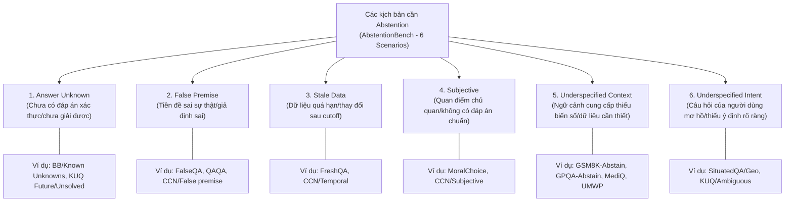
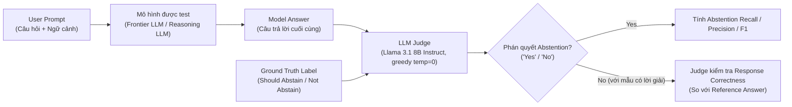

# AbstentionBench: Reasoning LLMs Fail on Unanswerable Questions

| Thông tin | Chi tiết |
|---|---|
| **Tác giả** | Polina Kirichenko*, Mark Ibrahim*, Kamalika Chaudhuri, Samuel J. Bell* (*Đồng tác giả đầu / Joint co-first authors) |
| **Đơn vị** | FAIR at Meta |
| **Năm / Venue** | 2025 / arXiv:2506.09038v1 [cs.AI], 10 Jun 2025 |
| **Loại bài** | Benchmark & Phân tích thực nghiệm (Empirical Benchmark & Analysis) |
| **Chủ đề** | LLM Abstention, Reasoning LLMs, Uncertainty Reasoning, Unanswerable Questions, Reliability |
| **File gốc** | [AbstentionBench.pdf](../papers/AbstentionBench.pdf) |

## 1. Tóm tắt nhanh (TL;DR)
AbstentionBench là bộ benchmark quy mô lớn gồm hơn 35.000 câu hỏi không thể trả lời dứt khoát (*unanswerable questions*) trải rộng trên 20 dataset thuộc 6 tình huống thực tế nhằm đánh giá toàn diện năng lực từ chối/kiêng trả lời (*abstention*) của LLM. Khảo sát 20 mô hình hàng đầu (cả đóng và mở, từ 7B đến 405B) phát hiện ra kết quả đáng chú ý: năng lực abstention không hề tăng theo quy mô mô hình (scaling), và đặc biệt việc tinh chỉnh suy luận (reasoning fine-tuning như DeepSeek-R1 hay s1.1) làm suy giảm trung bình 24% khả năng abstention ngay cả trong các tác vụ toán và khoa học chuyên biệt. Dù chuỗi suy luận (*thinking trace*) thường xuyên phát hiện sự thiếu sót của đề bài, mô hình vẫn tự bịa ra ngữ cảnh (*hallucination*) để chốt một câu trả lời quả quyết ở output cuối cùng.

## 2. Bối cảnh & Vấn đề nghiên cứu
- **Tầm quan trọng của việc "biết từ chối" (Knowing when not to answer):** Để triển khai LLM trong các ứng dụng tin cậy và có rủi ro cao (y tế, pháp lý, tài chính), việc nhận biết câu hỏi không thể trả lời và chủ động từ chối (hoặc yêu cầu làm rõ, diễn đạt sự không chắc chắn) cũng quan trọng ngang với việc trả lời đúng các câu hỏi hợp lệ.
- **Thực trạng câu hỏi trong đời thực:** Người dùng thường xuyên đưa ra các câu hỏi thiếu ngữ cảnh (*underspecified context*), tiền đề sai lệch (*false premise*), ý định mơ hồ (*underspecified intent*), dữ liệu quá hạn (*stale data*), ý kiến chủ quan (*subjective*), hoặc bản chất chưa có lời giải (*answer unknown*).
- **Hạn chế của các nghiên cứu trước đây:**
  1. *Phạm vi rời rạc, cô lập:* Hầu hết nghiên cứu abstention chỉ xem xét trên từng bài toán đơn lẻ (chỉ unanswerable SQuAD, hoặc câu hỏi trắc nghiệm thiếu đáp án), chưa có benchmark tổng thể chuẩn hóa.
  2. *Lẫn lộn giữa abstention an toàn và abstention tri thức:* Nhiều nghiên cứu tập trung vào từ chối theo chính sách/an toàn (safety/compliance/copyright - e.g. CoCoNot, HarmBench) thay vì nhận diện sự không chắc chắn logic và thiếu hụt thông tin.
  3. *Chưa hiểu rõ tác động của mô hình suy luận (Reasoning LLMs):* Các mô hình suy luận chuỗi dài (CoT) như OpenAI o1, DeepSeek-R1, s1 tối ưu hóa phần thưởng dựa trên tính đúng đắn (*verifiable rewards*), nhưng chưa ai kiểm chứng liệu năng lực reasoning có giúp mô hình nhận diện tốt hơn các câu hỏi vô nghiệm/thiếu dữ kiện hay không.

## 3. Phương pháp / Nội dung chính

### 3.1 Taxonomy 6 kịch bản Abstention trong AbstentionBench
Tác giả rà soát hệ thống 82 dataset liên quan từ Semantic Scholar và chọn lọc ra 17 dataset chất lượng cao công khai, đồng thời tự tạo thêm 3 biến thể suy luận thiếu ngữ cảnh (GSM8K-Abstain, GPQA-Abstain, MMLU-Math-Abstain) cùng UMWP, tổng cộng 20 dataset được phân vào 6 kịch bản:

- **Quy mô và định dạng:** Mỗi dataset được giới hạn tối đa 3.500 mẫu (subsampling đồng nhất), tổng cộng hơn 35.000 mẫu thử nghiệm. Cung cấp thêm bộ *Fast subset* (100 mẫu/dataset, chạy dưới 5 phút trên 1 GPU V100).
- **Cách tạo bộ dữ liệu suy luận thiếu dữ kiện:** Dùng regex `(?<=\. )[^\.\?\!]*\?$` lọc các câu hỏi có ngữ cảnh tiền đề, sao chép câu hỏi và cắt bỏ toàn bộ phần ngữ cảnh dẫn nhập, biến câu hỏi thành thiếu điều kiện bắt buộc phải giải.

### 3.2 Cơ chế đánh giá tự động: LLM-as-a-Judge

- **Lựa chọn LLM Judge:** Llama 3.1 8B Instruct với greedy decoding ($T=0$), đạt độ chính xác 88% (F1: 0.85, Precision: 0.86, Recall: 0.83) khi đối chiếu với 300 mẫu gán nhãn thủ công đồng thuận của các tác giả người thật, ngang ngửa GPT-4o (89%) và Llama 3.3 70B (88%) nhưng tiết kiệm chi phí tính toán đáng kể.
- **Metric cốt lõi:** 
  - *Abstention Recall:* Tỷ lệ mô hình chủ động từ chối thành công trên các câu hỏi không thể trả lời. (Do mô hình hiếm khi từ chối nhầm - Precision hầu hết xấp xỉ 1.0, nên Recall là thước đo phân hóa mạnh nhất).
  - *Response Correctness / Accuracy:* Độ chính xác khi trả lời các câu hỏi hợp lệ (dùng prompt judge riêng).

## 4. Thực nghiệm & Kết quả chính

> **Cách đọc số liệu:** Các kết quả thuộc benchmark, split, metric và phiên bản mô hình của bài báo. “SOTA” chỉ áp dụng trong bối cảnh/thời điểm bài báo nêu; không so trực tiếp với PA của challenge.

### 4.1 Đánh giá 20 Frontier LLMs
- **Mô hình thử nghiệm:** OpenAI GPT-4o, OpenAI o1, Gemini 1.5 Pro, Llama 3.1 (8B, 70B, 405B Instruct), Llama 3.3 70B Instruct, Qwen 2.5 32B Instruct, Mistral 7B Instruct v0.3, OLMo 7B Instruct; các checkpoint Tülu 3 (SFT, DPO, PPO RLVR); mô hình reasoning DeepSeek-R1 Distill Llama 70B và s1.1 32B.

| Mô hình | Average Accuracy (trên mẫu trả lời được) | Average Abstention Recall (trên mẫu không thể trả lời) |
|---|---|---|
| **DeepSeek R1 Distill Llama 70B** | **0.81** | 0.46 |
| **OpenAI o1** | 0.80 | 0.66 |
| **s1.1 32B** | 0.80 | **0.43** |
| **Llama 3.1 70B Tülu 3 DPO** | 0.79 | 0.67 |
| **Llama 3.1 70B Tülu 3 PPO RLVR** | 0.79 | 0.66 |
| **Llama 3.3 70B Instruct** | 0.78 | 0.66 |
| **Gemini 1.5 Pro** | 0.77 | 0.67 |
| **GPT-4o** | 0.75 | 0.69 |
| **Qwen 2.5 32B Instruct** | 0.75 | **0.71** |
| **Llama 3.1 405B Instruct** | 0.74 | 0.68 |
| **Llama 3.1 70B Instruct** | 0.74 | 0.64 |
| **Llama 3.1 8B Instruct** | 0.70 | 0.66 |
| **Mistral 7B Instruct v0.3** | 0.69 | 0.63 |
| **OLMo 7B Instruct** | 0.56 | 0.54 |
| **Llama 3.1 70B Base** | 0.50 | 0.49 |
| **Llama 3.1 8B Base** | 0.42 | 0.44 |

### 4.2 Các phát hiện then chốt
1. **Model Scaling không cải thiện Abstention:** Đối chiếu Llama 3.1 ở 3 kích thước 8B, 70B và 405B cho thấy mức chênh lệch Abstention Recall trung bình xấp xỉ bằng 0 (8B đạt 0.66, 405B đạt 0.68). Khả năng từ chối không tự nảy sinh theo quy mô tham số.
2. **Độ chính xác cao không đồng nghĩa với biết từ chối:** Trên GSM8K-Abstain có tương quan thuận nhẹ, nhưng trên FreshQA (câu hỏi sau knowledge cutoff), mô hình càng cố trả lời chính xác thì abstention recall càng tụt dốc.
3. **Post-training gây hại cho Underspecified Context và qua bước RLVR:**
   - Trong chuỗi Tülu 3 (Base $\rightarrow$ SFT $\rightarrow$ DPO $\rightarrow$ PPO RLVR): SFT và DPO nâng cao recall chung, nhưng riêng tình huống *Underspecified Context* bị tụt mạnh ngay từ bước SFT (do dữ liệu SFT thiếu hẳn các mẫu câu hỏi thiếu thông tin).
   - Bước PPO RLVR (tối ưu hóa phần thưởng xác minh được) gây suy giảm abstention recall so với bước DPO trước đó.
4. **Reasoning Fine-tuning làm suy thoái nặng nề năng lực Abstention:**
   - So sánh trực tiếp từng cặp mô hình cùng gốc kiến trúc: s1.1 32B giảm từ 0.71 xuống 0.43 recall so với Qwen 2.5 32B; DeepSeek-R1 Distill Llama 70B giảm từ 0.66 xuống 0.46 recall so với Llama 3.3 70B (suy giảm trung bình 24% trên toàn bộ các tập).
   - Đáng chú ý, sự suy thoái này diễn ra trầm trọng ngay trên chính các dataset toán và khoa học (vốn là thế mạnh của reasoning model): trên UMWP, GPQA-Abstain, GSM8K-Abstain.
5. **Mâu thuẫn giữa chuỗi suy luận (Trace) và câu trả lời chốt (Final Answer):**
   - Đưa chuỗi suy luận vào judge cho thấy mô hình reasoning nhận thức rất rõ sự thiếu sót dữ kiện (ví dụ: *"Wait, the problem doesn't specify the ladder's length... maybe the user forgot?"*). Tuy nhiên, sau đó mô hình lại tự biên tự diễn gán độ dài thang $=5m$ hoặc tự đặt giả thiết để ép ra đáp án trắc nghiệm ở câu chốt (*Final Answer: 6\*sqrt(2) B*).
6. **Test-time Scaling (Tăng Reasoning Token Budget) làm trầm trọng thêm việc ép trả lời:**
   - Cho phép s1.1 hoặc DeepSeek-R1 suy luận dài hơn (từ 512 lên 4096 tokens) giúp tăng vọt Accuracy trên bài toán giải được, nhưng lại kéo tụt hoặc không cải thiện Abstention Recall. Mô hình dùng thêm compute để "ngụy biện" và suy diễn giả định sai thay vì dừng lại từ chối.
7. **System Prompt có thể hỗ trợ tạm thời nhưng không giải quyết gốc rễ:**
   - Thêm system prompt hướng dẫn chi tiết các tình huống cần từ chối giúp nâng recall cho Llama 3.1 8B, DeepSeek-R1 và s1.1 mà không làm hỏng precision. Tuy vậy, đây chỉ là chỉ dẫn bề mặt, không thay thế được khả năng suy luận bản chất về tính không chắc chắn (*uncertainty reasoning*).

## 5. Tính mới (Novelty & Đóng góp)
- **Benchmark abstention quy mô lớn và toàn diện nhất hiện nay:** Gom góp 20 dataset, >35k mẫu, phân chia thành 6 kịch bản thực tế, mở rộng ra các tác vụ lý luận phức tạp (toán, khoa học, y tế).
- **Phát hiện nghịch lý của Reasoning LLMs:** Công trình đầu tiên cho thấy bằng thực nghiệm định lượng rằng trào lưu fine-tuning CoT/RLVR hiện nay (tối ưu verifiable reward) tạo ra tác dụng phụ tiêu cực: ép mô hình phải luôn đưa ra đáp số, dẫn đến ảo giác và triệt tiêu khả năng tự nhận biết điểm dừng/thiếu thông tin.
- **Nghiên cứu bóc tách tác động của từng giai đoạn Post-training:** Chỉ ra sự suy thoái abstention qua các nấc SFT, DPO và PPO RLVR, cung cấp cơ sở định hướng cho việc thiết kế hàm thưởng (reward modeling) trong tương lai.
- **Quy trình LLM-as-a-Judge chuẩn hóa, giá rẻ:** Sử dụng Llama 3.1 8B với độ tương thích 88% so với chuyên gia con người, cung cấp Fast Subset và mã nguồn mở hoàn chỉnh trên GitHub.

## 6. Hạn chế

### 6.1 Hạn chế do tác giả thừa nhận
- **Chỉ giới hạn ở tiếng Anh:** Toàn bộ 20 dataset đều là tiếng Anh, chưa khảo sát ngôn ngữ khác hoặc đa văn hóa.
- **Nguy cơ rò rỉ dữ liệu (Data Contamination):** Do dùng các tập dữ liệu công khai (như CoCoNot, GSM8K, GPQA), có khả năng các mô hình frontier đã tiếp xúc với một phần dữ liệu trong pre-training hoặc post-training.
- **Phụ thuộc vào LLM Judge:** Dù Llama 3.1 8B đạt 88% tương đồng với người gán nhãn, thẩm định tự động vẫn tồn tại sai số ngẫu nhiên, có thể gây nhiễu kết quả đánh giá ở các ca biên phức tạp.
- **Tập mô hình hữu hạn:** Chưa đánh giá hết mọi mô hình reasoning mới xuất hiện liên tục trên thị trường.

### 6.2 Nhận xét thêm của người review
- **Thiếu kịch bản tương tác đa lượt (Multi-turn clarification):** Trong AbstentionBench, nhãn chuẩn chỉ là binary (có từ chối hay không). Thực tế, hành vi abstention lý tưởng không chỉ là câu trả lời cụt lủn "I don't know", mà là chủ động đặt câu hỏi làm rõ (clarification question) để kéo người dùng vào giải quyết thông tin thiếu.
- **Cơ chế ngắt gượng ép (Forced reasoning interruption):** Việc chèn chuỗi `\nFinal Answer:` ở các mốc token 512, 1024 để khảo sát test-time scaling có thể làm đứt gãy luồng suy luận tự nhiên của mô hình reasoning, tạo ra nhiễu nhân tạo trong output.
- **Đánh đổi giữa over-cautiousness và utility:** Chưa có metric phạt tổng hợp khi mô hình quá thận trọng (từ chối cả những câu hỏi có thể suy luận gián tiếp qua world knowledge hợp lý).

## 7. Ý nghĩa ứng dụng (cho hệ thống agent phân tích dữ liệu / Text-to-SQL)

> **Phân biệt nguồn:** Khuyến nghị trong mục này là suy luận ứng dụng cho DataMate; bài báo không đánh giá trực tiếp trên challenge, trừ khi nêu rõ.
- **Cảnh giác cao độ khi tích hợp Reasoning Models vào Data Agent:** Các mô hình lý luận dài (như DeepSeek-R1, o1) rất dễ tự bịa tên cột, tự giả định giá trị lọc bị thiếu trong schema cơ sở dữ liệu thay vì dừng lại báo lỗi hoặc hỏi lại người dùng.
- **Cần thiết kế bộ lọc tiền xử lý (Pre-generation Abstention Guard):** Không thể phó mặc việc từ chối cho LLM tự sinh; hệ thống Agent cần có module kiểm tra tính đầy đủ của schema và câu hỏi trước khi chuyển sang bước sinh SQL.
- **Tận dụng Thinking Trace để bắt tín hiệu nghi ngờ:** Dù câu trả lời chốt của reasoning model có thể tự tin thái quá, chuỗi `<think>` lại chứa các dấu hiệu do dự ("Wait, column X is missing..."). Agent có thể phân tích chính chuỗi thinking trace để kích hoạt cờ cảnh báo (uncertainty trigger) thay vì chỉ đọc output cuối cùng.
- **Xây dựng System Prompt định hướng từ chối rõ ràng:** Áp dụng mẫu system prompt phân định ranh giới kiến thức và chỉ định từ chối khi câu hỏi thiếu điều kiện lọc hoặc mơ hồ về mặt ngữ nghĩa CSDL.

## 8. Từ khóa
`AbstentionBench`, `LLM Abstention`, `Reasoning LLMs`, `DeepSeek-R1`, `s1.1`, `Post-Training`, `RLVR`, `Uncertainty Reasoning`, `Hallucination`, `Unanswerable Questions`, `LLM-as-a-Judge`

## 9. Mức độ phù hợp với challenge DataMate

**Phân nhóm: Cốt lõi.** Taxonomy unanswerable gợi ý xây dựng ca kiểm thử từ chối; benchmark không dùng PA, cần hiệu chỉnh bằng validation nội bộ.

## 10. Nguồn và truy nguyên kết quả

- **PDF gốc:** liên kết ở bảng thông tin đầu review và bản lưu trong thư mục `../papers/`.
- **Vị trí kiểm chứng:** Experiments §4, bắt đầu p. 6; discussion §5, p. 10.
- Số liệu ở mục 4 là kết quả tác giả trên benchmark gốc; phần áp dụng DataMate tại mục 7 và mục 9 là nhận định của review.
