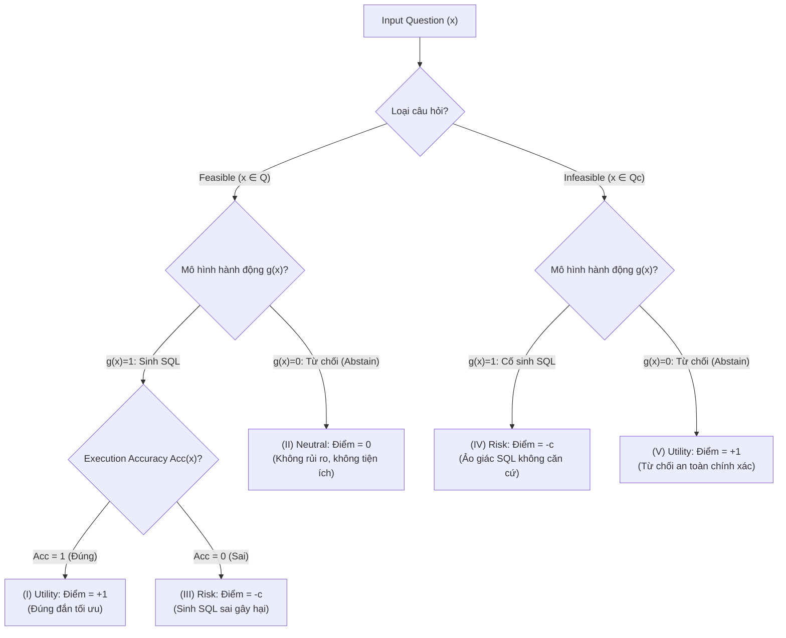
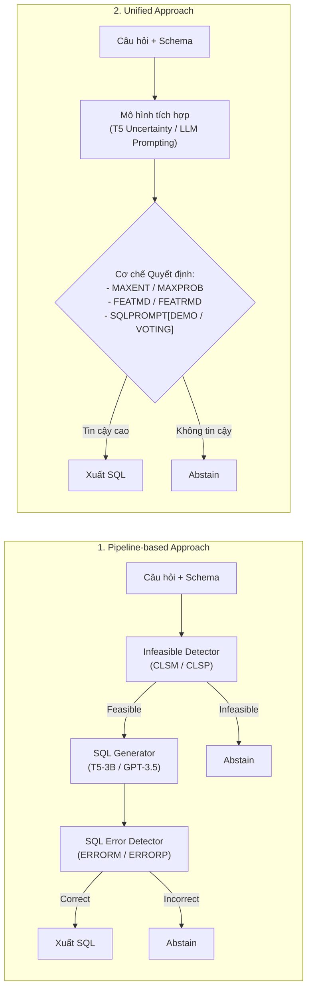

# TrustSQL: Benchmarking Text-to-SQL Reliability with Penalty-Based Scoring

| Thông tin | Chi tiết |
|---|---|
| **Tác giả** | Gyubok Lee, Woosog Chay, Seonhee Cho, Edward Choi |
| **Đơn vị** | KAIST AI (Korea Advanced Institute of Science and Technology) |
| **Năm / Venue** | 2024 / arXiv:2403.15879v6 [cs.AI], 2 Jul 2024 (Under review) |
| **Loại bài** | Benchmark & Phương pháp đánh giá (Benchmark & Evaluation Metric) |
| **Chủ đề** | Text-to-SQL Reliability, Penalty-Based Scoring, Abstention, Infeasible Queries, Out-of-Distribution Detection |
| **File gốc** | [Benchmarking Text-to-SQL Reliability with Penalty-Based Scoring.pdf](../papers/Benchmarking%20Text-to-SQL%20Reliability%20with%20Penalty-Based%20Scoring.pdf) |

## 1. Tóm tắt nhanh (TL;DR)
TrustSQL là bộ benchmark đầu tiên chuẩn hóa khái niệm **Độ tin cậy trong Text-to-SQL (Text-to-SQL Reliability)** thông qua cơ chế chấm điểm có phạt (**Penalty-Based Scoring** $\phi_c$) và tích hợp các câu hỏi không khả thi (*infeasible questions*). Khác với các benchmark truyền thống vốn chỉ tính Execution Accuracy và không có chế tài phạt cho các lỗi sinh sai, TrustSQL phân loại hành vi mô hình thành 5 vùng kết quả (Utility, Risk, Neutral) với hệ số phạt $c \in \{0, 10, N\}$. Đánh giá trên 4 bộ dữ liệu (ATIS, Advising, EHRSQL, Spider) với hơn 21.400 mẫu cho thấy khi áp dụng mức phạt vừa phải ($c=10$), hầu hết các mô hình SOTA (kể cả DIN-SQL hay MAC-SQL) đều giảm mạnh về điểm số âm nặng nề, cho thấy rằng trong môi trường triển khai thực tế, biết kiêng trả lời (*abstention*) quan trọng hơn nhiều so với việc liều lĩnh sinh SQL.

## 2. Bối cảnh & Vấn đề nghiên cứu
- **Rào cản triển khai Text-to-SQL trong thực tế:**
  1. *Người dùng không hiểu hết giới hạn của mô hình:* Người dùng nghiệp vụ (bác sĩ, kế toán, chuyên viên) không nắm rõ schema cơ sở dữ liệu hay giới hạn hàm cú pháp SQL, dẫn đến việc thường xuyên đặt những câu hỏi nằm ngoài phạm vi (*infeasible region*)—chẳng hạn đòi hỏi dữ liệu không có trong bảng, yêu cầu dự báo tương lai, hay phân tích học máy.
  2. *Thiếu vắng cơ chế từ chối (Abstention):* Các benchmark hiện nay (Spider, BIRD) ngầm giả định mọi câu hỏi đều trả lời được bằng SQL và chỉ đo lường Execution Accuracy. Trong công thức này, đoán mò nếu sai nhận 0 điểm, không có bất kỳ rủi ro nào. Hậu quả là mô hình luôn bị ép phải sinh SQL, dẫn đến việc các câu SQL sai sót hoặc hoang tưởng được thực thi âm thầm, gây thảm họa trong các lĩnh vực rủi ro cao (y tế, tài chính).
- **Định nghĩa mới về Độ tin cậy (Text-to-SQL Reliability):** Là năng lực của mô hình xử lý đúng đắn mọi loại câu hỏi đầu vào: sinh SQL chuẩn xác cho câu hỏi khả thi (*feasible*) và **chủ động từ chối (abstain)** đối với các câu hỏi không khả thi hoặc vượt quá năng lực suy luận của mô hình.

## 3. Phương pháp / Nội dung chính

### 3.1 Cấu trúc Dữ liệu Benchmark TrustSQL
TrustSQL tổng hợp 21.438 mẫu dữ liệu từ 3 CSDL chuyên miền phức tạp (ATIS - hàng không, Advising - giáo dục đại học, EHRSQL - y tế lâm sàng) và 1 tập đa miền (Spider).
- **Tập khả thi (Feasible questions - $Q$):** Trải qua tiền xử lý nghiêm ngặt (loại bỏ trùng lặp, viết lại câu hỏi đa dạng bằng GPT-4 kèm kiểm tra thủ công, khử kết quả rỗng `Null/[]`, đổi mốc thời gian tương đối sang tuyệt đối). Phân chia thành 'Seen SQL' (60%) và 'Unseen SQL' (20–40%) theo độ quen thuộc (*familiarity*) và 3 mức độ khó (*hardness: easy, medium, hard*).
- **Tập không khả thi (Infeasible questions - $Q^c$):** Được gán nhãn thủ công cẩn trọng, đưa vào tập test với tỷ lệ cân bằng 1:1 so với tập khả thi (50% test set là infeasible), phân bổ đều theo 5 loại tấn công:
  1. `column-surface`: Câu hỏi nhắm vào cột giả định có tên bề mặt tương tự cột ở bảng khác.
  2. `column-related`: Câu hỏi nhắm vào cột giả định có quan hệ ngữ nghĩa rất tự nhiên với bảng (vd: thêm cột `duration` vào bảng `song`).
  3. `column-unrelated`: Cột giả định lấy ngẫu nhiên từ CSDL khác, hoàn toàn không ăn nhập.
  4. `non-sql`: Câu hỏi vượt quá chức năng SQL (27 tác vụ nâng cao: phân tích bất thường, trực quan hóa biểu đồ, dự báo tương lai...).
  5. `ext-know`: Câu hỏi đòi hỏi tri thức thế giới bên ngoài hoặc suy luận nhân quả CSDL không chứa.

### 3.2 Hệ thống Chấm điểm có Phạt: Reliability Score (RS)

Hàm tính điểm từng mẫu $\phi_c(x)$:
$$\phi_c(x) = \begin{cases} 
1 & \text{nếu } x \in Q, g(x) = 1, \text{Acc}(x) = 1 & \text{(Vùng I: Sinh SQL đúng)} \\
0 & \text{nếu } x \in Q, g(x) = 0 & \text{(Vùng II: Từ chối câu hỏi khả thi)} \\
-c & \text{nếu } x \in Q, g(x) = 1, \text{Acc}(x) = 0 & \text{(Vùng III: Sinh SQL sai)} \\
-c & \text{nếu } x \in Q^c, g(x) = 1 & \text{(Vùng IV: Ảo giác sinh SQL cho câu hỏi vô nghiệm)} \\
1 & \text{nếu } x \in Q^c, g(x) = 0 & \text{(Vùng V: Từ chối đúng câu hỏi vô nghiệm)}
\end{cases}$$

Điểm tổng hợp: $\phi_c = \frac{1}{N} \sum_{i=1}^N \phi_c(x_i)$.
Nghiên cứu kiểm tra 3 mức phạt:
- $c = 0$ (Khoan dung): Không phạt sai sót. Tương đương accuracy thông thường trên tập khả thi.
- $c = 10$ (Nghiêm ngặt vừa phải): 1 câu sinh sai xóa sạch thành quả của 10 câu sinh đúng.
- $c = N$ (Cực kỳ nghiêm ngặt): Môi trường rủi ro cao (y tế); chỉ 1 lỗi sai duy nhất cũng kéo tụt toàn bộ điểm hệ thống xuống số âm.

> **Mốc chuẩn ABSTAIN-ALL:** Một mô hình giả định mù quáng từ chối 100% câu hỏi sẽ luôn đạt đúng $\phi_c = 50.0\%$ trên mọi giá trị $c$ (vì ăn trọn điểm $+1$ cho 50% câu infeasible và nhận điểm $0$ cho 50% câu feasible). Nếu một mô hình có $\phi_{10} < 50\%$, nó còn tệ hại hơn việc không làm gì cả!

### 3.3 Hai Trường phái Kiến trúc Mô hình Đánh giá

1. **Pipeline-based:** Kết hợp tuần tự 3 thành phần rời:
   - Bộ phát hiện câu hỏi không khả thi (CLSM dùng SQLCoder-7B fine-tune trên TriageSQL, hoặc CLSP dùng GPT-4o In-Context Learning).
   - Bộ sinh SQL (T5-3B, GPT-3.5 với SQLPROMPT, DIN-SQL, MAC-SQL).
   - Bộ kiểm tra lỗi SQL sinh ra (ERRORM hoặc ERRORP dùng GPT-4o).
2. **Unified:** Dùng một mô hình duy nhất tích hợp ước lượng độ bất định:
   - Mô hình mở (T5-3B): `MAXENT` (entropy cực đại của token), `MAXPROB` (xác suất token nhỏ nhất), `FEATMD` (khoảng cách Mahalanobis trong không gian biểu diễn ẩn), `FEATRMD` (khoảng cách Mahalanobis tương đối với phân phối nền TriageSQL).
   - Mô hình API (GPT-3.5): `SQLPROMPT[DEMO]` (cho ví dụ few-shot kèm nhãn `not_answerable`), `SQLPROMPT[VOTING]` (Self-consistency lấy mẫu 5 lần, chỉ xuất SQL nếu đồng thuận 100%, ngược lại từ chối).

## 4. Thực nghiệm & Kết quả chính

> **Cách đọc số liệu:** Các kết quả thuộc benchmark, split, metric và phiên bản mô hình của bài báo. “SOTA” chỉ áp dụng trong bối cảnh/thời điểm bài báo nêu; không so trực tiếp với PA của challenge.

### 4.1 Bảng So sánh Điểm số trên Toàn bộ Dữ liệu (Full Data)
Bảng dưới đây trích xuất kết quả tiêu biểu của các phương pháp trên 4 tập dữ liệu: ATIS (AT), Advising (AD), EHRSQL (EH), và Spider (SP) ở các mức phạt $\phi_0$, $\phi_{10}$, $\phi_N$ (đơn vị %):

| Phương pháp | Kiến trúc | $\phi_0$ (AT / AD / EH / SP) | $\phi_{10}$ (AT / AD / EH / SP) | $\phi_N$ (AT / AD / EH / SP) |
|---|---|---|---|---|
| **ABSTAIN-ALL** | Baseline | 50.0 / 50.0 / 50.0 / 50.0 | **50.0 / 50.0 / 50.0 / 50.0** | **50.0 / 50.0 / 50.0 / 50.0** |
| *Open Models* | | | | |
| CLSM $\rightarrow$ T5 | Pipeline | 55.7 / 48.1 / 62.7 / 61.1 | -160.7 / -154.5 / -60.4 / -304.2 | -20.5K / -21.6K / -22.9K / -38.4K |
| T5 $\rightarrow$ ERRORM | Pipeline | 73.0 / 73.8 / 75.5 / 60.3 | -59.3 / -133.5 / -115.6 / -121.8 | -12.5K / -22.0K / -35.6K / -19.1K |
| CLSM $\rightarrow$ T5 $\rightarrow$ ERRORM | Pipeline | 64.3 / 58.9 / 66.5 / 64.3 | 13.9 / -21.8 / 14.6 / -66.6 | -4.7K / -8.5K / -9.6K / -13.7K |
| T5[MAXENT] | Unified | 63.8 / 74.6 / 85.3 / 58.3 | 6.0 / 28.6 / 36.1 / -71.7 | -5.4K / -4.8K / -9.1K / -13.6K |
| **T5[MAXPROB]** | Unified | 61.6 / 74.4 / 85.3 / 56.7 | 15.3 / 18.1 / 36.6 / -18.2 | -4.3K / -5.9K / -9.0K / -7.8K |
| T5[FEATMD] | Unified | 67.5 / 57.1 / 67.6 / 50.1 | -9.1 / -315.3 / 14.1 / **50.1** | -7.2K / -39.6K / -9.9K / **50.1** |
| *API Models* | | | | |
| CLSP $\rightarrow$ SQLPROMPT | Pipeline | 88.9 / 88.7 / 85.3 / 67.1 | -2.5 / -3.2 / -48.0 / -126.5 | -8.6K / -9.7K / -24.8K / -20.3K |
| CLSP $\rightarrow$ DIN-SQL | Pipeline | 61.4 / 75.7 / 61.5 / 75.0 | -304.1 / -146.6 / -310.6 / -39.8 | -34.7K / -23.6K / -69.4K / -12.0K |
| CLSP $\rightarrow$ MAC-SQL | Pipeline | 73.2 / 71.0 / 66.1 / 74.4 | -169.4 / -198.2 / -260.0 / -46.1 | -23.0K / -28.6K / -60.8K / -12.6K |
| **CLSP $\rightarrow$ SQLPROMPT $\rightarrow$ ERRORP** | Pipeline | 54.5 / 58.9 / 57.4 / 67.6 | **51.4 / 45.8 / 46.7** / -41.5 | -245.5 / -1.3K / -1.9K / -11.4K |
| SQLPROMPT[DEMO] | Unified | 73.4 / 70.4 / 68.6 / 66.8 | -190.2 / -226.1 / -241.3 / -265.3 | -25.0K / -31.5K / -57.8K / -34.9K |
| **SQLPROMPT[VOTING]** | Unified | 66.2 / 67.4 / 73.4 / 50.7 | 41.0 / 40.2 / 45.0 / 29.8 | -2.3K / -2.8K / -5.2K / -2.1K |

### 4.2 Các Phát hiện Đột phá
1. **Sự giảm mạnh của các mô hình SOTA khi có chế tài phạt:**
   - Dưới mức phạt $c=0$, các mô hình phức tạp như DIN-SQL và MAC-SQL đạt điểm rất cao (74–75% trên Spider). Nhưng chỉ cần tăng mức phạt lên $c=10$, DIN-SQL rơi xuống $-304\%$ trên ATIS và $-310\%$ trên EHRSQL.
   - Nguyên nhân: Những framework này tối ưu hóa hết mức để sinh được SQL cho câu hỏi khó, nhưng hoàn toàn thiếu khả năng nhận diện câu hỏi vô nghiệm hoặc tự nghi ngờ câu truy vấn bị lỗi.
2. **Sức mạnh của mô hình Unified dựa trên xác suất:**
   - Với mô hình nguồn mở, T5[MAXPROB] và T5[MAXENT] thể hiện sự vượt trội so với các pipeline ghép nối cồng kềnh, giữ được điểm số dương ở mức $c=10$ trên hầu hết các tập miền dọc.
   - Với mô hình API, cơ chế bỏ phiếu đồng thuận `SQLPROMPT[VOTING]` (yêu cầu 5 lần sinh đồng nhất 100%) mang lại hiệu quả phòng thủ rủi ro đáng kinh ngạc, đạt điểm số $\phi_{10} > 40\%$ trên 3 tập dữ liệu mà không cần thêm module phức tạp.
3. **Cần cả bộ phát hiện câu hỏi (Question Detector) lẫn bộ dò lỗi SQL (Error Detector):**
   - Ghép cả hai bước `CLSP $\rightarrow$ SQLPROMPT $\rightarrow$ ERRORP` giúp giảm mạnh tỷ lệ sinh sai sót, nâng $\phi_{10}$ trên ATIS lên **51.4%**, vượt qua cả ngưỡng ABSTAIN-ALL.
4. **Độ khó của các dạng tấn công Infeasible:**
   - Trong 3 dạng schema incompatibility, thứ tự gây khó khăn cho mô hình từ cao đến thấp là: `column-surface` (dễ bị lừa nhất do tên cột tương đồng) $>$ `column-unrelated` $>$ `column-related`.
   - Dạng `ext-know` (tri thức ngoài) được lọc khá tốt, trong khi `non-sql` (yêu cầu ngoài chức năng SQL) vẫn thường xuyên bị mô hình cố tình sinh ra một câu `SELECT avg(...)` vu vơ để trả lời bừa.

## 5. Tính mới (Novelty & Đóng góp)
- **Tái định nghĩa bài toán Text-to-SQL gắn liền với thực tế triển khai:** Lần đầu tiên đưa cả 2 vùng bài toán (Feasible và Infeasible) vào một benchmark chuẩn, phản ánh chính xác rủi ro khi người dùng nghiệp vụ tương tác với CSDL.
- **Metric Chấm điểm có Phạt ($\phi_c$):** Cung cấp công cụ toán học định lượng rủi ro (*risk-adjusted evaluation*), phân định rõ ràng giữa tiện ích (utility) và tổn thất (risk), lấp đầy khoảng trống chết người của Execution Accuracy truyền thống.
- **Bộ dữ liệu tinh chỉnh chất lượng cao:** Đóng góp hơn 21.400 mẫu dữ liệu đã qua rà soát thủ công, thiết lập chuẩn phân chia 'Seen' vs 'Unseen' SQL và bổ sung 5 lớp câu hỏi tấn công red-teaming thực tế.
- **So sánh hệ thống giữa Pipeline và Unified:** Khảo sát toàn diện từ mô hình tham số cục bộ (T5, SQLCoder) đến mô hình thương mại lớn (GPT-3.5, GPT-4o, DIN-SQL, MAC-SQL) cùng các phương pháp ước lượng độ bất định (Entropy, Mahalanobis distance, Self-consistency voting).

## 6. Hạn chế

### 6.1 Hạn chế do tác giả thừa nhận
- **Chưa bao quát hết thực tế:** Dù đã xây dựng 5 nhóm câu hỏi infeasible, thế giới thực vẫn còn vô số dạng câu hỏi phức tạp khác.
- **Chỉ giới hạn ở tác vụ đơn lượt (Single-turn):** Chưa xử lý tính mơ hồ trong ngữ cảnh hội thoại đa lượt (*multi-turn interactive clarification*).
- **Tính tái lập của Commercial API:** Kết quả phụ thuộc vào GPT-3.5 và GPT-4o có thể biến động khi OpenAI cập nhật checkpoint.

### 6.2 Nhận xét thêm của người review
- **Thiết lập cân bằng 50:50 nhân tạo:** Tỷ lệ câu hỏi infeasible lên tới 50% trong tập test là khá cao so với thực tế vận hành (thường chỉ chiếm 10–20%), điều này vô tình tạo ưu thế lớn cho chiến lược tiêu cực `ABSTAIN-ALL`.
- **Hệ số phạt $c=N$ quá cực đoan:** Với $N$ bằng kích thước tập dữ liệu (hàng nghìn mẫu), chỉ 1 lỗi sai làm âm toàn bộ điểm là quá khắt khe, ít có giá trị phân hóa giữa các mô hình ở mức này (hầu hết đều âm hàng nghìn điểm).
- **Mô hình Backbone SQL Generator dùng GPT-3.5 thay vì GPT-4o:** Do hạn chế chi phí, tác giả dùng GPT-3.5 cho DIN-SQL và MAC-SQL. Năng lực của GPT-3.5 hiện nay đã lỗi thời, chưa phản ánh hết sức mạnh của các frontier model thế hệ mới.

## 7. Ý nghĩa ứng dụng (cho hệ thống agent phân tích dữ liệu / Text-to-SQL)

> **Phân biệt nguồn:** Khuyến nghị trong mục này là suy luận ứng dụng cho DataMate; bài báo không đánh giá trực tiếp trên challenge, trừ khi nêu rõ.
- **Áp dụng ngay cơ chế Voting Unanimity:** Đối với các tác vụ Text-to-SQL quan trọng trong doanh nghiệp, việc chạy lấy mẫu 3–5 lần và chỉ chấp nhận khi các câu SQL hoàn toàn đồng thuận (`SQLPROMPT[VOTING]`) là giải pháp phòng vệ rủi ro đơn giản mà cực kỳ hiệu quả.
- **Đưa Metric có Phạt vào đánh giá nội bộ:** Các đội ngũ phát triển AI nội bộ không nên chỉ nhìn vào tỷ lệ Execution Accuracy 80–90%. Cần áp dụng công thức $\phi_{10}$ để thấy rõ hệ thống đang mang lại giá trị hay đang tạo ra rủi ro ngầm.
- **Thiết kế Pipeline 2 lớp phòng thủ (Two-layer Defense):**
  1. *Lớp trước sinh (Pre-generation):* Kiểm tra tính khả thi của câu hỏi đối với schema (tương tự CLSP hoặc LatentRefusal).
  2. *Lớp sau sinh (Post-generation):* Cho một LLM thanh tra (Inspector/Error Detector) soi lại câu SQL và bảng dữ liệu để bắt lỗi suy diễn trước khi gửi trả kết quả cho người dùng.
- **Thà từ chối còn hơn sinh bừa:** Trong môi trường doanh nghiệp (báo cáo doanh thu, tồn kho, bệnh án), nguyên tắc vàng là "Từ chối trả lời (RS=0) tốt hơn vạn lần sinh ra câu lệnh SQL sai gây lệch số liệu (RS=-10)".

## 8. Từ khóa
`TrustSQL`, `Text-to-SQL Reliability`, `Penalty-Based Scoring`, `Abstention`, `Infeasible Questions`, `Schema Incompatibility`, `Out-of-Distribution Detection`, `Uncertainty Estimation`, `Safety-Utility Tradeoff`

## 9. Mức độ phù hợp với challenge DataMate

**Phân nhóm: Cốt lõi.** Cách xét chi phí của câu trả lời sai gần PA hơn accuracy thường; TrustSQL vẫn dùng công thức và benchmark khác.

## 10. Nguồn và truy nguyên kết quả

- **PDF gốc:** liên kết ở bảng thông tin đầu review và bản lưu trong thư mục `../papers/`.
- **Vị trí kiểm chứng:** Dataset §§2–3, pp. 2–5; experiments/results §§4–5, pp. 6–8; conclusion p. 9.
- Số liệu ở mục 4 là kết quả tác giả trên benchmark gốc; phần áp dụng DataMate tại mục 7 và mục 9 là nhận định của review.
