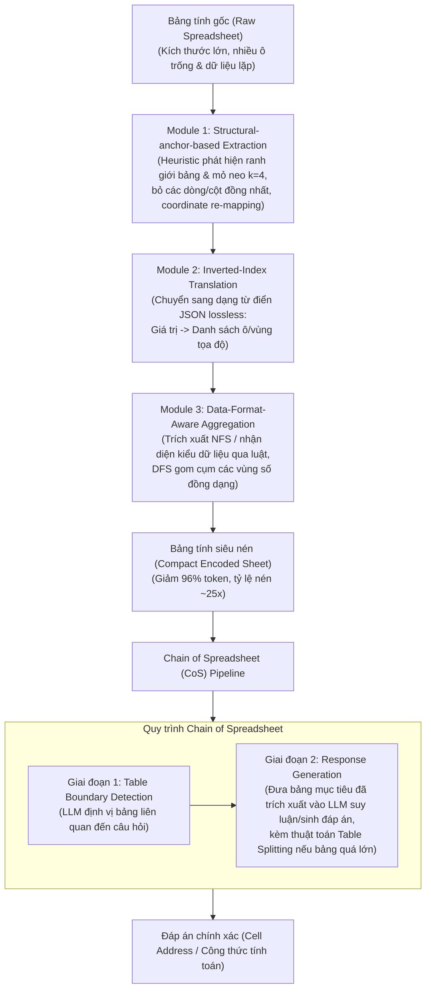

# SPREADSHEETLLM: Encoding Spreadsheets for Large Language Models

| Thông tin | Chi tiết |
|---|---|
| **Tác giả** | Haoyu Dong*†, Jianbo Zhao†‡, Yuzhang Tian†‡, Junyu Xiong†‡, Shiyu Xia‡, Mengyu Zhou, Yun Lin‡, José Cambronero, Yeye He, Shi Han, Dongmei Zhang (* Corresponding author: hadong@microsoft.com; † Đồng tác giả chính; ‡ Thực tập sinh tại Microsoft) |
| **Đơn vị** | Microsoft Corporation |
| **Năm / Venue** | 2024 / 2025 (arXiv:2407.09025v2 [cs.AI], 2 Apr 2025) |
| **Loại bài** | Phương pháp (Methodology / Framework) |
| **Chủ đề** | Spreadsheet Understanding, Spreadsheet Encoding, Prompt Compression, Table Detection, Multi-table QA |
| **File gốc** | [Encoding Spreadsheets for Large Language Models.pdf](../papers/Encoding%20Spreadsheets%20for%20Large%20Language%20Models.pdf) |

## 1. Tóm tắt nhanh (TL;DR)
SPREADSHEETLLM nghiên cứu cách biểu diễn và xử lý spreadsheet bằng LLM. Nhóm tác giả tại Microsoft đề xuất **SHEETCOMPRESSOR**, gồm trích xuất mỏ neo cấu trúc (structural anchors), dịch chỉ mục đảo (inverted-index translation) và gom cụm theo định dạng dữ liệu (data-format-aware aggregation). Trong các thiết lập được báo cáo, phương pháp giảm trung bình 25 lần số token. **Chain of Spreadsheet (CoS)** chia suy luận thành bước định vị bảng và bước trả lời; bài báo báo cáo F1 78,9% ở tác vụ phát hiện bảng và accuracy 74,3% ở Spreadsheet QA.

## 2. Bối cảnh & Vấn đề nghiên cứu
- **Tính phổ biến nhưng thách thức của bảng tính:** Bảng tính (Microsoft Excel, Google Sheets) là công cụ quản lý và phân tích dữ liệu phổ biến bậc nhất toàn cầu. Tuy nhiên, bảng tính khác biệt căn bản so với bảng quan hệ (relational tables): chúng trải dài trên lưới 2 chiều tự do, có thể chứa nhiều bảng con độc lập trên cùng một sheet, có cấu trúc phân tầng (hierarchical headers), các ô gộp (merged cells), ô trống và định dạng phức tạp.
- **Rào cản khi đưa bảng tính vào LLM:**
  1. *Bùng nổ token (Token Constraints):* Bảng tính kích thước vừa và lớn nhanh chóng làm tràn context window của LLM khi tuần tự hóa (serialize) từng dòng/cột. Hơn nữa, hiện tượng "Lost in the Middle" khiến độ chính xác của LLM suy giảm nghiêm trọng khi chuỗi văn bản đầu vào quá dài.
  2. *Bất đối xứng giữa cấu trúc 2D và văn bản tuần tự (1D):* LLM tiếp nhận đầu vào tuần tự, trong khi bảng tính mang cấu trúc không gian 2 chiều. Việc mất tọa độ ô (cell addresses) làm LLM không thể suy luận chính xác các quan hệ hàng-cột.
  3. *Hạn chế của các định dạng tuần tự hóa truyền thống:* Các cách mã hóa như HTML hay XML tiêu tốn lượng token khổng lồ cho các thẻ đóng/mở (`<td>`, `<tr>`). Định dạng Markdown tuy tiết kiệm token hơn nhưng lại thiếu tường minh về địa chỉ ô và không hỗ trợ biểu diễn ô gộp hay nhiều bảng rời rạc trên một sheet.
  4. *Nghịch lý thông tin định dạng:* Việc đưa chi tiết định dạng (màu nền, kiểu viền, font chữ) trực tiếp vào từng ô làm tăng token theo cấp số nhân và khiến LLM bị nhiễu loạn do chưa được huấn luyện chuyên sâu để hiểu các thẻ định dạng này.

## 3. Phương pháp / Nội dung chính

### 3.1 Khung mã hóa cơ sở (Vanilla Encoding)
Tác giả mở rộng định dạng Markdown để gắn kèm địa chỉ ô và thông tin định dạng:
$$S = \{\text{Cell}_{i,j}\}_{i \in m, j \in n}$$
$$T = \text{markdown}\{\text{encode}(\text{Cell}_{i,j})\} := \text{"|Address}_{i,j}\text{, Value}_{i,j}\text{, Format|... \backslash n"}$$

### 3.2 Khung nén SHEETCOMPRESSOR
SHEETCOMPRESSOR gồm 3 module có thể phối hợp linh hoạt:

1. **Module 1: Structural-anchor-based Extraction (Trích xuất dựa trên mỏ neo cấu trúc):**
   - *Nguyên lý:* Các bảng tính lớn thường chứa rất nhiều dòng/cột dữ liệu đồng nhất (homogeneous), ít đóng góp vào việc nhận diện bố cục. Nhóm tác giả dùng heuristic nhẹ (lightweight heuristics) phát hiện các dòng/cột bất đối xứng (chênh lệch văn bản, đường viền, ô gộp, màu nền) tại mép các bảng tiềm năng để làm "mỏ neo cấu trúc" (structural anchors).
   - *Cơ chế lọc láng giềng:* Giữ lại các dòng/cột nằm trong phạm vi khoảng cách $k$ (nghiên cứu chọn tối ưu $k=4$) tính từ mỏ neo nhằm bảo tồn tiêu đề (headers), ghi chú (notes) và ranh giới thực tế; loại bỏ hoàn toàn các hàng/cột đồng nhất ở xa.
   - *Tái lập tọa độ (Coordinate re-mapping):* Ánh xạ lại tọa độ liên tục trên khung xương (skeleton) đã nén để duy trì tính nhất quán khi LLM dự đoán.
   - *Hiệu quả:* Lọc bỏ 75% nội dung bảng tính nhưng bảo tồn hơn 97% ranh giới bảng thực tế, đạt tỷ lệ nén 4.41 lần.

2. **Module 2: Inverted-Index Translation (Dịch chỉ mục đảo - Lossless):**
   - *Nguyên lý:* Thay vì tuần tự hóa dạng lưới (row-by-row) vốn phải ghi lại hàng loạt ô trống và lặp lại các giá trị giống nhau, module chuyển đổi sang dạng từ điển chỉ mục đảo bằng định dạng JSON:
     $$T_t = \text{invert}(T) := \{\text{Value} : \text{Address or Address\_Region}, \dots\}$$
   - *Cơ chế gộp vùng:* Loại bỏ hoàn toàn ô trống; các ô có cùng giá trị văn bản được gộp thành dải tọa độ (ví dụ: `(Year|A1:A3)`).
   - *Hiệu quả:* Nén hoàn toàn không mất thông tin (lossless), nâng tỷ lệ nén kết hợp từ 4.41x lên 14.91x.

3. **Module 3: Data-Format-Aware Aggregation (Gom cụm theo định dạng dữ liệu số):**
   - *Nguyên lý:* Trong việc hiểu cấu trúc, giá trị số chính xác (ví dụ "18,476" hay "18,674") không quan trọng bằng kiểu định dạng và phân bố dữ liệu (cột doanh thu, ngày tháng, phần trăm).
   - *Cơ chế nhận diện:* Trích xuất chuỗi định dạng số (Number Format String - NFS, ví dụ `yyyy-mm-dd`, `#,##0`) thông qua thư viện OpenPyXL/ClosedXML. Nếu thiếu NFS, hệ thống áp dụng bộ nhận diện dựa trên luật để phân loại vào 10 kiểu định dạng phổ biến: *Year, Integer, Float, Percentage, Scientific notation, Date, Time, Currency, Email, Others* (chiếm ~55% ô trong tập dữ liệu thực tế).
   - *Thuật toán DFS gom cụm (Algorithm 1):* Gom các ô lân cận có chung kiểu định dạng thành các khối hình chữ nhật đại diện (ví dụ: `(FloatNum|C2:C38)`).
   - *Hiệu quả:* Nâng tổng tỷ lệ nén toàn framework lên 24.79x (~25 lần).

### 3.3 Chuỗi suy luận bảng tính (Chain of Spreadsheet - CoS)
Đối với các tác vụ hạ nguồn như Spreadsheet QA, CoS triển khai 2 giai đoạn:
1. **Định vị bảng mục tiêu (Table Identification & Boundary Detection):** Đầu vào gồm bảng tính siêu nén (qua SHEETCOMPRESSOR) và câu hỏi của người dùng. LLM xác định bảng liên quan nhất và trả về tọa độ ranh giới.
2. **Sinh phản hồi (Response Generation):** Trích xuất riêng bảng mục tiêu đó ở dạng đầy đủ (không nén mất mát thông tin số) đưa vào LLM để suy luận trả lời. Nếu bảng mục tiêu vẫn vượt quá giới hạn token, áp dụng thuật toán chia nhỏ bảng (**Table Splitting Algorithm - Algorithm 2**) giữ nguyên header và nối từng khối thân bảng.

## 4. Thực nghiệm & Kết quả chính

> **Cách đọc số liệu:** Các kết quả thuộc benchmark, split, metric và phiên bản mô hình của bài báo. “SOTA” chỉ áp dụng trong bối cảnh/thời điểm bài báo nêu; không so trực tiếp với PA của challenge.

### 4.1 Cấu hình thực nghiệm
- **Tác vụ 1: Phát hiện bảng tính (Spreadsheet Table Detection):**
  - *Dataset:* Benchmark chuẩn từ Dong et al. (2019b) được làm sạch và chuẩn hóa lại qua quy trình 5 chuyên gia gán nhãn, gồm 188 bảng tính (311 bảng dữ liệu thực tế), chia thành 4 nhóm kích cỡ token vanilla: Small (<4k), Medium (4-8k), Large (8-32k), Huge (>32k).
  - *Metric:* Micro F1 Score với chỉ số khắt khe **EoB-0 (Error-of-Boundary 0)** – yêu cầu trùng khớp tuyệt đối cả 4 biên trên, dưới, trái, phải.
  - *Baselines & Models:* TableSense-CNN; OpenAI GPT-4, GPT-3.5; các mô hình mã nguồn mở Llama-2-7b, Llama-3-8B, Mistral-v2-7B, Phi-3-mini-128k (huấn luyện LoRA phân tán trên 8 GPU A100).
- **Tác vụ 2: Hỏi đáp bảng tính (Spreadsheet QA):**
  - *Dataset mới:* 64 bảng tính đa bảng thực tế với 307 cặp (Câu hỏi, Đáp án tọa độ/công thức, Bảng tính), hệ số đồng thuận Fleiss Kappa đạt 0.846.
  - *Baselines:* TAPEX, Binder, GPT-4 chuẩn.

### 4.2 Kết quả định lượng nổi bật

#### Bảng 1: Kết quả tác vụ Spreadsheet Table Detection (Micro F1 Score - EoB-0)

| Nhóm mô hình | Cấu hình | Small | Medium | Large | Huge | Toàn bộ (All) |
|---|---|---|---|---|---|---|
| **Baseline CNN** | TableSense-CNN | 0.785 | 0.788 | 0.567 | 0.561 | 0.666 |
| **In-Context Learning (ICL)** | Mistral-v2 | 0.071 | 0.013 | 0.029 | 0.017 | 0.036 |
| | GPT-4 (Vanilla) | 0.318 | 0.292 | 0.090 | 0.000 | 0.154 |
| | **GPT-4-compress** | **0.480** | **0.454** | **0.373** | **0.330** | **0.410 (+25.6%)** |
| **Fine-tuned LLMs** | Llama-3-8B (Vanilla) | 0.715 | 0.765 | 0.290 | 0.000 | 0.471 |
| | **Llama-3-compress** | 0.825 | 0.768 | 0.664 | 0.617 | **0.719 (+24.8%)** |
| | Mistral-v2-7B (Vanilla) | 0.700 | 0.784 | 0.472 | 0.123 | 0.542 |
| | **Mistral-v2-compress** | 0.778 | 0.729 | 0.686 | 0.744 | **0.726 (+18.4%)** |
| | GPT-4 (Vanilla) | 0.779 | 0.707 | 0.288 | 0.000 | 0.520 |
| | **GPT-4-compress** | 0.810 | 0.832 | 0.718 | 0.690 | **0.759 (+23.9%)** |
| | **GPT-4-compress (w/o Aggregation)** | **0.864** | **0.816** | **0.739** | **0.753** | **0.789 (SOTA, +12.3% vs CNN)** |

*Nhận xét:*
- Trên các bảng tính siêu lớn (Huge), các mô hình LLM thông thường hoàn toàn thất bại (F1 = 0.000) do tràn context. Sau khi áp dụng SHEETCOMPRESSOR, GPT-4 đạt F1 0.690 và Mistral-v2 đạt 0.744.
- Bản GPT-4 fine-tune không dùng module Aggregation đạt F1 cao nhất 78.9% (do giữ lại giá trị số cụ thể giúp LLM phân biệt ranh giới chính xác hơn).

#### Bảng 2: Tỷ lệ nén và giảm số lượng token qua từng module

| Cấu hình Module | Tổng số Token (Test Set) | Tỷ lệ nén (Compression Ratio) |
|---|---|---|
| Gốc (No Modules - Vanilla) | 1,548,577 | 1.00x |
| Module 1 (Extraction) | 350,946 | 4.41x |
| Module 2 (Translation) | 580,912 | 2.67x |
| Module 3 (Aggregation) | 213,890 | 7.24x |
| Module 1 & 2 | 103,880 | 14.91x |
| Module 1 & 3 | 96,365 | 16.07x |
| **Đầy đủ: Module 1, 2 & 3** | **62,469** | **24.79x (~25x)** |

*Tiết kiệm chi phí:* Giảm **96.0% chi phí token API** trên cả GPT-3.5-turbo và GPT-4.

#### Bảng 3: Kết quả tác vụ Spreadsheet QA (Accuracy %)

| Mô hình / Phương pháp | Độ chính xác (Accuracy) |
|---|---|
| TAPEX (Liu et al., 2022) | 37.8% |
| Binder (Cheng et al., 2022) | 62.2% |
| GPT-4 (Vanilla trực tiếp) | 46.6% |
| GPT-4-compress (w/o splitting) | 65.1% |
| GPT-4-compress (w/o splitting, Fine-tuned) | 69.4% |
| GPT-4-compress (CoS đầy đủ, ICL) | 68.4% |
| **GPT-4-compress (CoS đầy đủ, Fine-tuned)** | **74.3% (SOTA)** |

### 4.3 Phân tích Ablation quan trọng
- **Vai trò của mỏ neo cấu trúc ($k$ threshold):** Khi khảo sát các giá trị $k \in \{2, 4, 8\}$, cấu hình $k=4$ đạt F1 tổng thể cao nhất (0.759). Nếu $k=2$, F1 giảm xuống 0.712 do mất ranh giới; nếu $k=8$, F1 giảm xuống 0.744 và làm giảm mạnh hiệu năng trên bảng tính Huge (từ 0.690 xuống 0.400) do số token tăng quá mức.
- **Loại bỏ Extraction:** F1 của GPT-4 giảm mạnh nhất từ 0.759 xuống 0.655 (trên tập Huge giảm từ 0.690 xuống 0.321), gợi ý đây là module then chốt để xử lý bảng lớn.
- **Loại bỏ Translation:** F1 giảm từ 0.759 xuống 0.743.

## 5. Tính mới (Novelty & Đóng góp)
- **Công trình đầu tiên khai phóng LLM cho bảng tính toàn diện:** Khác với các nghiên cứu trước chỉ xử lý bảng quan hệ đơn lẻ (single relational tables), SPREADSHEETLLM giải quyết trọn vẹn đặc thù của bảng tính lưới 2D, đa bảng, ô gộp và định dạng tự do.
- **Framework SHEETCOMPRESSOR:** Kết hợp trích xuất cấu trúc dựa trên mỏ neo, JSON inverted-index và trừu tượng hóa kiểu số NFS; tỷ lệ nén tối đa được báo cáo là 25x (giảm 96% token).
- **Chiến lược Chain of Spreadsheet (CoS):** Tách bạch bài toán suy luận phức tạp thành hai bước "Định vị vùng quan tâm $\rightarrow$ Trả lời chi tiết", giải quyết triệt để nguy cơ mất thông tin số trong quá trình nén.
- **Bộ benchmark chuẩn hóa và dataset Spreadsheet QA đa bảng:** Cung cấp tập dữ liệu đánh giá chất lượng cao có kiểm định giữa các chuyên gia cho cộng đồng nghiên cứu.

## 6. Hạn chế

### 6.1 Hạn chế do tác giả thừa nhận
- **Chưa tận dụng triệt để định dạng trực quan phong phú:** Do giới hạn token, hệ thống chưa đưa vào các thuộc tính màu sắc nền (fill color), đường viền (border styles), kiểu font chi tiết, dù đây là các tín hiệu ngữ cảnh trực quan rất giá trị để phân chia phân vùng bảng.
- **Thiếu nén ngữ nghĩa cho văn bản tự nhiên:** Module Aggregation hiện chỉ mới áp dụng cho các ô dữ liệu số; các ô chứa văn bản tự nhiên lặp lại mang tính nhóm (ví dụ: danh sách tên quốc gia "Vietnam, China, Japan") chưa được nén ngữ nghĩa trừu tượng thành nhãn nhóm "Country".

### 6.2 Nhận xét thêm của người review
- **Nguy cơ sai lệch của Heuristic mỏ neo trên bảng có layout dị thường:** Thuật toán phát hiện mỏ neo dựa trên các quy tắc chênh lệch định dạng và kiểm tra láng giềng $k=4$. Nếu một bảng tính có bố cục bất quy tắc, tiêu đề nhiều tầng trải dài trên 5 hàng, hoặc ranh giới không có viền/định dạng tương phản, heuristic có thể cắt xén nhầm hàng tiêu đề quan trọng.
- **Độ trễ và chi phí triển khai hệ thống 2 chặng (Two-stage Latency):** Pipeline CoS đòi hỏi 2 lần gọi LLM nối tiếp nhau (bước 1 định vị bảng, bước 2 trích xuất và trả lời câu hỏi). Mặc dù giảm token trên từng lượt, tổng độ trễ end-to-end cho ứng dụng tương tác thời gian thực sẽ tăng lên đáng kể.
- **Phụ thuộc vào công cụ bóc tách file nhị phân:** Việc trích xuất NFS phụ thuộc vào OpenPyXL hoặc ClosedXML. Trên thực tế, các file bảng tính bị lỗi cấu trúc ngầm hoặc được xuất từ hệ thống cũ (như CSV chuyển đổi hay Excel 97-2003) có thể không đọc được NFS chuẩn xác.

## 7. Ý nghĩa ứng dụng (cho hệ thống agent phân tích dữ liệu / Text-to-SQL)

> **Phân biệt nguồn:** Khuyến nghị trong mục này là suy luận ứng dụng cho DataMate; bài báo không đánh giá trực tiếp trên challenge, trừ khi nêu rõ.
- **Mã hóa bảng dạng Inverted-Index cho Agent Context:** Thay vì nhồi nhét hàng nghìn dòng dữ liệu tabular dạng Markdown làm tràn context, Data Agent nên chuyển đổi dữ liệu thành dạng từ điển đảo `{Giá trị: Dải ô}` để tiết kiệm tức thì 60-70% token mà hoàn toàn không mất mát dữ liệu.
- **Áp dụng mẫu "Locate First, Query Later" trong ChatBI đa bảng:** Khi người dùng tải lên một file Excel gồm nhiều sheet hoặc nhiều khối báo cáo rời rạc, agent cần dùng prompt định vị bảng (Table Detection) trước để khoanh vùng chính xác tọa độ khối dữ liệu, sau đó mới nạp schema/dữ liệu chi tiết vào module Text-to-SQL / Python REPL.
- **Tận dụng Number Format String (NFS) để tự động suy diễn kiểu dữ liệu:** Hệ thống có thể dùng NFS có sẵn trong metadata của Excel để nhận biết ngay lập tức các cột Ngày tháng, Tỷ lệ phần trăm, Tiền tệ mà không cần chạy mô hình phân loại tốn kém.

## 8. Từ khóa
`SpreadsheetLLM`, `SheetCompressor`, `Spreadsheet Understanding`, `Table Detection`, `Spreadsheet QA`, `Chain of Spreadsheet`, `Inverted-Index Translation`, `Structural Anchors`, `Number Format String`, `Token Compression`.

## 9. Mức độ phù hợp với challenge DataMate

**Phân nhóm: Cốt lõi.** Hữu ích cho biểu diễn workbook lớn; kỹ thuật nén không tự giải quyết quy tắc nghiệp vụ, tính toán và format trả lời.

## 10. Nguồn và truy nguyên kết quả

- **PDF gốc:** liên kết ở bảng thông tin đầu review và bản lưu trong thư mục `../papers/`.
- **Vị trí kiểm chứng:** Method §§2–3, pp. 2–6; results §5, pp. 7–9; limitations pp. 10, 14.
- Số liệu ở mục 4 là kết quả tác giả trên benchmark gốc; phần áp dụng DataMate tại mục 7 và mục 9 là nhận định của review.
