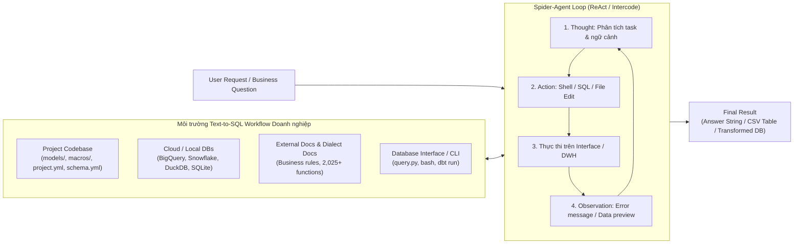

# Spider 2.0: Evaluating Language Models on Real-World Enterprise Text-to-SQL Workflows

| Thông tin | Chi tiết |
|---|---|
| **Tác giả** | Fangyu Lei, Jixuan Chen, Yuxiao Ye, Ruisheng Cao, Dongchan Shin, Hongjin Su, Zhaoqing Suo, Hongcheng Gao, Wenjing Hu, Pengcheng Yin, Victor Zhong, Caiming Xiong, Ruoxi Sun, Qian Liu, Sida I. Wang, Tao Yu |
| **Đơn vị** | The University of Hong Kong; Salesforce Research; Sea AI Lab; Google DeepMind; Google Cloud AI Research; University of Waterloo |
| **Năm / Venue** | ICLR 2025 (Conference paper); arXiv:2411.07763v2 (17/03/2025; bản v1 11/2024) |
| **Loại bài** | Benchmark & Khung đánh giá Agentic Workflow doanh nghiệp |
| **Chủ đề** | Enterprise Text-to-SQL Workflows, Data Engineering, DBT Projects, Cloud Data Warehouses (BigQuery, Snowflake), SQL Dialects, Code Agents |
| **File gốc** | [Evaluating Language Models on Real-World Enterprise Text-to-SQL Workflows .pdf](../papers/Evaluating%20Language%20Models%20on%20Real-World%20Enterprise%20Text-to-SQL%20Workflows%20.pdf) |

## 1. Tóm tắt nhanh (TL;DR)
Bài báo giới thiệu **Spider 2.0**, một mở rộng đáng kể so với các benchmark Text-to-SQL truyền thống, chuyển dịch từ bài toán dịch câu lệnh đơn lẻ tĩnh (seq2seq) sang đánh giá các quy trình kỹ nghệ dữ liệu thực tế (real-world enterprise data workflows). Benchmark bao gồm 632 tác vụ phức tạp (data wrangling, transformation, analytics) trên các hệ cơ sở dữ liệu doanh nghiệp thực (BigQuery, Snowflake, SQLite, DuckDB, Postgres, ClickHouse) với schema trung bình trên 800 cột và khối lượng dữ liệu quy mô Terabyte. Đặc biệt, Spider 2.0 đặt LLM vào vai trò Code Agent tương tác với kho mã dự án (codebase), tài liệu nghiệp vụ, mô hình dữ liệu DBT (Data Build Tool), và tài liệu phương ngữ SQL (dialect docs). Kết quả thực nghiệm cho thấy mô hình suy luận tiên tiến nhất là **OpenAI o1-preview** kết hợp framework Spider-Agent chỉ đạt tỷ lệ thành công **21.36%** (so với >91% trên Spider 1.0 và 73% trên BIRD), còn các phương pháp Text-to-SQL truyền thống trên bản Spider 2.0-lite chỉ đạt tối đa **5.68%** Execution Accuracy, cho thấy khoảng cách khổng lồ giữa nghiên cứu học thuật và môi trường sản xuất thực tế.

## 2. Bối cảnh & Vấn đề nghiên cứu
- **Sự bão hòa giả tạo trên các benchmark cũ:** Các mô hình Text-to-SQL dựa trên LLM (như GPT-4, DIN-SQL, DAIL-SQL) đã đạt điểm số rất cao trên Spider 1.0 (91.2%) và BIRD (73.0%), tạo cảm giác bài toán Text-to-SQL gần như đã được giải quyết.
- **Thực tế kỹ nghệ dữ liệu doanh nghiệp hoàn toàn khác biệt:**
  1. *Hệ thống phân tán và đa phương ngữ (SQL Dialects):* Dữ liệu doanh nghiệp nằm trên các Cloud Data Warehouse hiện đại (Google BigQuery, Snowflake) hoặc database phân tích nhúng (DuckDB, ClickHouse). Mỗi hệ thống sở hữu hàng trăm hàm đặc thù (khoảng cách địa lý `ST_DISTANCE`, thời gian `DATE_TRUNC`, xử lý mảng/JSON `UNNEST`, `FLATTEN`) mà các tập dữ liệu SQLite cũ không có.
  2. *Schema khổng lồ và cấu trúc lồng nhau (Massive & Nested Schemas):* Schema doanh nghiệp thường có hàng trăm đến hàng nghìn cột (trung bình 812 cột trong Spider 2.0), chứa các kiểu dữ liệu phức tạp như `STRUCT`, `RECORD`, `ARRAY`, các bảng phân vùng theo ngày (wildcard tables như `events_*`), và nhiều schema liên kết phức tạp.
  3. *Quy trình biến đổi dữ liệu theo dự án (Project-level Workflows with DBT):* Trong doanh nghiệp, dữ liệu không được phân tích trực tiếp từ bảng thô mà phải trải qua pipeline biến đổi (ETL/ELT). Các kỹ sư sử dụng công cụ như **DBT (Data Build Tool)** để định nghĩa các mô hình dữ liệu qua file DAG, cấu hình `.yml`, và macro Jinja/SQL lồng nhau.
  4. *Yêu cầu tương tác Agentic thay vì sinh code 1 lần:* Người làm dữ liệu phải đọc tài liệu hướng dẫn, tra cứu DDL, viết thử truy vấn, kiểm tra lỗi thực thi (execution feedback), và sửa mã lặp đi lặp lại.

## 3. Phương pháp / Nội dung chính

### 3.1 Ba cấu hình benchmark
1. **Spider 2.0 (Toàn diện - Code Agent Setting):** 632 bài toán dạng agentic workflow. Cung cấp câu hỏi tự nhiên, kho mã dự án (chứa tài liệu `.md`, mô tả data model trong `.yml`), và interface dòng lệnh tương tác với database. Agent có thể chạy lệnh bash, chỉnh sửa file mã nguồn, chạy truy vấn, và thực thi `dbt run`. Kết quả đầu ra là câu trả lời văn bản, bảng kết quả CSV, hoặc trạng thái cơ sở dữ liệu sau khi biến đổi. Đánh giá bằng **Success Rate (SR)**.
2. **Spider 2.0-lite (Text-to-SQL Setting chuẩn hóa):** 547 bài toán trích xuất từ Spider 2.0 nhưng đóng gói thành dạng tự chứa (self-contained prompt) bao gồm schema đã tiền xử lý, sample cell values, và tài liệu phương ngữ. Mô hình chỉ cần xuất ra câu lệnh SQL đơn lẻ. Phục vụ việc so sánh công bằng với các phương pháp Text-to-SQL truyền thống qua metric **Execution Accuracy (EX)**.
3. **Spider 2.0-snow (Snowflake Dialect Focus):** 547 bài toán được lưu trữ toàn bộ trên Snowflake để đánh giá chuyên sâu năng lực thích ứng với một phương ngữ DWH duy nhất.

### 3.2 Quy trình xây dựng dữ liệu 6 bước
- **Bước 1 - Thu thập DB và SQL thực tế:** Lấy dữ liệu từ Google Analytics 4, Salesforce, New York City Open Data, Google Patents, v.v. Lọc các DB có trên 200 cột hoặc schema lồng nhau. Thu thập 1,021 câu SQL thực tế và 157 dự án DBT từ Fivetran/DBT.
- **Bước 2 - Viết lại SQL (SQL Rewrite) chống rò rỉ dữ liệu:**
  - *Surface rewrite (84.2%):* Thay đổi tham số điều kiện, định dạng câu trả lời, công thức tính toán.
  - *Semantic rewrite (42.0%):* Mở rộng yêu cầu bài toán, gộp các câu SQL rời rạc (ví dụ: gộp truy vấn khoảng cách trạm thời tiết gần nhất với thống kê chuyến xe đạp vào ngày mưa).
- **Bước 3 - Thiết lập Codebase và Ngữ cảnh:** Cung cấp tài liệu hàm phương ngữ (cào từ trang chủ BigQuery, Snowflake, DuckDB... gồm 2,025 hàm), tài liệu phân loại kinh doanh (như luật phân loại URL trang PLP/PDP).
- **Bước 4 - Soạn thảo chỉ dẫn ngôn ngữ tự nhiên:** Bản Spider 2.0 hướng đến sự tự nhiên (naturalness) vì có file cấu hình định hướng, trong khi Spider 2.0-lite hướng đến sự rõ ràng, không nhập nhằng (unambiguity).
- **Bước 5 - Đánh giá tập trung dựa trên thực thi (Execution-based Focused Evaluation):** Kiểm tra xem các cột trọng tâm trong kết quả chuẩn có xuất hiện trong bảng dự đoán của mô hình hay không, bỏ qua các cột phụ không được yêu cầu rõ ràng, giúp triệt tiêu false negatives.
- **Bước 6 - Kiểm soát chất lượng (Quality Control & Red Teaming):** Mỗi mẫu được duyệt lặp bởi ít nhất 3 chuyên gia; thực hiện red-teaming bằng các kết quả cố tình làm sai để kiểm tra độ tin cậy của script đánh giá.

### 3.3 Khung tác tử Spider-Agent
Dựa trên kiến trúc ReAct và Intercode, Spider-Agent cung cấp không gian hành động chuyên biệt cho kỹ sư dữ liệu:
- `Bash`: Chạy lệnh shell (kiểm tra file, chạy script, gọi `dbt run`).
- `CreateFile` / `EditFile`: Tạo mới hoặc sửa đổi file SQL, cấu hình YAML.
- `BIGQUERY_EXEC_SQL` / `LOCAL_DB_SQL`: Thực thi truy vấn và lưu kết quả ra file.
- `GET_TABLES` / `GET_TABLE_INFO` / `SAMPLE_ROWS`: Khám phá DDL, danh sách cột và dữ liệu mẫu của bảng trong dataset.
- `Terminate` / `FAIL`: Kết thúc hoặc báo tác vụ bất khả thi.

## 4. Thực nghiệm & Kết quả chính

> **Cách đọc số liệu:** Các kết quả thuộc benchmark, split, metric và phiên bản mô hình của bài báo. “SOTA” chỉ áp dụng trong bối cảnh/thời điểm bài báo nêu; không so trực tiếp với PA của challenge.

### 4.1 Kết quả trên Spider 2.0 (Agentic Setting - Table 6)

| Framework | Mô hình nền | Success Rate (SR) |
|---|---|---|
| AutoEval | GPT-4o | 5.70% |
| Reflexion | GPT-4o | 7.28% |
| CodeR | GPT-4o | 7.91% |
| Spider-Agent | Llama-3.1-405B | 2.21% |
| Spider-Agent | Gemini-Pro-1.5 | 2.53% |
| Spider-Agent | DeepSeek-V2.5 | 5.22% |
| Spider-Agent | Qwen2.5-72B | 6.17% |
| Spider-Agent | GPT-4 | 9.86% |
| Spider-Agent | GPT-4o | 12.34% |
| Spider-Agent | Claude-3.5-Sonnet | 14.87% |
| **Spider-Agent** | **OpenAI o1-preview** | **21.36%** |

### 4.2 Kết quả trên Spider 2.0-lite và Spider 2.0-snow (Table 4 & Table 5)

| Phương pháp / Mô hình | Spider 1.0 (EX) | BIRD (EX) | Spider 2.0-lite (EX Overall) | Spider 2.0-snow (EX Overall) |
|---|---|---|---|---|
| **SFT CodeS-15B** | 85.4% | 59.3% | **0.73%** | 0.00% |
| **DIN-SQL + GPT-4o** | 85.3% | 55.9% | **1.46%** | 0.00% |
| **CHESS + GPT-4o** | 87.2% | 66.7% | **3.84%** | 1.28% |
| **DAIL-SQL + GPT-4o** | 86.6% | 57.4% | **5.68%** | 2.20% |
| *Spider-Agent + DeepSeek-V3* | – | – | 8.78% | 8.78% |
| *Spider-Agent + GPT-4o* | – | – | 13.16% | 12.98% |
| *Spider-Agent + Claude-3.5-Sonnet* | – | – | 15.54% | 15.54% |
| *Spider-Agent + o3-mini* | – | – | 23.40% | 19.20% |
| ***Spider-Agent + o1-preview*** | – | – | **23.22%** | **23.77%** |

*Nhận xét:* CodeS-15B đạt 0,73% trên Spider 2.0-lite trong thiết lập được báo cáo. Kết quả này gợi ý benchmark workflow doanh nghiệp có thể khác đáng kể với các benchmark Text-to-SQL dùng khi huấn luyện.

### 4.3 Phân tích hiệu năng theo đặc tính bài toán
- **Schema lồng nhau (Nested Schema - Tab. 7):** Trên các bảng có cột dạng array/struct (như BigQuery GA4), tỷ lệ thành công của mô hình tụt từ 27.38% xuống chỉ còn **10.34%**.
- **Tài liệu nghiệp vụ ngoài (External Documents - Tab. 8):** Khi bài toán bắt buộc phải đọc tài liệu kinh doanh để lấy luật phân loại (như quy tắc URL), tỷ lệ thành công giảm từ 26.64% xuống **11.54%**. Mô hình thường đọc được tài liệu nhưng thất bại khi chuyển hóa các điều kiện phức tạp (regex, string split) thành câu SQL.
- **Tác vụ dự án DBT (DBT Project - Tab. 9):** Mô hình chỉ giải được **12.82%** (10/78 bài), do gặp khó khăn trong việc định vị file trong repository, đồng bộ schema YAML với mã SQL, và kiểm tra tính toàn vẹn sau lệnh `dbt run`.
- **Phương ngữ CSDL (Database Types - Tab. 20):** Snowflake là hệ thống khó nhất (chỉ đạt 7.14% SR), trong khi BigQuery đạt 24.07% và SQLite đạt 20.74%. Khi thử nghiệm 180 bài toán giống hệt nhau trên cả 2 nền tảng, BigQuery đạt 12.78% trong khi Snowflake chỉ đạt 6.6%, phản ánh sự khác biệt tinh vi trong cú pháp hàm giữa các phương ngữ.

### 4.4 Phân tích lỗi (Error Analysis trên 300 mẫu của Spider-Agent)
1. **Erroneous Data Analysis (35.5%):**
   - *Intricate Query Planning (17.7%):* Thất bại trong việc lập kế hoạch truy vấn nhiều tầng CTEs, gộp kết quả bằng set operations, hoặc tính toán tỷ lệ giữ chân người dùng (retention cohorts).
   - *Dialect Function Usage (10.3%):* Dùng sai hàm địa lý (`ST_DISTANCE`), hàm thời gian (`DATE_TRUNC`, `PARSE_DATE`).
   - *Advanced Data Calculation (7.5%):* Tính sai phân vị (`NTILE`), hàm cửa sổ (`LAG`/`LEAD`), hệ số tương quan (`CORR`).
2. **Wrong Schema Linking (27.6%):** Chọn sai cột (16.6%) do database có quá nhiều cột tương đồng (>755 cột); chọn sai bảng hoặc không biết dùng wildcard table suffix trong BigQuery (10.1%).
3. **JOIN Errors (8.3%):** BigQuery thường không khai báo khóa ngoại (foreign key) tường minh trong metadata, buộc mô hình phải tự đoán quan hệ dẫn đến nối sai bảng.
4. **Misunderstanding External Knowledge (8.0%):** Hiểu sai tài liệu mô tả nghiệp vụ.
5. **Syntax Errors (3.0%):** Lỗi cú pháp SQL thuần túy.

### 4.5 Chi phí thực nghiệm (Table 21)
- Chi phí API trung bình cho mỗi bài toán: Spider-Agent + o1-preview tốn **$0.75**, GPT-4-Turbo tốn $0.58, GPT-4o tốn $0.32. Các phương pháp zero-shot như DAIL-SQL tốn $0.09/mẫu.

## 5. Tính mới (Novelty & Đóng góp)
- **Tái định nghĩa bài toán Text-to-SQL:** Đưa nghiên cứu vượt ra khỏi khuôn khổ dịch câu lệnh đơn thuần để tiến vào kỷ nguyên **Autonomous Data Engineering Agent** – tác tử có khả năng tương tác với repository, tài liệu nghiệp vụ, và công cụ chuyển đổi dữ liệu chuẩn công nghiệp (DBT).
- **Môi trường Cloud Data Warehouse quy mô Terabyte:** Lần đầu tiên đưa các kho dữ liệu lớn hàng đầu thế giới (Google BigQuery, Snowflake) với schema khổng lồ (>800 cột) và hàng nghìn hàm dialect vào benchmark chuẩn tắc.
- **Phương pháp đánh giá Focused Evaluation:** Giải quyết triệt để bài toán đánh giá kết quả bảng trong môi trường doanh nghiệp mà không làm sai lệch kết quả do trả thừa các cột thông tin không quan trọng.
- **Phát hiện nút thắt công nghệ:** Chứng minh các kỹ thuật in-context learning và mô hình SFT chuyên Text-to-SQL hiện nay gần như vô hiệu trên các bài toán doanh nghiệp thực, mở ra lộ trình phát triển mới cho các hệ thống Agentic Data Intelligence.

## 6. Hạn chế

### 6.1 Hạn chế do tác giả thừa nhận
- **Chi phí API và rào cản truy cập Cloud:** Chạy truy vấn trên BigQuery/Snowflake với dữ liệu quy mô Terabyte tiêu tốn chi phí điện toán đám mây đáng kể, gây khó khăn cho việc đánh giá hàng loạt nếu không có tài trợ credit.
- **Bỏ qua Value Linking quy mô lớn:** Do chi phí quét toàn bộ bảng dữ liệu hàng tỷ dòng trên cloud là quá lớn, benchmark chưa hỗ trợ module entity retrieval/value linking tự động như trên SQLite.
- **Không có tập Train cho Spider 2.0-lite:** Bộ dữ liệu chỉ tập trung vào đánh giá (evaluation benchmark), các mô hình mã nguồn mở không có tập huấn luyện tương ứng cùng phân phối để fine-tune.

### 6.2 Nhận xét thêm của người review
- **Tính khả thi của việc tái lập thực nghiệm (Reproducibility):** Dữ liệu công cộng trên BigQuery và Snowflake Marketplace có thể thay đổi hoặc cập nhật theo thời gian (dynamic tables), đòi hỏi ban tổ chức phải duy trì snapshot cố định để tránh kết quả thực nghiệm bị trôi dạt (data drift).
- **Rủi ro môi trường thực thi dòng lệnh (Sandboxing):** Việc cho phép Agent chạy lệnh shell tùy ý (`Bash`, chỉnh sửa file) trong môi trường dự án doanh nghiệp tiềm ẩn rủi ro bảo mật và tài nguyên nếu không được bọc trong các container cô lập nghiêm ngặt.
- **Độ phức tạp vượt trước năng lực mô hình:** Tỷ lệ giải quyết cao nhất hiện chỉ đạt ~21–23% (với các mô hình o1/o3 đắt đỏ nhất). Điều này biến Spider 2.0 thành một benchmark "cực khó" (tương tự SWE-bench trong software engineering), nơi phần lớn các mô hình nguồn mở hiện nay bị kẹt ở mức điểm sàn (<6–8%).
- **Chưa có cơ chế Human-in-the-loop:** Trong thực tế doanh nghiệp, khi gặp tài liệu nhập nhằng hoặc schema không có foreign key, kỹ sư dữ liệu sẽ trao đổi với product owner hoặc DBA; Spider 2.0 hiện tại hoàn toàn tự động (autonomous) nên agent dễ bị lạc lối trong không gian tìm kiếm.

## 7. Ý nghĩa ứng dụng (cho hệ thống agent phân tích dữ liệu / Text-to-SQL)

> **Phân biệt nguồn:** Khuyến nghị trong mục này là suy luận ứng dụng cho DataMate; bài báo không đánh giá trực tiếp trên challenge, trừ khi nêu rõ.
- **Chuyển dịch kiến trúc từ Single-prompt sang Interactive Code Agent:** Hệ thống phân tích dữ liệu doanh nghiệp bắt buộc phải có vòng lặp quan sát – hành động (ReAct Loop) với khả năng thực thi SQL thử nghiệm, đọc log lỗi từ database, và tự sửa mã (self-debugging).
- **Tích hợp RAG cho Phương ngữ và Tài liệu nghiệp vụ:** Không thể nhét toàn bộ DDL hàng nghìn cột và tài liệu dialect vào prompt. Cần xây dựng module tìm kiếm ngữ nghĩa chuyên dụng (Hybrid Search: Schema Pruning + Dialect Documentation Retriever) để chỉ cung cấp đúng thông tin hàm và bảng cần thiết.
- **Hỗ trợ công cụ Data Engineering tiêu chuẩn (DBT / Jinja):** Thay vì sinh ra một câu SQL monolithic dài hàng trăm dòng, agent cần được huấn luyện để phân rã bài toán thành các Data Model trung gian (CTEs hoặc bảng staging) tương thích với quy chuẩn DBT.
- **Module suy luận quan hệ bảng ẩn:** Do các DWH lớn thường bỏ qua ràng buộc foreign key để tối ưu tốc độ ghi, agent cần có khả năng suy luận các cặp khóa nối (JOIN keys) dựa trên phân tích tên cột và dữ liệu mẫu.

## 8. Từ khóa
`Spider 2.0`, `Enterprise Text-to-SQL`, `Data Engineering Workflows`, `Code Agents`, `DBT (Data Build Tool)`, `Google BigQuery`, `Snowflake`, `SQL Dialects`, `Nested Schemas`, `ReAct`, `OpenAI o1-preview`

## 9. Mức độ phù hợp với challenge DataMate

**Phân nhóm: Cốt lõi.** Nhấn mạnh tổng quát hóa schema/workflow; DBT/cloud của Spider 2.0 lớn hơn đáng kể và khác package dữ liệu challenge.

## 10. Nguồn và truy nguyên kết quả

- **PDF gốc:** liên kết ở bảng thông tin đầu review và bản lưu trong thư mục `../papers/`.
- **Vị trí kiểm chứng:** Benchmark §2, pp. 3–5; setup/results §3, pp. 6–9; conclusion §6, p. 10.
- Số liệu ở mục 4 là kết quả tác giả trên benchmark gốc; phần áp dụng DataMate tại mục 7 và mục 9 là nhận định của review.
