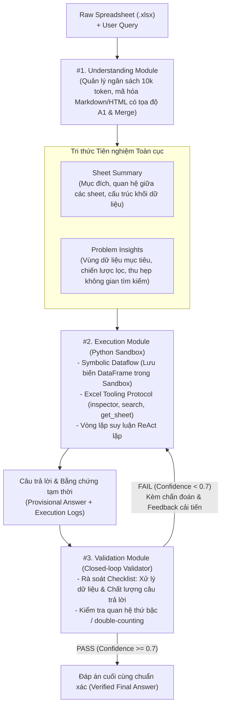

# SheetBrain: A Neuro-Symbolic Agent for Accurate Reasoning over Complex and Large Spreadsheets

| Thông tin | Chi tiết |
|---|---|
| **Tác giả** | Ziwei Wang1*†, Jiayuan Su2*†, Mengyu Zhou5‡, Huaxing Zeng3*, Mengni Jia4*, Xiao Lv5, Haoyu Dong5, Xiaojun Ma5, Shi Han5, Dongmei Zhang5 (*Thực tập sinh tại Microsoft; †Đồng tác giả chính; ‡Corresponding author: mezho@microsoft.com) |
| **Đơn vị** | 1Carnegie Mellon University; 2Zhejiang University; 3Brown University; 4University of Cambridge; 5Microsoft Research |
| **Năm / Venue** | 2025 (arXiv:2510.19247v1 [cs.CL], 22 Oct 2025) |
| **Loại bài** | Phương pháp, Hệ thống Agent & Benchmark (Methodology, System Agent & Benchmark Paper) |
| **Chủ đề** | Spreadsheet Agent, Neuro-Symbolic Reasoning, Table QA & Manipulation, Code Sandbox, Symbolic Dataflow, Self-Correction Validator, SheetBench |
| **File gốc** | [SheetBrain.pdf](../papers/SheetBrain.pdf) |

## 1. Tóm tắt nhanh (TL;DR)
SheetBrain là agent neuro-symbolic do Microsoft Research và các cộng tác viên nghiên cứu, thiết kế cho QA và thao tác trên spreadsheet lớn, đa bảng và có cấu trúc phức tạp. Hệ thống thực hiện ba bước **Hiểu (Understand) → Thực thi (Execute) → Thẩm định (Validate)**, dùng Symbolic Dataflow và công cụ Excel trong môi trường Python. Trên SheetBench (69 tác vụ), tác giả báo cáo 55 tác vụ đúng; các baseline được nêu trong bài đạt 47/69 (BizChat Analyst), 30/69 (ChatGPT-4o) và 35/69 (SheetAgent). Đây là kết quả của benchmark và cấu hình cụ thể trong bài.

## 2. Bối cảnh & Vấn đề nghiên cứu
- **Độ phức tạp vượt ngưỡng của bảng tính thực tế:** Bảng tính Excel trong doanh nghiệp không phải là các bảng quan hệ đơn giản (flat tables). Chúng thường có bố cục đa bảng (multi-table layouts), tiêu đề phân cấp nhiều tầng (hierarchical headers), các ô gộp (merged cells), khối dữ liệu phân nhóm theo người dùng/phòng ban, và quy mô khổng lồ lên tới hàng trăm nghìn dòng.
- **Ba điểm nghẽn chí tử của các LLM và Agent hiện nay:**
  1. *Suy luận mù quáng (Blind and Inefficient Reasoning):* Các agent hiện tại (như ChatGPT Advanced Data Analysis) thường chỉ xem lướt 5 dòng đầu qua hàm `df.head()`. Khi gặp bảng tính không có dòng tiêu đề chuẩn ở hàng 1 hoặc có nhiều khối dữ liệu rời rạc, cách xem này dẫn tới việc hiểu sai hoàn toàn cấu trúc bảng ngay từ bước đầu.
  2. *Nút thắt luồng dữ liệu thần kinh (Neural Dataflow Bottleneck):* Các agent gọi công cụ truyền thống (dạng JSON tool calling) thường nạp kết quả trích xuất thô (hàng nghìn dòng text) ngược lại vào context của LLM. Điều này không chỉ gây tràn token và tăng chi phí mà còn khiến LLM bị quá tải và thực hiện các phép đếm/tính toán số học sai lệch.
  3. *Sa lầy vào chi tiết cục bộ và thiếu cơ chế phản tư (Local Fixation & Lack of Reflection):* Trong quá trình sinh mã nhiều bước, agent rất dễ bị cuốn vào các giá trị trả về tức thời của từng dòng code con mà quên mất bức tranh tổng thể. Một ví dụ điển hình là **lỗi đếm trùng do cấu trúc thứ bậc (hierarchical double-counting)**: agent cộng cả hàng danh mục cha lẫn các hàng con chi tiết (chứa nhãn "of which"), dẫn đến kết quả sai lệch nghiêm trọng mà không hề hay biết.

## 3. Phương pháp / Kiến trúc SheetBrain

### 3.1 Pipeline 3 giai đoạn: Understand - Execute - Validate
SheetBrain kết hợp sức mạnh nhận dạng mẫu toàn cảnh của mạng nơ-ron (LLM) với độ chính xác tuyệt đối của tính toán biểu tượng (Python interpreter) qua quy trình 3 giai đoạn:

### 3.2 Chi tiết các Module cốt lõi

1. **Module 1: Understanding Module (Hiểu toàn cục & Tri thức tiên nghiệm):**
   - *Quản lý ngân sách Token động (Dynamic Token Budget):* Thiết lập trần ngân sách xem trước (mặc định 10.000 tokens) cho mỗi sheet để bao quát cấu trúc mà không làm tràn context.
   - *Tuần tự hóa nâng cao:* Sử dụng định dạng HTML hoặc Markdown tích hợp tọa độ ô A1 và thẻ định danh ô gộp (ví dụ: `B6: Time period [MERGED 1x3]`), bảo tồn không gian 2D cho LLM quan sát như mắt người.
   - *Đầu ra hai tầng:*
     - `Sheet Summary`: Phân tích tổng thể sổ tính, nhận diện các quy luật cấu trúc đặc thù (ví dụ: phát hiện "mỗi người dùng chiếm một khối dữ liệu nhiều hàng" để hướng dẫn agent duyệt theo khối thay vì duyệt từng hàng).
     - `Problem-Specific Insights`: Phân tích trực tiếp câu hỏi người dùng để định vị vùng dữ liệu cần quét và đề xuất chiến lược thu hẹp không gian tìm kiếm (ví dụ: "Lọc người dùng có số phiên chat > 11").

2. **Module 2: Execution Module (Thực thi Neuro-Symbolic & Symbolic Dataflow):**
   - *Kiến trúc Symbolic Dataflow:* Thay vì nhồi dữ liệu thô vào context của LLM (Neural Dataflow), toàn bộ sheet được tải và lưu dưới dạng biến định danh trong Python Sandbox (như biến `df` của Pandas). LLM chỉ sinh các dòng code thao tác trực tiếp trên biến này. Điều này giúp hệ thống xử lý các bảng khổng lồ hàng trăm nghìn dòng một cách nhẹ nhàng với độ chính xác số học tuyệt đối.
   - *Giao thức công cụ chuyên biệt cho Excel (Excel-Specific Tooling Protocol):*
     - `inspector(range_ref, sheet_name)`: Trích xuất ma trận giá trị hiển thị trong một dải ô cụ thể.
     - `inspector_attribute(range_ref, attributes, sheet_name)`: Lấy các thuộc tính thị giác và kỹ thuật (màu nền ô `fill_color`, kiểu font, công thức tính toán `formula`).
     - `search(value, sheet_name, case_sensitive, search_type)`: Tìm kiếm chuỗi có khả năng dung lỗi khoảng trắng và khớp mờ.
     - `get_sheet_as_dataframe(sheet_name, header_row, max_rows)`: Đọc an toàn bảng tính thành Pandas DataFrame với tham số xác định dòng header linh hoạt.
   - *Vòng lặp ReAct lặp lại:* Agent luân phiên giữa suy luận mức cao, sinh mã, thực thi trong sandbox, và nhận kết quả/lỗi từ console để tự điều chỉnh chiến lược qua nhiều lượt.

3. **Module 3: Validation Module (Thẩm định phản tư & Tự sửa lỗi Closed-loop):**
   - Đóng vai trò như một chuyên viên kiểm toán độc lập trước khi xuất kết quả cho người dùng.
   - Nhận đầu vào đa chiều: Bảng tính preview, câu hỏi gốc, nhật ký code execution logs, chuỗi suy luận và đáp án tạm thời.
   - Đánh giá theo Checklist kiểm định khắt khe: (1) Tính chính xác của phép biến đổi dữ liệu; (2) Độ đầy đủ và đúng định dạng; (3) Kiểm tra lỗi phân tầng (đặc biệt là lọc bỏ các hàng con "of which" để tránh đếm trùng).
   - Xuất ra: Trạng thái `PASSED` / `FAILED`, điểm số tự tin `CONFIDENCE_SCORE` (0.0 - 1.0) và phản hồi cải tiến chi tiết (`IMPROVEMENT_FEEDBACK`). Khi phát hiện lỗi, module này gửi yêu cầu thực thi lại kèm chỉ dẫn cụ thể cho Module 2, tạo thành vòng lặp tự sửa lỗi khép kín.

### 3.3 Bộ benchmark mới: SheetBench
Nhóm tác giả xây dựng **SheetBench** nhằm khắc phục sự thiếu hụt các ca thử nghiệm phức tạp thực tế:
- Tuyển chọn khắt khe **69 ca thử nghiệm cực khó** từ 11 bộ dữ liệu học thuật và công nghiệp nổi tiếng: *HiTab, MiMoTable, RealHiTBench, MultiHiertt, DABStep, SheetCopilot, SpreadsheetBench, SheetAgent, NCSE, MMQA, CodaBench*.
- Đã được chuyên gia rà soát và hiệu chỉnh các câu hỏi mơ hồ, lỗi dữ liệu gốc để đảm bảo ground-truth chuẩn xác.
- Chia thành 4 phân loại thách thức:
  1. **Complex Tables (21 cases):** Bảng có cấu trúc phân tầng sâu, nhiều tầng tiêu đề lồng nhau, ô gộp phức tạp.
  2. **Multi-table Layouts (20 cases):** Nhiều bảng dữ liệu độc lập nằm rải rác trên cùng một worksheet.
  3. **Large Sheets (20 cases):** Bảng tính quy mô lớn, vượt xa context window thông thường.
  4. **Editing Operations (8 cases):** Tác vụ thao tác chỉnh sửa dữ liệu, viết lại cấu trúc và lan truyền công thức.

## 4. Thực nghiệm & Kết quả chính

> **Cách đọc số liệu:** Các kết quả thuộc benchmark, split, metric và phiên bản mô hình của bài báo. “SOTA” chỉ áp dụng trong bối cảnh/thời điểm bài báo nêu; không so trực tiếp với PA của challenge.

### 4.1 Đánh giá trên bộ benchmark SheetBench

| Nhóm mô hình | Mô hình / Agent | Complex (21) | Multi-table (20) | Large Sheet (20) | Edit (8) | **Tổng điểm (69)** | Tỷ lệ thành công (%) |
|---|---|:---:|:---:|:---:|:---:|:---:|:---:|
| **Vanilla LLMs** | GPT-4.1 | 16 | 17 | 1 | – | 34 | 49.3% |
| | OpenAI o3 | 19 | 15 | 4 | – | 38 | 55.1% |
| | OpenAI o4-mini | 16 | 16 | 3 | – | 35 | 50.7% |
| | OpenAI o3-mini | 16 | 17 | 4 | – | 37 | 53.6% |
| | GPT-4o | 16 | 16 | 2 | – | 34 | 49.3% |
| | Qwen-3-32B | 17 | 16 | 1 | – | 34 | 49.3% |
| | DeepSeek-R1 | 16 | 17 | 2 | – | 35 | 50.7% |
| **Proprietary Agents** | **BizChat Analyst (Microsoft Copilot)** | 18 | 14 | 9 | 6 | 47 | 68.1% |
| | ChatGPT-4o (Advanced Data Analysis) | 13 | 8 | 9 | – | 30 | 43.5% |
| **Open-source Agents**| StructGPT (GPT-4.1) | 12 | 1 | 0 | – | 13 | 18.8% |
| | SheetAgent (GPT-4.1) | 11 | 10 | 10 | 4 | 35 | 50.7% |
| **Đề xuất** | **SheetBrain (GPT-4.1, Ours)** | **20** | **18** | **11** | **6** | **55** | **79.7% (SOTA)** |

*Nhận xét:*
- SheetBrain đạt **55/69 ca giải đúng** (gần 80%), dẫn đầu tuyệt đối ở mọi phân loại.
- Trên các bảng tính lớn (Large Sheet), tất cả các mô hình LLM đơn lẻ đều tê liệt (chỉ giải được 1-4 ca do tràn context), trong khi SheetBrain giải được 11 ca nhờ kiến trúc Symbolic Dataflow.
- SheetBrain đạt kết quả cao hơn trong các nhóm được thử nghiệm các agent đối thủ trên phân loại Complex Tables (20/21) và Multi-table (18/20).

### 4.2 Đánh giá trên 3 benchmark công khai

| Mô hình / Agent | MultiHierTT | SpreadsheetBench (Cell / Sheet / Overall) | RealHiTBench (Fact / Analysis / Reasoning / Overall) | SheetBench (Overall) |
|---|:---:|:---:|:---:|:---:|
| GPT-4.1 (Vanilla) | 53.5% | NA | 75.0% / 71.1% / 70.4% / 70.0% | 50.7% |
| o4-mini (Vanilla) | 54.2% | NA | 76.7% / 71.4% / 77.0% / 71.7% | 52.0% |
| GPT-4o (Vanilla) | 51.8% | NA | 74.3% / 63.9% / 71.4% / 67.7% | 50.7% |
| StructGPT | 13.0% | NA | 44.3% / 30.8% / 42.9% / 40.3% | 21.3% |
| SheetAgent | 35.3% | 14.3% / 33.7% / 21.8% | 70.1% / 31.8% / 68.6% / 58.8% | 50.8% |
| **SheetBrain (Ours)** | **62.6%** | **35.4% / 37.8% / 36.4%** | **85.5% / 71.8% / 73.6% / 78.3%** | **80.3%** |

*Điểm nhấn:*
- Trên **SpreadsheetBench** (tác vụ thao tác chỉnh sửa bảng tính), SheetBrain vượt SheetAgent tới **14.6 điểm phần trăm** (36.4% vs 21.8%), trong đó ở cấp độ thao tác từng ô (cell-level manipulation), SheetBrain tăng gấp 2.5 lần (35.4% vs 14.3%).
- Trên **RealHiTBench**, SheetBrain tăng mạnh mẽ nhất ở tác vụ Kiểm tra sự thật (Fact Checking) đạt **85.5%** (+10.5% so với GPT-4.1) nhờ cơ chế kiểm định độc lập của Module Validation.

### 4.3 Phân tích Ablation Study quan trọng

#### Bảng 3: Đóng góp của Understanding và Validation Module

| Understanding Module | Validation Module | RealHiTBench | SheetBench |
|:---:|:---:|:---:|:---:|
| $\checkmark$ | $\checkmark$ | **78.3%** | **80.3%** |
| $\times$ | $\checkmark$ | 75.0% (-3.3%) | 77.0% (-3.3%) |
| $\checkmark$ | $\times$ | 76.7% (-1.6%) | 77.0% (-3.3%) |
| $\times$ | $\times$ | 73.3% (-5.0%) | 73.8% (-6.5%) |

#### Bảng 4: Code Sandbox so với Phương thức Tool Calling truyền thống

| Phương pháp thực thi trong Execution Module | Độ chính xác trên SheetBench (%) |
|---|:---:|
| **Code Sandbox đầy đủ công cụ (Full Method)** | **79.1%** |
| - Bỏ công cụ `inspector` | 77.3% |
| - Bỏ công cụ `search` | 73.1% |
| - Bỏ toàn bộ bộ công cụ chuyên dụng (chỉ còn Python thuần) | 73.1% |
| **Gọi Tool truyền thống dạng JSON (Neural Calling - nạp data vào context)** | **65.1% (-14.0%)** |

*Kết luận:* Việc chuyển từ Symbolic Code Sandbox sang Neural Tool Calling làm độ chính xác sụt giảm nghiêm trọng 14%, gợi ý vai trò quan trọng của việc offload dữ liệu sang Python interpreter.

#### Bảng 5: Ảnh hưởng của định dạng tuần tự hóa bảng tính

| Định dạng cơ sở | Biến thể tuần tự hóa | Độ chính xác (%) |
|---|---|:---:|
| **Markdown** | Pure Markdown | 63.3% |
| | Markdown kèm vị trí ô (With Cell Position) | 75.0% (+11.7%) |
| **HTML** | Pure HTML | 59.7% |
| | MD-like HTML + Cell Position | 76.3% |
| | HTML + Colspan + Cell Position | 76.0% |
| | **HTML + Colspan + Row Tag (Không cần ghi tọa độ từng ô)** | **76.7%** |

### 4.4 Nghiên cứu tình huống sâu sắc (Case Studies)
- **Case 1 (Tầm quan trọng của Content Overview):** Bảng tính không có tiêu đề ở dòng 1 mà dữ liệu người dùng chia thành các block. ChatGPT đọc `df.head(5)` bị nhầm header dẫn đến phân tích hỏng hoàn toàn. SheetBrain nhờ có Understanding Module phát hiện trước cấu trúc không có header, truyền cờ `header_row=0` và lặp theo block người dùng, giải quyết chính xác.
- **Case 2 (Symbolic Dataflow vs Neural Dataflow):** Đếm số giao dịch theo quốc gia trên tập dữ liệu lớn. Neural Agent chỉ trích xuất mẫu $K2:K1001$ vào context do giới hạn token nên đoán sai thành "SE". SheetBrain lưu DataFrame trong sandbox và chạy `df['issuing_country'].value_counts()`, ra kết quả chính xác tuyệt đối "NL".
- **Case 3 & 4 (Lỗi Double-counting do cấu trúc phân tầng):** Tính tổng sản lượng đánh bắt cá Scotland 2023. Ban đầu, agent cộng toàn bộ các dòng và ra số sai 261,154 tấn do cộng gộp cả các dòng cha lẫn dòng con "of which IVa". Module Validation phát hiện mâu thuẫn phân tầng, chấm điểm 0.4 FAILED và gửi feedback: "Loại bỏ các dòng bắt đầu bằng 'of which'!". Agent thực thi lại và đưa ra con số chính xác 163,802 tấn.

## 5. Tính mới (Novelty & Đóng góp)
- **Khung Agent Neuro-Symbolic 3 giai đoạn hoàn chỉnh:** Tích hợp liền mạch giữa hiểu toàn cục (Understand), thực thi mã biểu tượng (Execute trong Sandbox) và thẩm định phản tư (Validate), giải quyết tận gốc tính "mù quáng" và "sa lầy cục bộ" của các agent bảng tính trước đây.
- **Tiên phong áp dụng Symbolic Dataflow cho Bảng tính:** Xóa bỏ rào cản context window bằng cách xử lý bảng tính như các biến chương trình trong Python sandbox, chỉ trao đổi lệnh điều khiển và tóm tắt cấp cao với LLM.
- **Bộ công cụ Excel Tooling Protocol tinh gọn:** Cung cấp các hàm công cụ mạnh mẽ (`inspector`, `inspector_attribute`, `search`) cho phép agent đọc được cả công thức ngầm và thuộc tính trực quan (màu sắc ô, đường viền).
- **Bộ benchmark SheetBench chất lượng cao:** Đóng góp cho cộng đồng một bộ dữ liệu đánh giá 69 bài toán thách thức cao bao quát cả 4 trục: phức tạp, đa bảng, siêu lớn và chỉnh sửa cấu trúc.

## 6. Hạn chế

### 6.1 Hạn chế do tác giả thừa nhận
- **Thách thức trên bảng tính siêu lớn (Large Sheets):** Mặc dù vượt trội so với các mô hình khác (11/20 ca), hiệu năng trên nhóm Large Sheet vẫn còn khoảng cách lớn so với nhóm Complex (20/21 ca), đòi hỏi các kỹ thuật phân mảnh dữ liệu và định tuyến schema thông minh hơn nữa.
- **Chi phí suy luận và độ trễ gia tăng:** Việc trải qua 3 module cùng các chu trình re-execution khi validation thất bại làm tăng đáng kể thời gian phản hồi và số lượng token so với các phương pháp single-turn.
- **Tiềm ẩn sai lệch của LLM-as-a-judge:** Đánh giá tự động bằng GPT-4.1 có thể có một tỷ lệ nhỏ sai lệch trong các câu trả lời dạng văn bản tự do phức tạp.

### 6.2 Nhận xét thêm của người review
- **Phụ thuộc vào môi trường Sandbox an toàn (Security & Isolation):** Hệ thống yêu cầu quyền thực thi mã Python tự do. Trong môi trường doanh nghiệp thực tế, việc mở sandbox đòi hỏi các giải pháp cách ly nghiêm ngặt (gVisor, Docker, WebAssembly) để chống tấn công thực thi mã độc hại từ prompt injection.
- **Chưa thử nghiệm trên LLM mã nguồn mở nhỏ (Edge/Local Deployment):** Toàn bộ thử nghiệm chính dựa trên GPT-4.1; chưa có đánh giá toàn diện xem pipeline 3 chặng này có vận hành trơn tru trên các mô hình 7B/14B cục bộ vốn có năng lực tuân thủ schema và sinh code Python kém hơn hay không.
- **Chưa tích hợp trực tiếp giao diện người dùng tương tác (UI/Copilot Experience):** Nghiên cứu tập trung vào backend agent, chưa mô tả cách thức trả kết quả trực quan (highlight dải ô, tương tác spreadsheet add-in) cho người dùng cuối trong Excel.

## 7. Ý nghĩa ứng dụng (cho hệ thống agent phân tích dữ liệu / Text-to-SQL)

> **Phân biệt nguồn:** Khuyến nghị trong mục này là suy luận ứng dụng cho DataMate; bài báo không đánh giá trực tiếp trên challenge, trừ khi nêu rõ.
- **Áp dụng triệt để kiến trúc Symbolic Dataflow trong ChatBI:** Tuyệt đối không nhồi dữ liệu bảng thô vào prompt của LLM. Mọi dữ liệu phải được nạp vào Python / DuckDB / SQL database; LLM chỉ đóng vai trò phân tích yêu cầu, sinh câu truy vấn / code, và đọc kết quả tổng hợp.
- **Bắt buộc có lớp tiền phân tích cấu trúc (Sheet Summary & Context Insights):** Trước khi chạy code phân tích, agent phải thực hiện bước "quét sơ bộ" để phát hiện: dòng header nằm ở đâu, có nhiều bảng trên sheet không, có ô gộp hay không. Điều này ngăn ngừa 90% lỗi giảm mạnh do nhầm header.
- **Thiết lập Guardrail kiểm toán chống Double-Counting:** Trong các bảng báo cáo tài chính/kinh doanh có cấu trúc thứ bậc, agent phân tích số liệu **bắt buộc phải có luật kiểm tra các dòng phụ (breakdown/subtotal rows như "of which", "trong đó")** để loại trừ khỏi phép cộng tổng.
- **Mã hóa bảng kèm thông tin ô gộp (`colspan`) và vị trí ô:** Khi gửi preview cấu trúc cho LLM, việc bổ sung thẻ `colspan` và tọa độ ô (như format HTML + Row Tag) giúp LLM nắm bắt bố cục 2D tốt hơn 15% so với Markdown thuần.

## 8. Từ khóa
`SheetBrain`, `Neuro-Symbolic Agent`, `Spreadsheet Reasoning`, `Symbolic Dataflow`, `Code Sandbox`, `Excel Tooling Protocol`, `Closed-loop Validation`, `SheetBench`, `Hierarchical Tables`, `Table Manipulation`.

## 9. Mức độ phù hợp với challenge DataMate

**Phân nhóm: Cốt lõi.** Hiểu–thực thi–kiểm tra gần với workbook challenge; cần kiểm soát sandbox, model size và output contract.

## 10. Nguồn và truy nguyên kết quả

- **PDF gốc:** liên kết ở bảng thông tin đầu review và bản lưu trong thư mục `../papers/`.
- **Vị trí kiểm chứng:** Kiến trúc và modules: PDF pp. 2–5; main results: p. 6; benchmark details, analyses and appendices continue in pp. 7 onward.
- Số liệu ở mục 4 là kết quả tác giả trên benchmark gốc; phần áp dụng DataMate tại mục 7 và mục 9 là nhận định của review.
