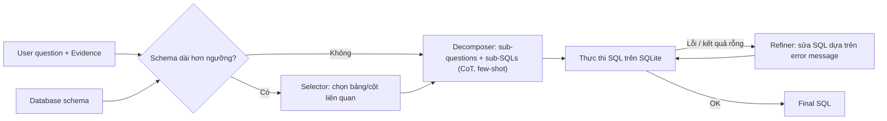

# MAC-SQL: A Multi-Agent Collaborative Framework for Text-to-SQL

| Thông tin | Chi tiết |
|---|---|
| **Tác giả** | Bing Wang, Changyu Ren, Jian Yang, Xinnian Liang, Jiaqi Bai, Linzheng Chai, Zhao Yan, Qian-Wen Zhang, Di Yin, Xing Sun, Zhoujun Li (corresponding), et al. |
| **Đơn vị** | Beihang University; Tencent Youtu Lab |
| **Năm / Venue** | arXiv:2312.11242 (bản v6, 18/03/2025; bản đầu 12/2023). Hội nghị chính thức: Không nêu rõ trong văn bản |
| **Loại bài** | Phương pháp (framework multi-agent + mô hình fine-tune SQL-Llama) |
| **Chủ đề** | Text-to-SQL, Multi-agent LLM, Schema linking / schema pruning, Question decomposition, Execution-feedback SQL refinement |
| **File gốc** | [A Multi-Agent Collaborative Framework for Text-to-SQL.pdf](../papers/A%20Multi-Agent%20Collaborative%20Framework%20for%20Text-to-SQL.pdf) |

## 1. Tóm tắt nhanh (TL;DR)
MAC-SQL đề xuất một framework gồm 3 agent LLM: **Selector** (cắt giảm database lớn thành sub-database), **Decomposer** (tách câu hỏi phức tạp thành sub-question và sinh SQL theo chain-of-thought few-shot) và **Refiner** (thực thi SQL, nhận lỗi từ SQLite và sửa). Với GPT-4, MAC-SQL đạt execution accuracy (EX) **59.59** trên BIRD test (SOTA tại thời điểm viết). Tác giả còn fine-tune **SQL-Llama** (Code Llama 7B) trên 10.000 mẫu agent-instruction do GPT-4 sinh, đạt EX 43.94 trên BIRD dev, gần với GPT-4 zero-shot (46.35).

## 2. Bối cảnh & Vấn đề nghiên cứu
- Các phương pháp Text-to-SQL dựa trên LLM (in-context learning như DIN-SQL, DAIL-SQL, C3; hoặc supervised fine-tuning) suy giảm hiệu năng mạnh khi gặp **database "huge"** (schema dài, nhiều cột/bảng không liên quan) và **câu hỏi phức tạp cần suy luận nhiều bước**.
- Đa số phương pháp trước **bỏ qua việc dùng công cụ ngoài** (ví dụ thực thi SQL để lấy phản hồi) và **hợp tác giữa các mô hình/agent**.
- Theo tác giả, nhiều phương pháp trước chỉ thử nghiệm trên họ Spider, chưa cho thấy tổng quát hoá trên BIRD; một số phụ thuộc vào bộ phân loại độ khó và "bias" sửa lỗi đặc thù cho Spider.
- Ngoài ra, thiếu mô hình mã nguồn mở có khả năng làm theo "agent instruction" cho Text-to-SQL.

## 3. Phương pháp / Nội dung chính

**Selector**
- Tìm schema tối thiểu S' = {T', C'} ⊆ S để trả lời câu hỏi. Động cơ: (i) nhiều schema item không liên quan làm LLM dễ chọn nhầm; (ii) schema dài gây tốn chi phí API và có thể vượt context length.
- Chỉ kích hoạt khi prompt schema vượt ngưỡng (trong bài: số token > 0.8 × max sequence length; với GPT-4-32k là > 25k token).
- Prompt one-shot yêu cầu output JSON: bảng ≤ 10 cột đánh dấu `keep_all`, bảng không liên quan `drop_all`, còn lại giữ top-6 cột theo độ liên quan; mỗi bảng giữ tối thiểu 6 cột, đảm bảo ít nhất 3 bảng.

**Decomposer**
- Agent cốt lõi: đánh giá độ khó; câu hỏi đơn giản thì sinh SQL trực tiếp, câu phức tạp thì sinh chuỗi sub-question → sub-SQL (1–5 sub-question) trong **một lần gọi** theo kiểu CoT (không dùng least-to-most lặp vì tốn chi phí và khó xác định tiêu chí dừng). Sub-SQL cuối là SQL đầu ra.
- Dùng tối đa 2-shot. Biểu diễn schema gồm: database ID, tên bảng, tên cột, mô tả cột, giá trị ô xuất hiện nhiều (bỏ qua cột số thuần, URL, email).
- Prompt có danh sách ràng buộc (chỉ SELECT cột cần, không JOIN bảng thừa, xử lý NULL, v.v.).

**Refiner**
- Nhận SQL lỗi + error message/exception class từ SQLite, yêu cầu LLM sinh SQL mới. Kiểm tra: đúng cú pháp, thực thi được, và kết quả không rỗng.
- Tối đa 3 vòng sửa. Xử lý các lỗi: syntax error, "schema illusion" (bảng/cột không tồn tại), kết quả rỗng.

**SQL-Llama**
- Tạo bộ **Agent-Instruct** bằng cách chạy GPT-4 qua các tác vụ multi-agent trên tập train của BIRD và Spider, lọc bỏ mẫu có SQL sai → 10.000 mẫu, 3 loại tác vụ (tương ứng 3 agent).
- Multi-task supervised fine-tuning trên Code Llama 7B; tác giả công bố mã nguồn và mô hình (GitHub: wbbeyourself/MAC-SQL).

## 4. Thực nghiệm & Kết quả chính

> **Cách đọc số liệu:** Các kết quả thuộc benchmark, split, metric và phiên bản mô hình của bài báo. “SOTA” chỉ áp dụng trong bối cảnh/thời điểm bài báo nêu; không so trực tiếp với PA của challenge.
- **Dataset:** BIRD (95 database lớn, 33.4GB, 37 domain) và Spider (7.000 train / 1.034 dev, 200 database, 138 domain).
- **Metric:** EX, VES (Valid Efficiency Score), EM (exact match).
- **Baseline:** GPT-4 zero-shot, DIN-SQL + GPT-4, DAIL-SQL + GPT-4, C3 + ChatGPT, cùng Palm-2, ChatGPT + CoT, Claude-2 (số liệu leaderboard BIRD).
- **Backbone:** GPT-4-32k, GPT-3.5-Turbo-16k, SQL-Llama 7B.

**BIRD (Table 1)**

| Method | Dev EX | Dev VES | Test EX | Test VES |
|---|---|---|---|---|
| GPT-4 | 46.35 | 49.77 | 54.89 | 60.77 |
| DIN-SQL + GPT-4 | 50.72 | 58.79 | 55.90 | 59.44 |
| DAIL-SQL + GPT-4 | 54.76 | 56.08 | 57.41 | 61.95 |
| SQL-Llama (7B) | 32.87 | 55.67 | – | – |
| MAC-SQL + SQL-Llama | 43.94 | 57.36 | – | – |
| MAC-SQL + GPT-3.5-Turbo | 50.56 | 61.25 | – | – |
| MAC-SQL + GPT-4 | **59.39** | **66.39** | **59.59** | **67.68** |
| MAC-SQL + GPT-4 + Oracle Schema | 70.28 | 62.63 | – | – |

("Oracle Schema" = dùng sub-database ground truth làm đầu vào cho Decomposer thay vì output của Selector; với SQL-Llama là 51.43, GPT-3.5-Turbo là 65.78 EX dev.)

**Spider EX (Table 2)**

| Method | Dev | Test |
|---|---|---|
| C3 + ChatGPT | 81.80 | 82.30 |
| DIN-SQL + GPT-4 | 82.80 | 85.30 |
| DAIL-SQL + GPT-4 | 84.40 | **86.60** |
| MAC-SQL + SQL-Llama | 76.25 | 70.58 |
| MAC-SQL + GPT-3.5-Turbo | 80.56 | 75.53 |
| MAC-SQL + GPT-4 | **86.75** | 82.80 |

**Ablation trên BIRD dev (Table 3, EX)**

| Biến thể | Simple | Moderate | Challenging | All |
|---|---|---|---|---|
| MAC-SQL + GPT-4 | 65.73 | 52.69 | 40.28 | 59.39 |
| w/o Selector | 65.73 | 52.04 | 35.14 | 57.28 |
| w/o Decomposer | 61.51 | 48.82 | 38.89 | 55.54 |
| w/o Refiner | 63.24 | 44.52 | 33.33 | 54.76 |

- Refiner đóng góp lớn nhất (−4.63 EX khi bỏ), Selector chủ yếu giúp câu hỏi Challenging.
- **Số lượng demonstration (Table 4):** 0-shot → 2-shot tăng BIRD EX 55.54 → 59.39, Spider EX 74.22 → 86.75 (EM 58.42 → 63.20). Chỉ thử tới 2-shot vì chi phí GPT-4 (ước tính ~6 triệu token cho Spider dev và ~10 triệu token cho BIRD dev mỗi lần chạy đầy đủ).
- **Error analysis (Figure 5):** "Gold Error" chiếm nhiều nhất (30% trên BIRD, 22% trên Spider), "Semantic Correct" (SQL đúng ngữ nghĩa nhưng bị chấm sai) 14% trên BIRD và 22% trên Spider. Appendix C liệt kê 8 loại lỗi trên BIRD: dirty database values, wrong schema linking, evidence misunderstand, gold error, database misunderstand, semantic correct, question misunderstand, other.

## 5. Tính mới (Novelty & Đóng góp)
- Một trong những công trình sớm đóng khung Text-to-SQL thành **hợp tác multi-agent** với phân vai rõ ràng (pruning schema – decomposition – execution-guided refinement), Selector/Refiner được kích hoạt có điều kiện và có thể mở rộng thêm agent/tool.
- Decomposer gộp phân rã câu hỏi + sinh SQL trong một lần gọi CoT, tránh chi phí của least-to-most.
- Refiner dựa trên **phản hồi thực thi thật** (error message, kết quả rỗng) thay vì bias sửa lỗi viết tay cho từng dataset.
- Công bố **SQL-Llama** và bộ dữ liệu Agent-Instruct — mô hình mở 7B có thể đóng vai cả 3 agent.
- Đạt SOTA BIRD test (59.59 EX) tại thời điểm viết.

## 6. Hạn chế
### 6.1 Hạn chế do tác giả thừa nhận
- Prompt của các agent có thể chưa tối ưu.
- Chỉ fine-tune Code Llama 7B; mô hình lớn hơn có thể tốt hơn.
- Refiner không sửa được SQL **chạy không lỗi và trả kết quả không rỗng nhưng sai ý định** câu hỏi.
- Do chi phí GPT-4, chỉ thử tối đa 2-shot.

### 6.2 Nhận xét thêm của người review
- **Refiner chỉ bắt lỗi "bề mặt"**: không có cơ chế kiểm tra ngữ nghĩa (vd. so khớp kết quả với ý định, self-consistency, đa ứng viên), nên lỗi logic — loại lỗi chiếm phần lớn trên BIRD — vẫn lọt qua.
- **Selector gắn cứng heuristic** (top-6 cột, ≥3 bảng, ngưỡng 25k token). Trên BIRD, nhiều database không vượt ngưỡng nên Selector ít được kích hoạt; khoảng cách lớn giữa có/không Oracle Schema (59.39 vs 70.28 EX dev) cho thấy schema linking vẫn là nút thắt chính.
- **So sánh trên Spider chưa vượt trội**: trên Spider test, MAC-SQL + GPT-4 (82.80) thấp hơn DIN-SQL (85.30) và DAIL-SQL (86.60); bài chủ yếu nhấn mạnh kết quả dev.
- **Không báo cáo chi phí/độ trễ** (số lần gọi LLM, token/câu hỏi) dù framework gồm nhiều lần gọi; chỉ có ước tính tổng token cho dev set.
- **SQL-Llama được distill từ GPT-4 trên tập train BIRD/Spider** rồi đánh giá trên cùng phân phối — khả năng tổng quát sang domain/doanh nghiệp khác chưa được kiểm chứng.
- **Một số điểm không nhất quán trong văn bản**: phần Error Analysis viết "Schema Linking Error is more frequent in BIRD (2%) than in Spider (8%)" — mâu thuẫn số liệu; Conclusion viết như thể 59.59 đạt được "cùng với SQL-Llama" trong khi Table 1 cho thấy đó là kết quả của GPT-4.
- Error analysis cho thấy ~30% lỗi trên BIRD là do gold SQL sai → EX trên BIRD có nhiễu đáng kể, cần thận trọng khi so sánh chênh lệch nhỏ giữa các phương pháp.

## 7. Ý nghĩa ứng dụng (cho hệ thống agent phân tích dữ liệu / Text-to-SQL)

> **Phân biệt nguồn:** Khuyến nghị trong mục này là suy luận ứng dụng cho DataMate; bài báo không đánh giá trực tiếp trên challenge, trừ khi nêu rõ.
- Mẫu kiến trúc **Selector → Generator → Refiner** là baseline đơn giản, dễ triển khai cho agent Text-to-SQL; Refiner dựa trên execution feedback (lỗi cú pháp, cột không tồn tại, kết quả rỗng) là "quick win" rõ rệt (+4.63 EX).
- Biểu diễn schema giàu thông tin (mô tả cột + giá trị mẫu tần suất cao + foreign key) và kích hoạt schema pruning theo ngưỡng token phù hợp với database doanh nghiệp lớn.
- Cần bổ sung lớp kiểm tra ngữ nghĩa (vd. kiểm tra kết quả, hỏi lại người dùng, sinh nhiều ứng viên) vì execution-feedback không bắt được SQL "chạy được nhưng sai".
- Có thể distill pipeline từ mô hình lớn sang mô hình nhỏ (như SQL-Llama) để giảm chi phí khi triển khai on-premise.

## 8. Từ khóa
`Text-to-SQL`, `multi-agent`, `schema linking`, `schema pruning`, `question decomposition`, `chain-of-thought`, `execution feedback`, `SQL refinement`, `BIRD`, `Spider`, `SQL-Llama`, `Code Llama`, `instruction tuning`

## 9. Mức độ phù hợp với challenge DataMate

**Phân nhóm: Tham khảo.** MAC-SQL minh họa phân rã schema, sinh truy vấn và sửa theo phản hồi thực thi. Kết quả dùng LLM/API và benchmark SQL; không chuyển nguyên trạng sang inference offline và PA.

## 10. Nguồn và truy nguyên kết quả

- **PDF gốc:** liên kết ở bảng thông tin đầu review và bản lưu trong thư mục `../papers/`.
- **Vị trí kiểm chứng:** Phương pháp §§4–5, PDF pp. 4–6; kết quả p. 6, Tables 2–3; limitations p. 9.
- Số liệu ở mục 4 là kết quả tác giả trên benchmark gốc; phần áp dụng DataMate tại mục 7 và mục 9 là nhận định của review.
