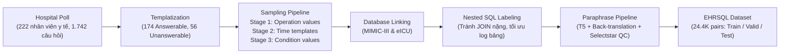

# EHRSQL: A Practical Text-to-SQL Benchmark for Electronic Health Records

| Thông tin | Chi tiết |
|---|---|
| **Tác giả** | Gyubok Lee, Hyeonji Hwang, Seongsu Bae, Yeonsu Kwon, Woncheol Shin, Seongjun Yang, Minjoon Seo, Jongyeup Kim, Edward Choi |
| **Đơn vị** | KAIST, Seoul Women's University, College of Medicine at Konyang University |
| **Năm / Venue** | NeurIPS 2022 (Track on Datasets and Benchmarks) |
| **Loại bài** | Benchmark |
| **Chủ đề** | Text-to-SQL, Electronic Health Records (EHR), Time-sensitive QA, Trustworthy Semantic Parsing, Unanswerable Questions / Abstention |
| **File gốc** | [A Practical Text-to-SQL Benchmark for Electronic Health Records.pdf](../papers/A%20Practical%20Text-to-SQL%20Benchmark%20for%20Electronic%20Health%20Records.pdf) |

## 1. Tóm tắt nhanh (TL;DR)
EHRSQL là bộ benchmark Text-to-SQL thực tế quy mô lớn dành cho dữ liệu hồ sơ bệnh án điện tử (EHR) có cấu trúc, được xây dựng dựa trên khảo sát thực tế từ 222 nhân viên y tế và liên kết với hai cơ sở dữ liệu mở phổ biến là MIMIC-III và eICU. Bộ dữ liệu đặt ra bài toán "Trustworthy Semantic Parsing" đòi hỏi mô hình không chỉ dịch câu hỏi tự nhiên giàu biểu thức thời gian thành các truy vấn SQL lồng nhau phức tạp (nested SQL) mà còn phải biết từ chối trả lời (abstain) khi gặp các câu hỏi không thể giải quyết được (unanswerable questions) dựa trên độ bất định (uncertainty/entropy).

## 2. Bối cảnh & Vấn đề nghiên cứu
- **Bối cảnh**: Hồ sơ bệnh án điện tử (EHR) lưu trữ toàn bộ lịch sử y tế của bệnh nhân dưới dạng cơ sở dữ liệu quan hệ đồ sộ với hàng trăm triệu bản ghi. Nhân viên y tế (bác sĩ, điều dưỡng, chuyên viên hồ sơ, thẩm định bảo hiểm) thường xuyên phải truy xuất thông tin nhưng bị phụ thuộc vào các hệ thống chuyển đổi quy tắc định sẵn (pre-defined rule systems) cứng nhắc, thiếu linh hoạt. Text-to-SQL hứa hẹn giải phóng tiềm năng này khi cho phép truy vấn trực tiếp bằng ngôn ngữ tự nhiên.
- **Hạn chế của các nghiên cứu trước**:
  - Các bộ dữ liệu QA y tế như MIMICSQL chỉ giới hạn trong 5 bảng đơn giản, câu hỏi sinh từ mẫu quy tắc định sẵn, không phản ánh nhu cầu thực tiễn. Bộ emrKBQA chuyển thể từ emrQA chủ yếu xoay quanh kết quả xét nghiệm của bệnh nhân ngoại trú.
  - Các benchmark Text-to-SQL đa miền kinh điển (Spider, WikiSQL, KaggleDBQA) chủ yếu dùng cú pháp JOIN phẳng, không tối ưu cho bảng log y tế khổng lồ (bảng `chartevents` có tới hơn 330 triệu dòng), đồng thời thiếu vắng các toán tử thời gian chuyên sâu (`strftime`, `datetime`).
  - Hầu hết các hệ thống Text-to-SQL đều mặc định mọi câu hỏi đều trả lời được (closed-world assumption). Trong y tế, việc cố tình sinh SQL trả về câu trả lời sai hoặc ảo giác cho câu hỏi không khả thi có thể dẫn đến sai lầm lâm sàng chí mạng.

## 3. Phương pháp / Nội dung chính

### 3.1 Quy trình thu thập và xây dựng dữ liệu
1. **Khảo sát nhân viên y tế (Hospital Poll)**: Khảo sát 222 nhân viên y tế thuộc 5 nhóm nghiệp vụ tại Bệnh viện Đại học Konyang (Hàn Quốc), thu về 1.742 phát biểu tự nhiên thực tế.
2. **Lọc và tạo mẫu câu hỏi (Question Templatization)**: Lọc các câu hỏi thành 230 template (174 template trả lời được - answerable, 56 template không thể trả lời - unanswerable do vượt ngoài schema hoặc đòi hỏi tri thức y khoa ngoại biên). Các câu hỏi bao quát 3 phạm vi: không có bệnh nhân (none), từng bệnh nhân (individual), nhóm bệnh nhân (group).
3. **Mẫu thời gian (Time Templates)**: Phân loại thời gian thành 3 loại bộ lọc:
   - `[time_filter_global]`: Giới hạn phạm vi thời gian tổng thể (tuyệt đối, tương đối, hỗn hợp; đơn vị: năm, tháng, ngày, lượt khám).
   - `[time_filter_within]`: Khoảng cách thời gian giữa hai sự kiện y tế (cùng ngày, cùng đợt nằm viện, trong vòng N tháng/năm).
   - `[time_filter_exact]`: Điểm thời gian hoặc thứ tự cụ thể (đầu tiên, cuối cùng, gần cuối, thời điểm cụ thể).
4. **Gán nhãn SQL thủ công theo cấu trúc lồng nhau (Nested SQL Annotation)**: Bốn học viên cao học gắn nhãn thủ công trong 5 tháng cho cả MIMIC-III và eICU. Thay vì lạm dụng JOIN gây chậm chạp trên cơ sở dữ liệu hàng trăm triệu dòng, các truy vấn được thiết kế lồng nhau (nested queries) tận dụng quan hệ thứ bậc của EHR.
5. **Sinh dữ liệu & Paraphrase**: Kết hợp template câu hỏi với lấy mẫu giá trị thao tác (Stage 1), mẫu thời gian (Stage 2) và giá trị điều kiện từ database (Stage 3). Sau đó áp dụng pipeline paraphrase đa tầng (Human paraphrase + T5/Back-translation + Lọc trùng RoBERTa + Xếp hạng Perplexity GPT-Neo + Đánh giá crowdsourcing Selectstar).

### 3.2 Quy mô và đặc điểm bộ dữ liệu
- **Quy mô**: Tổng cộng 24.411 cặp câu hỏi - SQL (22.5K answerable và 1.9K unanswerable).
- **Cơ sở dữ liệu**: Hỗ trợ 2 cơ sở dữ liệu EHR đa trung tâm lớn: MIMIC-III (13.5 bảng) và eICU (13.5 bảng).
- **Độ phức tạp vượt trội**:
  - Số bảng trung bình mỗi câu hỏi: 2.4 (so với 1.6 của Spider, 1.8 của MIMICSQL).
  - Độ sâu lồng truy vấn (# Nesting/Q): 2.7 cấp lồng (so với 1.2 của Spider, 1.0 của MIMICSQL).
  - Tỷ lệ câu hỏi dùng cột thời gian (% Time Used/Q): **93.2%** (so với 12.7% của Spider, 26.6% của MIMICSQL).
  - Tác giả câu hỏi không nhìn thấy schema (?Schema = True) và có câu hỏi không trả lời được (UnANS = True).

### 3.3 Tác vụ và Metric: Trustworthy Semantic Parsing
Mô hình phải sinh SQL cho câu hỏi hợp lệ và từ chối nếu không trả lời được dựa trên entropy giải mã:
- $F1_{ans}$: Đánh giá độ chính xác trong việc phân loại câu hỏi answerable vs. unanswerable ($P_{ans}$ và $R_{ans}$).
- $F1_{exe}$: Metric kết hợp giữa khả năng phát hiện câu hỏi answerable và tính đúng đắn khi thực thi truy vấn SQL ($P_{exe}$ và $R_{exe}$):
  $$P_{exe} = \frac{\text{Số câu trả lời đúng khi thực thi}}{\text{Tổng số câu mô hình dự đoán là answerable}}$$
  $$R_{exe} = \frac{\text{Số câu trả lời đúng khi thực thi}}{\text{Tổng số câu thực sự answerable}}$$

## 4. Thực nghiệm & Kết quả chính

> **Cách đọc số liệu:** Các kết quả thuộc benchmark, split, metric và phiên bản mô hình của bài báo. “SOTA” chỉ áp dụng trong bối cảnh/thời điểm bài báo nêu; không so trực tiếp với PA của challenge.
- **Mô hình thử nghiệm**: T5-base (có và không kèm serialized schema); cơ chế từ chối dựa trên ngưỡng entropy lớn nhất của decoder với 3 thiết lập: Không dùng ngưỡng (None), Phân cụm K-Means ($k=2$), Ngưỡng bách phân vị (Percentile-based ở mức 67%).
- **Thử nghiệm Zero-shot Cross-domain Transfer**: Sử dụng mô hình SOTA GAP (Generation-Augmented Pre-training) được huấn luyện trên Spider để kiểm tra khả năng chuyển giao sang tập con parsable của EHRSQL và MIMICSQL.

### Kết quả nổi bật

| Database | Ngưỡng (Threshold) | Model | Valid $F1_{ans}$ | Valid $F1_{exe}$ | Test $F1_{ans}$ | Test $F1_{exe}$ |
|---|---|---|---|---|---|---|
| **MIMIC-III** | None | T5-base | 80.8% | 77.8% | 80.3% | 76.6% |
| | None | T5 + Schema | 80.8% | 77.9% | 80.3% | 76.6% |
| | Clustering-based | T5-base | 89.2% | 87.2% | 86.5% | 83.8% |
| | Percentile-based | T5-base | **94.8%** | **93.8%** | **91.4%** | **89.9%** |
| | Percentile-based | T5 + Schema | 93.5% | 92.5% | 90.6% | 89.1% |
| **eICU** | None | T5-base | 80.7% | 77.8% | 80.4% | 76.5% |
| | Clustering-based | T5-base | 88.4% | 86.1% | 86.1% | 82.5% |
| | Percentile-based | T5-base | 93.0% | 92.1% | 90.8% | **89.5%** |
| | Percentile-based | T5 + Schema | **94.2%** | **92.1%** | **90.9%** | 88.9% |

### Phát hiện & Phân tích quan trọng
1. **Cơ chế từ chối nâng vọt hiệu năng tin cậy**: Khi áp dụng cơ chế xác định ngưỡng entropy (Percentile-based), $F1_{exe}$ tăng từ ~76.6% lên tới 89.9% trên Test set của MIMIC-III, giảm đáng kể các lỗi thực thi sai tai hại (falsely executed queries).
2. **Khoảng cách miền khổng lồ so với Spider**: Khi kiểm tra mô hình SOTA GAP (huấn luyện trên Spider), chỉ có **7%** (107/1.515 câu) trong EHRSQL có thể phân tích được bằng bộ parser của Spider do thiếu hỗ trợ các toán tử thời gian phức tạp (`strftime`, `datetime`). Ngay trên tập con này, GAP chỉ đạt execution accuracy **4.7%** (so với 16.4% trên MIMICSQL), chứng tỏ khoảng cách ngữ nghĩa và cấu trúc câu hỏi y tế thực tế là rất lớn.
3. **Schema không giúp ích nhiều khi fine-tune một database đơn lẻ**: T5 + Schema cho kết quả tương đương hoặc thậm chí nhỉnh kém hơn T5 không kèm schema, phù hợp với quan sát trước đó trong SEDE khi mô hình học thuộc schema cố định của cơ sở dữ liệu.
4. **Hiệu năng của Nested SQL vs. JOIN**: Truy vấn lồng nhau bảo toàn ngữ nghĩa tốt hơn và có tốc độ thực thi nhanh gấp 4 lần so với JOIN ngây thơ trên các bảng log khổng lồ (0.04s so với 0.15s).

## 5. Tính mới (Novelty & Đóng góp)
- **Nguồn gốc câu hỏi thực tế**: Là bộ dữ liệu Text-to-SQL y tế đầu tiên thu thập từ khảo sát thực tế trên 222 nhân sự bệnh viện đa khoa thay vì tự động sinh template thuần túy.
- **Biểu thức thời gian sâu và phong phú**: 93.2% câu hỏi chứa điều kiện thời gian, xây dựng một hệ thống phân loại và mẫu hoá toàn diện về thời gian (tương đối, tuyệt đối, khoảng thời gian điều trị).
- **Thiết lập bài toán Trustworthy Semantic Parsing**: Tích hợp các câu hỏi không thể trả lời (unanswerable) vào tập valid/test theo mô hình phát hiện OOD, buộc mô hình phải có cơ chế ước lượng độ bất định và biết từ chối trả lời để đảm bảo an toàn lâm sàng.
- **Tiêu chuẩn gán nhãn Nested SQL**: Chứng minh sự cần thiết và tính ưu việt của cấu trúc truy vấn lồng nhau (nested queries) so với JOIN khi làm việc với các cơ sở dữ liệu EHR quy mô hàng trăm triệu dòng.

## 6. Hạn chế
### 6.1 Hạn chế do tác giả thừa nhận
- **Dữ liệu thu thập từ một bệnh viện**: 222 nhân viên tham gia khảo sát đều thuộc một bệnh viện đại học tại Hàn Quốc (Konyang University Hospital), có thể chưa đại diện hết quy trình làm việc và thói quen hỏi đáp tại các bệnh viện khác trên thế giới.
- **Paraphrase bằng công cụ miền chung**: Các công cụ ML sinh paraphrase (T5, Back-translation) thuộc miền ngôn ngữ tổng quát nên chưa phản ánh triệt để mật độ thuật ngữ viết tắt và tiếng lóng y khoa chuyên sâu.
- **Số lượng cơ sở dữ liệu còn hạn chế**: Chỉ liên kết với 2 database (MIMIC-III và eICU), chưa đủ lớn để đánh giá khả năng tổng quát hóa cross-database Text-to-SQL sang các schema EHR hoàn toàn mới lạ.

### 6.2 Nhận xét thêm của người review
- **Giá trị điều kiện giữ nguyên khi chia split**: Tác giả đơn giản hóa bằng cách giữ nguyên các giá trị điều kiện (condition values như tên thuốc, bệnh lý) giữa train/val/test, chỉ thay đổi giới tính và chỉ số sinh tồn. Điều này làm giảm độ khó của bài toán value linking trong thực tế khi gặp các thực thể thuốc/bệnh mới.
- **Ngưỡng Percentile-based mang tính lý tưởng**: Thiết lập ngưỡng dựa trên 67th percentile tận dụng giả định biết trước tỷ lệ unanswerable questions (33%). Trong triển khai thực tế, tỷ lệ câu hỏi không hợp lệ từ người dùng không cố định, do đó K-means hoặc các kỹ thuật calibrated uncertainty độc lập ngưỡng là bắt buộc.
- **Cơ chế Nested SQL khó tổng quát hóa bằng LLM Prompting**: Cấu trúc truy vấn lồng nhau tối ưu cho SQLite/PostgreSQL trong log-table nhưng đòi hỏi mô hình hiểu sâu về schema phân cấp, dễ bị lỗi syntax nếu không fine-tune chuyên biệt.

## 7. Ý nghĩa ứng dụng (cho hệ thống agent phân tích dữ liệu / Text-to-SQL)

> **Phân biệt nguồn:** Khuyến nghị trong mục này là suy luận ứng dụng cho DataMate; bài báo không đánh giá trực tiếp trên challenge, trừ khi nêu rõ.
- **Thiết kế cơ chế Abstention / Out-of-Domain Guardrail**: Agent phân tích dữ liệu y tế hoặc doanh nghiệp phải có module tự kiểm tra độ bất định hoặc schema-check trước khi thực thi SQL; tuyệt đối không cưỡng ép sinh truy vấn khi thiếu dữ liệu hoặc schema không hỗ trợ.
- **Xử lý thời gian tương đối và neo mốc thời gian**: Cần có bước chuẩn hóa thời gian (Time Normalization) trước khi sinh SQL: neo mốc "thời điểm hiện tại" (`current_time`) và phân tách rõ các biểu thức thời gian tương đối ("trong đợt khám vừa qua", "sau khi chẩn đoán 2 tháng").
- **Tối ưu hóa chiến lược truy vấn bảng lớn**: Với các bảng nhật ký sự kiện hàng trăm triệu dòng (clickstream, sensor, event log y tế), ưu tiên dùng subquery lồng nhau lọc chỉ mục thay vì đa JOIN gây tràn bộ nhớ và treo database engine.

## 8. Từ khóa
`EHRSQL`, `Text-to-SQL`, `Electronic Health Records`, `Trustworthy Semantic Parsing`, `Unanswerable Questions`, `Time-sensitive QA`, `MIMIC-III`, `eICU`, `Uncertainty Estimation`

## 9. Mức độ phù hợp với challenge DataMate

**Phân nhóm: Tham khảo.** Hữu ích cho truy vấn thời gian và câu không thể trả lời; schema y tế khác dữ liệu cửa hàng, nên chỉ mượn cách kiểm thử answerability.

## 10. Nguồn và truy nguyên kết quả

- **PDF gốc:** liên kết ở bảng thông tin đầu review và bản lưu trong thư mục `../papers/`.
- **Vị trí kiểm chứng:** Dataset §3, pp. 3–7; results §4.4, p. 9; conclusion §5, p. 10.
- Số liệu ở mục 4 là kết quả tác giả trên benchmark gốc; phần áp dụng DataMate tại mục 7 và mục 9 là nhận định của review.
