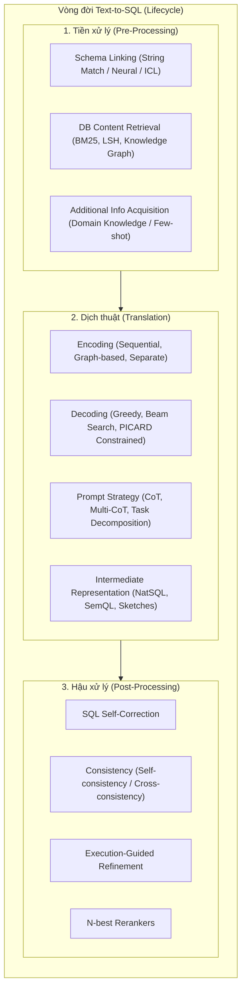

# A Survey of Text-to-SQL in the Era of LLMs: Where are we, and where are we going?

| Thông tin | Chi tiết |
|---|---|
| **Tác giả** | Xinyu Liu, Shuyu Shen, Boyan Li, Peixian Ma, Runzhi Jiang, Yuxin Zhang, Ju Fan, Guoliang Li, Nan Tang, Yuyu Luo* |
| **Đơn vị** | HKUST (Guangzhou), Renmin University of China, Tsinghua University |
| **Năm / Venue** | 2024 (cập nhật v7 2026), arXiv:2408.05109 [cs.DB] (chuẩn bị cho IEEE TKDE) |
| **Loại bài** | Survey (Tổng quan) |
| **Chủ đề** | Text-to-SQL, LLMs, Pre-trained Language Models, Database Interface, Modular Design, Multi-Agent, Benchmark & Error Analysis |
| **File gốc** | [A Survey of Text-to-SQL in the Era of LLMs.pdf](../papers/A%20Survey%20of%20Text-to-SQL%20in%20the%20Era%20of%20LLMs.pdf) |

## 1. Tóm tắt nhanh (TL;DR)
Bài báo cung cấp một cái nhìn toàn diện về toàn bộ vòng đời (lifecycle) của Text-to-SQL trong kỷ nguyên mô hình ngôn ngữ lớn (LLM), bao gồm 4 khía cạnh cốt lõi: mô hình (tiền xử lý, dịch thuật, hậu xử lý và đa tác tử), dữ liệu huấn luyện / tổng hợp dữ liệu, đánh giá đa chiều (multi-angle evaluation), và phân tích lỗi có hệ thống (error taxonomy 2 tầng). Ngoài việc hệ thống hóa hơn 40 giải pháp tiêu biểu, tác giả đề xuất lộ trình tối ưu hóa mô hình định hướng theo dữ liệu (data-driven roadmap) cùng luồng quyết định (decision flow) lựa chọn module Text-to-SQL thực tế, đồng thời vạch ra các hướng nghiên cứu mở như Open-Domain Text-to-SQL và giải pháp tiết kiệm chi phí (cost-effective Text-to-SQL).

## 2. Bối cảnh & Vấn đề nghiên cứu
- **Bối cảnh**: Text-to-SQL (NL2SQL) chuyển đổi câu hỏi ngôn ngữ tự nhiên (NL) thành câu truy vấn SQL có thể thực thi trên cơ sở dữ liệu quan hệ (RDB), đóng vai trò then chốt trong việc hạ thấp rào cản truy cập cơ sở dữ liệu và dân chủ hóa phân tích dữ liệu (democratizing data science). Sự trỗi dậy của các LLM (GPT-4, Claude, DeepSeek, CodeS, StarCoder...) đã thay đổi hoàn toàn cục diện nghiên cứu từ các mô hình end-to-end nguyên khối sang các kiến trúc pipeline mô-đun hóa và multi-agent.
- **Thách thức cốt lõi**:
  1. *Ngôn ngữ tự nhiên mơ hồ và thiếu đặc tả (uncertain NL)*: Nhập nhằng từ vựng (lexical ambiguity), nhập nhằng cú pháp (syntactic ambiguity) và thiếu thông tin (under-specification, ví dụ "Labor Day 2023" khác nhau giữa Mỹ và Trung Quốc).
  2. *Cơ sở dữ liệu phức tạp và dữ liệu bẩn (complex DB & dirty content)*: Hàng trăm bảng với quan hệ khóa ngoại đan xen, tên bảng/cột đa nghĩa, thiết kế đặc thù theo miền và giá trị ô bị thiếu/nhiễu.
  3. *Khoảng cách dịch thuật (NL-to-SQL mismatch)*: Ánh xạ từ tự do (free-form) sang cú pháp hình thức có ràng buộc nghiêm ngặt (constrained formal SQL), một câu hỏi có thể ứng với nhiều câu lệnh SQL tương đương.
  4. *Thách thức triển khai thực tế*: Chi phí API/phần cứng khổng lồ, độ trễ suy luận, hiệu năng thực thi của câu lệnh SQL sinh ra (SQL efficiency), độ tin cậy và sự thiếu hụt dữ liệu huấn luyện chất lượng cao.
- **Thiếu sót của các khảo sát trước**: Các survey trước thường chỉ tập trung vào một phân nhánh (như deep learning truyền thống, PLM, hoặc prompt engineering đơn giản), thiếu góc nhìn bao quát toàn bộ vòng đời (lifecycle), bỏ qua phân tích module chi tiết (như database content retrieval với LSH hay BM25), và chưa có taxonomy phân tích lỗi chuẩn hóa hay hướng dẫn thực tiễn cho kỹ sư triển khai.

## 3. Phương pháp / Nội dung chính
Khảo sát phân chia vòng đời Text-to-SQL thành 4 trụ cột chính: Models, Data, Evaluation, và Error Analysis.

### 3.1 Tiến hóa của mô hình Text-to-SQL
Bài báo chia quá trình tiến hóa thành 4 giai đoạn gắn liền với 5 cấp độ năng lực giải quyết thách thức (Figure 3):
1. **Rule-based Stage (những năm 1990s–2013)**: Bộ phân tích cú pháp ngữ nghĩa (semantic parsers) dựa trên tập luật định trước; chỉ giải quyết truy vấn đơn bảng đơn giản ở cấp độ token.
2. **Neural Network-based Stage (2013–2018)**: Seq2seq (LSTM, GRU) và Graph Neural Networks (GNN); mở rộng sang truy vấn đa bảng cơ bản, nhận diện từ đồng nghĩa tốt hơn.
3. **PLM-based Stage (2018–2022)**: BERT, T5, RAT-SQL, Graphix-T5, RESDSQL. Giải quyết ~80% các trường hợp trên Spider nhưng tụt xuống ~50% ở các ca cực khó (extra hard); bắt đầu gặp giới hạn với lược đồ phức tạp.
4. **LLM-based Stage (2022–nay)**: Tận dụng khả năng suy luận mới nổi (emergent abilities) qua In-Context Learning (DAIL-SQL, DIN-SQL, CHESS, MAC-SQL) hoặc tiền huấn luyện/tinh chỉnh chuyên sâu (CodeS, DTS-SQL). Trọng tâm chuyển từ hiểu NL sang giải quyết độ phức tạp của DB lớn (BIRD, Spider 2.0).

### 3.2 Phân tích các mô-đun trong kiến trúc Text-to-SQL hiện đại (Table I & Figure 5)
- **Tiền xử lý (Pre-Processing)**:
  - *Schema Linking*: Rút gọn không gian tìm kiếm cột/bảng qua đối sánh chuỗi (IRNet, ValueNet), bộ mã hóa nơ-ron (RESDSQL dùng cross-encoder xếp hạng bảng/cột), hoặc In-Context Learning (C3-SQL dùng zero-shot prompt với GPT-3.5, MAC-SQL kích hoạt agent Selector khi prompt schema vượt ngưỡng độ dài).
  - *Database Content Retrieval*: Truy xuất giá trị ô (cell values) phục vụ mệnh đề `WHERE`. Các kỹ thuật gồm đối sánh chuỗi (anchor text matching trong BRIDGE), nơ-ron/đồ thị (TABERT, ConceptNet), và đánh chỉ mục quy mô lớn (Locality-Sensitive Hashing - LSH trong CHESS, BM25 kết hợp Longest Common Substring trong CodeS).
  - *Bổ sung tri thức (Additional Information Acquisition)*: Nạp tri thức miền vào prompt mẫu (sample-based như DIN-SQL) hoặc dùng bộ truy xuất vector/DPR (retrieval-based như REGROUP, ReBoost).
- **Dịch thuật (Translation Methods)**:
  - *Mã hóa (Encoding)*: Tuần tự (Sequential Encoding - nối chuỗi prompt tiêu chuẩn), đồ thị (Graph-based Encoding - RAT-SQL, S²SQL, Graphix-T5), và mã hóa phân tách (Separate Encoding - SC-Prompt, TKK tách biệt cấu trúc và nội dung).
  - *Giải mã (Decoding)*: Greedy search (mặc định của các mô hình LLM API), Beam search (giữ lại top-k giả thuyết), và Constrained Incremental Decoding (tiêu biểu là PICARD, ép tuân thủ ngữ pháp SQL và lược đồ DB tại từng bước sinh token).
  - *Prompt đặc thù (Task-specific Prompt)*: Chain-of-Thought (CoT, Multi-CoT như CHASE-SQL) và chiến lược phân rã (Decomposition như DIN-SQL phân rã thành phân loại độ khó, liên kết schema, sinh SQL con; MAC-SQL dùng Decomposer agent).
  - *Biểu diễn trung gian (Intermediate Representation - IR)*: Giảm khoảng cách ngữ nghĩa giữa NL và cú pháp SQL. Phân loại thành:
    - *Ngữ pháp cú pháp kiểu SQL (Syntax Language)*: NatSQL (loại bỏ JOIN/GROUP BY thừa), SemQL.
    - *Khung phác thảo (Sketch Structure)*: CatSQL, SC-Prompt, RESDSQL (sinh khung SQL skeleton trước, điền thông tin sau).
- **Hậu xử lý (Post-Processing)**:
  - *Sửa lỗi SQL (Self-Correction)*: Zero-shot feedback (DIN-SQL dùng mild prompt cho GPT-4 và general prompt cho CodeX; ZeroNL2SQL đối sánh đa mức).
  - *Độ nhất quán đầu ra (Consistency)*: Self-consistency (DAIL-SQL tăng 0.4%), phân cụm truy vấn (FinSQL), và Cross-consistency (PET-SQL bỏ phiếu chéo giữa nhiều mô hình LLM khác nhau).
  - *Định hướng thực thi (Execution-Guided)*: Thực thi câu lệnh nháp trên DB để nhận phản hồi (lỗi cú pháp hoặc NULL) rồi tinh chỉnh (CHESS, CodeS beam search chọn câu lệnh đầu tiên thực thi được).
  - *Xếp hạng N-best (Rerankers)*: Dùng mô hình phân biệt để tái xếp hạng top-N (G³R dùng contrastive learning).
- **Xu hướng Multi-Agent & MCTS**:
  - Phân chia trách nhiệm cho các agent chuyên trách: MAC-SQL (Selector, Decomposer, Refiner), CHASE-SQL (multi-path CoT và candidate selection), Alpha-SQL (kết hợp LLM với Monte Carlo Tree Search để hoạch định và kích hoạt mô-đun linh hoạt theo phản hồi thực thi).

## 4. Thực nghiệm & Kết quả chính

> **Cách đọc số liệu:** Các kết quả thuộc benchmark, split, metric và phiên bản mô hình của bài báo. “SOTA” chỉ áp dụng trong bối cảnh/thời điểm bài báo nêu; không so trực tiếp với PA của challenge.
### 4.1 Thống kê và phân tích các Benchmark (Table II & Figure 10)
Tác giả sử dụng bộ công cụ NL2SQL360 để phân tích định lượng hơn 30 tập dữ liệu trên 3 trục: Mức độ dư thừa (Redundancy), Độ phức tạp DB (DB Complexity), và Độ phức tạp câu truy vấn (Query Complexity).
- *Các benchmark tiêu biểu*:
  - **Spider** (Yu et al., 2018): 11.840 câu hỏi, 206 DB, trung bình 5,13 bảng/DB; đóng vai trò chuẩn mực cross-domain suốt nhiều năm.
  - **BIRD** (Li et al., 2023): 10.962 câu hỏi, 80 DB thực tế quy mô lớn (tổng hơn 4,5 triệu bản ghi), trung bình 7,64 bảng/DB; tích hợp tri thức miền (external knowledge), tính toán toán học và hàm vô hướng (scalar functions).
  - **Spider 2.0 / Spider2-Lite** (Lei et al., 2024): Đỉnh cao về độ phức tạp hiện thực doanh nghiệp (enterprise workflows), trung bình 23,71 bảng/DB, 35,61 cột/bảng; truy vấn trung bình 6,53 bảng, 5,10 mệnh đề SELECT, 3,57 hàm tổng hợp.
  - Các tập chuyên biệt: Dr.Spider (15.269 câu với 17 dạng nhiễu kiểm tra tính bền vững), AmbiQT (đánh giá câu hỏi mơ hồ với 2 nhãn SQL hợp lệ), FIBEN & SEDE (câu truy vấn phức tạp từ đời thực).

### 4.2 Thước đo đánh giá (Evaluation Metrics)
- **Execution Accuracy (EX)**: Tỉ lệ tập kết quả thực thi của câu SQL dự đoán trùng khớp với ground-truth. Thước đo thực tế nhất nhưng có rủi ro false positives (hai câu SQL khác ngữ nghĩa ngẫu nhiên trả về cùng bảng kết quả).
- **Exact-Match Accuracy (EM)** / **Component-Match Accuracy (CM)**: So khớp cú pháp từng mệnh đề hoặc toàn bộ câu lệnh; rất khắt khe và thường phạt các câu lệnh đúng ngữ nghĩa nhưng khác cách viết.
- **Valid Efficiency Score (VES)**: Đánh giá đồng thời độ chính xác và hiệu năng thực thi tương đối $R(Y_i, \hat{Y}_i) = \sqrt{\frac{E(Y_i)}{E(\hat{Y}_i)}}$ trên cơ sở dữ liệu lớn (giới thiệu bởi BIRD).
- **Query Variance Testing (QVT)**: Đánh giá độ bền vững khi cùng một câu SQL được biểu đạt bằng nhiều biến thể NL khác nhau (giới thiệu bởi NL2SQL360).

### 4.3 Đánh đổi tài nguyên và hiệu năng (Table III)
Phân tích tài nguyên trên tập Spider cho thấy sự đánh đổi rõ nét giữa mô hình PLM chuyên dụng và LLM agentic:
| Phương pháp | Base Model | Chi phí API Tokens/SQL | Độ trễ Latency/SQL (giây) |
|---|---|---|---|
| RESDSQL | PLM (T5-3B) | 0 | 1.91s |
| RESDSQL + NatSQL | PLM (T5-3B) | 0 | 1.97s |
| ZeroNL2SQL (ZeroNet) | PLM + LLM | 377 | 3.72s |
| DIN-SQL | LLM (GPT-4) | 3.579 | 10.34s |

- **Phân tích lỗi (Error Analysis - Section VIII-C & Figure 1(d))**:
  Tác giả đề xuất Taxonomy 2 tầng (Level 1: Vị trí lỗi - SELECT, WHERE, GROUP BY, FROM, ORDER BY...; Level 2: Nguyên nhân lỗi - Schema Linking, Content/Value, Condition, Aggregation...).
  Khi phân loại lỗi của DIN-SQL trên Spider:
  - Mệnh đề `SELECT` chiếm 25,5% tổng lỗi (trong đó Incorrect Column chiếm 12,4%, Excess Column chiếm 5,8%).
  - Mệnh đề `WHERE` chiếm 15,2% tổng lỗi (trong đó lỗi Value chiếm 11,6% - cho thấy khâu trích xuất nội dung DB còn yếu).
  - Mệnh đề `GROUP BY` chiếm 16,6% và `FROM` (JOIN) chiếm 15,3%.
  - Chỉ có 1,8% lỗi thuộc nhóm "Khác" (Others), cho thấy tính toàn diện của taxonomy đề xuất.

## 5. Tính mới (Novelty & Đóng góp)
- **Góc nhìn vòng đời toàn diện (Lifecycle Perspective)**: Lần đầu tiên hệ thống hóa bài toán Text-to-SQL xuyên suốt 4 khía cạnh: Models, Data Synthesis, Multi-angle Evaluation và Systematic Error Analysis.
- **Kiến trúc mô-đun hóa chi tiết (Modular Taxonomy)**: Mổ xẻ chi tiết từng module (Pre-processing, Translation, Post-processing) và so sánh chéo hơn 30 hệ thống hiện đại trong một bảng chuẩn hóa (Table I).
- **Taxonomy phân tích lỗi 2 tầng (Two-Level Error Taxonomy)**: Định hình khung phân tích lỗi chuẩn hóa dựa trên 4 nguyên tắc (Comprehensiveness, Mutual Exclusivity, Extensibility, Practicality), phân biệt rõ vị trí lỗi (Error Localization) và căn nguyên lỗi (Root Cause).
- **Lộ trình và luồng quyết định thực tiễn (Practical Roadmap & Decision Flow)**: Hướng dẫn kỹ sư đưa ra quyết định chọn kiến trúc dựa trên 2 điều kiện cốt lõi: Quyền riêng tư dữ liệu (Data Privacy: Open-source vs Closed-source LLMs) và Quy mô dữ liệu (Data Volume: Pre-train, Fine-tune, Few-shot, Zero-shot), kèm các khuyến nghị module theo ngữ cảnh (Figure 11).
- **Kho tài nguyên trực tuyến sống**: Duy trì repository GitHub mã nguồn mở (NL2SQL Handbook) cập nhật liên tục các tiến bộ mới nhất.

## 6. Hạn chế
### 6.1 Hạn chế do tác giả thừa nhận
- **Khoảng cách giữa Benchmark và thực tế (Reality Gap)**: Các benchmark hiện tại (ngay cả BIRD) vẫn có số lượng mệnh đề `SELECT` trung bình khá thấp (~1–2), thiếu vắng các câu lệnh lồng nhau phức tạp (nested subqueries), các phép toán tập hợp nâng cao và tính toán logic nhiều bước như trong doanh nghiệp.
- **Chi phí suy luận cao của LLM**: Các phương pháp Multi-agent, CoT và Self-consistency tiêu tốn lượng token khổng lồ (gấp 10–20 lần PLM) và độ trễ cao, gây khó khăn cho các ứng dụng tương tác thời gian thực.
- **Giới hạn trong môi trường đóng (Closed-World Assumption)**: Hầu hết nghiên cứu mặc định câu hỏi chỉ truy vấn trên một DB duy nhất đã biết trước cấu trúc, chưa giải quyết được bài toán phân tán nhiều nguồn dữ liệu (Open-Domain Text-to-SQL).
- **Tính tổng quát của bộ phân loại lỗi**: Mặc dù taxonomy bao phủ 98,2% lỗi của DIN-SQL trên Spider, việc mở rộng sang các CSDL thực tế với dữ liệu phi cấu trúc hoặc phương ngữ SQL đặc thù vẫn cần tiếp tục tinh chỉnh.

### 6.2 Nhận xét thêm của người review
- **Thiếu phân tích sâu về bảo mật và kiểm soát truy cập (Security & RBAC)**: Khi triển khai Text-to-SQL cho doanh nghiệp, câu hỏi của người dùng thường bị ràng buộc bởi quyền hạn (Row-Level Security, Column Masking) và rủi ro SQL Injection qua prompt/data taint. Khảo sát chưa đào sâu khía cạnh an toàn bảo mật này.
- **Tính phụ thuộc vào dữ liệu sạch trong tiền xử lý**: Module Schema Linking và DB Content Retrieval giả định CSDL có chỉ mục hoặc schema tương đối rõ ràng. Trên thực tế, nhiều hệ thống kế thừa (legacy systems) có tên cột viết tắt khó hiểu (`c_u_stat_01`), không có khóa ngoại khai báo tường minh và tài liệu mô tả bằng 0.
- **Chi phí vận hành của MCTS và Multi-agent**: Khảo sát nhấn mạnh Alpha-SQL và MAC-SQL là hướng đi tương lai, nhưng chưa định lượng chi phí tài chính (dollars per query) khi chạy MCTS nhiều nhánh đối với các CSDL lớn, điều này có thể cản trở triển khai production quy mô rộng.

## 7. Ý nghĩa ứng dụng (cho hệ thống agent phân tích dữ liệu / Text-to-SQL)

> **Phân biệt nguồn:** Khuyến nghị trong mục này là suy luận ứng dụng cho DataMate; bài báo không đánh giá trực tiếp trên challenge, trừ khi nêu rõ.
- **Thiết kế Pipeline linh hoạt theo ngữ cảnh**: Nên chia tách hệ thống thành các micro-agents độc lập (Schema Linker, Query Planner, SQL Generator, Execution-based Refiner) thay vì ép một LLM duy nhất gánh vác toàn bộ quá trình. Kích hoạt Schema Pruning khi schema vượt quá 2.000 tokens.
- **Kết hợp BM25 + Vector + LSH cho Content Retrieval**: Áp dụng bài học từ CodeS và CHESS để lập chỉ mục giá trị ô ngoại tuyến (offline indexing) bằng LSH hoặc BM25, giúp lọc chính xác cell value đưa vào mệnh đề `WHERE` mà không tốn chi phí gọi LLM lớn.
- **Ứng dụng Vòng lặp Sửa lỗi có giám sát thực thi (Execution-Guided Loop)**: Bắt buộc cấu hình môi trường sandbox DB chỉ đọc (read-only replica) để thực thi thử câu lệnh SQL, bắt lỗi cú pháp hoặc kết quả rỗng (empty result) trước khi trả về cho người dùng.
- **Chiến lược định tuyến thông minh (Complexity-Aware Routing)**: Triển khai bộ phân loại độ khó câu hỏi (như EllieSQL) để gửi câu hỏi đơn giản cho mô hình nhẹ/nhanh (hoặc fine-tuned SLM như CodeS-7B) và chỉ kích hoạt multi-agent LLM lớn cho các câu hỏi đa bảng lồng nhau phức tạp.

## 8. Từ khóa
`Text-to-SQL`, `Large Language Models`, `Pre-trained Language Models`, `Schema Linking`, `Database Content Retrieval`, `Intermediate Representation`, `PICARD`, `Execution-Guided Refinement`, `Multi-Agent Text-to-SQL`, `BIRD Benchmark`, `Error Taxonomy`, `Open-Domain Text-to-SQL`

## 9. Mức độ phù hợp với challenge DataMate

**Phân nhóm: Tham khảo.** Có thể dùng làm survey nền về vòng đời Text-to-SQL; số liệu tổng hợp từ nghiên cứu khác, không phải kết quả trên DataMate.

## 10. Nguồn và truy nguyên kết quả

- **PDF gốc:** liên kết ở bảng thông tin đầu review và bản lưu trong thư mục `../papers/`.
- **Vị trí kiểm chứng:** Survey, không có thực nghiệm mới: taxonomy/mô hình hóa PDF pp. 2–14; phần discussion và evaluation metrics p. 15. Số liệu benchmark cần truy về nghiên cứu gốc.
- Số liệu ở mục 4 là kết quả tác giả trên benchmark gốc; phần áp dụng DataMate tại mục 7 và mục 9 là nhận định của review.
