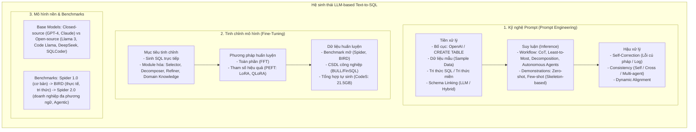

# A Survey on Employing Large Language Models for Text-to-SQL Tasks

| Thông tin | Chi tiết |
|---|---|
| **Tác giả** | Liang Shi*, Zhengju Tang*, Nan Zhang, Xiaotong Zhang, Zhi Yang† (*đồng tác giả thứ nhất, †tác giả liên hệ) |
| **Đơn vị** | School of Computer Science, Peking University, China; SINGDATA CLOUD PTE. LTD (USA & China) |
| **Năm / Venue** | 2025 (nhận bài 11/2024, chấp nhận 05/2025), ACM Computing Surveys (CSUR), Vol. 1, No. 1, Article 1, 36 pages (arXiv:2407.15186v5) |
| **Loại bài** | Survey (Tổng quan) |
| **Chủ đề** | Text-to-SQL, LLMs, Prompt Engineering, Fine-Tuning, Autonomous Agents, Inference-Time Scaling, Enterprise Workflows |
| **File gốc** | [A Survey on Employing Large Language Models for.pdf](../papers/A%20Survey%20on%20Employing%20Large%20Language%20Models%20for.pdf) |

## 1. Tóm tắt nhanh (TL;DR)
Bài báo trên ACM Computing Surveys cung cấp một khảo sát toàn diện và có cấu trúc chặt chẽ về việc ứng dụng Mô hình Ngôn ngữ Lớn (LLM) cho tác vụ Text-to-SQL, phân chia thành hai luồng phương pháp chính: Prompt Engineering (In-Context Learning) và Fine-tuning. Tác giả xây dựng hệ thống phân loại chi tiết (taxonomy) cho từng giai đoạn của pipeline, phân tích xu hướng dịch chuyển từ mô hình nguồn đóng sang nguồn mở, đánh giá hiệu năng thực tế trên Spider 1.0, BIRD và Spider 2.0, đồng thời đúc kết các bài học cốt lõi ("Key Takeaways") có giá trị thực tiễn cao cho cả nghiên cứu lẫn triển khai công nghiệp.

## 2. Bối cảnh & Vấn đề nghiên cứu
- **Bối cảnh**: Cơ sở dữ liệu quan hệ (RDB) lưu trữ phần lớn dữ liệu có cấu trúc của doanh nghiệp, nhưng việc truy vấn đòi hỏi chuyên môn SQL chuyên sâu. Text-to-SQL đóng vai trò cầu nối giúp người dùng phi kỹ thuật truy vấn dữ liệu bằng ngôn ngữ tự nhiên.
- **Sự chuyển dịch mô hình**:
  - *Thời kỳ đầu*: Phương pháp dựa trên mẫu (template-based) và tập luật (rule-based) đòi hỏi xây dựng thủ công tốn kém.
  - *Thời kỳ Deep Learning & PLM*: Seq2seq (LSTM, GNN, Transformer) và mô hình ngôn ngữ tiền huấn luyện (BERT, T5) thống trị nhưng cấu trúc phân mảnh, đòi hỏi huấn luyện tốn kém và gặp trần hiệu năng trên các truy vấn phức tạp.
  - *Kỷ nguyên LLM*: Đem lại hai thay đổi mang tính cách mạng: (1) **Novel Paradigm** - khả năng tuân theo chỉ dẫn (instruction-following) và in-context learning cho phép giải quyết bài toán mà không nhất thiết phải huấn luyện lại tham số; (2) **Uniform Architecture** - thống nhất trên kiến trúc Transformer Decoder-only quy mô lớn, tạo đà bứt phá hiệu năng và khả năng mở rộng.
- **Vấn đề cốt lõi khảo sát giải quyết**: Thiếu một khung phân loại hệ thống làm rõ ranh giới, ưu thế và sự đánh đổi giữa hai trường phái: *Prompt Engineering* (linh hoạt, ít dữ liệu nhưng phụ thuộc API đóng và rủi ro rò rỉ dữ liệu) và *Fine-tuning* (tùy biến sâu theo miền, bảo mật nội bộ nhưng đòi hỏi tài nguyên và dữ liệu gán nhãn lớn).

## 3. Phương pháp / Nội dung chính
Khảo sát phân tách toàn bộ hệ sinh thái LLM-based Text-to-SQL thành hai trụ cột công nghệ chính: Prompt Engineering và Fine-tuning, cùng sự tiến hóa của Base Models và Benchmarks.

### 3.1 Taxonomy kỹ nghệ Prompt (Prompt Engineering)
Quy trình suy luận của Prompt Engineering được chuẩn hóa theo công thức:
$$\text{pred\_SQL} = \text{Post\_process}(\text{LLM}(\text{QuestionRepresentation}, \text{Demonstration}, \text{Reasoning}))$$
- **Giai đoạn tiền xử lý (Pre-processing)**:
  - *Biểu diễn câu hỏi (Question Representation)*:
    - Bố cục (Layout): So sánh giữa định dạng OpenAI API template (chú thích SQLite) và câu lệnh `CREATE TABLE` đầy đủ. Thực nghiệm chỉ ra các định dạng có cấu trúc đạt kết quả cao hơn trong các cấu hình được so sánh so với văn bản phi cấu trúc.
    - Dữ liệu mẫu (Sample Data): Chèn vài dòng mẫu (`LIMIT 3` hoặc liệt kê giá trị theo cột) giúp LLM hiểu định dạng thực tế, nhưng đưa quá nhiều mẫu gây phản tác dụng do loãng ngữ cảnh.
    - Tri thức bổ trợ (Knowledge): Hướng dẫn thói quen viết SQL (tránh `LEFT JOIN`, ưu tiên `JOIN` và `INTERSECT`, ép dùng `DISTINCT` như trong C3), và bằng chứng tri thức miền (external evidence từ BIRD).
  - *Liên kết lược đồ (Schema Linking)*:
    - Phân loại thành: (1) Prompting LLM theo từng bước (C3, MCS-SQL phân tách bảng trước - cột sau; CHESS lọc 3 giai đoạn); (2) Tận dụng năng lực tổng quát (CoT, Self-consistency, Few-shot); (3) Tích hợp truyền thống và LLM (CRUSH4SQL sinh schema ảo rồi truy xuất vector); (4) Phương pháp truyền thống dựa trên độ tương đồng (BERT embeddings) và đồ thị kết nối (DBCopilot, PURPLE).
    - Phát hiện từ Distillery (2024): Khi năng lực suy luận của LLM tăng lên, mô hình ít nhạy cảm hơn với các cột dư thừa, tuy nhiên Schema Linking vẫn bắt buộc đối với các kho dữ liệu doanh nghiệp vượt quá context window.
- **Giai đoạn suy luận (Inference)**:
  - *Luồng công việc (Workflows)*:
    - **Chain-of-Thought (CoT)**: Sinh từng mệnh đề SQL bước-bước; các biến thể như Auto-CoT (ACT-SQL) hay Chain-of-Edition (CoE-SQL với 14 luật biên tập SQL).
    - **Least-to-Most**: Tách nhỏ câu hỏi ngôn ngữ tự nhiên từ đơn giản đến phức tạp (LTMP-DA-GP kết hợp NatSQL).
    - **Decomposition**: Phân rã song song (DIN-SQL phân loại độ khó) hoặc tuần tự (MAC-SQL với Decomposer agent, DEA-SQL).
    - **Autonomous Agents**: Lấy LLM làm "bộ não" điều khiển tương tác đa vòng với môi trường CSDL qua CLI, có bộ nhớ dài hạn và điều kiện dừng động (Spider-Agent trong Spider 2.0, REFORCE với self-refinement và hạn chế định dạng).
  - *Ví dụ mẫu (Demonstrations)*:
    - Zero-shot (tiết kiệm token nhưng khó với tác vụ lạ) vs Few-shot (học mẫu tác vụ).
    - Chiến lược chọn mẫu: Trích xuất khung xương câu hỏi (Question Skeleton / De-semanticization trong DAIL-SQL, PURPLE) để tìm kiếm các truy vấn có cùng ý định logic thay vì dựa trên từ vựng bề mặt.
- **Giai đoạn hậu xử lý (Post-processing)**:
  - *Self-Correction*: Tận dụng thông báo lỗi thực thi, log cơ sở dữ liệu hoặc bộ phê bình (SQL Critic) để tinh chỉnh câu lệnh hỏng.
  - *Tính nhất quán (Consistency)*: Self-Consistency (lấy mẫu nhiều lần ở nhiệt độ cao rồi bỏ phiếu đa số); Cross-Consistency (PET-SQL bỏ phiếu chéo kết quả thực thi giữa các họ LLM khác nhau để khử định kiến mô hình); Đàm phán đa tác tử (R3).

### 3.2 Taxonomy tinh chỉnh mô hình (Fine-Tuning)
- **Mục tiêu tinh chỉnh (Finetuning Objectives)**: Ngoài việc tinh chỉnh trực tiếp bài toán dịch NL-to-SQL (Open-SQL, CodeS, FinSQL), các nghiên cứu mới tinh chỉnh các module chuyên biệt: agent Selector/Refiner (MAC-SQL), module sinh tri thức miền (DELLM).
- **Phương pháp huấn luyện**: Full Fine-Tuning (FFT) tốn kém và dễ gây quên thảm họa (catastrophic forgetting); Parameter-Efficient Fine-Tuning (PEFT, đặc biệt là LoRA và QLoRA) trở thành lựa chọn chủ đạo nhờ hiệu quả bộ nhớ và giữ được tri thức tổng quát.
- **Dữ liệu huấn luyện**: Khắc phục tình trạng thiếu dữ liệu thực tế bằng cách tổng hợp dữ liệu quy mô lớn (CodeS thu thập 21.5GB dữ liệu hỗn hợp SQL/Code/NL và dùng GPT-3.5 sinh mẫu thích ứng miền mới).

## 4. Thực nghiệm & Kết quả chính

> **Cách đọc số liệu:** Các kết quả thuộc benchmark, split, metric và phiên bản mô hình của bài báo. “SOTA” chỉ áp dụng trong bối cảnh/thời điểm bài báo nêu; không so trực tiếp với PA của challenge.
### 4.1 Phân tích trên các Benchmark chính (Spider 1.0, BIRD, Spider 2.0)
Tác giả tổng hợp kết quả chính thức trên các leaderboard (Figure 8) theo độ chính xác thực thi (Execution Accuracy - EX):
1. **Spider 1.0 (Đã được giải quyết cơ bản)**: Hầu hết các phương pháp LLM hiện đại đều đạt độ chính xác thực thi $EX > 80\%$, cho thấy năng lực ngữ nghĩa cơ bản trên lược đồ chuẩn đã tiệm cận mức tối đa.
2. **BIRD (Thu hẹp khoảng cách nguồn mở và nguồn đóng)**:
   - Các mô hình nguồn mở kích thước nhỏ được tinh chỉnh chuyên sâu (fine-tuned SLMs như Code Llama, DeepSeek-Coder) cạnh tranh sòng phẳng với các mô hình nguồn đóng khổng lồ (GPT-4) khi kết hợp cùng kỹ nghệ suy luận.
   - Các giải pháp dẫn đầu (OpenSearch-SQL, Distillery, MCS-SQL) chia sẻ hai đặc tính chung:
     - *Inference-time Scaling*: Đầu tư tính toán tại thời điểm suy luận (sinh nhiều ứng viên SQL, tự sửa lỗi lặp, self-consistency).
     - *Enhanced Schema Linking*: Mở rộng không gian tìm kiếm hoặc đưa tối đa schema vào prompt nếu context cho phép.
3. **Spider 2.0 (Khoảng cách thực tế doanh nghiệp)**:
   - Trong các kết quả Spider 2.0 được survey tổng hợp, pipeline không agent như DIN-SQL và DAIL-SQL đạt điểm thấp hơn các cấu hình agent được báo cáo.
   - Các kiến trúc agent như Spider-Agent và REFORCE có thể dùng CLI, dò cấu trúc lặp và xử lý dialect trong benchmark này; kết quả phụ thuộc vào công cụ và mô hình đi kèm.
   - Tuy nhiên, phương pháp SOTA (REFORCE) hiện chỉ đạt **31.26% EX**, cho thấy thách thức cực lớn của môi trường doanh nghiệp thực tế.

### 4.2 Thước đo đánh giá nâng cao
- Giới thiệu **ESM+ (Exact Set Match Plus)**: Bổ sung các luật kiểm tra nghiêm ngặt cho `JOIN`, `DISTINCT`, `LIMIT`, `IN`, alias và ràng buộc schema so với EM truyền thống, giúp giảm đáng kể cả false positive lẫn false negative.
- **Valid Efficiency Score (VES)**: Đánh giá câu truy vấn có tối ưu thời gian chạy trên bảng hàng triệu dòng hay không.

### 4.3 Phân tích lỗi (Error Analysis Summary - Section 8.1)
Tổng hợp lỗi trên Spider và BIRD:
- **Schema Linking**: Là nguồn lỗi lớn nhất, chiếm **29%–49%** tổng số ca sai sót.
- **Phép nối bảng (JOIN)**: Chiếm **21%–26%** lỗi do sai khóa ngoại hoặc quan hệ bắc cầu.
- **GROUP BY và Nested Subqueries**: Chiếm dưới **20%**.
- **Chất lượng nhãn benchmark**: Khảo sát chỉ ra bản thân nhãn vàng (gold standard) của Spider và BIRD tồn tại từ **20%–30% lỗi hoặc bất nhất**, đặt ra yêu cầu cấp thiết về lọc rửa dữ liệu chuẩn (data cleaning).

## 5. Tính mới (Novelty & Đóng góp)
- **Cấu trúc phân loại nhị phân rõ nét**: Tách bạch mạch lạc và phân tích song song hai luồng giải pháp lớn: Prompt Engineering vs. Fine-Tuning.
- **Đúc kết "Key Takeaways" thực chứng**: Cung cấp các kết luận súc tích, thực tế sau mỗi phần (như: ưu tiên cấu trúc khung xương câu hỏi để chọn few-shot; kết hợp cả Self-Correction và Consistency ở hậu xử lý; mở rộng Schema Linking khi context cho phép).
- **Phân tích toàn diện về Autonomous Agents và Inference-Time Scaling**: Là một trong những khảo sát đầu tiên phân tích chuyên sâu các framework agentic tự trị mới nhất (Spider 2.0, Spider-Agent, REFORCE) và cơ chế mở rộng tính toán tại thời điểm suy luận (inference-time scaling).
- **Khảo sát xu hướng mô hình nền thực tế**: Định lượng tần suất và xu hướng dịch chuyển từ mô hình đóng sang mô hình mở (DeepSeek, Llama 3, Qwen) trong giai đoạn 2022–2025.

## 6. Hạn chế
### 6.1 Hạn chế do tác giả thừa nhận
- **Tốc độ lỗi thời nhanh của kết quả benchmark**: Lĩnh vực LLM phát triển quá nhanh, các mô hình và phương pháp mới xuất hiện liên tục khiến các bảng xếp hạng thực nghiệm nhanh chóng bị vượt qua.
- **Nghiên cứu Fine-tuning còn tụt hậu**: Cộng đồng học thuật tập trung áp đảo vào prompt engineering trên mô hình đóng (chi phí API thấp, dễ viết bài), trong khi fine-tuning mô hình mở cho môi trường doanh nghiệp ít bài công bố chuyên sâu hơn.
- **Độ phức tạp CSDL nghiên cứu chưa phản ánh CSDL công nghiệp**: Các kho dữ liệu thực tế (như kho dữ liệu Microsoft với 632 bảng, hơn 4.000 cột và 200 views) vượt xa quy mô của các benchmark hiện hữu.

### 6.2 Nhận xét thêm của người review
- **Thiếu đánh giá định lượng chi phí tài chính (Dollar Cost per Query)**: Khảo sát khuyến nghị mở rộng inference-time scaling (sinh nhiều câu SQL, chạy nhiều vòng voting), nhưng không cung cấp phân tích chi phí tài chính chi tiết tương ứng với từng mức cải thiện độ chính xác.
- **Chưa bàn thảo sâu về tương tác người dùng (Human-in-the-Loop)**: Khi agent gặp lỗi hoặc câu hỏi mơ hồ, cơ chế hỏi lại người dùng để làm rõ ý định (clarification questions) chưa được đưa vào taxonomy như một thành phần chính thức.
- **Độ tin cậy của việc LLM tự đánh giá (Critic / Self-Correction)**: Các nghiên cứu gần đây chỉ ra LLM thường có xu hướng "tự tin sai" khi tự duyệt code của mình; khảo sát chưa phân tích sâu hiện tượng thiên vị tự xác nhận (self-confirmation bias) này.

## 7. Ý nghĩa ứng dụng (cho hệ thống agent phân tích dữ liệu / Text-to-SQL)

> **Phân biệt nguồn:** Khuyến nghị trong mục này là suy luận ứng dụng cho DataMate; bài báo không đánh giá trực tiếp trên challenge, trừ khi nêu rõ.
- **Áp dụng Skeleton Retrieval cho Few-shot In-Context Learning**: Che mờ thực thể/tên cột trong câu hỏi để lấy khung logic (question skeleton), sau đó tìm kiếm các ví dụ mẫu có cùng cấu trúc câu truy vấn để đưa vào prompt giúp tăng độ chính xác rõ rệt.
- **Tận dụng Inference-Time Scaling hợp lý**: Thay vì chỉ gọi LLM một lần, triển khai pipeline sinh 3–5 ứng viên kèm nhiệt độ phân tán, thực thi trên replica DB và áp dụng đa số phiếu (majority voting) trên tập kết quả thực thi.
- **Chiến lược lai ghép cho doanh nghiệp**: Sử dụng QLoRA để tinh chỉnh mô hình mã nguồn mở (như DeepSeek-Coder-33B hoặc Qwen-2.5-Coder) trên schema nội bộ nhằm đảm bảo an toàn dữ liệu cá nhân/bí mật kinh doanh, kết hợp prompt template `CREATE TABLE` có chú thích khóa ngoại rõ ràng.
- **Kiến trúc Autonomous Agent cho CSDL lớn**: Đối với CSDL phức tạp nhiều bảng, xây dựng agent tương tác kiểu ReAct có khả năng thăm dò lược đồ từng phần (column exploration) và nén bảng (table compression) trước khi sinh toàn bộ truy vấn.

## 8. Từ khóa
`Text-to-SQL`, `Large Language Models`, `Prompt Engineering`, `Fine-Tuning`, `Schema Linking`, `Autonomous Agents`, `Inference-Time Scaling`, `Spider 2.0`, `BIRD Benchmark`, `Self-Correction`, `Cross-Consistency`, `ESM+`

## 9. Mức độ phù hợp với challenge DataMate

**Phân nhóm: Tham khảo.** Dùng tra cứu prompt và fine-tuning; phạm vi trùng các survey Text-to-SQL khác, không thay thế kiểm thử format challenge.

## 10. Nguồn và truy nguyên kết quả

- **PDF gốc:** liên kết ở bảng thông tin đầu review và bản lưu trong thư mục `../papers/`.
- **Vị trí kiểm chứng:** Benchmark/metric: PDF §3, pp. 5–7; evaluation methodology/results: §§7.2–7.3, pp. 26–27; conclusion §9, p. 30.
- Số liệu ở mục 4 là kết quả tác giả trên benchmark gốc; phần áp dụng DataMate tại mục 7 và mục 9 là nhận định của review.
