# AmbiSQL: Interactive Ambiguity Detection and Resolution for Text-to-SQL

| Thông tin | Chi tiết |
|---|---|
| **Tác giả** | Zhongjun Ding, Yin Lin†, Tianjing Zeng, Rong Zhu†, Bolin Ding, Jingren Zhou († Corresponding authors) |
| **Đơn vị** | Alibaba Group |
| **Năm / Venue** | 2026 / SIGMOD-Companion '26 (SIGMOD 2026 Demo Track, May 31–June 5, 2026, Bengaluru, India; arXiv:2508.15276v2 [cs.DB], 23 Mar 2026) |
| **Loại bài** | Hệ thống demo (Demonstration paper) |
| **Chủ đề** | Text-to-SQL, Query Ambiguity, Interactive Clarification, Ambiguity Taxonomy, Human-in-the-Loop |
| **File gốc** | [AmbiSQL.pdf](../papers/AmbiSQL.pdf) |

## 1. Tóm tắt nhanh (TL;DR)
AmbiSQL là hệ thống demo tương tác (human-in-the-loop) giúp tự động phát hiện và giải quyết tính mơ hồ (query ambiguity) trong các câu hỏi ngôn ngữ tự nhiên cho Text-to-SQL thông qua các câu hỏi làm rõ trắc nghiệm (clarification questions - CQs). Hệ thống đề xuất một phân loại mơ hồ (taxonomy) 2 chiều gồm 7 loại con (bắt nguồn từ CSDL và từ suy luận của LLM), áp dụng in-context learning để phát hiện cụm từ mơ hồ và sinh câu hỏi trắc nghiệm kèm lựa chọn "Abstain" và "Others". Kết hợp cơ chế cập nhật cây sở thích (preference tree) và viết lại câu truy vấn, AmbiSQL tích hợp trực tiếp với backend Text-to-SQL thương mại XiYan-SQL của Alibaba, minh họa qua 40 câu truy vấn mơ hồ tuyển chọn từ BIRD và TAG.

## 2. Bối cảnh & Vấn đề nghiên cứu
- **Vấn đề cốt lõi:** Dù các mô hình ngôn ngữ lớn (LLM) đạt tiến bộ vượt bậc trên các benchmark Text-to-SQL như Spider hay BIRD, tính mơ hồ trong câu hỏi tự nhiên (query ambiguity) vẫn là nguyên nhân lỗi hàng đầu. Người dùng thực tế thường đặt câu hỏi thiếu ngữ cảnh, không đầy đủ hoặc có nhiều cách hiểu.
- **Hậu quả:** Khi gặp câu hỏi mơ hồ, hệ thống Text-to-SQL có thể sinh ra câu truy vấn SQL hợp lệ về mặt cú pháp (*syntactically valid*) nhưng hoàn toàn sai lệch về mặt ngữ nghĩa (*semantically inaccurate*), không phản ánh đúng mong muốn của người dùng. Điều này gây khó khăn nghiêm trọng cho:
  1. *Phát triển hệ thống:* Khó khăn trong việc liên kết câu hỏi với đúng thực thể/cột trong cơ sở dữ liệu (schema linking).
  2. *Đánh giá benchmark:* Câu hỏi có thể có nhiều cách diễn giải hợp lệ nhưng benchmark thường chỉ cung cấp duy nhất một ground truth.
  3. *Triển khai thực tế:* Hệ thống gặp khó khi suy luận ý định người dùng nếu không có thêm ngữ cảnh hoặc tương tác.
- **Thiếu sót của các phương pháp trước đó:**
  1. *Phương pháp tự động hoàn toàn (fully automated):* Tự sinh và lựa chọn các cách diễn giải ứng viên mà không có người dùng tham gia, dẫn đến việc chọn sai lệch hoàn toàn so với ý định thực của người dùng.
  2. *Phạm vi giải quyết hẹp:* Đa số công trình trước (kể cả phương pháp tự động lẫn human-in-the-loop) chỉ tập trung vào lỗi schema-linking và dữ liệu trong CSDL, bỏ qua các loại mơ hồ phát sinh từ suy luận logic của LLM (ví dụ: mốc thời gian lịch sử nhiều mức độ chi tiết, câu hỏi cần dữ liệu ngoài hay dữ liệu trong CSDL).
  3. *Thiếu taxonomy toàn diện:* Không có bộ phân loại chuẩn dẫn đến việc sinh bùng nổ số lượng ứng viên diễn giải (tốn kém tài nguyên tính toán), hoặc phụ thuộc vào các bộ phát hiện mơ hồ được huấn luyện trước (pre-trained detectors) vốn tốn kém dữ liệu gán nhãn và khái quát hóa kém giữa các miền (poor cross-domain generalization).

## 3. Phương pháp / Nội dung chính

### 3.1 Phân loại mơ hồ (Ambiguity Taxonomy)
AmbiSQL phân loại mơ hồ thành 2 chiều lớn với 7 loại con:

1. **Database-sourced ambiguity (Mơ hồ bắt nguồn từ CSDL):** Phát sinh từ tham chiếu không rõ ràng đến lược đồ hoặc dữ liệu CSDL.
   - `AmbiSchema`: Câu hỏi thiếu ngữ cảnh để xác định bảng/cột nào cần dùng cho thao tác lọc, xếp hạng hoặc tổng hợp (ví dụ: "oldest user" có thể là tuổi lớn nhất hay ngày đăng ký sớm nhất).
   - `AmbiValue`: Giá trị được hỏi không khớp chính xác với giá trị lưu trong CSDL, gây khó khăn cho việc tạo hằng số trong mệnh đề `WHERE` (ví dụ: hỏi "New York City" nhưng CSDL lưu "NYC", hoặc hỏi "COVID-19" nhưng CSDL lưu "coronavirus").
   - `AmbiIntent`: Thiếu từ khóa xác định rõ toán tử/thao tác SQL mong muốn (ví dụ: "Show me users by registration date" có thể là `ORDER BY`, `GROUP BY`, hoặc `WHERE`).

2. **LLM-sourced ambiguity (Mơ hồ bắt nguồn từ suy luận của LLM):** Phát sinh từ yêu cầu suy luận không rõ ràng của LLM khi truy xuất hoặc áp dụng tri thức vượt ra ngoài CSDL.
   - `AmbiSource`: Không rõ dữ liệu nên được lấy từ CSDL hay suy luận qua tri thức ngoài của LLM (ví dụ: "players taller than Michael Jordan" - chiều cao của Jordan lấy từ CSDL hay từ tri thức ngoài).
   - `AmbiContext`: Câu hỏi thiếu ngữ cảnh cần thiết để LLM suy luận hiệu quả (ví dụ: yêu cầu "exchange rate" mà không chỉ rõ cặp tiền tệ hoặc ngày áp dụng).
   - `AmbiFallacy`: Giả định kiến thức nằm trong câu hỏi mâu thuẫn với thực tế hoặc nội dung CSDL (ví dụ: hỏi về người tham gia một sự kiện chưa từng diễn ra).
   - `AmbiRef`: Ràng buộc không gian/thời gian không đủ cụ thể, dẫn đến nhiều cách hiểu ở các mức độ chi tiết (granularity) khác nhau (ví dụ: "after the 2018 World Cup" là sau trận chung kết hay sau năm 2018; "the end of the Vietnam War" là 30/04/1975 hay 29/03/1973).

### 3.2 Kiến trúc và Pipeline 2 giai đoạn

```mermaid
flowchart LR
    Q["Câu hỏi ban đầu (q) + Schema (D)"] --> S1["Giai đoạn 1: Ambiguity Identification"]
    subgraph S1_BOX ["Giai đoạn 1: Nhận diện mơ hồ"]
        AD1["Ambiguity Detection<br/>(LLM In-Context Learning)"] --> CQ["CQ Generation<br/>(Sinh câu hỏi trắc nghiệm)"]
    end
    S1 --> S1_BOX
    CQ --> USR["Người dùng phản hồi<br/>(Chọn trắc nghiệm / Abstain / Others<br/>+ Additional Constraints)"]
    USR --> S2["Giai đoạn 2: Iterative Refinement"]
    subgraph S2_BOX ["Giai đoạn 2: Tinh chỉnh lặp"]
        PU["Preference Update<br/>(Cập nhật cây sở thích)"] --> QR["Query Refinement<br/>(Viết lại câu hỏi)"]
        QR --> AD2["Ambiguity Detection<br/>(Kiểm tra lại mơ hồ mới/phụ thuộc)"]
    end
    S2 --> S2_BOX
    AD2 -- "Còn mơ hồ" --> CQ
    AD2 -- "Hết mơ hồ" --> BACKEND["XiYan-SQL Backend<br/>(Thương mại)"]
    BACKEND --> FINAL_SQL["SQL Query hoàn chỉnh (Q*)"]
```

1. **Giai đoạn 1: Ambiguity Identification (Nhận diện mơ hồ):**
   - **Ambiguity Detection Module:** Dùng LLM tiền huấn luyện với phương pháp *In-Context Learning*. Prompt được thiết kế cẩn thận gồm: (1) định nghĩa mơ hồ rõ ràng, (2) taxonomy phân loại chi tiết, và (3) các ví dụ đại diện cho từng loại mơ hồ. Module trích xuất các cụm từ con mơ hồ $P = \{p_1, \dots, p_k\}$ trong câu hỏi và gán nhãn loại mơ hồ $a_i \in \mathcal{A}$.
   - **Clarification Question (CQ) Generation Module:** Sinh câu hỏi trắc nghiệm khách quan kèm các phương án lựa chọn và mô tả/snippet từ CSDL. Mỗi câu hỏi luôn đi kèm 2 tùy chọn mặc định quan trọng:
     - *Abstain:* Cho phép người dùng bỏ qua nếu câu hỏi làm rõ không đúng hoặc không liên quan đến ý định của họ (giúp hệ thống nhận phản hồi để cải thiện).
     - *Others:* Cho phép người dùng tự nhập câu trả lời tự do nếu các lựa chọn đưa ra chưa bao hàm ý định thực tế.

2. **Giai đoạn 2: Iterative Refinement (Tinh chỉnh lặp):**
   - **Preference Update Module:** Lưu các câu trả lời làm rõ vào cấu trúc dạng cây (*tree-like structure*) được tổ chức theo các nút của ambiguity taxonomy. Khi người dùng đưa ra phản hồi mới mâu thuẫn với phản hồi cũ, hệ thống tự động cập nhật và ưu tiên phản hồi mới nhất.
   - **Query Refinement Module:** Tổng hợp các ràng buộc bổ sung (*Additional Constraints*) do người dùng chủ động gõ thêm vào câu truy vấn gốc (ví dụ: "quốc tịch tay đua phải là người Đức").
   - **Vòng lặp giải quyết phụ thuộc (Ambiguity Dependencies):** Câu truy vấn viết lại được gửi ngược lại module Ambiguity Detection để rà soát. Điều này đảm bảo xử lý triệt để các mơ hồ phụ thuộc (ví dụ: cần làm rõ `AmbiIntent` để xác định toán tử trước, sau đó mới xác định được `AmbiSchema` hay `AmbiValue`), đồng thời kiểm tra xem các ràng buộc bổ sung có phát sinh mơ hồ mới hay không.

### 3.3 Thiết kế Giao diện Demo (User Interface)
Giao diện AmbiSQL gồm 3 panel tương tác:
1. **User Input Panel (Panel 1):** Người dùng nhập câu hỏi tự nhiên, chọn SQL dialect và chọn CSDL; hoặc chọn nhanh từ playground 40 câu hỏi mẫu có sẵn.
2. **Ambiguity Resolution Panel (Panel 2):** Hiển thị các câu hỏi trắc nghiệm dưới dạng dropdown menu, kèm khung nhập *Additional Constraints*. Panel này duy trì một *persistent interaction log* ghi lại từng bước làm rõ để người dùng theo dõi nguồn gốc thay đổi.
3. **SQL Generation Panel (Panel 3):** Tích hợp với backend XiYan-SQL. Hiển thị đối chiếu song song (*side-by-side comparison*) giữa kết quả sinh SQL khi có AmbiSQL và khi không có AmbiSQL. Có nút "Compare Results" và mục "Detected Differences" nêu bật chính xác những điểm đã được tinh chỉnh (ví dụ: sửa đúng cột CSDL, đổi đúng mốc ngày tháng lọc).

## 4. Thực nghiệm & Kết quả chính

> **Cách đọc số liệu:** Các kết quả thuộc benchmark, split, metric và phiên bản mô hình của bài báo. “SOTA” chỉ áp dụng trong bối cảnh/thời điểm bài báo nêu; không so trực tiếp với PA của challenge.
- **Đặc thù bài báo:** AmbiSQL là bài báo hệ thống demo (SIGMOD-Companion '26 Demonstration, 4 trang), vì vậy không tập trung vào bảng điểm benchmark quy mô lớn với các chỉ số thống kê diện rộng (như Execution Accuracy % trên toàn bộ tập BIRD), mà tập trung vào việc cho thấy tính khả thi của hệ thống tương tác thực tế và giải quyết các ca mơ hồ phức tạp.
- **Tập dữ liệu thử nghiệm (Playground Dataset):**
  - Gồm **40 câu truy vấn mơ hồ** được tuyển chọn kỹ càng từ 2 benchmark thực tế: **BIRD** và **TAG**.
  - Bao phủ toàn bộ **7 loại mơ hồ** trong taxonomy đề xuất.
  - Mỗi câu truy vấn đều được gán nhãn thủ công (human-annotated) về phân loại mơ hồ và ý định truy vấn chuẩn của người dùng.
- **Minh họa ca thực tế điển hình (từ TAG benchmark):**
  - *Câu hỏi gốc:* "How many drivers born after the end of the Vietnam War have been ranked 2?" kèm ràng buộc thêm: "the driver's nationality should be German".
  - *Hệ thống phát hiện 2 mơ hồ:*
    1. Cụm "the end of the Vietnam War" thuộc `AmbiRef`: AmbiSQL đưa ra lựa chọn ngày lịch sử cụ thể (ngày 30/04/1975 vs ngày 29/03/1973).
    2. Cụm "ranked 2" thuộc `AmbiSchema`: AmbiSQL đưa ra lựa chọn ánh xạ sang cột `position` của bảng `driverStandings` thay vì nhầm sang cột `rank`.
  - *Kết quả đối chiếu:*
    - Khi không có AmbiSQL: Hệ thống Text-to-SQL tự mặc định mốc 1975-04-30 hoặc chọn sai cột trong bảng, dẫn tới SQL sai ngữ nghĩa.
    - Khi có AmbiSQL: Nhờ người dùng chọn mốc 1973-03-29 và cột `position`, kết hợp thêm điều kiện lọc quốc tịch Đức, câu lệnh SQL sinh ra phản ánh chuẩn xác 100% ý định người dùng.
- **Backend Text-to-SQL:** Tích hợp với **XiYan-SQL**, mô hình Text-to-SQL thương mại đa bộ sinh (*multi-generator framework*) của Alibaba.
- **Tài nguyên công bố:** Tác giả cung cấp mã nguồn tại GitHub: `https://github.com/JustinzjDing/AmbiSQL` và video demo tại: `https://www.youtube.com/watch?v=rbB-0ZKwYkk`.

## 5. Tính mới (Novelty & Đóng góp)
- **Taxonomy mơ hồ 2 chiều toàn diện:** Mở rộng khái niệm mơ hồ trong Text-to-SQL vượt khỏi phạm vi CSDL truyền thống (schema/value) sang cả phạm vi suy luận của LLM (`AmbiSource`, `AmbiContext`, `AmbiFallacy`, `AmbiRef`).
- **Phát hiện mơ hồ nhẹ nhàng bằng In-Context Learning:** Sử dụng LLM với prompt có cấu trúc và taxonomy định hướng, loại bỏ nhu cầu huấn luyện các bộ phân loại mơ hồ chuyên biệt vốn tốn kém chi phí gán nhãn và khó tổng quát hóa qua các domain mới.
- **Cơ chế tương tác 2 giai đoạn giải quyết phụ thuộc (Dependency-aware):** Cho phép phát hiện và giải quyết các mơ hồ theo thứ tự logic (ví dụ làm rõ toán tử trước khi làm rõ cột dữ liệu), lặp lại việc kiểm tra sau mỗi lần viết lại truy vấn.
- **Quản lý ngữ cảnh bằng Cây Sở thích (Tree-like Preference Tracking):** Lưu trữ và cập nhật trạng thái làm rõ của người dùng theo cấu trúc cây phân tầng, hỗ trợ xử lý mâu thuẫn khi người dùng thay đổi quyết định hoặc đưa thêm điều kiện mới (*Additional Constraints*).
- **Thiết kế câu hỏi trắc nghiệm thân thiện với UX:** Tránh việc bắt người dùng tự giải thích bằng cách cung cấp trắc nghiệm kèm snippet dữ liệu, đồng thời luôn có lựa chọn an toàn "Abstain" (giảm hỏi phiền) và "Others" (tránh ép người dùng vào lựa chọn sai).

## 6. Hạn chế

### 6.1 Hạn chế do tác giả thừa nhận
- **Phụ thuộc vào năng lực mô hình nền:** Việc phát hiện mơ hồ và sinh câu hỏi trắc nghiệm dựa hoàn toàn vào in-context learning của LLM, do đó chất lượng và độ nhạy phát hiện mơ hồ vẫn chịu ảnh hưởng bởi năng lực suy luận của LLM nền tảng.
- **Quy mô playground demo có giới hạn:** Tập playground tích hợp sẵn mới dừng lại ở 40 câu hỏi được tuyển chọn từ BIRD và TAG để phục vụ trình diễn tại hội nghị.

### 6.2 Nhận xét thêm của người review
- **Thiếu số liệu đánh giá định lượng diện rộng (Quantitative Evaluation):** Do là bài báo thể loại Demonstration (4 trang tại SIGMOD Companion), tác giả không công bố các thước đo định lượng cụ thể như: Precision / Recall / F1-score của module phát hiện mơ hồ; tỷ lệ câu hỏi làm rõ thừa/thiếu; hay mức tăng Execution Accuracy (EX) trên toàn bộ tập dữ liệu BIRD/TAG.
- **Gánh nặng tương tác lên người dùng (Cognitive Load & User Fatigue):** Với những câu hỏi có nhiều điểm mơ hồ phức tạp hoặc chuỗi phụ thuộc dài, việc bắt người dùng trả lời nhiều câu hỏi trắc nghiệm qua nhiều vòng lặp có thể làm gián đoạn trải nghiệm và gây nản lòng cho người dùng cuối.
- **Rủi ro ảo giác khi sinh câu hỏi (Hallucination in CQ Generation):** Khi schema CSDL quá lớn với hàng trăm bảng và cột, việc LLM tự động sinh các phương án trắc nghiệm có thể bị sót các cột quan trọng hoặc đưa ra các lựa chọn sai lệch nếu context window bị quá tải.
- **Chi phí gọi LLM và độ trễ gia tăng:** Pipeline nhiều bước (Detect $\rightarrow$ Sinh CQ $\rightarrow$ Nhận phản hồi $\rightarrow$ Refine $\rightarrow$ Re-detect $\rightarrow$ Sinh SQL qua XiYan-SQL) tốn nhiều lượt gọi LLM, làm tăng đáng kể độ trễ phản hồi (latency) và chi phí API so với các hệ thống Text-to-SQL sinh 1 lần (single-turn).

## 7. Ý nghĩa ứng dụng (cho hệ thống agent phân tích dữ liệu / Text-to-SQL)

> **Phân biệt nguồn:** Khuyến nghị trong mục này là suy luận ứng dụng cho DataMate; bài báo không đánh giá trực tiếp trên challenge, trừ khi nêu rõ.
- **Áp dụng mẫu tương tác "Disambiguate First, Parse Later" vào ChatBI:** Thay vì để Text-to-SQL agent cố gắng "đoán mò" khi câu hỏi mập mờ, hệ thống nên chủ động dừng lại hỏi làm rõ dạng trắc nghiệm với các phương án khả thi dựa trên schema thực tế.
- **Tận dụng Taxonomy 2 chiều làm Guardrail cho Agent:** Phân tách rõ ràng giữa mơ hồ schema/data và mơ hồ suy luận logic/thời gian để kích hoạt đúng công cụ xử lý (ví dụ: tra cứu CSDL để làm rõ `AmbiValue`, hoặc tra cứu tài liệu/web để làm rõ `AmbiRef`).
- **Thiết kế câu hỏi có lựa chọn "Abstain" và "Others":** Đây là nguyên tắc thiết kế UX cực kỳ quan trọng cho các Data Agent thực tế, giúp giảm bớt cảm giác phiền toái khi agent nhận diện nhầm câu hỏi bình thường thành câu hỏi mơ hồ.
- **Cơ chế so sánh và giải thích khác biệt (Detected Differences):** Giúp người dùng doanh nghiệp hiểu rõ câu SQL đã thay đổi như thế nào sau khi họ làm rõ ý định, từ đó tăng độ tin cậy và minh bạch của hệ thống.

## 8. Từ khóa
`Text-to-SQL`, `Query Ambiguity`, `Ambiguity Taxonomy`, `Interactive Clarification`, `Clarification Questions`, `Human-in-the-Loop`, `XiYan-SQL`, `In-Context Learning`, `Query Refinement`.

## 9. Mức độ phù hợp với challenge DataMate

**Phân nhóm: Tham khảo.** Phân loại mơ hồ có thể tham khảo; luồng hỏi lại người dùng không phù hợp quy định không có human-in-the-loop.

## 10. Nguồn và truy nguyên kết quả

- **PDF gốc:** liên kết ở bảng thông tin đầu review và bản lưu trong thư mục `../papers/`.
- **Vị trí kiểm chứng:** Bài system demo 4 trang: mô tả vấn đề, kiến trúc AmbiSQL và đánh giá minh họa nằm trong PDF pp. 1–4; không có benchmark lớn.
- Số liệu ở mục 4 là kết quả tác giả trên benchmark gốc; phần áp dụng DataMate tại mục 7 và mục 9 là nhận định của review.
