# CHESS: Contextual Harnessing for Efficient SQL Synthesis

| Thông tin | Chi tiết |
|---|---|
| **Tác giả** | Shayan Talaei, Mohammadreza Pourreza, Yu-Chen Chang, Azalia Mirhoseini, Amin Saberi |
| **Đơn vị** | Stanford University; University of Alberta |
| **Năm / Venue** | arXiv:2405.16755v3 (25/11/2024; bản đầu 05/2024). Hội nghị chính thức: Không nêu rõ trong văn bản |
| **Loại bài** | Phương pháp (multi-agent framework + hybrid SFT/In-Context Learning) |
| **Chủ đề** | Text-to-SQL, Multi-agent LLM, Schema pruning / Schema selection, Entity & Context retrieval (LSH, Vector DB), Natural language unit testing, Execution revision |
| **File gốc** | [Contextual Harnessing for Efficient SQL Synthesis.pdf](../papers/Contextual%20Harnessing%20for%20Efficient%20SQL%20Synthesis.pdf) |

## 1. Tóm tắt nhanh (TL;DR)
CHESS là framework multi-agent gồm 4 agent chuyên biệt: **Information Retriever (IR)**, **Schema Selector (SS)**, **Candidate Generator (CG)** và **Unit Tester (UT)**, giải quyết toàn diện 4 thách thức lớn trong Text-to-SQL: truy xuất dữ liệu/metadata ngữ cảnh, cắt tỉa schema quy mô công nghiệp, sinh truy vấn kèm sửa lỗi lặp, và thẩm định kết quả bằng unit test ngôn ngữ tự nhiên. CHESS có tính thích ứng cao theo ràng buộc triển khai: đạt **71.10%** Execution Accuracy (EX) trên BIRD test set ở cấu hình high-compute (sát mức 73.00% của CHASE-SQL nhưng giảm ~83% số lượt gọi LLM); dẫn đầu nhóm mô hình mã nguồn mở bảo toàn quyền riêng tư với **61.5%** EX trên BIRD dev; và xử lý hiệu quả schema công nghiệp hơn 4.000 cột giúp giảm 5 lần token và tăng 2% độ chính xác.

## 2. Bối cảnh & Vấn đề nghiên cứu
- **Khoảng cách hiệu năng lớn:** Ngay cả các mô hình thương mại mạnh như GPT-4 vẫn tụt hậu xa so với con người trên các benchmark Text-to-SQL phức tạp (kém ~40% trên BIRD).
- **Độ phức tạp của cơ sở dữ liệu thực tế:** 
  1. Kích thước database catalog và bảng dữ liệu rất lớn; giá trị thực tế trong ô cơ sở dữ liệu thường không khớp chính xác với từ ngữ người dùng hỏi (cần kỹ thuật đối sánh giá trị linh hoạt).
  2. Tên cột/bảng mơ hồ, dữ liệu nhiễu, đòi hỏi phải tận dụng tài liệu metadata trong database catalog.
  3. Schema công nghiệp có thể chứa hàng nghìn cột; việc nhồi toàn bộ schema vào prompt vượt quá khả năng xử lý ngữ cảnh hiệu quả của LLM (hiện tượng "lost in the middle").
  4. Câu hỏi tự nhiên có độ mơ hồ cao, dễ dẫn đến các cấu trúc SQL khác nhau (ví dụ: dùng `ORDER BY ... LIMIT 1` đối chiếu với subquery `MAX()`).
  5. Thiếu cơ chế kiểm thử/thẩm định suy luận tin cậy ở giai đoạn suy luận (inference-time verification) để chọn ra SQL đúng nhất giữa nhiều candidate.
- **Hạn chế của các phương pháp trước:** Các phương pháp sampling nhiều candidate (như Large Language Monkeys, MCS-SQL, CHASE-SQL) yêu cầu hàng trăm lượt gọi LLM đắt đỏ và thiếu khả năng thích ứng linh hoạt theo ngân sách tính toán hoặc yêu cầu bảo mật dữ liệu doanh nghiệp (on-premise).

## 3. Phương pháp / Nội dung chính

```mermaid
flowchart LR
    Q["User Question + Hint"] --> IR["Information Retriever (IR)"]
    DB["Database & Catalog"] --> IR
    
    subgraph Preprocessing["Tiền xử lý (Offline)"]
        LSH["LSH Index (Unique Values)"]
        VDB["Vector DB ChromaDB (Catalogs & Descriptions)"]
    end
    Preprocessing -.-> IR

    IR -->|"Keywords, Values, Context Descriptions"| SS{"Cần cắt tỉa Schema?<br>(Schema lớn / Low compute)"}
    
    SS -- "Có" --> SSAgent["Schema Selector (SS)"]
    SSAgent -->|"filter column -> select tables -> select columns"| CG["Candidate Generator (CG)"]
    SS -- "Không (BIRD mặc định / High compute)" --> CG
    
    CG -->|"generate candidate query"| EXEC["Thực thi trên SQLite"]
    EXEC -- "Lỗi cú pháp / Rỗng" --> REV["Revise tool (max 3 lần)"]
    REV --> EXEC
    
    EXEC -->|"1 hoặc nhiều Candidate Queries"| DECIDE{"Số lượng Candidate?"}
    DECIDE -- "1 Candidate (Low budget / Open LLM)" --> OUT["Final SQL"]
    DECIDE -- "Nhiều Candidates (High budget)" --> UT["Unit Tester (UT)"]
    
    UT -->|"generate unit tests (k NL tests)"| EVAL["Evaluate Tool (So sánh các candidates)"]
    EVAL -->|"Chọn Candidate đạt điểm cao nhất"| OUT
```

### 3.1 Bốn Agent chuyên biệt và các Tool

1. **Information Retriever (IR):**
   - `extract keywords`: Gọi LLM few-shot để trích xuất từ khóa, cụm từ chính và thực thể từ câu hỏi và gợi ý (hint).
   - `retrieve entity`: Tìm kiếm giá trị tương đồng trong database thông qua chiến lược phân tầng (hierarchical retrieval): truy vấn LSH để lấy top-10 ứng viên nhanh chóng, sau đó kết hợp độ tương đồng embedding (OpenAI `text-embedding-3-small`) và khoảng cách Levenshtein (edit distance). Giúp rút ngắn thời gian tìm kiếm từ 5 phút xuống 5 giây trên hàng triệu dòng dữ liệu.
   - `retrieve context`: Truy vấn vector database (ChromaDB) lưu trữ các mô tả metadata/catalog đã tiền xử lý để lấy thông tin giải nghĩa cột, bảng và quy ước giá trị.

2. **Schema Selector (SS):**
   - Cắt tỉa schema theo cơ chế phễu (funnel) 3 bước:
     1. `filter column`: LLM đánh giá độc lập từng cột là "relevant" hay "irrelevant" dựa trên thông tin cột, mô tả và giá trị tìm được. Quy tắc bảo vệ: luôn giữ lại toàn bộ Primary Key (PK) và Foreign Key (FK) để đảm bảo kết nối JOIN.
     2. `select tables`: LLM chọn các bảng thực sự cần thiết từ tập schema đã lọc.
     3. `select columns`: LLM chọn tập cột tối thiểu cuối cùng từ các bảng đã giữ lại.
   - Thu hẹp schema từ hàng trăm hoặc hàng nghìn cột xuống còn khoảng ~10 cột cốt lõi.

3. **Candidate Generator (CG):**
   - `generate candidate query`: Dựa trên schema thu gọn, thực thể và ngữ cảnh, hướng dẫn LLM suy luận từng bước (step-by-step reasoning) sinh truy vấn SQL hợp lệ.
   - `revise`: Thực thi câu lệnh trên SQLite; nếu gặp lỗi cú pháp hoặc trả về kết quả rỗng, công cụ cung cấp thông báo lỗi, kết quả thực thi và chỉ dẫn admin để LLM tự sửa (tối đa 3 vòng lặp).

4. **Unit Tester (UT):**
   - Phục vụ lựa chọn câu lệnh tối ưu giữa nhiều candidates (sample pool):
     - `generate unit test`: LLM phân tích các cụm candidate queries (được gom cụm theo kết quả thực thi) và tạo $k$ unit test bằng ngôn ngữ tự nhiên (dạng: *"The answer SQL query should mention/state/use..."*), tập trung vào logic truy vấn thay vì định dạng đầu ra.
     - `evaluate`: Đưa đồng thời các candidate queries vào đối chiếu với từng unit test (cho thấy thực nghiệm cho thấy đánh giá song song nhiều candidate trên một test tốt hơn đánh giá một candidate qua nhiều test). Candidate nào vượt qua nhiều test nhất sẽ được chọn.

### 3.2 Các cấu hình thích ứng (Deployment Adaptivity)
- **High Computational Budget (`CHESS(IR, CG, UT)`):** Sử dụng LLM thương mại hàng đầu (Gemini-1.5-pro), sinh 20 candidate queries, bỏ qua SS (vì schema BIRD chuẩn ~100 cột chưa cần lọc), dùng UT với 10 unit tests để xếp hạng.
- **Large Industrial Schema (`CHESS(IR, SS, CG, UT)`):** Bổ sung agent SS để giải quyết bài toán context window và hiện tượng suy giảm hiệu năng khi schema vượt quá 4.000 cột.
- **Limited Budget & Data Privacy (`CHESS(IR, SS, CG)`):** Không dùng UT, sinh duy nhất 1 candidate (kèm tối đa 3 lần revise), áp dụng SS để giảm tối đa chiều dài prompt. Sử dụng mô hình mã nguồn mở triển khai on-premise hoàn toàn (fine-tuned DeepSeek Coder 34B qua QLoRA rank 128 kết hợp Llama-3-70B).

## 4. Thực nghiệm & Kết quả chính

> **Cách đọc số liệu:** Các kết quả thuộc benchmark, split, metric và phiên bản mô hình của bài báo. “SOTA” chỉ áp dụng trong bối cảnh/thời điểm bài báo nêu; không so trực tiếp với PA của challenge.

### 4.1 Datasets & Thiết lập
- **Benchmarks:** BIRD (95 database, 33.4 GB, 37 lĩnh vực) và Spider (200 database, đa miền).
- **Subsampled Development Set (SDS):** Tập con gồm 147 mẫu (81 simple, 54 moderate, 12 challenging) đại diện chuẩn phân phối BIRD dev dùng cho ablation cost-effective.
- **Synthetic Industrial-scale Database Schema:** Ghép nhiều database trong BIRD tạo schema cực lớn lên tới 4.337 cột để kiểm tra năng lực mở rộng thực tế.
- **Metric:** Execution Accuracy (EX), số lượng LLM calls, số lượng prompt tokens.

### 4.2 Kết quả trên BIRD & Spider

**Bảng 1: Cấu hình High-Compute trên BIRD**

| Phương pháp | Backbone / Setup | Dev EX (%) | Test EX (%) |
|---|---|---|---|
| CHASE-SQL | Proprietary + Pairwise SFT selection | **73.01** | **73.00** |
| **CHESS(IR, CG, UT)** | **Gemini-1.5-pro (20 candidates, 10 unit tests)** | 68.31 | **71.10** |
| Distillery | GPT-4o | 67.21 | 71.83 |
| MCS-SQL | GPT-4 | 63.36 | 65.45 |
| SFT CodeS-15B | CodeS-15B | 58.47 | 60.37 |
| DTS-SQL | DeepSeek 7B | 55.80 | 60.31 |
| MAC-SQL | GPT-4 | 59.59 | 59.59 |

*(Ghi chú: CHESS chỉ kém CHASE-SQL ~1.9% trên Test nhưng không cần fine-tune model chọn lọc chuyên biệt và giảm ~83% số lượt gọi LLM).*

**Bảng 2: Cấu hình Low-Compute / Privacy-Preserving trên BIRD**

| Phương pháp | Backbone | Dev EX (%) | Test EX (%) | Số lượt gọi LLM chính |
|---|---|---|---|---|
| **CHESS(IR, SS, CG) + proprietary** | GPT-3.5/4-turbo + FT DeepSeek | 65.00 | **66.69** | ~6 calls GPT-4-turbo |
| MCS-SQL | GPT-4 | 63.36 | 65.45 | ~100 calls |
| **CHESS(IR, SS, CG) + Open LLMs** | **FT DeepSeek 34B + Llama-3-70B** | **61.50** | – | Hoàn toàn on-premise |
| SFT CodeS-15B | CodeS-15B | 58.47 | 60.37 | – |
| DTS-SQL | DeepSeek 7B | 55.80 | 60.31 | – |
| MAC-SQL | GPT-4 | 59.59 | 57.56 | – |

**Bảng 3: Kết quả tổng quát hoá trên Spider Test**

| Phương pháp | Backbone | Test EX (%) |
|---|---|---|
| MCS-SQL | GPT-4 | **89.6** |
| **CHESS(IR, SS, CG)** | Default engine (không sửa prompt, bỏ retrieve context) | **87.2** |
| DAIL-SQL | GPT-4 | 86.6 |
| DIN-SQL | GPT-4 | 85.3 |
| C3 | ChatGPT | 82.3 |
| RESDSQL-3B | 3B Seq2seq | 79.9 |

### 4.3 Khảo sát trên Schema quy mô công nghiệp (4.337 cột)
- Với Gemini-1.5-pro không dùng schema pruning: Khi schema tăng từ mức chuẩn lên 4.337 cột, Pass@1 giảm sâu tới 11% do prompt quá dài làm loãng sự chú ý.
- Khi kích hoạt Schema Selector (SS): Pass@1 trên schema 4.337 cột tăng lên **61%** (tăng 2% so với không lọc), và Pass@1 của hệ thống có SS còn cao hơn Pass@5 của hệ thống không lọc, trong khi số lượng token sử dụng giảm hơn **5 lần**.

### 4.4 Phân tích thành phần (Ablation Studies)

**Bảng 4: Ablation các công cụ trên tập SDS (BIRD Dev subsampled)**

| Cấu hình | EX (%) | $\Delta$ EX (%) |
|---|---|---|
| Đầy đủ công cụ (`All tools`) | **64.62** | – |
| Loại bỏ `retrieve entity & context` | 59.86 | -4.76 |
| Loại bỏ `filter column` | 61.90 | -2.72 |
| Loại bỏ `select tables` | 58.50 | -6.12 |
| Loại bỏ `select columns` | 59.18 | -5.44 |
| Loại bỏ `revise` | 57.82 | **-6.80** |
| Chỉ dùng revise 1 lần | 61.22 | -3.40 |

- Công cụ `revise` mang lại đóng góp lớn nhất (+6.80%), theo sau là `select tables` (+6.12%) và `retrieve entity & context` (+4.76%).
- **Tác động của Unit Test:** Độ chính xác tăng dần từ 1 đến 10 unit tests và bão hòa sau 10 tests (đạt 68.31% trên dev). Đánh giá đồng thời nhiều candidate trên từng unit test đạt 68.31%, cao hơn hẳn so với đánh giá từng candidate qua toàn bộ unit test (66.78%).
- **Precision và Recall của Schema Selection (Table 5):** Sau 3 bước lọc, Precision của bảng tăng từ 0.33 lên 0.90 (Recall 0.96); Precision của cột tăng từ 0.11 lên 0.71 (Recall 0.94), giữ số cột trung bình còn khoảng 10 cột.
- **Phân tích lỗi (Error Analysis trên SDS):** So với vanilla GPT-4 (57.1% lỗi SQL, trong đó 26% do sai schema linking), CHESS giảm tỷ lệ lỗi SQL xuống 42.9% (chỉ còn 5.4% do sai schema linking). Các lỗi còn lại do câu hỏi mơ hồ (vague questions) và lỗi nhãn ground truth của BIRD (gold SQL sai công thức, thiếu GROUP BY/DISTINCT/NULL check).

## 5. Tính mới (Novelty & Đóng góp)
1. **Framework thích ứng đa kịch bản (Configurable Multi-Agent):** Khác với các hệ thống cố định cứng nhắc, CHESS có thể tùy biến cấu hình linh hoạt tùy theo tài nguyên tính toán (high compute vs. low compute), kích thước schema (nhỏ vs. công nghiệp 4.000+ cột), và yêu cầu bảo mật riêng tư (on-premise open-source vs. cloud API).
2. **Cơ chế Unit Test ngôn ngữ tự nhiên:** Đề xuất phương pháp sinh và đánh giá unit test bằng ngôn ngữ tự nhiên để xếp hạng candidate SQL tại thời điểm suy luận, tránh phụ thuộc vào các bộ chọn lọc được fine-tune chuyên biệt trên từng benchmark.
3. **Phân tầng truy xuất kết hợp LSH và Vector DB:** Tích hợp LSH cho hàng triệu dòng giá trị dữ liệu và ChromaDB cho metadata catalog, giải quyết triệt để sự không khớp giữa câu hỏi người dùng và định dạng lưu trữ trong DB mà vẫn duy trì tốc độ tính bằng giây.
4. **Quy trình Schema Selection phân tầng (Funnel Protocol):** Kết hợp góc nhìn cục bộ (`filter column`, giữ lại PK/FK) và góc nhìn tổng thể (`select tables`, `select columns`), cho thấy năng lực mở rộng thành công trên schema công nghiệp lên đến 4.337 cột.
5. **Kết quả với mô hình mở:** Bài báo báo cáo 61,5% EX trên BIRD dev ở cấu hình dùng mô hình 34B/70B; cấu hình này vượt giới hạn tổng tham số 15B của challenge.

## 6. Hạn chế

### 6.1 Hạn chế do tác giả thừa nhận
- **Thiếu benchmark công nghiệp thực tế:** Hiện tại chưa có benchmark Text-to-SQL công khai nào phản ánh trọn vẹn độ phức tạp của database doanh nghiệp thực thụ; tác giả phải tự tạo benchmark tổng hợp bằng cách gộp nhiều database BIRD lại.
- **Chưa fine-tune mô hình cho Unit Testing:** Các agent sinh và đánh giá unit test hiện vẫn dựa vào prompting mô hình nền tổng quát (in-context learning), chưa được fine-tune chuyên biệt cho nhiệm vụ này.

### 6.2 Nhận xét thêm của người review
- **Độ trễ ở chế độ High-Compute:** Mặc dù số lượt gọi LLM ít hơn MCS-SQL hay CHASE-SQL, việc sinh 20 candidates kết hợp sinh 10 unit tests và chạy ma trận đánh giá candidates $\times$ tests vẫn tạo ra độ trễ (latency) đáng kể, khó đáp ứng các tương tác phân tích thời gian thực (interactive OLAP/BI dashboards).
- **Phụ thuộc vào chất lượng Database Catalog:** Công cụ `retrieve context` chỉ phát huy tối đa tác dụng khi database có catalog/data dictionary chi tiết (như BIRD). Với các database thực tế trong doanh nghiệp thiếu tài liệu mô tả metadata hoặc mô tả lỗi thời, hiệu quả của IR sẽ suy giảm.
- **Rủi ro rớt cột quan trọng (Recall drop):** Mặc dù Recall sau khi lọc schema đạt 0.94, vẫn tồn tại 6% nguy cơ các cột tính toán cần thiết bị loại bỏ sớm, khiến các bước sinh SQL phía sau không thể sửa chữa sai lầm này.

## 7. Ý nghĩa ứng dụng (cho hệ thống agent phân tích dữ liệu / Text-to-SQL)

> **Phân biệt nguồn:** Khuyến nghị trong mục này là suy luận ứng dụng cho DataMate; bài báo không đánh giá trực tiếp trên challenge, trừ khi nêu rõ.
- **Kiến trúc phân tầng cho Enterprise Data Warehouses:** Áp dụng mô hình phễu LSH (cho entity values) + ChromaDB (cho data catalog) + 3 bước Schema Pruning (filter column giữ PK/FK $\rightarrow$ select tables $\rightarrow$ select columns) khi kết nối agent với cơ sở dữ liệu doanh nghiệp có hàng nghìn cột.
- **Chiến lược kiểm định kết quả bằng Unit Test:** Thay vì dựa vào cơ chế majority voting đơn thuần (vốn dễ chọn nhầm truy vấn sai phổ biến), hệ thống phân tích dữ liệu có thể yêu cầu LLM tạo các tiêu chí kiểm thử logic nghiệp vụ bằng ngôn ngữ tự nhiên để chấm điểm các phương án SQL sinh ra.
- **Giải pháp On-Premise bảo mật:** Cấu hình `CHESS(IR, SS, CG)` kết hợp fine-tuned Coder model và LLM nguồn mở 70B là tham chiếu tiêu chuẩn để triển khai trợ lý truy vấn dữ liệu nội bộ không lo rò rỉ dữ liệu nhạy cảm ra ngoài cloud.

## 8. Từ khóa
`Text-to-SQL`, `CHESS`, `Multi-Agent System`, `Schema Pruning`, `Locality Sensitive Hashing (LSH)`, `Vector Database`, `Unit Testing`, `Execution Revision`, `BIRD Benchmark`, `Privacy-Preserving SQL`

## 9. Mức độ phù hợp với challenge DataMate

**Phân nhóm: Tham khảo.** Có ý tưởng schema retrieval và kiểm tra thực thi; pipeline nhiều thành phần cần rút gọn cho offline, độ trễ và giới hạn mô hình.

## 10. Nguồn và truy nguyên kết quả

- **PDF gốc:** liên kết ở bảng thông tin đầu review và bản lưu trong thư mục `../papers/`.
- **Vị trí kiểm chứng:** Method §3, pp. 4–6; experiments/results §4, pp. 7–10.
- Số liệu ở mục 4 là kết quả tác giả trên benchmark gốc; phần áp dụng DataMate tại mục 7 và mục 9 là nhận định của review.
