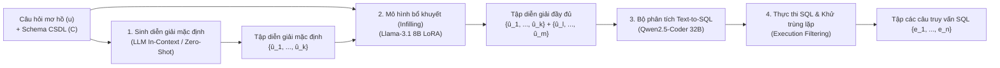

# Disambiguate First, Parse Later: Generating Interpretations for Ambiguity Resolution in Semantic Parsing

| Thông tin | Chi tiết |
|---|---|
| **Tác giả** | Irina Saparina, Mirella Lapata |
| **Đơn vị** | Institute for Language, Cognition and Computation, School of Informatics, University of Edinburgh |
| **Năm / Venue** | 2025 / arXiv:2502.18448v2 [cs.CL] (Tháng 7/2025; mã nguồn: `github.com/saparina/disambiguate-then-parse`) |
| **Loại bài** | Phương pháp (Methodological / Framework Paper) |
| **Chủ đề** | Text-to-SQL, Semantic Parsing, Query Ambiguity, Interpretation Infilling, Modularity |
| **File gốc** | [Disambiguate First, Parse Later.pdf](../papers/Disambiguate%20First%2C%20Parse%20Later.pdf) |

## 1. Tóm tắt nhanh (TL;DR)
Bài báo đề xuất chiến lược tiếp cận dạng mô-đun hai giai đoạn: "Làm rõ trước, dịch ngữ nghĩa sau" (*Disambiguate First, Parse Later*) nhằm giải quyết tính mơ hồ trong bài toán Text-to-SQL. Thay vì bắt LLM sinh trực tiếp nhiều câu SQL, hệ thống trước hết sinh tập các diễn giải ngôn ngữ tự nhiên mặc định (*default interpretations*), sau đó dùng một mô hình bổ khuyết chuyên biệt (*infilling model*) để tìm và sinh các diễn giải còn thiếu. Cuối cùng, từng diễn giải rõ nghĩa được chuyển thành câu lệnh SQL thông qua một bộ phân tích ngữ nghĩa chuẩn, giúp tăng mạnh độ bao phủ ý định người dùng trên cả dữ liệu trong miền lẫn ngoài miền.

## 2. Bối cảnh & Vấn đề nghiên cứu
- **Vấn đề cốt lõi:** Câu hỏi tự nhiên từ người dùng trong giao diện cơ sở dữ liệu thường mơ hồ (*ambiguous*), mơ hồ phạm vi (*underspecified*) hoặc nhập nhằng (*vague*), dẫn tới việc có thể tương ứng với nhiều câu lệnh SQL khác nhau với kết quả thực thi khác nhau ngay cả khi đã biết lược đồ CSDL.
- **Hạn chế của LLM hiện nay:** Các LLM thương mại lẫn mã nguồn mở tuy dịch rất tốt các câu hỏi rõ nghĩa, nhưng lại mắc thiên vị cố hữu (*systematic bias*) đối với câu hỏi mơ hồ: chúng có xu hướng mặc định chỉ chọn một cách hiểu phổ biến/ưa thích nhất (*preferred interpretation*) và bỏ qua toàn bộ các cách hiểu hợp lệ khác.
- **Thiếu sót của các cách tiếp cận trước:**
  1. *End-to-end prompting (Zero-shot / Few-shot):* Khi yêu cầu LLM sinh trực tiếp toàn bộ các câu SQL tương ứng trong một lần nhắc, mô hình thường bỏ sót các cách diễn giải hợp lệ hoặc sinh sai cấu trúc SQL.
  2. *Supervised Fine-Tuning (SFT) trực tiếp ra SQL:* Dễ bị khớp quá mức (*overfitting*) vào các mẫu cú pháp và cấu trúc bảng của tập dữ liệu huấn luyện (như AmbiQT), mất hoàn toàn khả năng tổng quát hóa khi gặp benchmark mới (như Ambrosia).
  3. *Hạn chế của các tập dữ liệu hiện có:* Các benchmark đa phần chỉ ghép cặp câu hỏi mơ hồ với danh sách các câu lệnh SQL mà không diễn giải rõ ràng bằng ngôn ngữ tự nhiên (*natural language interpretations*), gây khó khăn cho việc giải thích cho người dùng và huấn luyện các mô-đun trung gian.

## 3. Phương pháp / Nội dung chính

### 3.1 Triết lý tổng thể: Disambiguate First, Parse Later
Hệ thống phân rã bài toán thành 2 giai đoạn độc lập:
1. **Giai đoạn 1 (Disambiguation):** Ánh xạ phát biểu mơ hồ $u$ và ngữ cảnh CSDL $C$ thành một tập các phát biểu diễn giải rõ nghĩa bằng ngôn ngữ tự nhiên $\{\hat{u}_1, \dots, \hat{u}_n\}$.
2. **Giai đoạn 2 (Text-to-SQL Parsing):** Ánh xạ từng diễn giải rõ nghĩa $\hat{u}_i$ thành câu truy vấn logic tương ứng $e_i$ (SQL) bằng một bộ phân tích ngữ nghĩa Text-to-SQL tiêu chuẩn.

### 3.2 Cơ chế tạo tập diễn giải 2 bước (Default + Infilling)
Thay vì cố gắng triệt tiêu thiên vị của LLM, tác giả xây dựng quy trình tận dụng chính thiên vị đó:
- **Bước 1: Sinh diễn giải mặc định (Default Interpretation Generation):** Sử dụng một LLM cơ sở (zero-shot prompt với Llama-3.1 8B) để trích xuất các cách hiểu hiển nhiên nhất $\{\hat{u}_1, \dots, \hat{u}_k\}$. Prompt được thiết kế để xử lý linh hoạt: nếu câu hỏi vốn đã rõ nghĩa, mô hình chỉ trả về 1 diễn giải duy nhất.
- **Bước 2: Mô hình bổ khuyết diễn giải (Interpretation Infilling Model):**
  - Nhận đầu vào gồm: câu hỏi gốc $u$, ngữ cảnh CSDL $C$, và tập diễn giải mặc định đã tạo ở Bước 1.
  - Nhiệm vụ: Đánh giá xem còn cách hiểu hợp lệ nào bị bỏ sót hay không. Nếu có, mô hình sinh tiếp các diễn giải bổ sung $\{\hat{u}_l, \dots, \hat{u}_m\}$. Nếu tất cả đã được bao phủ, mô hình xuất câu quy ước: *"All possible interpretations are covered."*
  - Mô hình infilling chỉ thêm vào tập diễn giải mà không xóa bỏ các diễn giải ở Bước 1, tránh làm giảm độ phủ của các cách hiểu mặc định chuẩn xác.

### 3.3 Phương pháp gán nhãn tự động bằng thực thi SQL (SQL Execution Supervision)
Để giải quyết bài toán thiếu dữ liệu diễn giải ngôn ngữ tự nhiên có giám sát để huấn luyện mô hình infilling:
1. **Tạo dữ liệu diễn giải nhân tạo (Synthetic Interpretations):** Dựa trên cơ chế thay thế từ đồng nghĩa trong AmbiQT (tên cột, tên bảng), tác giả dùng Llama-3.1 8B (với 3 ví dụ in-context) để viết lại câu hỏi gốc thành các diễn giải tự nhiên rõ nghĩa thay thế các từ mơ hồ.
2. **Kiểm chứng chất lượng bằng Code LLM:** Dùng Qwen2.5-Coder 32B sinh SQL thử nghiệm cho từng diễn giải. Chỉ giữ lại những mẫu mà cả 2 diễn giải đều sinh được SQL đúng trong tối đa 5 lần thử.
3. **Phát hiện diễn giải bị thiếu thông qua thực thi SQL:** Thay vì so sánh ngữ nghĩa phức tạp giữa hai câu ngôn ngữ tự nhiên, hệ thống dùng bộ parser chuyển đổi các diễn giải mặc định thành SQL, sau đó thực thi trên CSDL và so sánh tập kết quả trả về với kết quả của các câu Gold SQL. Bất kỳ Gold SQL nào chưa có kết quả thực thi tương ứng sẽ xác định được diễn giải tham chiếu bị thiếu, làm nhãn mục tiêu (*supervision target*) cho mô hình infilling.

## 4. Thực nghiệm & Kết quả chính

> **Cách đọc số liệu:** Các kết quả thuộc benchmark, split, metric và phiên bản mô hình của bài báo. “SOTA” chỉ áp dụng trong bối cảnh/thời điểm bài báo nêu; không so trực tiếp với PA của challenge.

### 4.1 Thiết lập thực nghiệm
- **Tập dữ liệu:**
  - `AmbiQT`: Xây dựng trên nền Spider, gồm 1.8K mẫu test không rỗng, chứa mơ hồ từ vựng (tên bảng, tên cột) và mơ hồ cấu trúc (phép JOIN, hàm tổng hợp tính sẵn). Thử nghiệm In-domain.
  - `Ambrosia`: Gồm 1K câu hỏi mơ hồ kiểm thử ngữ nghĩa tự nhiên (scope ambiguity, attachment ambiguity, vagueness) trên các CSDL tổng hợp. Thử nghiệm Out-of-domain.
  - Tập con không mơ hồ (unambiguous subset) của Ambrosia.
- **Mô hình triển khai:** Mô hình sinh diễn giải mặc định là Llama-3.1 8B-Instruct; Mô hình infilling được tinh chỉnh LoRA (rank 16, NEFTune) trên Llama-3.1 8B; Mô hình Text-to-SQL là Qwen2.5-Coder 32B-Instruct.
- **Thước đo đánh giá:**
  - *Full Interpretation Coverage (Full):* Tỷ lệ các trường hợp tìm được đầy đủ tất cả các cách hiểu SQL hợp lệ (chỉ số quan trọng nhất).
  - *Single Interpretation Coverage (Single):* Tỷ lệ tìm được ít nhất một cách hiểu đúng.
  - *Precision* và *Recall*.

### 4.2 Kết quả trên bài toán câu hỏi mơ hồ (In-domain & Out-of-domain)

| Phương pháp | AmbiQT (In-Domain) Single (%) | AmbiQT (In-Domain) Full (%) | Ambrosia (Out-of-Domain) Single (%) | Ambrosia (Out-of-Domain) Full (%) |
|---|---|---|---|---|
| **End-to-End Baselines** | | | | |
| 0-shot Prompt (Llama-3.1 8B) | 62.3 | 12.3 | 29.4 | 0.9 |
| 3-shot Prompt (Llama-3.1 8B) | 44.3 | 10.9 | 35.7 | 1.3 |
| SFT trực tiếp ra SQL (LoRA) | 82.1 | **63.2** | 38.0 | 0.4 |
| **Disambiguate-and-Parse** | | | | |
| Interpretation Prompt (chưa infilling) | 81.8 | 26.0 | 81.9 | 16.9 |
| Prompt + Self-Correction | 77.4 | 13.9 | 65.7 | 5.9 |
| Gold Interpretation SFT | 87.4 | 61.2 | 62.6 | 0.3 |
| **Phương pháp đề xuất (Ours)** | **92.3** | 53.2 | **84.4** | **18.8** |

*Nhận xét quan trọng:*
- Trên **AmbiQT (In-domain)**: Phương pháp đề xuất đạt Single Coverage cao nhất (92.3%) và Full Coverage đạt 53.2% (gấp hơn 4 lần so với 0-shot prompt). Mô hình SFT trực tiếp đạt Full 63.2% nhưng giảm mạnh khi sang domain khác.
- Trên **Ambrosia (Out-of-domain)**: Đạt Full Coverage 18.8% và Single Coverage 84.4%, đạt kết quả cao hơn trong các cấu hình được so sánh so với tất cả các baseline khác (mô hình SFT chỉ đạt 0.4%, 0-shot đạt 0.9%, Self-correction chỉ đạt 5.9%). Điều này cho thấy việc tách giai đoạn làm rõ bằng ngôn ngữ tự nhiên có năng lực khái quát hóa (*cross-domain generalization*) vượt bậc.

### 4.3 Kết quả trên câu hỏi rõ nghĩa (Unambiguous Subset)
Trên tập câu hỏi rõ nghĩa của Ambrosia (Table 5):
- Baseline End-to-End: 0-shot đạt 35.9%, SFT đạt 44.5%.
- Nhóm Disambiguate-and-Parse: Đạt **77.9%** (Ours), đạt kết quả cao hơn trong các cấu hình được so sánh. Việc làm rõ câu hỏi đóng vai trò như một biểu diễn trung gian (*intermediate representation*), giúp làm sáng tỏ câu truy vấn trước khi ánh xạ sang SQL.

### 4.4 Các phân tích và nghiên cứu thành phần (Ablation Studies)
1. **Hiệu quả của module Infilling qua các LLM khác nhau:**
   - Khi áp dụng infilling, Full Coverage tăng từ 26.0% $\rightarrow$ 53.2% trên Llama-3.1 8B; từ 25.9% $\rightarrow$ 48.6% trên Qwen-2.5 7B; và từ 17.3% $\rightarrow$ 55.9% trên Gemma-2 9B.
2. **Ảnh hưởng của bộ parser Text-to-SQL:**
   - Thay Qwen2.5-Coder 32B bằng bản thu gọn 7B khiến Full Coverage trên AmbiQT tụt từ 53.2% xuống 40.2%, và trên Ambrosia tụt từ 18.8% xuống 10.9%.
   - Ngay cả khi cung cấp 100% Gold Interpretations trên Ambrosia, Qwen2.5-Coder 32B cũng chỉ đạt Full Coverage 49.0%, cho thấy bản thân khâu dịch Text-to-SQL không mơ hồ vẫn còn gặp nhiều khó khăn.
3. **Phân tích lỗi (Error Analysis trên 50 ca lỗi):**
   - Lỗi sinh SQL từ diễn giải hợp lệ: chiếm 33.3% (AmbiQT) và 30.0% (Ambrosia), bao gồm sai JOIN, sai cột và lỗi cú pháp (chiếm 20%).
   - Diễn giải không khớp ý định: 26.7% (AmbiQT), 30.0% (Ambrosia).
   - Diễn giải thừa/gần trùng (redundant): 23.3% (AmbiQT), 20.0% (Ambrosia).
   - Diễn giải quá chung chung/vẫn còn mơ hồ: 16.7% (AmbiQT), 20.0% (Ambrosia).

## 5. Tính mới (Novelty & Đóng góp)
- **Đề xuất chiến lược phân rã "Disambiguate First, Parse Later":** Tách bạch rõ ràng quá trình giải quyết tính mơ hồ ở tầng ngôn ngữ tự nhiên ra khỏi quá trình ánh xạ cú pháp hình thức SQL.
- **Cơ chế Infilling bù đắp thiên vị mô hình (Exploit & Infill):** Tận dụng tính ưu tiên tự nhiên của LLM để lấy tập diễn giải mặc định, sau đó dùng mô hình chuyên trách tìm kiếm và bổ khuyết các diễn giải bị bỏ sót.
- **Giám sát tự động bằng thực thi SQL (Execution-based Supervision):** Phương pháp sáng tạo trong việc huấn luyện mô hình ngôn ngữ trung gian bằng cách kiểm tra denotation kết quả thực thi SQL thay vì so khớp chuỗi văn bản.
- **Tính khái quát hóa vượt trội:** Chứng minh bằng thực nghiệm rằng biểu diễn trung gian bằng diễn giải tự nhiên giúp mô hình chịu lỗi và thích nghi tốt hơn hẳn với các loại mơ hồ mới và CSDL mới so với các hệ thống end-to-end.

## 6. Hạn chế

### 6.1 Hạn chế do tác giả thừa nhận
- **Phụ thuộc dữ liệu tham chiếu để huấn luyện Infilling:** Cần các cặp SQL và diễn giải tham chiếu để tạo dữ liệu huấn luyện, việc mở rộng sang các miền cơ sở dữ liệu chuyên biệt có thể tốn công sức.
- **Lan truyền lỗi theo chuỗi (Cascading Errors):** Sai lầm ở khâu sinh diễn giải tự nhiên sẽ trực tiếp làm sai khâu sinh SQL; ngược lại bộ parser lỗi sẽ làm mất đi các diễn giải vốn dĩ đúng.
- **Chưa có bộ lọc diễn giải sai:** Mô hình infilling chỉ có khả năng bổ sung diễn giải chứ không lọc bỏ các diễn giải sai ngữ nghĩa sinh ra từ bước 1, dẫn tới làm giảm Precision trong một số trường hợp.
- **Tăng chi phí tính toán:** Việc phải sinh nhiều diễn giải tự nhiên và dịch từng diễn giải qua LLM làm tăng đáng kể độ trễ và tài nguyên tính toán so với mô hình sinh trực tiếp một lần.

### 6.2 Nhận xét thêm của người review
- **Độ bao phủ thực tế trên tập out-of-domain vẫn còn thấp:** Mức Full Coverage 18.8% trên Ambrosia dù cao hơn nhiều so với baseline nhưng phản ánh rằng bài toán mơ hồ ngữ nghĩa ngoài đời thực (đặc biệt là scope và attachment ambiguity) vẫn là thách thức cực lớn đối với các mô hình 8B-32B.
- **Phụ thuộc vào dữ liệu trong CSDL để lọc trùng lặp:** Cơ chế so sánh execution results để loại bỏ các diễn giải trùng lặp (*paraphrases*) có thể gặp hiện tượng dương tính giả (*false positive*) nếu dữ liệu trong bảng thử nghiệm quá nhỏ hoặc có các cột chứa giá trị giống hệt nhau một cách ngẫu nhiên.
- **Thiếu tương tác người dùng (Human-in-the-Loop):** Bài báo tập trung vào chế độ tự động xuất ra tập câu hỏi đa nghĩa (*overton response*). Trong môi trường agent thực tế, việc đưa ra quá nhiều lựa chọn hoặc để sót lựa chọn mà không có cơ chế hỏi lại người dùng sẽ làm giảm trải nghiệm tương tác.

## 7. Ý nghĩa ứng dụng (cho hệ thống agent phân tích dữ liệu / Text-to-SQL)

> **Phân biệt nguồn:** Khuyến nghị trong mục này là suy luận ứng dụng cho DataMate; bài báo không đánh giá trực tiếp trên challenge, trừ khi nêu rõ.
- **Chiến lược làm rõ trước khi hành động:** Khi gặp câu hỏi người dùng có dấu hiệu nhập nhằng về số đo hoặc định nghĩa (ví dụ: "doanh thu", "khách hàng tích cực"), agent nên sinh ra các phương án diễn giải tự nhiên cụ thể để xác nhận trước khi bắt tay vào viết truy vấn SQL phức tạp.
- **Tách rời mô-đun làm rõ và mô-đun dịch mã:** Có thể dùng một LLM linh hoạt (như GPT-4o / Claude 3.5 Sonnet) để chuyên trách việc phân tích ngữ nghĩa câu hỏi và hội thoại làm rõ, sau đó dùng các mô hình chuyên biệt về code (như Qwen2.5-Coder) để viết truy vấn SQL chính xác.
- **Khử trùng lặp câu hỏi bằng thực thi thử nghiệm:** Khi agent sinh ra nhiều giả thuyết diễn giải câu hỏi của người dùng, có thể chạy thử truy vấn trên môi trường sandbox; nếu hai giả thuyết cho ra bảng kết quả giống hệt nhau, agent có thể tự động gộp lại để giảm tải số lượng câu hỏi cần xác nhận với người dùng.

## 8. Từ khóa
`Text-to-SQL`, `Semantic Parsing`, `Query Ambiguity`, `Disambiguate First Parse Later`, `Interpretation Infilling`, `Execution-based Supervision`, `AmbiQT`, `Ambrosia`, `Modular Architecture`

## 9. Mức độ phù hợp với challenge DataMate

**Phân nhóm: Tham khảo.** Sinh diễn giải thay thế có thể giúp phát hiện thiếu xác định; không yêu cầu người dùng xác nhận trong lượt chấm.

## 10. Nguồn và truy nguyên kết quả

- **PDF gốc:** liên kết ở bảng thông tin đầu review và bản lưu trong thư mục `../papers/`.
- **Vị trí kiểm chứng:** Method §§2–3, pp. 2–5; results §4, pp. 6–8; conclusion p. 9.
- Số liệu ở mục 4 là kết quả tác giả trên benchmark gốc; phần áp dụng DataMate tại mục 7 và mục 9 là nhận định của review.
