# ExCoT: Optimizing Reasoning for Text-to-SQL with Execution Feedback

| Thông tin | Chi tiết |
|---|---|
| **Tác giả** | Bohan Zhai, Canwen Xu, Yuxiong He, Zhewei Yao |
| **Đơn vị** | Snowflake Inc. |
| **Năm / Venue** | arXiv:2503.19988v1 (25/03/2025). Hội nghị chính thức: Không nêu rõ trong văn bản |
| **Loại bài** | Phương pháp (Post-training Alignment / Reinforcement Learning via SFT + Iterative DPO) |
| **Chủ đề** | Text-to-SQL, Chain-of-Thought (CoT), Direct Preference Optimization (DPO), Execution Feedback, On-policy Self-improvement |
| **File gốc** | [ExCoT.pdf](../papers/ExCoT.pdf) |

## 1. Tóm tắt nhanh (TL;DR)
ExCoT đề xuất một framework hậu huấn luyện (post-training) kết hợp suy luận chuỗi tư duy (Chain-of-Thought - CoT) với Direct Preference Optimization (DPO) qua hai giai đoạn off-policy và on-policy lặp (iterative), chỉ dựa duy nhất vào độ chính xác thực thi SQL (execution accuracy) làm tín hiệu thưởng mà không cần reward model hay gán nhãn người. Phương pháp giúp nâng Execution Accuracy (EX) của LLaMA-3.1 70B từ 57.37% lên **68.51%** trên BIRD dev và từ 78.81% lên **86.59%** trên Spider test, đồng thời đạt **68.53%** trên BIRD test set ở thiết lập mô hình đơn lẻ (single-model SOTA), vượt qua các mô hình reasoning thương mại như OpenAI o1-mini và o3-mini.

## 2. Bối cảnh & Vấn đề nghiên cứu
- **Thách thức của Text-to-SQL:** Nhiệm vụ đòi hỏi suy luận logic cấu trúc chính xác (schema linking, nested subqueries, joins phức tạp, điều kiện lọc). Sai sót ở bất kỳ bước logic trung gian nào cũng khiến câu truy vấn cuối cùng thất bại hoàn toàn.
- **Ba quan sát thực nghiệm then chốt:**
  1. *Zero-shot CoT không hiệu quả cho Text-to-SQL:* Việc chỉ thêm prompt yêu cầu "hãy suy luận từng bước" vào các LLM nền tảng không mang lại cải thiện, thậm chí làm giảm độ chính xác (ví dụ LLaMA-3.1 70B giảm từ 57.37% xuống 52.61% trên BIRD dev), do suy luận tự do không tuân thủ các ràng buộc schema và cú pháp cơ sở dữ liệu.
  2. *DPO trực tiếp không có CoT chỉ tăng nhẹ:* Áp dụng DPO trực tiếp lên cặp câu SQL đúng/sai (không có chuỗi suy luận) chỉ cải thiện khiêm tốn (~2.6% trên BIRD dev) vì tín hiệu phản hồi không thể định vị được lỗi logic nằm ở đâu trong quá trình sinh.
  3. *Sự cộng hưởng giữa CoT và phản hồi thực thi qua DPO:* Khi có chuỗi suy luận CoT làm trung gian, chỉ cần một tín hiệu nhị phân thực thi (kết quả SQL khớp hay không khớp với ground truth) là đủ để DPO hướng dẫn mô hình nhận diện và tự sửa lỗi logic.
- **Hạn chế của các phương pháp trước:** Các phương pháp Text-to-SQL trước đó thường chỉ tập trung sửa cú pháp (constrained decoding như PICARD), hoặc phụ thuộc vào quy trình multi-agent/prompting phức tạp gọi API tốn kém (như CHASE-SQL, XiYan-SQL) thay vì tối ưu hoá trực tiếp năng lực suy luận nội tại của một mô hình đơn lẻ.

## 3. Phương pháp / Nội dung chính

```mermaid
flowchart LR
    subgraph S1["Giai đoạn 1 & 2: Sinh dữ liệu CoT & Off-Policy DPO"]
        direction TB
        Q1["Tập train (BIRD/Spider)"] --> P_GPT["GPT-4o CoT Prompting (Divide-and-Conquer)"]
        P_GPT --> CAND1["Sinh tối đa 32 Candidate CoTs / query"]
        CAND1 --> EXE1["Thực thi SQLite & Đối chiếu Ground Truth"]
        EXE1 --> POS1["Tập Đúng (Win) -> SFT Base Model"]
        EXE1 --> NEG1["Tập Sai (Lose)"]
        POS1 & NEG1 --> PAIR1["Ghép cặp Win-Lose (Khoảng cách Edit Distance lớn nhất)"]
        PAIR1 --> OFF_DPO["Off-Policy DPO (1 round)"]
    end

    subgraph S2["Giai đoạn 3: On-Policy Iterative DPO"]
        direction TB
        OFF_DPO --> M_CURR["Mô hình hiện tại"]
        M_CURR --> GEN2["Tự sinh CoT + SQL (Tối đa 32 Candidates / query)"]
        GEN2 --> EXE2["Thực thi SQLite & Đối chiếu Ground Truth"]
        EXE2 --> PAIR2["Ghép cặp Win-Lose (Khoảng cách Edit Distance nhỏ nhất - Near-miss)"]
        PAIR2 --> ON_DPO["On-Policy DPO (Lặp 2 rounds)"]
        ON_DPO --> M_FINAL["Mô hình ExCoT cuối cùng"]
    end

    S1 --> S2
```

### 3.1 Cấu trúc Chain-of-Thought (CoT)
Bài báo khảo sát 3 dạng CoT:
- **No-CoT (Direct SQL):** Sinh trực tiếp câu SQL, thiếu khả năng giải thích và không tận dụng được suy luận nội tại.
- **Simple-CoT:** Sinh đoạn giải thích ngắn gọn trước khi đưa ra câu SQL.
- **Complex-CoT (Divide-and-Conquer):** Phương pháp chia để trị phân cấp:
  1. Phân tích câu hỏi tổng thể và lập khung pseudo-SQL (join, filter, aggregation).
  2. Tách thành các sub-questions độc lập kèm pseudo-SQL cho từng phần.
  3. Tổng hợp (conquer) các sub-queries thành SQL hoàn chỉnh.
  4. Tối ưu hoá và rút gọn (simplification & optimization) để loại bỏ mệnh đề dư thừa.

### 3.2 Khởi tạo và Supervised Fine-Tuning (SFT)
- Dùng GPT-4o few-shot sinh tối đa 32 candidate CoTs cho mỗi câu hỏi trong tập train của BIRD (9.2k) và Spider (8.6k).
- Thực thi truy vấn trên SQLite cục bộ. Chỉ các lời giải cho kết quả thực thi khớp 100% với ground truth mới được giữ lại (thu được 5.6k mẫu BIRD và 6.1k mẫu Spider).
- Fine-tune base model (LLaMA-3.1 70B hoặc Qwen-2.5-Coder 32B) trên tập dữ liệu này kết hợp dữ liệu hội thoại ngôn ngữ tự nhiên tổng quát.

### 3.3 Off-Policy DPO Alignment
- Tận dụng cả các lời giải sai do GPT-4o sinh ra thay vì vứt bỏ. Ghép cặp lời giải đúng (Win) và sai (Lose) cho cùng một câu hỏi.
- **Chiến lược chọn mẫu (Curriculum):** Lựa chọn các cặp có khoảng cách chỉnh sửa (edit distance) giữa câu SQL đúng và sai là **lớn nhất (Furthest)**. Điều này giúp mô hình nhận diện rõ các lỗi sai nghiêm trọng và vẽ nên ranh giới rõ ràng giữa suy luận đúng và suy luận sai ở giai đoạn đầu.

### 3.4 On-Policy Iterative DPO với Execution Feedback
- Do dữ liệu GPT-4o (off-policy) có sự lệch phân phối so với mô hình đang huấn luyện, tác giả đưa mô hình vào vòng lặp on-policy:
  1. Dùng mô hình vừa huấn luyện tự sinh đến 32 candidates (kèm CoT) cho mỗi câu hỏi.
  2. Thực thi trên database để tự phân loại Win (kết quả đúng) và Lose (kết quả sai).
  3. **Chiến lược chọn mẫu On-policy:** Lựa chọn các cặp có edit distance **nhỏ nhất (Nearest)**. Các mẫu này đại diện cho các lỗi tinh vi ("near-miss") thuộc phân phối của chính mô hình, giúp mô hình trau chuốt các chi tiết suy luận nhỏ.
  4. Huấn luyện DPO trên các cặp tự sinh này và lặp lại qua các vòng (tác giả cho thấy thực nghiệm 2 vòng on-policy là tối ưu).

## 4. Thực nghiệm & Kết quả chính

> **Cách đọc số liệu:** Các kết quả thuộc benchmark, split, metric và phiên bản mô hình của bài báo. “SOTA” chỉ áp dụng trong bối cảnh/thời điểm bài báo nêu; không so trực tiếp với PA của challenge.

### 4.1 Thiết lập thực nghiệm
- **Benchmarks:** BIRD (9.2k train, dev và hold-out test set) và Spider (8.6k train, test set).
- **Mô hình nền tảng:** LLaMA-3.1 70B Base và Qwen-2.5-Coder 32B Base.
- **Tài nguyên huấn luyện:** 64 GPU NVIDIA H100 (SFT tốn 448 GPU hours; DPO tốn 160 GPU hours).
- **Metric:** Execution Accuracy (EX%) và SQL Validity (Valid%).

### 4.2 Kết quả qua từng giai đoạn huấn luyện

**Bảng 1: Tiến trình hiệu năng của ExCoT trên BIRD dev và Spider test**

| Giai đoạn | Mô hình & Loại CoT | BIRD Dev EX (%) | BIRD Valid (%) | Spider Test EX (%) | Spider Valid (%) |
|---|---|---|---|---|---|
| **Base Model** | LLaMA-3.1 70B (No-CoT) | 57.37 | 92.83 | 78.81 | 98.74 |
| | LLaMA-3.1 70B (Simple-CoT) | 52.61 | 94.72 | 77.83 | 99.44 |
| | Qwen-2.5-Coder 32B (No-CoT) | 58.93 | 89.31 | 79.32 | 99.72 |
| | Qwen-2.5-Coder 32B (Simple-CoT) | 54.11 | 94.13 | 77.83 | 99.44 |
| **Stage 1: SFT** | LLaMA-3.1 70B (No-CoT) | 62.03 | 94.72 | 83.00 | 98.65 |
| | LLaMA-3.1 70B (Complex-CoT) | 58.14 | 91.20 | 81.42 | 99.02 |
| | Qwen-2.5-Coder 32B (Complex) | 59.65 | 91.13 | 81.23 | 99.12 |
| **Stage 2: Off-Policy DPO** | LLaMA-3.1 70B (Complex) | 66.30 | 98.50 | 82.49 | 99.86 |
| | Qwen-2.5-Coder 32B (Complex) | 66.23 | 98.04 | 83.98 | 99.95 |
| **Stage 3: On-Policy DPO** | LLaMA-3.1 70B (No-CoT) | 59.97 | 96.74 | 81.00 | 98.14 |
| | LLaMA-3.1 70B (Simple-CoT) | 65.12 | 97.20 | 84.26 | 99.77 |
| | **LLaMA-3.1 70B (Complex-CoT)** | **68.51** | **98.50** | **86.59** | **99.91** |
| | **Qwen-2.5-Coder 32B (Complex)** | **68.25** | **98.37** | **85.14** | **99.95** |
| **Baselines (Zero-shot)** | XiYanSQL-QwenCoder 32B | 63.75 | 95.83 | 81.42 | 99.72 |
| | GPT-4o (No-CoT) | 54.69 | 90.87 | 76.53 | 99.21 |
| | Claude 3.5 Sonnet (No-CoT) | 50.13 | 89.05 | 69.91 | 99.07 |
| | OpenAI o1-mini (Built-in CoT) | 52.41 | 86.38 | 75.13 | 98.09 |
| | OpenAI o3-mini (Built-in CoT) | 53.72 | 97.00 | 72.80 | 95.99 |

**Bảng 2: So sánh trên BIRD Test Set ở thiết lập Single-Model (Table 4)**

| Mô hình | Tham số | Dev EX (%) | Test EX (%) |
|---|---|---|---|
| **ExCoT-70B** | 70B | **68.51** | **68.53** |
| **ExCoT-32B** | 32B | 68.32 | 68.19 |
| SFT CodeS-15B | 15B | 58.47 | 60.37 |
| SFT CodeS-7B | 7B | 57.17 | 59.25 |
| DeepSeek 236B | 236B | 56.13 | 56.68 |
| Mistral 123B | 123B | 53.52 | 55.84 |
| GPT-4 | - | 46.35 | 54.89 |

### 4.3 Phân tích chuyên sâu & Phát hiện quan trọng
1. **Vai trò quan trọng của chuỗi suy luận CoT trong DPO:**
   - DPO áp dụng trên No-CoT chỉ tăng EX BIRD dev lên 59.97% (+2.6% so với base 57.37%).
   - Trong khi đó, DPO kết hợp Complex-CoT đưa EX lên 68.51% (+11.14% so với base và +10.37% so với SFT). Điều này xác nhận rằng việc bộc lộ chuỗi suy luận trung gian là điều kiện tiên quyết để DPO phạt đúng bước suy luận sai lầm.
2. **Chiến lược chọn mẫu (Curriculum Strategy):**
   - Ở giai đoạn Off-policy: Lựa chọn cặp *Furthest* đạt EX 66.30% (so với Random 64.08% và Nearest 61.99%).
   - Ở giai đoạn On-policy: Lựa chọn cặp *Nearest* đạt EX 67.21% (so với Random 66.36% và Furthest 66.95%).
3. **Hiện tượng cạn kiệt cặp đối chiếu (Diminishing Returns):**
   - Số lượng cặp tương phản hợp lệ giảm nhanh sau từng vòng: từ >2.000 cặp ở SFT xuống ~560 cặp ở vòng On-policy 3. Hiệu năng tăng mạnh ở vòng On-policy 1 & 2 nhưng bắt đầu chững lại hoặc suy giảm nhẹ ở vòng 3.
4. **Độ dài chuỗi CoT tăng tự nhiên:**
   - Chiều dài trung bình của đoạn suy luận CoT tăng từ 560 tokens (ở SFT) lên 910 tokens (ở On-policy vòng 2), cho thấy DPO khuyến khích mô hình suy nghĩ sâu và chi tiết hơn trước khi viết SQL.

## 5. Tính mới (Novelty & Đóng góp)
1. **Cơ chế căn chỉnh DPO thuần dựa trên phản hồi thực thi (Execution Feedback Only):** Khác biệt với RLHF thông thường cần mô hình chấm điểm thưởng (reward model) phức tạp hoặc dữ liệu gán nhãn thủ công đắt đỏ, ExCoT cho thấy tính đúng đắn khi thực thi SQL trên database cục bộ là tín hiệu thưởng khách quan, hoàn hảo và có thể mở rộng vô hạn cho DPO.
2. **Làm rõ bản chất của CoT trong Text-to-SQL:** Chứng minh thực nghiệm rằng CoT zero-shot không hiệu quả, nhưng CoT phân cấp (divide-and-conquer) lại là thành phần bắt buộc để các thuật toán preference optimization như DPO phát huy tác dụng.
3. **Quy trình kết hợp Off-Policy và On-Policy Curriculum DPO:** Thiết lập chiến lược huấn luyện phân tầng: dùng off-policy với cặp cách xa (furthest) để học biên bao quát, nối tiếp bằng on-policy với cặp gần (nearest) để trau chuốt các ca khó.
4. **Kết quả single-model Text-to-SQL:** Các checkpoint mở Qwen-2.5-Coder 32B và LLaMA-3.1 70B đạt kết quả tương đương hoặc cao hơn một số pipeline multi-agent trong benchmark của bài. Cả hai checkpoint đều vượt giới hạn 15B của challenge.

## 6. Hạn chế

### 6.1 Hạn chế do tác giả thừa nhận
- **Thách thức với schema phức tạp đặc thù:** Mô hình vẫn có thể gặp khó khăn trước các schema doanh nghiệp quá rối rắm hoặc chứa các quy ước nghiệp vụ ngầm chuyên sâu chưa có trong dữ liệu huấn luyện.
- **Rủi ro ảo tưởng trong CoT:** Dù câu SQL cuối cùng có thể thực thi đúng, các bước CoT trung gian đôi khi vẫn chứa đựng suy luận thừa, mâu thuẫn hoặc tính chân lý cục bộ (hallucinated intermediate steps), gây khó khăn cho việc giải thích quy trình ra quyết định.
- **Khuôn mẫu CoT cứng:** Bài báo áp dụng template CoT dạng chia-để-trị cố định; chưa nghiên cứu khả năng suy luận tự do (free-style CoT tương tự DeepSeek-R1).

### 6.2 Nhận xét thêm của người review
- **Chi phí sinh dữ liệu và huấn luyện GPU rất lớn:** Quá trình huấn luyện đòi hỏi hạ tầng tính toán 64 GPU H100 chạy hàng trăm giờ cùng hàng chục nghìn lượt gọi API GPT-4o để sinh 32 ứng viên mỗi câu hỏi ở giai đoạn khởi đầu, là rào cản chi phí lớn cho các nhóm nghiên cứu nhỏ.
- **Độ trễ suy luận (Inference Latency):** Việc mô hình sinh trung bình hơn 900 tokens CoT trước khi đưa ra câu SQL làm tăng thời gian phản hồi (TTFT và generation time) so với các mô hình sinh SQL trực tiếp, cần cân nhắc kỹ khi tích hợp vào hệ thống yêu cầu độ trễ thấp.
- **Vấn đề "False Positive" của Execution Accuracy:** Hai câu SQL có logic khác nhau hoàn toàn vẫn có thể trả về cùng một kết quả rỗng (empty set) hoặc kết quả trùng hợp trên các bảng dữ liệu nhỏ, dẫn đến việc gán nhãn sai lệch trong quá trình lọc preference pairs.

## 7. Ý nghĩa ứng dụng (cho hệ thống agent phân tích dữ liệu / Text-to-SQL)

> **Phân biệt nguồn:** Khuyến nghị trong mục này là suy luận ứng dụng cho DataMate; bài báo không đánh giá trực tiếp trên challenge, trừ khi nêu rõ.
- **Tận dụng mô hình ExCoT làm Backbone Engine:** Thay vì tốn chi phí gọi các API thương mại đắt tiền hoặc xây dựng pipeline multi-agent cồng kềnh với nhiều vòng trao đổi, một agent Text-to-SQL có thể sử dụng trực tiếp checkpoint `Qwen-2.5-coder-Arctic-ExCoT-32B` làm core generator với độ chính xác cao và chạy on-premise.
- **Áp dụng On-Policy Self-Improvement cho nội bộ doanh nghiệp:** Doanh nghiệp có thể áp dụng đúng vòng lặp ExCoT để tinh chỉnh mô hình theo thời gian: cho mô hình sinh truy vấn trên DB nội bộ, chạy thử trên dữ liệu thực tế, lọc cặp đúng/sai và cập nhật định kỳ qua DPO mà không cần chuyên gia SQL ngồi chấm điểm.
- **Kết hợp trực giao với các Framework đa Agent:** ExCoT hoàn toàn trực giao với các kỹ thuật prompt/agent như schema retrieval hay error-refinement; việc thay thế generator thông thường bằng ExCoT bên trong các framework như CHESS hay MAC-SQL hứa hẹn sẽ đẩy hiệu năng tổng thể lên cao hơn nữa.

## 8. Từ khóa
`Text-to-SQL`, `ExCoT`, `Chain-of-Thought (CoT)`, `Direct Preference Optimization (DPO)`, `Execution Feedback`, `On-Policy DPO`, `Divide-and-Conquer Reasoning`, `BIRD Benchmark`, `Single-Model SOTA`, `LLaMA-3.1 70B`, `Qwen-2.5-Coder`

## 9. Mức độ phù hợp với challenge DataMate

**Phân nhóm: Tham khảo.** Execution feedback và preference optimization là ý tưởng huấn luyện; cần xét cỡ mô hình, dữ liệu và compute trước khi áp dụng.

## 10. Nguồn và truy nguyên kết quả

- **PDF gốc:** liên kết ở bảng thông tin đầu review và bản lưu trong thư mục `../papers/`.
- **Vị trí kiểm chứng:** Method/training: PDF §§3–5, pp. 3–7; results tables: p. 8; limitations: p. 9.
- Số liệu ở mục 4 là kết quả tác giả trên benchmark gốc; phần áp dụng DataMate tại mục 7 và mục 9 là nhận định của review.
