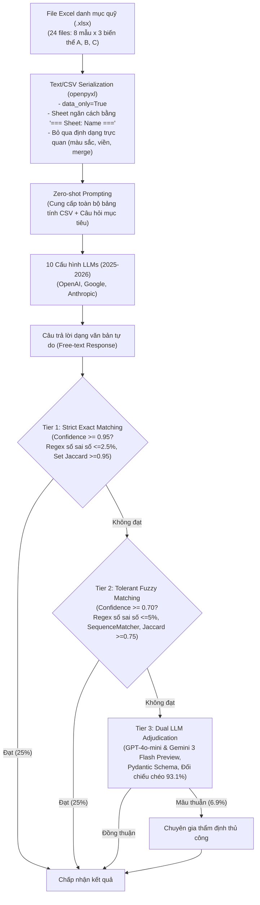

# FinSheet-Bench: From Simple Lookups to Complex Reasoning, Where LLMs Break on Financial Spreadsheets

| Thông tin | Chi tiết |
|---|---|
| **Tác giả** | Jan Ravnik1*†, Matjaž Ličen1, Felix Bührmann1, Bithiah Yuan2, Felix Stinson1, Tanvi Singh1 (*Corresponding author: info@qubera.ch) |
| **Đơn vị** | 1Qubera AG (Zürich, Thụy Sĩ); 2University of Zurich, Department of Informatics |
| **Năm / Venue** | 2026 (arXiv:2603.07316v1 [cs.AI], 7 Mar 2026) |
| **Loại bài** | Benchmark / Thực nghiệm đánh giá (Empirical Benchmark Paper) |
| **Chủ đề** | Financial Spreadsheets, Private Equity Due Diligence, Portfolio Monitoring, Multi-fund Table QA, Numeric Reasoning, Cascading Verification |
| **File gốc** | [FinSheet-Bench.pdf](../papers/FinSheet-Bench.pdf) |

## 1. Tóm tắt nhanh (TL;DR)
FinSheet-Bench là bộ benchmark chuyên sâu đầu tiên mô phỏng chân thực các bảng tính theo dõi danh mục đầu tư tư nhân (Private Equity portfolio monitoring) – nguồn dữ liệu vốn được bảo mật nghiêm ngặt trong các data room tài chính. Đánh giá 10 cấu hình mô hình ngôn ngữ lớn (LLM) hàng đầu thế hệ 2025–2026 (OpenAI GPT-5.2, Google Gemini 3.1 Pro/3 Pro/2.5 Pro, Anthropic Claude Opus 4.6) trên 24 file bảng tính đa quỹ phức tạp với 7 loại tác vụ suy luận, nghiên cứu kết luận: **Không có mô hình độc lập (standalone LLM) nào đạt tỷ lệ lỗi đủ thấp để vận hành tự động không có con người giám sát trong nghiệp vụ tài chính**. Mô hình tốt nhất (Gemini 3.1 Pro) chỉ đạt độ chính xác 82.4% (cứ 6 câu hỏi thì sai 1 câu), và độ chính xác tụt dốc nghiêm trọng từ 89.1% ở bài tra cứu đơn giản xuống còn 19.6% ở bài toán tổng hợp phức tạp (tính trung vị, tỷ số đòn bẩy nợ). Tác giả đề xuất lối thoát duy nhất là kiến trúc tách rời khâu hiểu tài liệu (LLM) khỏi khâu tính toán số học tất định (Deterministic computation).

## 2. Bối cảnh & Vấn đề nghiên cứu
- **Điểm nghẽn thẩm định đầu tư tư nhân (PE Due Diligence):** Thẩm định quỹ đầu tư tư nhân (Private Equity / Venture Capital) là quy trình tiêu tốn nguồn lực khổng lồ trong ngành tài chính (55–120 giờ chuyên viên phân tích, chi phí 20.000\$–100.000\$ cho mỗi quỹ, với tổng chi phí trước đầu tư lên tới 200.000\$–1.000.000\$ mỗi danh mục). Với quy mô tài sản thị trường tư nhân toàn cầu vượt 24 nghìn tỷ USD (McKinsey 2026), các nhà đầu tư tổ chức (Limited Partners - LPs) cấp thiết cần công cụ AI để mở rộng quy mô thẩm định.
- **Đặc thù phức tạp của bảng tính tài chính:** Khác biệt hoàn toàn với văn bản phi cấu trúc hay các bảng biểu quan hệ đơn giản:
  1. *Cấu trúc đa sheet và đa quỹ (Multi-fund structures):* Chứa nhiều bảng con, các hàng phân cách quỹ (fund dividers) nằm xen lẫn giữa các hàng dữ liệu.
  2. *Bố cục phi tiêu chuẩn:* Ô gộp (merged cells), tiêu đề nhiều hàng nhiều dòng (multi-line headers), ghi chú dưới chân (footnotes), và định dạng thị giác mang ý nghĩa ngữ nghĩa (màu nền phân biệt quỹ, chữ in đậm biểu thị dòng tổng phụ).
  3. *Quy ước ngành ngặt nghèo:* Trạng thái công ty đã thoái vốn (realized) hay đang nắm giữ (unrealized) quyết định các ô dữ liệu có bị bỏ trống hay không.
  4. *Dung sai sai số cực thấp (Zero-tolerance for errors):* Trong tài chính chuyên nghiệp, sai số 5% trong một chỉ số định giá có thể bóp méo các quyết định đầu tư trị giá hàng chục triệu USD. Ngành tài chính đòi hỏi độ chính xác vận hành từ 97%+ trở lên.
- **Khoảng trống dữ liệu bảo mật (The Dataset Gap):** Các data room của quỹ PE được bảo vệ bằng thỏa thuận không tiết lộ (NDA) nghiêm ngặt, khiến giới nghiên cứu không thể tiếp cận dữ liệu thực để làm benchmark. Các benchmark hiện có (WikiTableQuestions, Spider, FinQA, TAT-QA) chỉ dựa trên báo cáo tài chính công ty niêm yết sạch sẽ, không phản ánh được "sự lộn xộn" của bảng tính thị trường tư nhân.

## 3. Phương pháp / Nội dung chính của FinSheet-Bench

### 3.1 Quy trình tạo dữ liệu tổng hợp dựa trên mẫu cấu trúc thực
FinSheet-Bench giải quyết bài toán bảo mật bằng cách phân tách cấu trúc khỏi giá trị:
- **Khung cấu trúc (Layout & Templates):** Dựa trên 8 bảng tính theo dõi danh mục thực tế do các General Partners (GPs) gửi cho Family Offices, giữ nguyên 100% tổ chức sheet, tên cột, vị trí header, hàng phân tách quỹ và quy ước định dạng.
- **Sinh lại giá trị ô (Cell Values):**
  - Tên quỹ, tên công ty, hội đồng quản trị được thay bằng tên giả định theo chuẩn phân ngành GICS.
  - Các giá trị số được làm xáo trộn thông qua hai hệ số tỷ lệ ngẫu nhiên $A, B \in [0.5, 2.0]$ (cho giá trị đầu tư ban đầu và thoái vốn) kết hợp hệ số nhiễu $k \in [0.95, 1.05]$ để ngăn chặn hoàn toàn việc tái dựng dữ liệu gốc nhưng vẫn giữ được tương quan quy mô.
- **Tập dữ liệu 24 file (Versions A, B, C):** Từ 8 file gốc (Version A), mỗi file được sinh thêm 2 biến thể cấu trúc (Version B và C) bằng cách ngẫu nhiên lược bỏ 1/3 số dòng, gộp/tách cột ngành, đổi dấu phân cách (dấu phẩy sang chấm phẩy), hoặc chuyển cột tên quỹ thành các hàng phân cách xen kẽ (fund annotation rows).

### 3.2 Bộ câu hỏi và 4 cấp độ phức tạp
Benchmark gồm 16 mẫu câu hỏi chia thành 7 danh mục thao tác và 4 cấp độ nhận thức:
1. *Low (Simple Lookup):* Tra cứu 1 giá trị, 1 cột, không tính toán (Q1: Đếm số quỹ, Q3: Quỹ mới nhất, Q9: Trạng thái thoái vốn của công ty X, Q10: Giá trị doanh nghiệp vào lúc đầu tư của công ty X).
2. *Medium (Counting, List Extraction, Filtering):* Thao tác 2-3 cột, gom nhóm đơn giản (Q2: Số công ty mỗi quỹ, Q4: Danh sách công ty trong quỹ mới nhất, Q7: Quỹ nào còn khoản đầu tư chưa thoái vốn, Q8: Số khoản chưa thoái vốn mỗi quỹ, Q13: Ngày thoái vốn gần nhất).
3. *High (Sorting, Aggregation):* Thao tác trên nhiều hàng và 3+ cột đòi hỏi tổng hợp (Q5: Sắp xếp công ty theo EBITDA, Q6: Công ty có EBITDA cao nhất mỗi quỹ, Q11: Tổng vốn chưa thoái theo quỹ, Q12: Giá trị EV trung bình mỗi quỹ, Q14: Tỷ lệ Nợ/EBITDA cao nhất, Q15: Nợ ròng trung bình khi mua của quỹ X).
4. *Very High (Complex Aggregation):* Thao tác thống kê đa bước (Q16: Tính giá trị trung vị Net Debt/EBITDA trên toàn bộ các quỹ).

### 3.3 Pipeline đánh giá và Thẩm định 3 tầng (Cascading Verification)



Hệ thống thẩm định 3 tầng đảm bảo chấm điểm tự động khách quan cho các câu trả lời tự do:
- **Tier 1 (Khớp chính xác - giải quyết ~25% câu hỏi):** Dùng regex chặt chẽ, dung sai số học 2.5%, so khớp chuỗi không phân biệt hoa thường, so khớp tập hợp Jaccard $\ge 0.95$ cho danh sách.
- **Tier 2 (Khớp mờ - giải quyết ~25% câu hỏi):** Dung sai số học mở rộng 5%, thuật toán so khớp chuỗi SequenceMatcher $\ge 0.95$, Jaccard $\ge 0.75$.
- **Tier 3 (LLM làm trọng tài - giải quyết ~48% câu hỏi):** Kích hoạt cho các câu trả lời dạng danh sách/từ điển phức tạp. Sử dụng song song **GPT-4o-mini** và **Gemini 3 Flash Preview** với schema Pydantic có cấu trúc. Hai mô hình đạt tỷ lệ đồng thuận 93.1% trên 2,332 câu trả lời; 6.9% ca bất đồng còn lại được chuyên gia con người thẩm định trực tiếp.

## 4. Thực nghiệm & Kết quả chính

> **Cách đọc số liệu:** Các kết quả thuộc benchmark, split, metric và phiên bản mô hình của bài báo. “SOTA” chỉ áp dụng trong bối cảnh/thời điểm bài báo nêu; không so trực tiếp với PA của challenge.

### 4.1 Bảng kết quả tổng thể các mô hình

| Mô hình LLM | Đơn vị cung cấp | Ngày công bố | Tỷ lệ xử lý (Coverage) | Độ chính xác (Accuracy) | Thời gian phản hồi (s) | Tổng số Token tiêu thụ |
|---|---|---|:---:|:---:|:---:|:---:|
| **Gemini 3.1 Pro** | Google | Feb 2026 | 100% | **82.4%** | 27.60 | 13,455,183 |
| **GPT-5.2 (reasoning)** | OpenAI | Dec 2025 | 100% | **80.4%** | 16.37 | 8,861,018 |
| **Claude Opus 4.6 (thinking)** | Anthropic | Feb 2026 | 100% | **80.2%** | 23.14 | 9,759,287 |
| **Gemini 3 Pro** | Google | Nov 2025 | 100% | **80.2%** | 21.62 | 13,575,897 |
| **Gemini 2.5 Pro** | Google | Jun 2025 | 100% | **78.8%** | 11.17 | 13,122,140 |
| Claude Opus 4.6 (no thinking) | Anthropic | Feb 2026 | 100% | 66.7% | 7.11 | 9,145,661 |
| GPT-5.2 (no reasoning) | OpenAI | Dec 2025 | 100% | 57.7% | 3.04 | 8,353,847 |
| GPT-4o | OpenAI | May 2024 | 100% | 54.1% | 6.17 | 8,474,293 |
| Gemini 2.0 Flash | Google | Feb 2025 | 100% | 50.1% | 2.27 | 12,533,984 |
| GPT-3.5-Turbo* | OpenAI | Jan 2024 | 73.7% | 33.6% (Eff: 24.8%) | 1.63 | 2,900,242 |

*\*Ghi chú: GPT-3.5-Turbo tràn context window (16K) trên 6/24 file, độ chính xác thực tế tính trên toàn bộ tập benchmark chỉ đạt 24.8%.*

### 4.2 Độ chính xác theo danh mục câu hỏi và cấp độ phức tạp

| Danh mục câu hỏi | Cấp độ phức tạp | Số lượt thử | Toàn bộ 10 mô hình | Top 3 mô hình hàng đầu |
|---|---|:---:|:---:|:---:|
| **Simple Lookup** | Low | 1,870 | **89.1%** | **93.6%** |
| **List Extraction** | Medium | 200 | 85.5% | 93.3% |
| **Filtering** | Medium | 230 | 70.9% | 84.1% |
| **Aggregation** | High | 1,780 | 53.7% | 76.2% |
| **Counting** | Medium | 460 | 41.7% | 66.7% |
| **Sorting** | High | 240 | 37.5% | 79.2% |
| **Complex Aggregation** | Very High | 230 | **19.6%** | **33.3%** |

*Nhận xét quan trọng:*
- **Độ dốc hiệu năng theo độ phức tạp:** Độ chính xác sụt giảm phi mã từ 89.1% ở bài toán tra cứu xuống chỉ còn 19.6% ở bài toán tính toán phức tạp (như tính trung vị Net Debt/EBITDA toàn quỹ). Ngay cả nhóm Top 3 mô hình mạnh nhất cũng rơi từ 93.6% xuống 33.3%.
- **Nghịch lý tác vụ Đếm (Counting) và Sắp xếp (Sorting):** Mặc dù trích xuất danh sách đạt 85.5%, việc sắp xếp danh sách theo giá trị số chỉ đạt 37.5% (toàn bộ mô hình). Điều này cho thấy LLM hiểu nội dung text nhưng gặp lỗi nghiêm trọng khi so sánh độ lớn các con số. Tác vụ đếm (41.7%) thất bại do LLM bị mất dấu ranh giới phân cách giữa các quỹ trong văn bản CSV.

### 4.3 Sức mạnh và cái giá của Chế độ Suy luận (Reasoning / Thinking)
- Kích hoạt chế độ suy luận giúp tăng vọt độ chính xác:
  - **GPT-5.2:** Tăng từ **57.7% lên 80.4% (+22.8 điểm phần trăm)**.
  - **Claude Opus 4.6:** Tăng từ **66.7% lên 80.2% (+13.6 điểm phần trăm)**.
- **Sự đánh đổi về chi phí và thời gian:**
  - Output tokens tăng gấp 11 lần ở GPT-5.2 (từ 106 lên 1,118 tokens/câu) và gấp 5 lần ở Claude Opus.
  - Thời gian xử lý tăng từ 3.04s lên 16.37s (GPT-5.2) và từ 7.11s lên 23.14s (Claude Opus).

### 4.4 Tác động của kích thước và độ phức tạp file
- File đơn giản nhất (*synthetic2_C*) đạt độ chính xác trung bình 86.2%.
- File lớn và phức tạp nhất (*synthetic4_A*, gồm 152 công ty thuộc 8 quỹ, dung lượng ~108K ký tự) khiến độ chính xác trung bình toàn bộ mô hình tụt dốc thảm hại xuống **48.6%** (GPT-5.2 reasoning và Claude Opus thinking đều tụt xuống mức 55%).

## 5. Tính mới (Novelty & Đóng góp)
- **Bộ benchmark PE Portfolio đầu tiên giải quyết rào cản NDA:** Tạo dựng thành công tập dữ liệu 24 file bảng tính tổng hợp mô phỏng chính xác 100% cấu trúc, bố cục và độ nhiễu thực tế của các data room đầu tư tư nhân mà không vi phạm bảo mật.
- **Phân tách rạch ròi 2 nhóm nguyên nhân lỗi:** Phân định rõ giữa lỗi do tuần tự hóa mất tín hiệu thị giác (*modality-dependent failures* - mất viền, mất màu nền phân cách quỹ) và lỗi bản chất trong suy luận số học của LLM (*modality-independent failures* - lỗi tính trung vị, so sánh số học, tích lũy sai số).
- **Quy trình thẩm định Cascading Verification 3 tầng:** Mô hình hóa phương pháp đánh giá câu trả lời tự do kết hợp giữa regex nghiêm ngặt, đối sánh mờ và trọng tài LLM kép có cơ chế hòa giải con người.
- **Đề xuất giải pháp kiến trúc Pipeline 3 chặng khả thi:** Đưa ra định hướng kỹ thuật cụ thể nhằm thay thế phương pháp hỏi đáp trực tiếp (single-turn QA) bằng quy trình tách rời trích xuất dữ liệu và tính toán code.

## 6. Hạn chế

### 6.1 Hạn chế do tác giả thừa nhận
- **Tổn thất thông tin từ Text Serialization:** Việc chuyển đổi file Excel sang CSV qua openpyxl làm mất hoàn toàn thông tin ô gộp (chỉ giữ giá trị góc trên trái), màu sắc ô, kiểu chữ in đậm, đường kẻ viền và các công thức liên kết giữa các sheet.
- **Phạm vi hẹp trong Private Equity:** Benchmark chỉ tập trung vào bảng tính theo dõi danh mục PE, chưa bao quát các mô hình tài chính dạng khác như mô hình LBO (Leveraged Buyout), định giá DCF phức tạp hay bảng tính có nhúng biểu đồ (charts).
- **Cỡ mẫu thực thể còn hạn chế:** Do chi phí API rất lớn, các câu hỏi tham số hóa (như hỏi về từng công ty cụ thể) mới chỉ lấy mẫu đại diện cố định (`sample_size=3`).

### 6.2 Nhận xét thêm của người review
- **Thiếu nhánh thực nghiệm đa phương thức (Multimodal/Vision Baseline):** Tác giả lập luận rằng text serialization làm mất tín hiệu thị giác nhưng chưa đưa ra đối chứng thực nghiệm với các mô hình thị giác (Vision-LLMs) đọc trực tiếp ảnh chụp bảng tính để kiểm chứng giả thuyết này.
- **Tiêu chuẩn dung sai 5% là khá nới lỏng đối với tài chính:** Trong Tier 2, việc chấp nhận sai số tương đối 5% ($|a - e| / |e| < 0.05$) đối với các giá trị định giá hay nợ ròng thực chất đã "cứu" rất nhiều câu trả lời sai lệch của LLM; nếu siết chặt dung sai về chuẩn ngân hàng ($< 0.1\%$), điểm số thực tế của các LLM sẽ còn thấp hơn nhiều.
- **Chưa thử nghiệm các kỹ thuật Prompting nâng cao:** Thử nghiệm sử dụng zero-shot prompt thuần túy; nếu được bổ sung Few-shot mẫu hoặc kỹ thuật chia nhỏ bảng như SPREADSHEETLLM, kết quả có thể được cải thiện đáng kể.

## 7. Ý nghĩa ứng dụng (cho hệ thống agent phân tích dữ liệu / Text-to-SQL)

> **Phân biệt nguồn:** Khuyến nghị trong mục này là suy luận ứng dụng cho DataMate; bài báo không đánh giá trực tiếp trên challenge, trừ khi nêu rõ.
- **Tuyệt đối không để LLM trực tiếp tính toán số học (Deterministic Separation):** Không bao giờ giao cho LLM tự thực hiện các phép toán phức tạp (tính trung vị, tính trung bình có điều kiện, tính tỷ lệ phần trăm) trực tiếp trong câu trả lời văn bản. Agent phải tuân thủ nguyên tắc: **LLM trích xuất bảng dữ liệu chuẩn hóa $\rightarrow$ Chuyển cho Python / SQL tính toán tất định**.
- **Mô hình kiến trúc Pipeline 3 chặng (Staged Pipeline Architecture) cho Bảng tính Tài chính:**
  ```mermaid
  flowchart LR
      F["Excel File"] --> S1["1. Schema Discovery<br/>(LLM phân tích header, ranh giới quỹ)"]
      S1 --> S2["2. Entity Extraction<br/>(LLM bóc tách từng hàng/công ty thành JSON)"]
      S2 --> S3["3. Deterministic Python REPL<br/>(Tính sum, avg, median, sort chuẩn xác 100%)"]
      S3 --> OUT["Báo cáo thẩm định tin cậy"]
  ```
- **Xử lý ranh giới quỹ bằng Metadata Enrichment:** Khi tuần tự hóa bảng tính đa tầng, hệ thống tiền xử lý cần chủ động điền tên Quỹ vào từng dòng của công ty con (denormalization) thay vì để các hàng phân cách trống khiến LLM mất dấu ngữ cảnh khi trích xuất.
- **Ứng dụng Cascading Verification vào hệ thống đánh giá Agent:** Tận dụng kiến trúc 3 tầng (Exact Regex $\rightarrow$ Fuzzy SequenceMatcher $\rightarrow$ Dual LLM Judge) để tự động hóa việc chấm điểm và giám sát chất lượng đầu ra của các ChatBI Agent trong doanh nghiệp.

## 8. Từ khóa
`FinSheet-Bench`, `Financial Spreadsheets`, `Private Equity`, `Due Diligence`, `Portfolio Monitoring`, `Table QA`, `Numeric Reasoning`, `Cascading Verification`, `Reasoning Models`, `Deterministic Computation`, `Prompt Serialization`.

## 9. Mức độ phù hợp với challenge DataMate

**Phân nhóm: Tham khảo.** Dùng khi quan tâm audit bảng tài chính; tác vụ PE/investment không đại diện hỏi đáp dữ liệu cửa hàng.

## 10. Nguồn và truy nguyên kết quả

- **PDF gốc:** liên kết ở bảng thông tin đầu review và bản lưu trong thư mục `../papers/`.
- **Vị trí kiểm chứng:** Dataset/method §§3–4, pp. 3–9; results §5, pp. 11–20; limitations p. 21; conclusion p. 22.
- Số liệu ở mục 4 là kết quả tác giả trên benchmark gốc; phần áp dụng DataMate tại mục 7 và mục 9 là nhận định của review.
