# Large Language Model for Table Processing: A Survey

| Thông tin | Chi tiết |
|---|---|
| **Tác giả** | Weizheng Lu, Jing Zhang (corresponding), Ju Fan, Zihao Fu, Yueguo Chen (corresponding), Xiaoyong Du |
| **Đơn vị** | School of Information, Renmin University of China; Key Laboratory of Data Engineering and Knowledge Engineering, Beijing; WPS Office (Kingsoft Co. Zhuhai), China |
| **Năm / Venue** | Frontiers of Computer Science (FCS), 2024 / arXiv:2402.05121v3 (Bản v3, 10/2024). Xuất bản bởi Higher Education Press & Springer Nature |
| **Loại bài** | Survey (Tổng quan toàn diện về xử lý bảng bằng LLM) |
| **Chủ đề** | Table Processing, Large Language Models (LLMs), Visual Language Models (VLMs), Spreadsheet Manipulation, Table QA, NL2SQL, Data Analysis Lifecycle, LLM Agents (Planning, Action, Memory) |
| **File gốc** | [Large Language Model for Table Processing.pdf](../papers/Large%20Language%20Model%20for%20Table%20Processing.pdf) |

## 1. Tóm tắt nhanh (TL;DR)
Khảo cứu của Đại học Nhân dân Trung Hoa (RUC) kết hợp cùng WPS Office cung cấp bức tranh toàn cảnh về việc ứng dụng LLMs và VLMs vào xử lý dữ liệu bảng, mở rộng từ các tác vụ học thuật truyền thống (Table QA, NL2SQL) sang các ứng dụng thực tế trong văn phòng như thao tác bảng tính (*spreadsheet manipulation*) và phân tích dữ liệu tự động (*data analysis*). Khảo cứu xây dựng hệ thống phân loại 4 trụ cột: (1) **Table Types & Tasks** theo vòng đời dữ liệu 5 giai đoạn; (2) **Table Data Representation** (văn bản tuần tự hóa, anchor-based JSON, và layout/visual embeddings); (3) **Table Training** (phân biệt table-tuning, code-tuning và hybrid code-table); (4) **Table Prompting & Agents** (kiến trúc Memory-Planning-Action). Bài báo đối chiếu chi tiết chi phí huấn luyện vs chi phí gọi suy luận agent, đồng thời thảo luận về xu hướng tư duy chậm (*slow & deep thinking* - o1 paradigm) trong xử lý bảng.

## 2. Bối cảnh & Vấn đề nghiên cứu
- **Bản chất khác biệt giữa Bảng và Văn bản:**
  - *Văn bản (Text):* Tuyến tính 1 chiều, đọc từ trái qua phải, nhạy cảm với việc đảo vị trí token.
  - *Bảng dữ liệu (Table):* Cấu trúc 2 chiều (ngang và dọc), phụ thuộc chặt chẽ vào schema/tiêu đề cột, bất biến trước một số phép hoán vị dòng/cột.
  - LLMs vốn được tiền huấn luyện trên văn bản tuần tự nên gặp khó khăn lớn khi phải hiểu bố cục 2D, thực hiện các phép suy luận số học đa bước và tích hợp công cụ chuyên biệt (Excel, SQL, Python).
- **Khoảng trống của các khảo cứu trước:**
  - Các survey thời kỳ đầu (Dong et al., 2022; Badaro et al., 2023) chỉ tập trung vào mô hình nhỏ tiền LLM (BERT/BART với TaPas, TaPEx).
  - Các survey khác chỉ giới hạn ở một bài toán hẹp: Jin et al. (2022) chỉ nói về Table QA; Qin et al. (2022) và Hong et al. (2024) chỉ bàn về Text-to-SQL.
  - Thiếu góc nhìn thực tiễn về **vòng đời dữ liệu (data lifecycle)** và các tác vụ văn phòng như **thao tác bảng tính Excel/Google Sheets** và **khoa học dữ liệu tự động**.

## 3. Phương pháp / Nội dung chính (Taxonomy & Kiến trúc hệ thống)

### 3.1 Hệ thống phân loại 4 trụ cột của bài khảo cứu

```mermaid
flowchart LR
    subgraph P1 ["1. Types & Tasks (§2)"]
        direction TB
        F1["4 Định dạng: Spreadsheet, Web Table, Database, Document"]
        F2["Vòng đời 5 bước: Entry -> Cleaning -> CRUD -> Analysis -> Viz"]
        F3["Giao diện: Beside (Copilot), Inside (Core), Outside (Orchestrator)"]
    end

    subgraph P2 ["2. Data Representation (§3)"]
        direction TB
        R1["Text: Markdown, HTML, CSV, Anchor-based JSON (SpreadsheetLLM)"]
        R2["Visual: Tọa độ chuẩn hóa [0, 1000], LayoutLM, ViT/ResNet"]
    end

    subgraph P3 ["3. Table Training (§4)"]
        direction TB
        T1["LLM: Table Tuning vs Code Tuning vs Hybrid Table-Code"]
        T2["SLM + LLM (ZeroNL2SQL: SLM sinh sketch, LLM điền chi tiết)"]
        T3["VLM: Pre-train Encoder + Fine-tune LLM Decoder"]
    end

    subgraph P4 ["4. Table Prompting & Agents (§5)"]
        direction TB
        A1["Planning: Task Decomposition (DIN-SQL), ReAct, Reflection/Revision"]
        A2["Action: SQL/Python (ReAcTable), Atomic VBA (SheetCopilot)"]
        A3["Test-Time: Self-consistency, Voting, Error Debugging"]
    end

    P1 --> P2 --> P3 --> P4
```

### 3.2 Bốn loại bảng và Vòng đời dữ liệu (Data Lifecycle)
Khảo cứu phân định 4 hình thái bảng với các đặc thù kỹ thuật riêng:
1. **Spreadsheet (SS):** Chiếm 1/10 dân số thế giới (Excel, Google Sheets). Chứa ô gộp (merged cells), cột phân cấp, định dạng màu sắc/phông chữ và công thức tính toán.
2. **Web Table (WT):** Bảng HTML/Markdown nhúng trong trang web, giàu tri thức thực thể (Wikipedia).
3. **Database (DB):** Bảng quan hệ định nghĩa schema chặt chẽ, tối ưu cho OLTP (khóa ngoại) và OLAP (bảng rộng). Giao tiếp chuẩn qua SQL.
4. **Document Table (DOC):** Bảng nằm trong PDF, ảnh scan, Word; đòi hỏi phát hiện tọa độ và nhận dạng cấu trúc quang học.

**Vòng đời dữ liệu 5 giai đoạn (Data Lifecycle - Figure 3):**
- **Data Entry (Nhập liệu):** Tạo khung bảng (column population), trích xuất bảng từ ảnh/PDF sang định dạng native (ChatGPT-4o, Table-LLaVA).
- **Data Cleaning (Làm sạch):** Phát hiện và sửa lỗi giá trị, điền khuyết (missing value imputation), chuẩn hóa kiểu cột.
- **Data CRUD (Thao tác cơ bản):** Hỏi đáp trên bảng (Table QA), kiểm chứng dữ liệu (Fact verification), sinh SQL (NL2SQL), điều khiển bảng tính (Spreadsheet manipulation).
- **Data Analysis (Phân tích nâng cao):** Kỹ thuật đặc trưng (feature engineering), phát hiện ngoại lai, chạy mô hình học máy.
- **Data Visualization (Trực quan hóa):** Tự động chọn biểu đồ phù hợp và sinh đồ thị trực quan.

### 3.3 Biểu diễn dữ liệu bảng (Table Data Representation)
- **Text Serialization:**
  - So sánh các định dạng: HTML và Markdown (hoặc CSV có phân tách rõ ràng) mang lại hiệu quả cao nhất vì LLM được huấn luyện nhiều trên mã nguồn web và code.
  - **Kỹ thuật Anchor-based (SpreadsheetLLM - Tian et al., 2024):** Nhận diện các hàng/cột không đồng nhất làm "neo" (anchors), sau đó mã hóa theo dạng inverted-index JSON để nén không gian biểu diễn bảng tính khổng lồ mà không làm mất cấu trúc ô gộp.
- **Visual & Layout Embedding:**
  - Chuẩn hóa tọa độ bounding box về dải số nguyên $[0, 1000]$ trên cả hai trục $x$ và $y$ (LayoutLM, TableVLM).
  - Sử dụng ResNet hoặc Vision Transformer (ViT) làm visual encoder để nắm bắt định dạng highlight màu sắc và đường kẻ bảng.

### 3.4 Kỹ thuật huấn luyện (Table Training)
- **Table Tuning (Huấn luyện theo chỉ dẫn bảng):** Tinh chỉnh mô hình nền tảng (Llama) bằng các bộ dữ liệu đa tác vụ bảng (TableLlama với bộ `TableInstruct` gồm 14 datasets; Table-GPT sử dụng cơ chế xáo trộn dòng/cột để tăng cường dữ liệu).
- **Code Tuning (Huấn luyện sinh mã):** Tiếp cận bài toán bảng thông qua sinh code thực thi (WizardCoder dùng Evol-Instruct; Magicoder dùng OSS-Instruct; Lemur cân bằng tỉ lệ 10:1 code-to-text; DAAgent chuyên cho phân tích dữ liệu; SENSE dùng DPO trên cặp dữ liệu mạnh-yếu).
- **Phát hiện quan trọng về Hybrid Table-Code:** Nghiên cứu từ StructLM và TableLLM cho thấy rằng: **Sử dụng Code LLM làm backbone để tinh chỉnh trên dữ liệu bảng đạt hiệu năng vượt trội rõ rệt so với việc tinh chỉnh từ General LLM hay Math LLM.**
- **Mô hình phối hợp SLM + LLM (ZeroNL2SQL):** Huấn luyện mô hình nhỏ (Encoder-Decoder SLM) để sinh bộ khung truy vấn (SQL sketch), sau đó dùng LLM suy luận ngữ nghĩa để điền chi tiết và sửa lỗi.

### 3.5 Table Prompting & LLM Agents
Khảo cứu quy chuẩn hóa kiến trúc agent cho dữ liệu bảng theo công thức $A_t = P(A_t \mid I, S_t, Q, H_{t-1})$:
- **Planning:** Phân rã tác vụ phức tạp (DIN-SQL, Dater), phản tư và tự sửa lỗi (reflection & revision) thông qua quan sát lỗi thực thi mã (SheetAgent, SelfEvolve).
- **Action theo tác vụ:**
  - *Table QA & NL2SQL:* Sinh truy vấn SQL hoặc mã Python lặp theo ReAct (ReAcTable, Binder).
  - *Spreadsheet Manipulation:* Chuẩn hóa API thao tác thành các atomic actions (SheetCopilot mô hình hóa VBA APIs; SheetAgent kết hợp Planner sinh Python và Informer sinh SQL).
  - *Data Analysis:* Data-Copilot trừu tượng hóa 2 tầng (high-level pseudo-code và low-level executable code); ChatPipe ứng dụng Deep Q-Network (RL) để đề xuất bước chuẩn bị dữ liệu.

## 4. Thực nghiệm & Phân tích đối sánh (Table 3)

> **Cách đọc số liệu:** Các kết quả thuộc benchmark, split, metric và phiên bản mô hình của bài báo. “SOTA” chỉ áp dụng trong bối cảnh/thời điểm bài báo nêu; không so trực tiếp với PA của challenge.

Khảo cứu tổng hợp kết quả đối sánh toàn diện giữa SLMs, LLMs tinh chỉnh, LLM prompting thuần và LLM Agent trên 4 benchmark chuẩn:

| Phân loại | Phương pháp | Số tham số | Tokens huấn luyện | WikiTQ (EM) | FeTaQA (ROUGE) | WikiSQL (Acc) | Spider (EX) | Lượt gọi suy luận TB (Avg. Infers) |
|---|---|:---:|:---:|:---:|:---:|:---:|:---:|:---:|
| **SLM Training** | TaPEX | 0.14B | – | 38.55 | – | 83.90 | 15.04 | 1 |
| **SLM Training** | TaPas | 0.11B | – | 31.60 | – | 74.20 | 23.05 | 1 |
| **LLM Training** | TableLlama | 7B | 3.3B | 48.82 | 67.73 | 43.70 | – | 1 |
| **LLM Training** | TableLLM | 13B | 1.1B | **62.40** | **74.50** | **90.70** | **83.40** | 1 |
| **Prompting** | CodeLlama | 13B | – | 43.44 | 57.24 | 38.30 | 21.88 | 1 |
| **Prompting** | GPT-3.5 | – | – | 58.45 | 71.18 | 81.70 | 67.38 | 1 |
| **Prompting** | **GPT-4** | – | – | **74.09** | **78.35** | 84.00 | 69.53 | 1 |
| **Prompting Agent** | StructGPT (GPT-3.5) | – | – | 52.45 | 11.80 | 67.80 | **84.80** | 3 |
| **Prompting Agent** | Binder (GPT-3.5) | – | – | 61.61 | 12.77 | 78.60 | 52.55 | 50 |
| **Prompting Agent** | DATER (GPT-3.5) | – | – | 53.40 | 18.26 | 58.20 | 26.52 | 100 |

### Phân tích sâu về Đánh đổi Chi phí & Hiệu năng:
1. **Huấn luyện (Training) vs Prompting:**
   - Prompting GPT-4 thuần mang lại độ chính xác áp đảo trên WikiTQ (74.09) và FeTaQA (78.35).
   - Tuy nhiên, TableLLM-13B (huấn luyện trên 1.1 tỷ token instruction) đạt kết quả vượt trội trên các tác vụ có cấu trúc chặt chẽ như WikiSQL (90.70) và Spider (83.40), cho thấy mô hình mã nguồn mở chuyên biệt có thể vượt qua GPT-4 trong các tác vụ hẹp.
2. **Chi phí ẩn của Agent:**
   - Dù tăng độ chính xác, các agent dựa trên self-consistency tiêu tốn lượng tài nguyên khổng lồ: Binder cần trung bình **50 lượt inference**, DATER cần tới **100 lượt inference** cho một câu hỏi, gây nghẽn và chi phí API quá cao cho ứng dụng thực tế.
3. **Điểm yếu thấu hiểu cấu trúc (Table Structure Understanding):**
   - Khảo cứu trích dẫn benchmark TIS (Pang et al., 2024): Các LLM thông thường chỉ đạt độ chính xác gần như ngẫu nhiên (~50%) trong việc xác định vùng cấu trúc của bảng phân cấp phức tạp; ngay cả GPT-4 cũng chỉ đạt 66.1%.

## 5. Tính mới (Novelty & Đóng góp)
1. **Tiên phong tích hợp tác vụ văn phòng (Spreadsheet Manipulation & Data Analysis):** Không dừng lại ở Table QA hay SQL, survey đưa các tác vụ thực tế trong môi trường doanh nghiệp (Excel formulas, VBA, Python data science pipelines) vào trọng tâm nghiên cứu.
2. **Hệ thống hóa vòng đời dữ liệu bảng (Data Lifecycle):** Lần đầu tiên ánh xạ toàn bộ các bài toán nghiên cứu AI vào 5 mắt xích của quy trình xử lý dữ liệu thực tế (Entry $\to$ Cleaning $\to$ CRUD $\to$ Analysis $\to$ Visualization).
3. **Khẳng định ưu thế của Code LLM cho bảng:** Tổng kết và cung cấp bằng chứng thực nghiệm rõ ràng rằng Code LLM là nền tảng khởi đầu tốt nhất để xây dựng các mô hình chuyên biệt về bảng.
4. **Phân tích chiều sâu về "Slow and Deep Thinking" (System 2 / o1 paradigm):** Đưa ra góc nhìn sớm về việc chuyển đổi từ các quy trình prompting cứng nhắc (hard-coded prompts) sang khả năng suy luận nội tại đa bước phục vụ bảng biểu.

## 6. Hạn chế

### 6.1 Hạn chế do tác giả thừa nhận
- **Giới hạn thời gian thu thập:** Bài báo hoàn thiện vào tháng 10/2024, do đó chưa kịp bao quát các nghiên cứu bùng nổ cuối năm 2024 và đầu năm 2025–2026 (như mô hình TableGPT2, RLVR DeepSeek-R1 style trên bảng).
- **Chưa có chuẩn mực đánh giá toàn năng:** Sự đa dạng của các tác vụ thao tác bảng tính khiến việc so sánh chéo giữa các hệ thống (SheetCopilot vs SheetAgent) vẫn phụ thuộc vào các môi trường mô phỏng riêng lẻ.

### 6.2 Nhận xét thêm của người review
- **Thiếu phân tích chi tiết về an toàn và Sandbox:** Việc cho phép LLM sinh mã Python và VBA để tự động hóa bảng tính trong doanh nghiệp tiềm ẩn rủi ro phá hủy dữ liệu (data corruption) hoặc thực thi mã độc, nhưng khảo cứu chưa phân tích sâu về cơ chế kiểm soát an toàn (sandboxing, permission boundaries).
- **Rào cản trần hiệu năng từ việc chưng cất dữ liệu (Distillation Ceiling):** Hầu hết các bộ dữ liệu huấn luyện mã nguồn mở đều được chưng cất từ GPT-4; điều này khiến các mô hình sau khi tinh chỉnh khó có thể vượt qua được các khiếm khuyết nội tại của chính mô hình giáo viên GPT-4.

## 7. Ý nghĩa ứng dụng (cho hệ thống agent phân tích dữ liệu / Text-to-SQL)

> **Phân biệt nguồn:** Khuyến nghị trong mục này là suy luận ứng dụng cho DataMate; bài báo không đánh giá trực tiếp trên challenge, trừ khi nêu rõ.
- **Lựa chọn mô hình nền tảng:** Khi phát triển agent Text-to-SQL hoặc phân tích bảng dữ liệu, nên chọn các model gốc chuyên code (CodeLlama, Qwen-Coder, DeepSeek-Coder) làm nền tảng thay vì dùng model văn bản thông thường.
- **Nén biểu diễn bảng tính bằng kỹ thuật Anchor-based:** Học tập SpreadsheetLLM: khi bảng tính có kích thước lớn và nhiều ô trống/ô gộp, chỉ nên trích xuất các hàng/cột biên không đồng nhất để giảm 70–80% context token mà vẫn giữ toàn vẹn ngữ nghĩa schema.
- **Thiết kế kiến trúc Planner-Informer:** Áp dụng mô hình tách đôi vai trò của SheetAgent: một agent phụ (Informer) chuyên chạy SQL để bóc tách thông tin hỗ trợ, còn agent chính (Planner) dùng Python để thực hiện logic phân tích và vẽ biểu đồ.
- **Chuẩn bị cho làn sóng Suy luận chậm (Reasoning Models):** Tương lai của agent phân tích dữ liệu sẽ dịch chuyển từ các chuỗi prompt ReAct nhiều vòng tốn kém sang việc sử dụng các mô hình có năng lực suy luận nội tại sâu (o1/R1-like reasoning), giúp giảm số lượt tương tác ngoài và tăng độ chính xác suy luận logic.

## 8. Từ khóa
`Table Processing`, `Survey`, `Large Language Models`, `Spreadsheet Manipulation`, `NL2SQL`, `Data Analysis Lifecycle`, `Visual Language Models`, `SheetAgent`, `Code Tuning`, `TableLLM`

## 9. Mức độ phù hợp với challenge DataMate

**Phân nhóm: Tham khảo.** Survey rộng về xử lý bảng; giữ để tra cứu, không dùng như kết quả thực nghiệm hay thiết kế cụ thể.

## 10. Nguồn và truy nguyên kết quả

- **PDF gốc:** liên kết ở bảng thông tin đầu review và bản lưu trong thư mục `../papers/`.
- **Vị trí kiểm chứng:** Survey, không có thực nghiệm mới: taxonomy và quy trình xử lý bảng ở các chương đầu đến p. 18; discussions §7.1–7.2, pp. 20–21. Truy số liệu về nguồn sơ cấp.
- Số liệu ở mục 4 là kết quả tác giả trên benchmark gốc; phần áp dụng DataMate tại mục 7 và mục 9 là nhận định của review.
