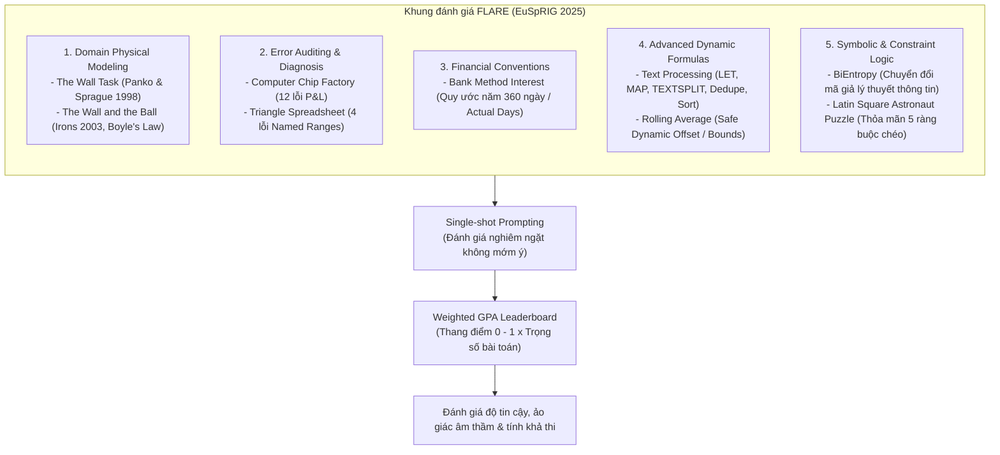

# Large Language Models for Spreadsheets: Benchmarking Progress and Evaluating Performance with FLARE

| Thông tin             | Chi tiết                                                                                                                                                                   |
| ---------------------- | --------------------------------------------------------------------------------------------------------------------------------------------------------------------------- |
| **Tác giả**    | Simon Thorne                                                                                                                                                                |
| **Đơn vị**    | Department of Computer Science, Cardiff Metropolitan University, UK (sthorne@cardiffmet.ac.uk)                                                                              |
| **Năm / Venue** | 2025 / Proceedings of the EuSpRIG 2025 Conference "Spreadsheet Productivity & Risks" (ISBN: 978-1-905404-60-5, European Spreadsheet Risks Interest Group - www.eusprig.org) |
| **Loại bài**   | Benchmark / Thực nghiệm đánh giá (Empirical Evaluation & Benchmark paper)                                                                                              |
| **Chủ đề**    | Spreadsheet LLM Benchmark, Formula Logic, Spreadsheet Auditing, Error Detection, Hallucination, Symbolic Reasoning, FLARE                                                   |
| **File gốc** | [Large Language Models for Spreadsheets.pdf](../papers/Large%20Language%20Models%20for%20Spreadsheets.pdf) |

## 1. Tóm tắt nhanh (TL;DR)

Bài báo giới thiệu khung đánh giá **FLARE** (*Formula Logic, Auditing, Reasoning and Evaluation*) được công bố tại hội thảo EuSpRIG 2025 nhằm khảo sát sự tiến bộ và giới hạn thực chất của hơn 20 mô hình ngôn ngữ lớn tiên tiến nhất năm 2025 (OpenAI o3/o4 mini, GPT-4o, Gemini 2.5 Pro, Claude, DeepSeek R1, Grok 3...) trên các tác vụ bảng tính thực tế. Khác với các benchmark chỉ đo việc sinh công thức đơn giản theo mẫu, FLARE cắm rễ vào các bài toán kinh điển về rủi ro bảng tính: kiểm toán lỗi (error auditing), gỡ lỗi công thức (logic repair), mô hình hóa miền kỹ thuật/tài chính chuyên sâu và giải đố ràng buộc biểu tượng (Latin Square). Kết quả cho thấy dù có tiến bộ rõ rệt so với thế hệ GPT-3.5 (2022), khả năng suy luận logic của LLM vẫn cực kỳ mỏng manh: mô hình xuất sắc nhất (Gemini 2.5 Pro) chỉ đạt điểm GPA có trọng số 0.667/1.0, và 100% các mô hình thất bại hoàn toàn trước bài toán thỏa mãn đa ràng buộc logic đồng thời.

## 2. Bối cảnh & Vấn đề nghiên cứu

- **Nguy cơ lỗi trong bảng tính nghiệp vụ:** Bảng tính là trụ cột trong phân tích dữ liệu và ra quyết định tài chính doanh nghiệp, nhưng các nghiên cứu xuyên suốt nhiều thập kỷ của cộng đồng EuSpRIG (Panko, Powell, Baker...) đã cho thấy phần lớn bảng tính vận hành thực tế đều chứa lỗi nghiêm trọng (mechanical errors, logic errors, omission errors), gây thiệt hại kinh tế hàng tỷ USD.
- **Sự trỗi dậy của LLM và ảo giác công thức (Formula Hallucination):** Từ khi ChatGPT ra đời cuối năm 2022, LLM được kỳ vọng sẽ tự động hóa việc viết công thức và kiểm tra bảng tính. Tuy nhiên, các nghiên cứu ban đầu (Thorne 2023, O’Beirne 2023) chỉ ra LLM thường xuyên "ảo giác": sinh ra các công thức nhìn qua rất chuyên nghiệp, hợp lý (plausible) nhưng thực chất sai lệch logic căn bản hoặc tạo ra các lỗi âm thầm (silent failures) rất khó phát hiện.
- **Khoảng trống của các bộ Benchmark hiện hữu:**
  - Các benchmark đương đại (như *SpreadsheetBench*, *MiMoTable*, *SheetAgent*) chủ yếu tập trung vào việc dịch yêu cầu ngôn ngữ tự nhiên thành các công thức đơn giản (như `SUMIF`, `VLOOKUP`) hoặc hỏi đáp dữ liệu bề mặt.
  - Hoàn toàn thiếu vắng các tác vụ phản ánh bản chất phức tạp trong công việc thực tế của chuyên gia bảng tính: kiểm toán và phát hiện lỗi ẩn trong file kế thừa, hiểu sâu các quy ước nghiệp vụ tài chính/kỹ thuật (domain conventions), xử lý chuỗi động nâng cao và suy luận logic biểu tượng đa ràng buộc (symbolic constraint satisfaction).

## 3. Phương pháp / Nội dung chính của FLARE

### 3.1 Cấu trúc khung đánh giá FLARE

FLARE (Formula Logic, Auditing, Reasoning and Evaluation) là bộ benchmark dạng mô-đun hóa, tuyển chọn các bài toán kinh điển từ kho tàng nghiên cứu rủi ro bảng tính hơn 20 năm của EuSpRIG:

1. **The Wall task & The Wall and the Ball task:**
   - *The Wall:* Bài toán dựng mô hình chi phí xây tường từ mô tả văn bản (quy đổi đơn vị thể tích, nhân công, tỷ suất lợi nhuận).
   - *The Wall and the Ball:* Mô hình khí cầu chở khách kết hợp hình học mặt cầu, áp suất khí quyển theo Định luật Boyle và hao hụt vật liệu. Đánh giá theo dải sai số kỹ thuật hàng không: Hạng Hàng không (*Aviation Grade* $\le \pm 0.1\%$), Đạt yêu cầu (*Suitable* $0.1\% - 0.5\%$), và Không chấp nhận được (*Unsuitable* $> 1.5\%$).
2. **Error-seeded Computer Chip Factory:**
   - Bảng tính báo cáo lãi lỗ (P&L) được cài sẵn 12 lỗi thực tế: lỗi nhập liệu cơ học (*mechanical errors* - ví dụ chi phí cố định không nhất quán, gõ đơn giá 50 thay vì 500, lỗi chính tả "Decemeber"), lỗi tính toán logic (*logical calculation errors* - tính sai giá vốn hàng bán COGS), và lỗi bỏ sót (*omission errors* - quên cộng chi phí cố định khi tính lợi nhuận tháng 11).
3. **Error-seeded Triangle Spreadsheet:**
   - Bảng tính phân loại tam giác sử dụng vùng đặt tên (Named Ranges), chứa 4 lỗi logic công thức lồng nhau: (1) thiếu kiểm tra điều kiện bất đẳng thức tam giác, (2) trả về sai biến cạnh ngắn nhất, (3) trả về sai biến cạnh giữa, và (4) dùng nhầm toán tử logic `OR` thay vì `AND` khi xác định cạnh dài nhất. Thang điểm tối đa là 8 (1 điểm cho phát hiện và 1 điểm cho sửa đúng mỗi lỗi).
4. **Bank Method Interest Calculation:**
   - Kiểm tra kiến thức nghiệp vụ tài chính đặc thù: phương pháp tính lãi vay ngân hàng dựa trên quy ước năm 360 ngày nhưng tính theo số ngày thực tế của từng tháng ($P \times \text{APR} \times \text{Days} / 360$). Đánh giá khả năng phân biệt giữa quy ước này với lãi đơn chia 12, lãi kép hay phương pháp khấu hao đều IPMT/PMT.
5. **Text Processing & Rolling Average:**
   - *Text Processing:* Yêu cầu viết một công thức Excel duy nhất để xử lý chuỗi: gộp danh sách tên từ 2 ô, bóc tách họ tên, loại bỏ trùng lặp, định dạng lại thành "Lastname, Firstname", sắp xếp theo thứ tự bảng chữ cái và ghép lại bằng dấu chấm phẩy (đòi hỏi các hàm mảng động mới: `LET`, `LAMBDA`, `TEXTSPLIT`, `TEXTJOIN`, `SORT`, `UNIQUE`).
   - *Rolling Average:* Viết công thức tính trung bình trượt 3 kỳ an toàn, có kiểm tra biên để tránh lỗi tràn ô tham chiếu ngoài vùng (`OFFSET`, `MAP`, `MAKEARRAY`).
6. **BiEntropy & Latin Square Puzzle:**
   - *BiEntropy:* Dịch định nghĩa toán học/mã giả về độ hỗn loạn chuỗi nhị phân (Croll 2013) thành công thức tính toán.
   - *Astronaut Latin Square:* Câu đố phân công 5 vị trí chuyên môn cho 5 phi hành gia theo ma trận ràng buộc loại trừ lẫn nhau, kiểm tra năng lực suy luận suy diễn tất định (deterministic deduction).

### 3.2 Hệ thống tính điểm Weighted GPA

Mỗi tác vụ được chuẩn hóa về thang điểm $[0, 1]$ (chấp nhận điểm thành phần). Điểm tổng kết được tính theo trung bình trọng số:

$$
\text{Weighted GPA} = \frac{\sum (\text{Task Score} \times \text{Task Weight})}{\sum \text{Task Weight}}
$$

Trọng số được thiết kế dựa trên độ phức tạp: BiEntropy (2.0), Triangle Logic Repair (1.5), Text Processing (1.5), Bank Method (1.0), Rolling Average (1.0), Latin Square (1.0).

## 4. Thực nghiệm & Kết quả chính

> **Cách đọc số liệu:** Các kết quả thuộc benchmark, split, metric và phiên bản mô hình của bài báo. “SOTA” chỉ áp dụng trong bối cảnh/thời điểm bài báo nêu; không so trực tiếp với PA của challenge.

### 4.1 Bảng xếp hạng tổng thể (Weighted GPA Leaderboard)

Thực nghiệm đánh giá hơn 20 mô hình LLM đại diện tiêu biểu nhất năm 2025 theo phương thức Single-shot Prompting:

| Xếp hạng | Mô hình LLM                  | Triangle (w=1.5) | Bank Method (w=1.0) | Text Proc (w=1.5) | Rolling Avg (w=1.0) | BiEntropy (w=2.0) | Astronaut (w=1.0) | **Weighted GPA** |
| :---------: | ------------------------------ | :--------------: | :-----------------: | :---------------: | :-----------------: | :---------------: | :---------------: | :--------------------: |
| **1** | **Gemini 2.5 Pro**       |      0.125      |   **1.000**   |       0.500       |   **1.000**   |  **1.000**  |       0.400       |    **0.667**    |
| **2** | **ChatGPT-4o mini-high** |      0.125      |   **1.000**   |  **1.000**  |   **1.000**   |       0.330       |       0.400       |    **0.593**    |
| **3** | **ChatGPT-4o**           |      0.125      |        0.000        |       0.500       |   **1.000**   |  **1.000**  |       0.400       |    **0.542**    |
| **4** | **Cohere**               |      0.125      |        0.000        |       0.500       |   **1.000**   |  **1.000**  |       0.400       |    **0.542**    |
|      5      | ChatGPT-o3 mini                |      0.000      |        0.000        |       0.500       |   **1.000**   |  **1.000**  |       0.200       |         0.494         |
|      6      | ChatGPT-o3 mini-high           |      0.000      |        0.000        |       0.500       |   **1.000**   |  **1.000**  |       0.200       |         0.494         |
|      7      | Perplexity                     |      0.125      |        0.000        |  **1.000**  |        0.500        |       0.660       |       0.400       |         0.488         |
|      8      | GROK3 DeepSearch               |      0.125      |        0.500        |       0.500       |        0.500        |       0.660       |       0.400       |         0.457         |
|      9      | Meta AI                        | **0.375** |        0.500        |       0.250       |   **1.000**   |       0.330       |       0.400       |         0.437         |
|     10     | Claude                         |      0.125      |   **1.000**   |       0.500       |        0.500        |       0.330       |       0.400       |         0.437         |
|     11     | ChatGPT-o4 mini                |      0.125      |   **1.000**   |       0.500       |   **1.000**   |       0.000       |       0.400       |         0.417         |
|     12     | Gemini 2.0 Flash               |      0.250      |        0.000        |       0.500       |   **1.000**   |       0.330       |       0.400       |         0.398         |
|     13     | DeepSeek                       |      0.125      |        0.500        |       0.250       |   **1.000**   |       0.330       |       0.400       |         0.390         |
|     14     | GROK3                          |      0.125      |        0.500        |       0.000       |        0.500        |       0.660       |       0.400       |         0.363         |
|     15     | Gemini 2.5 Flash               |      0.125      |        0.500        |  **1.000**  |        0.000        |       0.000       |       0.400       |         0.323         |
|     16     | DeepSeek R1                    |      0.000      |        0.500        |       0.000       |   **1.000**   |       0.330       |       0.400       |         0.320         |
|     17     | Mistral                        |      0.000      |        0.000        |       0.000       |        0.500        |       0.330       |       0.400       |         0.195         |
|     18     | Copilot                        |      0.000      |        0.250        |       0.250       |        0.500        |       0.000       |       0.400       |         0.191         |
|     19     | ChatGPT-4 mini                 |      0.125      |        0.000        |       0.000       |        0.000        |       0.000       |       0.400       |         0.073         |

### 4.2 Các phát hiện thực nghiệm cốt lõi

1. **Kiểm toán lỗi bảng tính (Computer Chip Factory - 12 lỗi):**
   - *Gemini 2.5 Pro* phát hiện hoàn hảo 12/12 lỗi (100%), *ChatGPT-4.5* và *ChatGPTo3 mini high* phát hiện 11/12 (91.67%).
   - *Phát hiện:* Các mô hình nhận diện rất tốt lỗi logic công thức (sai tham chiếu hàng), nhưng **rất kém trong việc phát hiện lỗi cơ học** (bỏ sót đơn giá 50 thay vì 500) và lỗi chính tả tên cột ("Decemeber", "Distrubtion") trừ khi có prompt nhắc nhở đặc biệt.
2. **Sửa lỗi công thức hình học (Triangle Spreadsheet - 4 lỗi, Max 8 điểm):**
   - Đa số mô hình hoàn toàn thất bại (Group A: 0 điểm).
   - Mô hình đạt điểm cao nhất là *Meta AI* nhưng cũng chỉ đạt **3/8 điểm** (nhận diện và sửa được bất đẳng thức tam giác và lỗi logic OR $\rightarrow$ AND).
   - **Hiện tượng đáng lo ngại:** 100% các mô hình đều **bỏ sót hoàn toàn lỗi gán sai biến** của cạnh ngắn nhất (`shortest`) và cạnh giữa (`middle`), cho thấy LLM chưa có năng lực suy luận sâu về ngữ nghĩa tham chiếu định danh (named ranges).
3. **Quy ước tính lãi ngân hàng (Bank Method):**
   - Chỉ có 4 mô hình làm đúng chuẩn tài chính ($N/360$ ngày): *Claude, ChatGPT o4 mini, ChatGPT o4 mini high, Gemini 2.5 Pro*. Hầu hết các LLM khác tự động áp dụng công thức chia 12 tháng đơn giản hoặc dùng nhầm các hàm trả góp định kỳ (`PMT`, `IPMT`).
4. **Xử lý chuỗi nâng cao (Text Processing):**
   - Chỉ có 3 mô hình sinh được công thức Excel hợp lệ và thực thi thành công: *Perplexity, ChatGPT o4 mini, ChatGPT o4 mini high*.
   - Hàng loạt mô hình gặp lỗi cú pháp nghiêm trọng (`#NAME?`, `too few arguments` trong cấu trúc `LET`), minh chứng cho thấy LLM rất dễ vấp ngã trước các cấu trúc ngôn ngữ hàm lồng nhau của Excel hiện đại.
5. **Thất bại tuyệt đối ở bài toán ràng buộc (Latin Square Puzzle):**
   - **Tỷ lệ giải đúng hoàn chỉnh: 0% trên toàn bộ các mô hình tested.**
   - Mặc dù nhiều mô hình đưa ra chuỗi giải thích dài (CoT) nghe có vẻ cực kỳ thuyết phục và tự tin, nhưng thực tế chúng chỉ thỏa mãn được một vài gợi ý rời rạc và vi phạm các ràng buộc loại trừ chéo, cho thấy LLM hoạt động theo cơ chế suy luận thống kê xác suất chứ không thể suy luận suy diễn tất định (deterministic deduction).

## 5. Tính mới (Novelty & Đóng góp)

- **Cầu nối giữa nghiên cứu rủi ro bảng tính cổ điển và kỷ nguyên LLM:** FLARE là benchmark đầu tiên tích hợp các bài học sâu sắc từ 25 năm nghiên cứu của hiệp hội EuSpRIG vào việc đánh giá AI, kéo trọng tâm nghiên cứu ra khỏi việc sinh công thức đồ chơi để hướng vào rủi ro kiểm toán thực tế.
- **Hệ thống đánh giá toàn diện dựa trên Weighted GPA:** Cân bằng giữa kiểm toán lỗi (Auditing), quy ước tài chính (Domain modeling), cú pháp hàm mảng hiện đại (Text processing) và suy luận logic biểu tượng (Symbolic logic).
- **Phơi bày bản chất nguy hiểm của "Sự tự tin giả tạo" (Confident Hallucinations):** Nghiên cứu cho thấy rằng các mô hình LLM năm 2025 có xu hướng đưa ra câu trả lời sai nhưng được bọc dưới lớp vỏ lập luận rất trôi chảy, khiến người dùng không chuyên rất dễ bị đánh lừa trong các bảng tính quan trọng.

## 6. Hạn chế

### 6.1 Hạn chế do tác giả thừa nhận

- **Quy mô tập mẫu còn khiêm tốn:** Benchmark tập trung vào các case study sâu sắc mang tính chất đại diện thay vì hàng nghìn câu hỏi tự động hóa bằng script.
- **Đánh giá trên Prompt tĩnh (Single-turn Static Prompts):** Thử nghiệm chỉ đánh giá 1 lượt hỏi-đáp trực tiếp, chưa phản ánh các kịch bản tương tác đa lượt (multi-turn conversation) hoặc các agent có cơ chế phản tư (reflective agents).
- **Tính chủ quan trong chấm điểm từng phần:** Mặc dù có rubric cụ thể, việc cho điểm bán phần (partial credit) vẫn có yếu tố diễn giải của người đánh giá.
- **Giới hạn ở giao diện Text-in/Text-out:** Chưa đánh giá khả năng thao tác trực tiếp trên môi trường bảng tính đa phương thức (multimodal / UI interaction).

### 6.2 Nhận xét thêm của người review

- **Thiếu tính tự động hóa (Automated Programmatic Evaluation):** Do bài báo xuất phát từ cộng đồng nghiên cứu rủi ro (EuSpRIG), tác giả thực hiện phần lớn việc chấm điểm và phân loại thủ công; việc thiếu một test runner tự động khiến việc tái lập và mở rộng cho các mô hình ra mắt sau đó gặp rào cản.
- **Không nhất quán trong đặt tên phiên bản mô hình:** Tác giả dùng nhiều tên gọi không đồng nhất trong bài (ví dụ: `ChatGPT o4 mini`, `ChatGPT-04 mini`, `ChatGPT-4o mini-high`, `Gemini 2.4 Pro` đối chiếu với `Gemini 2.5 Pro`), phản ánh sự biến động nhanh của thị trường AI nhưng gây khó hiểu cho người đọc đối chiếu.
- **Chưa đề xuất giải pháp kỹ thuật:** Bài báo dừng lại ở vai trò chẩn đoán và gióng lên hồi chuông cảnh báo về rủi ro, chưa đề xuất kiến trúc agent hay giải pháp hybrid neuro-symbolic cụ thể nào để khắc phục các điểm yếu này.

## 7. Ý nghĩa ứng dụng (cho hệ thống agent phân tích dữ liệu / Text-to-SQL)

> **Phân biệt nguồn:** Khuyến nghị trong mục này là suy luận ứng dụng cho DataMate; bài báo không đánh giá trực tiếp trên challenge, trừ khi nêu rõ.

- **Nguyên tắc "Trust, but Verify" cho AI Bảng tính:** Không bao giờ để LLM trực tiếp cập nhật hoặc xuất file bảng tính tài chính/kiểm toán mà không có bộ kiểm tra cú pháp và logic độc lập (Symbolic Validator / Excel Calculation Engine).
- **Phân định rõ vai trò giữa LLM và Constraint Solvers:** Đối với các bài toán tối ưu hóa nguồn lực, xếp lịch hay thỏa mãn ràng buộc ma trận (CSP - như bài toán Latin Square), agent **bắt buộc phải dịch bài toán sang mã code gọi Solver chuyên dụng** (như Python `scipy.optimize`, `Z3`, `ortools`) thay vì để LLM tự suy luận chay.
- **Thiết kế Prompt có bối cảnh nghiệp vụ tường minh:** Khi yêu cầu LLM tính toán tài chính (lãi suất, khấu hao), prompt của agent phải chỉ định rõ quy ước cơ sở (day-count convention: ví dụ Actual/360, Actual/365, hay 30/360) để tránh việc mô hình tự ý áp dụng công thức đơn giản hóa sai thực tế.
- **Cảnh giác cao độ với lỗi cơ học trong dữ liệu:** LLM rất dễ "bỏ qua" các lỗi gõ sai số học hay lỗi chính tả tên cột. Hệ thống agent cần tích hợp tiền xử lý bằng các công cụ phân tích thống kê (outlier detection, schema fuzzy matching) trước khi giao cho LLM phân tích.

## 8. Từ khóa

`FLARE`, `Spreadsheet Benchmark`, `EuSpRIG`, `Spreadsheet Risks`, `Error Auditing`, `Formula Generation`, `Formula Hallucination`, `Constraint Satisfaction`, `Symbolic Reasoning`, `Bank Method`, `Domain Modeling`.

## 9. Mức độ phù hợp với challenge DataMate

**Phân nhóm: Tham khảo.** FLARE tập trung hàm, công thức và thao tác workbook; hữu ích về lỗi spreadsheet nhưng khác hỏi đáp có đầu ra typed.

## 10. Nguồn và truy nguyên kết quả

- **PDF gốc:** liên kết ở bảng thông tin đầu review và bản lưu trong thư mục `../papers/`.
- **Vị trí kiểm chứng:** Method §1.6, p. 4; results §2, pp. 6–15; limitations/conclusion §3.4–3.5, p. 16.
- Số liệu ở mục 4 là kết quả tác giả trên benchmark gốc; phần áp dụng DataMate tại mục 7 và mục 9 là nhận định của review.
