# LinkAlign: Scalable Schema Linking for Real-World Large-Scale Multi-Database Text-to-SQL

| Thông tin | Chi tiết |
|---|---|
| **Tác giả** | Yihan Wang, Peiyu Liu, Xin Yang |
| **Đơn vị** | China Academy of Information and Communications Technology (CAICT), Renmin University of China, University of International Business and Economics |
| **Năm / Venue** | EMNLP 2025 / arXiv:2503.18596 |
| **Loại bài** | Phương pháp (Method) + Benchmark phụ (AmbiDB) |
| **Chủ đề** | Text-to-SQL, Schema Linking, Multi-Database, Database Retrieval, Schema Item Grounding, Multi-Agent Debate, Query Rewriting |
| **File gốc** | [LinkAlign.pdf](../papers/LinkAlign.pdf) |

## 1. Tóm tắt nhanh (TL;DR)
LinkAlign là khung làm việc (framework) giải quyết bài toán schema linking trong môi trường Text-to-SQL đa cơ sở dữ liệu (multi-database) quy mô lớn trong doanh nghiệp. Thông qua phân tích 4 loại lỗi cốt lõi (chiếm 68.3% nguyên nhân thất bại), LinkAlign đề xuất quy trình 3 bước module hóa (Multi-round Semantic Retrieval $\rightarrow$ Response Filtering $\rightarrow$ Schema Parsing) hỗ trợ linh hoạt hai chế độ thực thi (Pipeline một lượt gọi nhanh và Agent tranh biện đa tác tử), đạt điểm số SOTA 33.09% trên Spider 2.0-Lite hoàn toàn bằng mô hình nguồn mở (DeepSeek-R1).

## 2. Bối cảnh & Vấn đề nghiên cứu
- **Bối cảnh**: Phần lớn nghiên cứu Text-to-SQL hiện tại giả định một kịch bản lý tưởng: người dùng chỉ hỏi trên **một database duy nhất đã được chỉ định trước** với schema tương đối nhỏ gọn. Trong thực tế doanh nghiệp, dữ liệu phân tán trên hàng chục cơ sở dữ liệu (cloud data warehouse BigQuery, Snowflake lẫn hệ thống quan hệ cục bộ SQLite/MySQL) với hàng ngàn bảng và cột.
- **Phân tích lỗi (Error Analysis trên 500 mẫu Spider đa DB)**: Lỗi schema linking chiếm tới **68.3%** nguyên nhân gây trượt truy vấn SQL. Bài báo phân rã thành 2 thách thức và 4 dạng lỗi:
  - **Thách thức 1: Database Retrieval (Định vị Database mục tiêu)**
    - *Error 1 (23.6%) - Target Database without Retrieval*: Truy vấn người dùng dùng từ ngữ lệch xa schema (semantic gap), khiến tìm kiếm vector không thu hồi được database chuẩn.
    - *Error 2 (13.3%) - Referring Irrelevant Databases*: Do nhiều database chứa bảng có tên na ná nhau (ví dụ: `Student` vs. `People`), mô hình bị nhiễu và chọn nhầm schema từ database không liên quan.
  - **Thách thức 2: Schema Item Grounding (Khớp bảng và cột chi tiết)**
    - *Error 3 (19.8%) - Linking to the Wrong Tables*: Chọn sai bảng trong database mục tiêu.
    - *Error 4 (11.6%) - Linking to the Wrong Columns*: Bỏ sót hoặc chọn sai cột khóa chính/ngoại hoặc cột điều kiện lọc.

## 3. Phương pháp / Nội dung chính

LinkAlign cấu trúc tiến trình schema linking thành 3 bước mô-đun hóa, mỗi bước đều hỗ trợ 2 chế độ: **Pipeline** (dùng prompt CoT duy nhất, độ trễ thấp) và **Agent** (tranh biện đa tác tử, độ chính xác cao).

```mermaid
flowchart LR
    subgraph Step1 ["Step 1: Multi-round Retrieval & Query Rewriting"]
        Q0["User Query Q0"] --> Auditor["Schema Auditor<br/>(Bóc tách Entity/Attr/Constraint<br/>& suy đoán schema thiếu)"]
        Auditor --> Rewriter["Query Rewriter Agent<br/>(Viết lại truy vấn ngữ nghĩa chuẩn hóa)"]
        Rewriter --> EmbedRet["Vector Retrieval (bge-large-en-v1.5)<br/>Tổng hợp kết quả Z qua T vòng"]
    end

    subgraph Step2 ["Step 2: Isolate Irrelevant DB (Response Filtering)"]
        EmbedRet --> Analyst["Data Analyst Agent<br/>(Đánh giá độ phủ miền, xếp hạng DB)"]
        Analyst <-->|Tranh biện luân phiên 1-by-1| Expert["Database Expert Agent<br/>(Kiểm chứng schema DB có thỏa mãn query)"]
        Expert --> TargetDB["Định vị Target Database Dt<br/>(Loại bỏ hoàn toàn nhiễu DB khác)"]
    end

    subgraph Step3 ["Step 3: Extract Schema for SQL (Schema Parsing)"]
        TargetDB --> Parsers["Multiple Schema Parsers<br/>(Trích xuất Table / Column / Relation)"]
        Parsers -->|Simultaneous-Talk| Scientist["Data Scientist Agent<br/>(Tổng hợp, phản biện lỗi sót/thừa)"]
        Scientist --> LinkedSchema["Final Concise Schema S'"]
    end

    LinkedSchema --> GenSQL["Text-to-SQL Generator (DIN-SQL / DeepSeek-R1)"]
```

### 3.1 Ba bước xử lý cốt lõi
1. **Bước 1: Thu hồi Schema tiềm năng qua viết lại truy vấn (Multi-round Semantic Retrieval)**:
   - Dùng phản hồi suy luận (reflection) của LLM để phát hiện các thành phần schema còn thiếu cho câu lệnh SQL (mệnh đề SELECT, JOIN, WHERE).
   - Tác tử *Schema Auditor* bóc tách bộ ba (thực thể, thuộc tính, điều kiện) và sinh báo cáo kiểm toán schema.
   - Tác tử *Query Rewriter* viết lại câu hỏi tự nhiên bổ sung thông tin ngữ nghĩa và cấu trúc hóa câu truy vấn để embedding model (`bge-large-en-v1.5`) tìm kiếm chính xác hơn, thu hồi schema mục tiêu sau $T$ vòng.
2. **Bước 2: Cách ly thông tin rác qua lọc phản hồi (Response Filtering)**:
   - Gom nhóm kết quả tìm kiếm theo từng cơ sở dữ liệu.
   - Tổ chức tranh luận đa tác tử (*Multi-Agent Debate*): *Data Analyst* phân tích mức độ phù hợp miền dữ liệu và xếp hạng ứng viên; *Database Expert* phản biện kiểm tra xem database được chọn có thực sự giải được câu hỏi không.
   - Loại bỏ triệt để các database rác, chọn ra duy nhất Database mục tiêu $D_t$. (Đối với kịch bản single-database, tác giả đề xuất kỹ thuật *Random Preservation with Exponential Decay* và *Post-Retrieval* để lọc bảng rác mà không làm mất bảng đúng).
3. **Bước 3: Trích xuất Schema phục vụ sinh SQL (Schema Parsing)**:
   - Thay vì ánh xạ tĩnh, LinkAlign áp dụng cơ chế tranh luận đồng thời có trọng tài (*Simultaneous-Talk-with-Summarizer*): Nhiều *Schema Parser* độc lập trích xuất bảng, cột và quan hệ khóa; sau đó *Data Scientist* đóng vai trò chuyên gia tổng hợp, thẩm định và loại trừ trùng lặp/thiếu sót.

### 3.2 Bộ dữ liệu AmbiDB
Để đo lường chuẩn xác thách thức đa cơ sở dữ liệu có tính mơ hồ cao, bài báo tự động xây dựng **AmbiDB** (dựa trên Spider):
- **Database Expansion**: Mở rộng các schema con tương đồng sang nhiều database (ví dụ các bảng `Student`, `Course` thuộc miền trường học xuất hiện ở nhiều database giả lập), bổ sung bảng/cột mới để tăng quy mô.
- **Query Modification & Verification**: Làm mờ câu hỏi để không chứa đích danh tên bảng/cột, buộc mô hình phải suy luận ngữ cảnh database, sau đó kiểm tra tính thực thi và lọc độ dài câu hỏi.

## 4. Thực nghiệm & Kết quả chính

> **Cách đọc số liệu:** Các kết quả thuộc benchmark, split, metric và phiên bản mô hình của bài báo. “SOTA” chỉ áp dụng trong bối cảnh/thời điểm bài báo nêu; không so trực tiếp với PA của challenge.
- **Mô hình**: GLM-4-Air cho module Schema Linking; DeepSeek-R1, DeepSeek-V3, Qwen-72B, GPT-4 cho phần sinh SQL Text-to-SQL.
- **Metric**: Locate Accuracy (LA - tỷ lệ chọn đúng database), Exact Match (EM - tỷ lệ khớp chính xác schema), Recall, Execution Accuracy (EX).

### 4.1 Kết quả Schema Linking trong môi trường Multi-Database

| Phương pháp | Spider LA / EM / Recall (%) | BIRD LA / EM / Recall (%) | AmbiDB LA / EM / Recall (%) |
|---|:---:|:---:|:---:|
| DIN-SQL | 80.0 / 26.8 / 62.4 | 68.8 / 5.1 / 31.3 | 59.7 / 13.3 / 44.2 |
| PET-SQL | 84.1 / 38.6 / 67.2 | 77.1 / 8.2 / 39.7 | 66.4 / 22.0 / 50.2 |
| MAC-SQL | 82.3 / 17.3 / 42.8 | 75.0 / 5.7 / 34.5 | 65.1 / 9.7 / 30.8 |
| MCS-SQL | 81.0 / 24.3 / 73.2 | 73.7 / 13.9 / 56.1 | 61.9 / 13.7 / 54.8 |
| RSL-SQL | 74.8 / 29.1 / 76.1 | 80.0 / 16.1 / 61.8 | 62.4 / 17.9 / 59.6 |
| **LinkAlign (Pipeline)** | 85.4 / 37.4 / 65.9 | 66.8 / 8.6 / 38.1 | **69.4** / 20.3 / 50.4 |
| **LinkAlign (Agent)** | **86.4** / **47.7** / **80.7** | **83.4** / **22.1** / **64.9** | 67.6 / **22.4** / **56.9** |

*LinkAlign (Agent) vượt trội tất cả các baseline về độ chính xác định vị database (LA) và độ khớp schema tuyệt đối (EM).*

### 4.2 Kết quả trên Spider 2.0-Lite (Enterprise Benchmark)

| Phương pháp | Loại mô hình | Execution Accuracy (EX %) |
|---|:---:|:---:|
| DIN-SQL + GPT-4o | Closed | 1.46% |
| CHESS + GPT-4o | Closed | 3.84% |
| DAIL-SQL + GPT-4o | Closed | 5.68% |
| Spider-Agent + o3-mini | Closed | 23.40% |
| Spider-Agent + Claude-3.7-Sonnet | Closed | 25.41% |
| ReFoRCE + o1-preview | Closed | 30.35% |
| LinkAlign + DeepSeek-V3 | Open-source | 24.86% |
| **LinkAlign + DeepSeek-R1** | **Open-source** | **33.09%** |

*(LinkAlign đưa DIN-SQL từ mức 1.46% vọt lên 33.09%, đứng Top 1 trên bảng xếp hạng Spider 2.0-Lite tại thời điểm công bố).*

### 4.3 Thời gian chạy và Ablation
- **Hiệu quả thực thi (Table 6 & 8)**:
  - Pipeline mode: Tổng thời gian 13.63s cho 3 bước (S1: 9.0s, S2: 2.9s, S3: 1.7s), tiêu tốn trung bình 8.5K tokens.
  - Agent mode: Tổng thời gian 70.59s cho 3 bước (S1: 30.9s, S2: 26.2s, S3: 13.5s), tiêu tốn trung bình 12.5K tokens.
- **Ablation Query Rewriting & Response Filtering**:
  - Viết lại truy vấn (Query Rewriting) giúp giảm lỗi thiếu database (Error 1) tới 10.8% trong chế độ Agent.
  - Lọc phản hồi (Response Filtering) giúp triệt tiêu lỗi nhiễu database ngoài (Error 2) tới 10.8%, bù trừ hoàn hảo cho rủi ro query rewrite mở rộng quá đà.

## 5. Tính mới (Novelty & Đóng góp)
- **Tập trung vào môi trường Multi-Database thực tế**: Thay vì giả định biết trước database, bài báo tiên phong giải quyết trọn vẹn bài toán xác định database mục tiêu giữa hàng chục hệ thống cơ sở dữ liệu doanh nghiệp.
- **Phân loại 4 dạng lỗi schema linking có hệ thống**: Đưa ra thống kê định lượng chi tiết về tỉ lệ lỗi trong quy trình Text-to-SQL thực tế.
- **Cơ chế tranh biện đa tác tử chuyên biệt**: Thiết kế các vai trò rõ ràng (*Schema Auditor*, *Query Rewriter*, *Data Analyst*, *Database Expert*, *Schema Parser*, *Data Scientist*) với các giao thức tranh luận có kiểm soát (*One-by-one debate*, *Simultaneous-talk with summarizer*).
- **Bộ benchmark AmbiDB**: Đóng góp môi trường đánh giá schema linking có độ mơ hồ cao giữa các database đồng nghĩa.

## 6. Hạn chế
### 6.1 Hạn chế do tác giả thừa nhận
- **Chưa thử nghiệm kết hợp chéo Pipeline và Agent**: Các bước hiện được chạy đồng nhất toàn Pipeline hoặc toàn Agent, chưa khảo sát kịch bản tối ưu chi phí (ví dụ: Step 1 dùng Pipeline, Step 2 & 3 dùng Agent).
- **Mô hình nền tảng trong schema linking còn khiêm tốn**: Sử dụng GLM-4-Air làm backbone cho schema linking; nếu dùng các reasoning model mạnh hơn có thể tạo ra các biến đổi hiệu năng khác.

### 6.2 Nhận xét thêm của người review
- **Chiến lược Schema quá cô đọng gây rủi ro về Strict Recall**: Như được kiểm chứng độc lập trong bài báo AutoLink (2025), LinkAlign chỉ giữ lại trung bình 21.1 cột trên Spider 2.0-Lite. Việc lọc quá gắt (aggressive noise reduction) khiến Strict Recall Rate (SRR) của LinkAlign trên Spider 2.0-Lite chỉ đạt 36.4%, đồng nghĩa với việc gần 2/3 trường hợp schema đưa vào bị thiếu ít nhất 1 cột so với gold SQL.
- **Hiệu năng cao nhờ mô hình Reasoning (DeepSeek-R1)**: Điểm số 33.09% trên Spider 2.0-Lite phần lớn được hưởng lợi từ năng lực tự suy luận và tự sửa sai của DeepSeek-R1 ở giai đoạn sinh SQL; khi chạy với DeepSeek-V3 điểm tụt về 24.86%.
- **Chưa có cơ chế tương tác trực tiếp với Database Engine**: Khác với AutoLink có action chạy thử SQL trên live database để bắt lỗi cột thiếu, LinkAlign hoàn toàn dựa vào suy luận tĩnh giữa LLM và vector store, thiếu vòng phản hồi từ compiler/execution engine.

## 7. Ý nghĩa ứng dụng (cho hệ thống agent phân tích dữ liệu / Text-to-SQL)

> **Phân biệt nguồn:** Khuyến nghị trong mục này là suy luận ứng dụng cho DataMate; bài báo không đánh giá trực tiếp trên challenge, trừ khi nêu rõ.
- **Kiến trúc phân tầng Database Routing $\rightarrow$ Schema Linking**: Trong các hệ sinh thái dữ liệu doanh nghiệp lớn gồm Data Lakehouse, Data Warehouse và RDBMS nghiệp vụ, cần xây dựng bộ định tuyến (Database Router) lọc database trước khi nạp schema chi tiết cho SQL agent.
- **Kỹ thuật Query Rewriting định hướng Schema**: Khi người dùng đặt câu hỏi ngắn hoặc dùng tiếng lóng kinh doanh, hệ thống agent nên dùng LLM mở rộng câu hỏi thành các thực thể/thuộc tính chuẩn mực trước khi bắn query vào Vector DB.
- **Chế độ linh hoạt Pipeline vs. Agent**: Cung cấp cấu hình kép: chạy chế độ Pipeline nhanh (~13s) cho các dashboard BI/báo cáo thời gian thực, và chuyển sang Agent Debate sâu (~70s) cho các câu hỏi ad-hoc phân tích phức tạp.

## 8. Từ khóa
`LinkAlign`, `Text-to-SQL`, `Schema Linking`, `Multi-Database`, `Database Retrieval`, `Schema Item Grounding`, `Multi-Agent Debate`, `Spider 2.0-Lite`, `AmbiDB`, `DeepSeek-R1`

## 9. Mức độ phù hợp với challenge DataMate

**Phân nhóm: Tham khảo.** Schema linking đa database có thể dùng nếu lỗi chọn bảng/cột là nút thắt đã đo; bài dùng cấu hình mô hình nặng.

## 10. Nguồn và truy nguyên kết quả

- **PDF gốc:** liên kết ở bảng thông tin đầu review và bản lưu trong thư mục `../papers/`.
- **Vị trí kiểm chứng:** Method §3, pp. 3–5; experiments/results §4, pp. 6–8; conclusion p. 9.
- Số liệu ở mục 4 là kết quả tác giả trên benchmark gốc; phần áp dụng DataMate tại mục 7 và mục 9 là nhận định của review.
