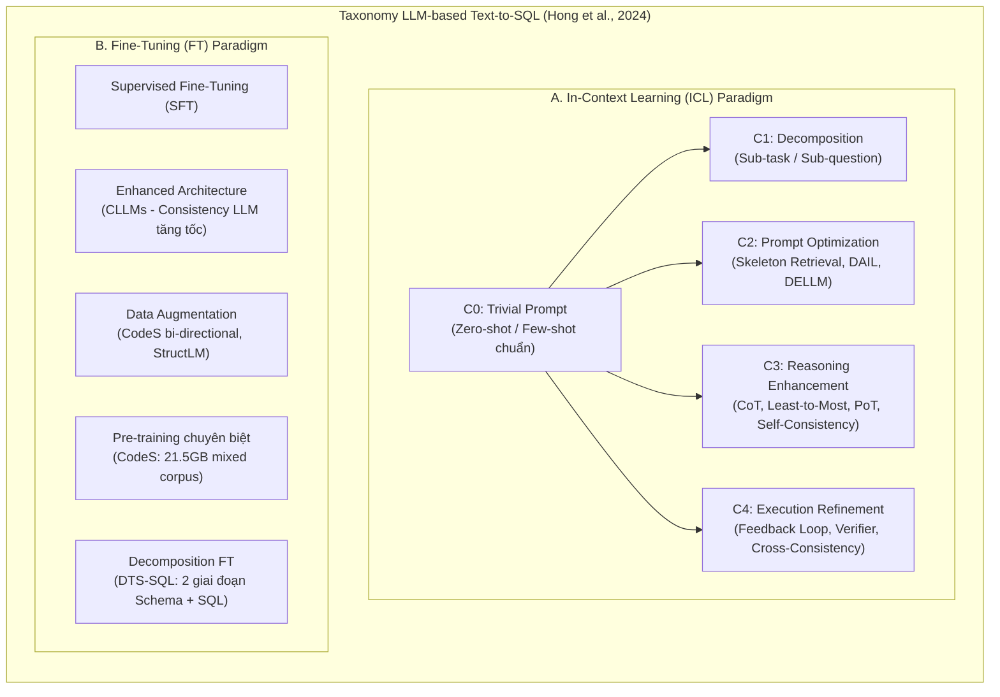

# Next-Generation Database Interfaces: A Survey of LLM-based Text-to-SQL

| Thông tin | Chi tiết |
|---|---|
| **Tác giả** | Zijin Hong, Zheng Yuan, Qinggang Zhang, Hao Chen, Junnan Dong, Feiran Huang, Xiao Huang* (*tác giả liên hệ) |
| **Đơn vị** | Jinan University (Quảng Châu) & The Hong Kong Polytechnic University (PolyU, Hồng Kông) |
| **Năm / Venue** | 2024 (cập nhật v2 tháng 6/2024), arXiv:2406.08426 [cs.CL] |
| **Loại bài** | Survey (Tổng quan) |
| **Chủ đề** | Text-to-SQL, LLM-based NLIDB, In-Context Learning Taxonomy, Fine-Tuning, Execution Refinement, Computational Efficiency |
| **File gốc** | [Next-Generation Database Interfaces A Survey of LLM-based Text-to-SQL.pdf](../papers/Next-Generation%20Database%20Interfaces%20A%20Survey%20of%20LLM-based%20Text-to-SQL.pdf) |

## 1. Tóm tắt nhanh (TL;DR)
Khảo sát từ Đại học Tế Nam và Đại học Bách khoa Hồng Kông hệ thống hóa các nghiên cứu Text-to-SQL trong kỷ nguyên LLM theo góc nhìn giao diện cơ sở dữ liệu thế hệ mới (Next-Generation NLIDB). Bài báo phân loại toàn diện các phương pháp Học trong ngữ cảnh (In-Context Learning - ICL) thành 5 nhóm chiến lược (C0: Trivial Prompt, C1: Decomposition, C2: Prompt Optimization, C3: Reasoning Enhancement, C4: Execution Refinement), phân tích 4 hướng tinh chỉnh mô hình mở (Fine-tuning), và chỉ ra các thách thức trọng tâm về tính bền vững thực tế, hiệu quả tính toán (độ trễ suy luận, chi phí token), bảo mật dữ liệu và khả năng giải thích (interpretability).

## 2. Bối cảnh & Vấn đề nghiên cứu
- **Bối cảnh**: SQL là ngôn ngữ truy vấn thống trị với hơn 51,5% lập trình viên chuyên nghiệp sử dụng, nhưng chỉ có khoảng 35,3% trong số đó được đào tạo bài bản (theo khảo sát Stack Overflow 2023). Giao diện ngôn ngữ tự nhiên cho cơ sở dữ liệu (NLIDB) cho phép người dùng phổ thông truy cập dữ liệu quan hệ mà không cần học SQL, đồng thời đẩy nhanh tốc độ tương tác người - máy. Ngược lại, Text-to-SQL cũng cung cấp dữ liệu thực tế từ cơ sở dữ liệu để giải quyết vấn đề ảo giác (hallucination) cố hữu của LLM.
- **Tiến trình lịch sử**:
  1. *Rule-based (trước 2015)*: Dựa trên cây phân tích cú pháp (parsing tree) và luật ngữ pháp định sẵn; tốn công xây dựng và không thể tổng quát hóa.
  2. *Deep Learning (2015–2019)*: Seq2seq, LSTM, GNN, RYANSQL (dùng intermediate representation và slot-filling dạng sketch).
  3. *PLM-based (2019–2021)*: BERT, RoBERTa, GraPPa, TABERT, RESDSQL. Hiệu năng cao trên tập dữ liệu chuẩn nhưng bị giới hạn khi lược đồ CSDL phình to và câu hỏi phức tạp.
  4. *LLM-based (2021–nay)*: Tận dụng khả năng hiểu ngôn ngữ sâu rộng và năng lực suy luận emergent qua ICL và Fine-tuning.
- **Thách thức kỹ thuật cốt lõi**:
  - *Độ phức tạp ngôn ngữ và sự mơ hồ*: Câu hỏi lồng ghép, tỉnh lược, đa nghĩa, cách diễn đạt mơ hồ.
  - *Hiểu và biểu diễn lược đồ (Schema Representation)*: Khó mã hóa toàn bộ hàng trăm bảng/cột và ràng buộc quan hệ vào ngữ cảnh giới hạn của mô hình.
  - *Cú pháp SQL hiếm và phức tạp*: Các phép toán `WINDOW FUNCTION`, `OUTER JOIN`, subquery lồng nhau nhiều cấp hiếm gặp trong tập huấn luyện.
  - *Khả năng tổng quát hóa xuyên miền (Cross-Domain Generalization)*: Khác biệt lớn về thuật ngữ và phong cách CSDL giữa các lĩnh vực nghiệp vụ.

## 3. Phương pháp / Nội dung chính
Tác giả đề xuất cây phân loại (Taxonomy Tree, Figure 3) cấu trúc hóa toàn bộ các nghiên cứu Text-to-SQL sử dụng LLM:

### 3.1 Khung phân loại phương pháp In-Context Learning (ICL - Bảng II & III)
Tác giả phân rã ICL thành 5 nhóm kỹ thuật (C0 đến C4):
- **C0 - Trivial Prompt**: Các kỹ thuật prompt cơ bản (Zero-shot và Few-shot tiêu chuẩn theo tài liệu của OpenAI). Nghiên cứu cho thấy việc đưa quá nhiều nội dung database thô vào prompt có thể làm giảm độ chính xác; định dạng `CREATE TABLE` có khóa ngoại và chỉ dẫn cấm giải thích dài dòng ("no explanation") giúp LLM trả lời ngắn gọn, chính xác hơn.
- **C1 - Decomposition (Phân rã bài toán)**: Chia thành 2 trường phái:
  1. *Sub-task decomposition*: Tách toàn bộ quy trình thành các nhiệm vụ phụ: Schema Linking $\rightarrow$ Phân loại độ khó $\rightarrow$ Sinh SQL $\rightarrow$ Tự sửa lỗi (tiêu biểu: DIN-SQL, C3, DEA-SQL, MAC-SQL).
  2. *Sub-question decomposition*: Chia câu hỏi người dùng phức tạp thành chuỗi các câu hỏi con đơn giản hơn, giải quyết từng câu để ghép thành câu lệnh SQL cuối cùng (QDecomp, least-to-most).
- **C2 - Prompt Optimization (Tối ưu hóa Prompt)**: Tập trung nâng cao chất lượng ngữ cảnh đưa vào:
  - Lựa chọn ví dụ mẫu (Demonstration Selection): Lọc theo độ tương đồng khung xương câu hỏi (Question Skeleton Similarity trong DESEM, DAIL-SQL), phân cụm đa dạng (k-Means trong SD+SA+Voting, FUSED).
  - Tăng cường tri thức chuyên gia: Framework DELLM (Hong et al., ACL 2024) huấn luyện một mô hình chuyên gia dữ liệu riêng biệt để tự động sinh 4 loại tri thức miền bổ trợ vào prompt.
- **C3 - Reasoning Enhancement (Tăng cường suy luận)**:
  - Chain-of-Thought (CoT) nguyên bản không phải lúc nào cũng mang lại hiệu quả vượt trội cho SQL nếu không được tùy biến; ACT-SQL tự động sinh ví dụ CoT bằng cách liên kết từng mệnh đề SQL với lát cắt câu hỏi tương ứng.
  - Program-of-Thoughts (PoT) / SQL-CRAFT: Ép LLM sinh code Python song song cùng câu lệnh SQL để hỗ trợ tính toán số học phức tạp.
  - Self-Consistency: Lấy mẫu nhiều đường suy luận và bỏ phiếu dựa trên kết quả thực thi.
- **C4 - Execution Refinement (Tinh chỉnh dựa trên thực thi)**:
  - *Vòng lặp sửa lỗi phản hồi (Second-round Feedback)*: Thực thi câu lệnh nháp, hứng mã lỗi hoặc log ngoại lệ của DBMS đưa ngược lại prompt cho LLM sửa (Self-Debugging, DIN-SQL, MAC-SQL).
  - *Chọn lọc dựa trên thực thi*: Đánh giá rủi ro Bayes (MBR-Exec), huấn luyện bộ kiểm định học được (learned verifier trong LEVER), hoặc bỏ phiếu chéo giữa nhiều mô hình ở các cấp độ khó khác nhau (PET-SQL).

### 3.2 Khung phân loại Fine-Tuning cho mô hình mã nguồn mở (Bảng IV)
- **Kiến trúc tăng tốc (Enhanced Architecture)**: CLLMs (Consistency Large Language Models) áp dụng giải mã nhất quán (không tự hồi quy hoàn toàn hoặc speculative decoding) để giải quyết vấn đề độ trễ cao khi sinh chuỗi SQL dài.
- **Tăng cường dữ liệu (Data Augmentation)**: CodeS sử dụng ChatGPT để sinh song hướng (bi-directional generation: từ SQL sinh NL và ngược lại) để mở rộng tập huấn luyện; StructLM huấn luyện đa tác vụ trên dữ liệu có cấu trúc.
- **Tiền huấn luyện gia tăng (Continued Pre-training)**: CodeS huấn luyện tiếp trên 21.5GB văn bản hỗn hợp (SQL, NL-to-Code, NL) để bù đắp việc dữ liệu SQL chỉ chiếm tỷ lệ rất nhỏ trong các mô hình nền tảng chung.
- **Phân rã trong Fine-tuning (Decomposition FT)**: DTS-SQL phân chia việc tinh chỉnh thành 2 giai đoạn: một mô hình nhỏ chuyên trách Schema Linking và một mô hình chuyên sinh câu lệnh SQL hoàn chỉnh.

## 4. Thực nghiệm & Phân tích Benchmark

> **Cách đọc số liệu:** Các kết quả thuộc benchmark, split, metric và phiên bản mô hình của bài báo. “SOTA” chỉ áp dụng trong bối cảnh/thời điểm bài báo nêu; không so trực tiếp với PA của challenge.
### 4.1 Phân loại Benchmark theo đặc trưng (Bảng I)
Bài báo phân loại các bộ dữ liệu thành **Original Datasets** (phát hành kèm CSDL gốc) và **Post-annotated Datasets** (gán nhãn bổ sung trên CSDL có sẵn), đồng thời phân định theo 5 đặc trưng:
1. *Cross-domain*: Đánh giá khả năng tổng quát hóa xuyên nhiều CSDL (WikiSQL, Spider, KaggleDBQA, BIRD).
2. *Knowledge-augmented*: Bổ sung tri thức miền ngoài lược đồ (Spider-DK bổ sung 5 loại tri thức; BIRD cung cấp tri thức suy luận số học, thuật ngữ nghiệp vụ; SQUALL gán nhãn căn chỉnh từ ngữ).
3. *Context-dependent*: Hội thoại nhiều lượt, phụ thuộc ngữ cảnh trước (SParC, CoSQL, Spider-SS&CG).
4. *Robustness*: Kiểm tra độ bền vững trước nhiễu (Spider-Realistic bỏ tên cột trong câu hỏi; Spider-SYN thay từ đồng nghĩa; ADVETA chèn cột gây nhiễu đối kháng - Adversarial Table Perturbation).
5. *Cross-lingual*: Đa ngôn ngữ (CSpider, DuSQL cho tiếng Trung).

### 4.2 Thước đo đánh giá
- So sánh nội dung cú pháp: **Component Matching (CM)** (F1-score trên từng mệnh đề) và **Exact Matching (EM)** (toàn bộ các mệnh đề phải khớp tuyệt đối).
- So sánh kết quả thực thi: **Execution Accuracy (EX)** (kết quả truy vấn khớp nhãn vàng) và **Valid Efficiency Score (VES)** (đo lường tốc độ chạy tương đối của câu lệnh đúng so với ground truth qua 100 lần chạy trung bình).

## 5. Tính mới (Novelty & Đóng góp)
- **Hệ thống hóa ICL thành 5 nhóm chiến lược (C0–C4)**: Cung cấp một khung phân tích cực kỳ rõ ràng, phân biệt rành mạch giữa kỹ thuật cơ bản (C0), phân rã cấu trúc (C1), tối ưu đầu vào (C2), kích hoạt suy luận (C3) và kiểm định vòng lặp thực thi (C4).
- **Phân tích chuyên sâu về hiệu quả tính toán (Computational Efficiency)**: Là khảo sát hiếm hoi chú trọng sâu sắc đến bài toán độ trễ suy luận của LLM trong NLIDB thực tế, đề xuất các giải pháp như CLLMs (speculative decoding) và lọc schema sớm để giảm chi phí token.
- **Cầu nối giữa Text-to-SQL và Nghiên cứu LLM rộng hơn (Extensions)**: Chỉ ra mối quan hệ tương hỗ hai chiều: Text-to-SQL không chỉ là ứng dụng của LLM, mà còn là công cụ truy xuất dữ liệu có cấu trúc chính xác giúp giải quyết ảo giác trong Knowledge-Based Question Answering (KBQA) và code generation tổng quát.
- **Bao phủ toàn diện các phương pháp tinh chỉnh mô hình mở mới nổi (2023–2024)**: Điểm danh và phân tích kịp thời các công trình nổi bật như CodeS, DTS-SQL, DELLM, CLLMs, StructLM.

## 6. Hạn chế
### 6.1 Hạn chế do tác giả thừa nhận
- **Độ bền vững trong môi trường thực tế còn yếu**: Khi gặp câu hỏi có lỗi chính tả, dùng từ lóng hoặc mô tả CSDL không chuẩn hóa, độ chính xác của các mô hình hàng đầu (như ChatGPT) tụt giảm khoảng 10%–40% trên các tập kiểm thử nhiễu.
- **Nghịch lý chi phí và độ phức tạp**: Các phương pháp ICL đạt độ chính xác cao nhất (như DIN-SQL, MAC-SQL) đều phải gọi API nhiều vòng (multi-stage), làm tăng vọt chi phí tài chính và độ trễ phản hồi, gây khó khăn cho việc phục vụ người dùng thời gian thực.
- **Vấn đề an toàn dữ liệu và tính minh bạch (Black-box)**: Phần lớn các giải pháp dẫn đầu vẫn phụ thuộc vào API đóng (OpenAI), tiềm ẩn rủi ro rò rỉ dữ liệu doanh nghiệp; đồng thời các giải pháp thiếu tính năng giải thích quyết định sinh SQL cho các chuyên gia quản trị CSDL (DBA).

### 6.2 Nhận xét thêm của người review
- **Thiếu các bảng thực nghiệm định lượng trực tiếp**: Khảo sát chủ yếu tổng hợp phương pháp và phân loại bằng lời, thiếu một bảng so sánh số liệu thực nghiệm tập trung (benchmark leaderboard table) đối đầu trực tiếp giữa các phương pháp trên cùng một trang để người đọc dễ đối chiếu điểm số tuyệt đối.
- **Phần thảo luận về cơ sở dữ liệu phi quan hệ (NoSQL/NewSQL) còn bỏ ngỏ**: Bài báo hoàn toàn giới hạn trong phạm vi SQL quan hệ truyền thống, chưa mở rộng sang các giao diện dữ liệu hiện đại khác như đồ thị (Cypher/GraphDB) hay tài liệu (MongoDB/JSON).

## 7. Ý nghĩa ứng dụng (cho hệ thống agent phân tích dữ liệu / Text-to-SQL)

> **Phân biệt nguồn:** Khuyến nghị trong mục này là suy luận ứng dụng cho DataMate; bài báo không đánh giá trực tiếp trên challenge, trừ khi nêu rõ.
- **Triển khai kiến trúc phân rã kết hợp kiểm tra thực thi (C1 + C4)**: Thiết kế luồng xử lý 2 giai đoạn: (1) Phân tích câu hỏi và sinh SQL sơ bộ, (2) Thực thi thử trong sandbox DB và kích hoạt vòng tự sửa lỗi (Self-Debugging) nếu phát sinh ngoại lệ cú pháp.
- **Tối ưu hóa token bằng Schema Filtering (C2)**: Thay vì nạp toàn bộ cấu trúc CSDL vào context, cần xây dựng bộ lọc chỉ giữ lại các bảng/cột có điểm liên quan cao nhất đối với câu hỏi người dùng, giúp giảm tới 60%–80% chi phí token và tránh làm loãng sự chú ý của LLM.
- **Tích hợp PoT/Python cho tính toán phân tích nâng cao (C3)**: Với các bài toán Business Intelligence đòi hỏi tính toán thống kê phức tạp, nên cho phép agent sinh mã Python kết hợp SQL (Program-of-Thoughts) thay vì ép câu lệnh SQL thuần túy phải xử lý các công thức toán học nặng.
- **Định hướng Fine-tuning cục bộ cho bài toán bảo mật**: Khi làm việc với dữ liệu nhạy cảm của khách hàng, áp dụng mô hình phân tách 2 bước như DTS-SQL trên nền mô hình nguồn mở (DeepSeek hoặc Mistral/CodeLlama) để bảo đảm dữ liệu không bị gửi ra ngoài mạng nội bộ.

## 8. Từ khóa
`Text-to-SQL`, `Large Language Models`, `NLIDB`, `In-Context Learning Taxonomy`, `Task Decomposition`, `Prompt Optimization`, `Program-of-Thoughts`, `Execution-based Refinement`, `CodeS`, `CLLMs`, `Valid Efficiency Score`

## 9. Mức độ phù hợp với challenge DataMate

**Phân nhóm: Tham khảo.** Nguồn survey dự phòng; trùng phạm vi với các survey Text-to-SQL khác.

## 10. Nguồn và truy nguyên kết quả

- **PDF gốc:** liên kết ở bảng thông tin đầu review và bản lưu trong thư mục `../papers/`.
- **Vị trí kiểm chứng:** Survey, không có thực nghiệm mới: taxonomy/approaches ở các section giữa bài (PDF §§2–4); truy theo bảng và tài liệu sơ cấp trước khi dùng số liệu.
- Số liệu ở mục 4 là kết quả tác giả trên benchmark gốc; phần áp dụng DataMate tại mục 7 và mục 9 là nhận định của review.
