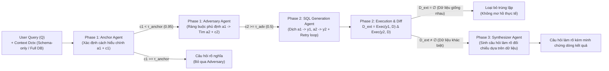

# Probing Ambiguity: Adversarial Intent Resolution for Robust Text-to-SQL

| Thông tin | Chi tiết |
|---|---|
| **Tác giả** | Youbing Yin, Xujun Peng, Muhammad S. Uddin, Erin Babinsky, Daben Liu, Anoop Kumar |
| **Đơn vị** | Capital One |
| **Năm / Venue** | 2026 / arXiv:2610.24248v1 [cs.AI] (Tháng 10/2026) |
| **Loại bài** | Phương pháp / Khung đa tác nhân (Multi-Agent Framework) |
| **Chủ đề** | Text-to-SQL, Query Ambiguity, Adversarial Probing, Extensional Divergence Verification, Clarification Question Generation, Schema-Only Context |
| **File gốc** | [Probing Ambiguity.pdf](../papers/Probing%20Ambiguity.pdf) |

## 1. Tóm tắt nhanh (TL;DR)
Bài báo đề xuất Adversarial Intent Resolution (AIR), một khung đa tác nhân (multi-agent) không cần huấn luyện tác vụ chuyên biệt (*training-free*), tiếp cận vấn đề mơ hồ trong Text-to-SQL như một bài toán "thăm dò và kiểm chứng" (*probing and verification*). AIR sử dụng tác nhân Anchor để xác định cách hiểu chính, tác nhân Adversary với ràng buộc phủ định để chủ động tìm kiếm các cách diễn giải cạnh tranh, và cơ chế kiểm chứng bằng thực thi SQL (*execution-based verification*) để cho thấy tính phân kỳ dữ liệu thực tế ($D_{ext} \ne \emptyset$) trước khi sinh câu hỏi làm rõ. Trong môi trường thực tế chỉ cung cấp lược đồ (*schema-only context*), AIR vượt qua mô hình học tăng cường IntentRL (SOTA) trên mọi chỉ số của benchmark AMBROSIA và thể hiện độ bền bỉ vượt trội (chỉ suy giảm ~7% so với mức ~20% của IntentRL).

## 2. Bối cảnh & Vấn đề nghiên cứu
- **Giả định sai lệch trong Text-to-SQL:** Hầu hết các hệ thống Text-to-SQL hiện nay đều giả định mối quan hệ ánh xạ một-một ($1-1$) giữa câu hỏi tự nhiên và câu lệnh SQL duy nhất. Trong thực tế, câu hỏi của người dùng thường mang tính mơ hồ cố hữu (ví dụ: phạm vi áp dụng điều kiện lọc giá, mơ hồ liên kết bảng, tính mơ hồ của lược đồ), dẫn đến việc có nhiều câu truy vấn SQL hợp lệ trả về các tập kết quả hoàn toàn khác nhau.
- **Hạn chế của các phương pháp hiện tại:**
  1. *Prompting và giải mã đa dạng (Diverse Decoding):* Khi yêu cầu LLM sinh nhiều câu SQL thông qua prompt hoặc beam search / sampling, mô hình chủ yếu sinh các biến thể cú pháp bề mặt (*surface-level variants*) thay vì các cách diễn giải ngữ nghĩa cấu trúc thực sự khác nhau.
  2. *Học tăng cường (IntentRL):* Huấn luyện mô hình sinh cố định một số lượng câu SQL (ví dụ: 5 câu) trong một lượt. Cách làm này coi mơ hồ là bài toán sinh thuần túy (*generation problem*), dẫn tới tình trạng sinh thừa (*over-generation*) đến 76% câu hỏi, trong đó ~40% kết quả là trùng lặp ngữ nghĩa.
  3. *Sinh câu hỏi làm rõ thiếu kiểm chứng dữ liệu:* Các hệ thống làm rõ trước đây thường tạo câu hỏi dựa trên cảm nhận mơ hồ chủ quan của mô hình mà không cho thấy được liệu các cách hiểu đó có dẫn tới dữ liệu khác nhau trên CSDL thực tế hay không, gây phiền hà không cần thiết cho người dùng.
- **Thách thức môi trường Production (Schema-Only Context):** Trong môi trường doanh nghiệp thực tế, vì lý do bảo mật dữ liệu (*privacy*), độ trễ (*latency*) và chi phí (*cost*), hệ thống không thể đưa toàn bộ nội dung dữ liệu CSDL vào ngữ cảnh của LLM bên thứ ba mà chỉ được phép cung cấp lược đồ (*schema-only*). Các mô hình như IntentRL bị suy giảm hiệu năng nghiêm trọng (tụt hơn 20%) khi mất dữ liệu ngữ cảnh.

## 3. Phương pháp / Nội dung chính

### 3.1 Khung kiến trúc Adversarial Intent Resolution (AIR)
AIR hoạt động hoàn toàn ở thời điểm suy luận (*inference-time*), không yêu cầu fine-tuning hay huấn luyện RL. Khung gồm 3 giai đoạn (Phase) với các tác nhân phối hợp:

### 3.2 Chi tiết 3 giai đoạn của AIR

#### Phase 1: Adversarial Intent Discovery (Khám phá ý định đối kháng)
Tác nhân hoạt động ở tầng suy luận ngôn ngữ tự nhiên (*intent-level*), chưa vội sinh SQL:
1. **Anchor Agent:** Phân tích câu hỏi từng bước, ánh xạ các từ khóa vào các trường trong schema, đưa ra cách hiểu khả dĩ nhất $a_1$ kèm điểm tin cậy $c_1 \in [0, 1]$ rằng đây là cách hiểu duy nhất hợp lý.
2. **Cơ chế Gating dựa trên độ tin cậy:** Nếu $c_1 \ge \tau_{anchor}$ (mặc định $0.95$), hệ thống xác định câu hỏi không mơ hồ và dừng ngay, không gọi Adversary.
3. **Adversary Agent:** Nhận câu hỏi $Q$, lược đồ $D_{ctx}$, và diễn giải của Anchor $a_1$ đóng vai trò như một **ràng buộc phủ định** (*negative constraint*). Tác nhân này có nhiệm vụ phản biện lại tính duy nhất của Anchor bằng cách chủ động tìm kiếm một cách diễn giải thay thế hợp lệ $a_2$ kèm độ tin cậy $c_2$. Nếu $c_2 < \tau_{adv}$ (mặc định $0.5$), phương án này bị bác bỏ.
4. **Vòng lặp đối kháng nhiều lượt (Multi-Round Adversary):** Đối với các câu hỏi có thể có trên 2 cách hiểu, Adversary được gọi lặp lại; các diễn giải đã phát hiện $\{a_1, a_2, \dots\}$ đều được chuyển thành tập ràng buộc phủ định cho đến khi không tìm thêm được cách hiểu nào hoặc đạt giới hạn tối đa $K=5$.

#### Phase 2: Extensional Divergence Verification (Kiểm chứng phân kỳ ngoại diên)
Khác biệt về câu chữ chưa chắc đã tạo ra sự khác biệt về dữ liệu:
1. **SQL Generation Agent:** Biên dịch từng diễn giải tự nhiên $a_i$ thành câu lệnh SQL $y_i$ có thể thực thi trên SQLite, tích hợp vòng lặp sửa lỗi tự động (*feedback loop*) tối đa 3 lần nếu xảy ra lỗi CSDL.
2. **Execution-based Pruning (Cắt tỉa dựa trên thực thi):** Hệ thống thực thi các câu SQL trên CSDL $D$ và tính toán hiệu đối xứng giữa các tập kết quả:
   $$D_{ext}(y_i, y_j) = \text{Exec}(y_i, D) \Delta \text{Exec}(y_j, D)$$
   - Nếu $D_{ext} = \emptyset$: Hai cách hiểu thực chất trả về cùng một dữ liệu trên CSDL hiện tại. Hệ thống loại bỏ một câu (prune duplicate), coi như không có mơ hồ ảnh hưởng tới câu trả lời.
   - Nếu $D_{ext} \ne \emptyset$: Đây là minh chứng cụ thể (*constructive proof*) cho thấy tồn tại sự mơ hồ thực tế giữa hai ý định.

#### Phase 3: Contrastive Clarification Synthesis (Tổng hợp câu hỏi làm rõ đối chiếu)
Khi sự mơ hồ đã được cho thấy qua dữ liệu, tác nhân **Synthesizer** nhận các cặp $(a_i, \text{Exec}(y_i, D))$ và sinh ra câu hỏi làm rõ đối chiếu (*contrastive clarification*). Thay vì hỏi chung chung, câu hỏi nêu rõ sự khác biệt cụ thể về kết quả dữ liệu (ví dụ: "Cách 1: Lọc cả hai dịch vụ ở giá \$150 trả về 2 kết quả; Cách 2: Chỉ lọc dịch vụ chăm sóc giá \$150 và lấy tất cả spa trả về 6 kết quả. Bạn muốn chọn cách nào?").

### 3.3 Ngữ cảnh Schema-Only vs. Full Database
Bài báo phân định rạch ròi hai khái niệm:
- **Ngữ cảnh gửi cho LLM ($D_{ctx}$):** Trong thiết lập *Schema-Only*, chỉ có thông tin cấu trúc bảng/cột được gửi vào prompt của LLM cho Phase 1 và tạo SQL trong Phase 2, không để lộ bất kỳ dòng dữ liệu nào.
- **Môi trường thực thi SQL backend ($D$):** Quá trình thực thi câu SQL để kiểm chứng $D_{ext}$ (Phase 2) và đếm dòng kết quả cho Synthesizer (Phase 3) được chạy trực tiếp bên trong CSDL nội bộ an toàn của hệ thống, tuân thủ kiểm soát truy cập thông thường, không gửi dữ liệu ra API bên ngoài.

## 4. Thực nghiệm & Kết quả chính

> **Cách đọc số liệu:** Các kết quả thuộc benchmark, split, metric và phiên bản mô hình của bài báo. “SOTA” chỉ áp dụng trong bối cảnh/thời điểm bài báo nêu; không so trực tiếp với PA của challenge.

### 4.1 Thiết lập thực nghiệm
- **Benchmarks:**
  - `AMBROSIA`: 440 mẫu thử (131 câu mơ hồ về scope, attachment, vagueness; 309 câu không mơ hồ).
  - `AmbiQT`: 1,911 mẫu validation split; kiểm thử khả năng chuyển giao (transferability) với mơ hồ xuất phát từ thiết kế schema (cột đồng nghĩa, bảng tách, aggregate tính sẵn).
- **Mô hình thử nghiệm:** Claude Sonnet 4.5 (Anthropic), Gemma 4 26B A4B (Google), gpt-oss-20b (OpenAI - kiến trúc MoE ~3.6B active parameters). Cấu hình nhiệt độ $T=0$.
- **Baseline so sánh:**
  - *Prompt Baseline (Claude Sonnet 4.5):* Prompt trực tiếp mô hình sinh nhiều câu SQL.
  - *IntentRL (Saparina & Lapata, 2026):* Mô hình SOTA huấn luyện bằng học tăng cường (RL) trên AMBROSIA, sinh cố định 5 câu SQL.

### 4.2 Kết quả trên Benchmark AMBROSIA

| Ngữ cảnh Context | Phương pháp | Recall | Precision | F1 | One-Found | All-Found |
|---|---|---|---|---|---|---|
| **Full database** | | | | | | |
| | Prompt Baseline (Sonnet 4.5) | 0.697 | 0.592 | 0.610 | 0.797 | 0.590 |
| | SOTA: IntentRL (RL-trained) | **0.854** | 0.758 | **0.786** | **0.886** | **0.823** |
| | **AIR – Claude Sonnet 4.5 (Ours)** | 0.818 | 0.707 | 0.729 | 0.880 | 0.758 |
| | AIR – Gemma 4 26B A4B | 0.804 | 0.584 | 0.640 | 0.876 | 0.729 |
| | AIR – gpt-oss-20b | 0.759 | 0.728 | 0.718 | 0.845 | 0.673 |
| **Schema only** *(Production Setting)* | | | | | | |
| | Prompt Baseline (Sonnet 4.5) | 0.610 | 0.539 | 0.548 | 0.698 | 0.520 |
| | SOTA: IntentRL (RL-trained) | 0.691 *(-19%)* | 0.589 *(-22%)* | 0.618 *(-21%)* | 0.723 *(-18%)* | 0.664 *(-19%)* |
| | **AIR – Claude Sonnet 4.5 (Ours)** | **0.757** *(-7%)* | **0.658** *(-7%)* | **0.679** *(-7%)* | **0.813** *(-8%)* | **0.701** *(-8%)* |
| | AIR – Gemma 4 26B A4B | 0.750 *(-7%)* | 0.518 *(-11%)* | 0.578 *(-10%)* | 0.820 *(-6%)* | 0.682 *(-6%)* |
| | AIR – gpt-oss-20b | 0.648 *(-15%)* | 0.642 *(-12%)* | 0.626 *(-13%)* | 0.728 *(-14%)* | 0.568 *(-16%)* |

*Điểm nhấn kết quả:*
- **Vượt trội trong môi trường Schema-only:** Trong bối cảnh production thực tế không cung cấp dữ liệu bảng, AIR (Sonnet 4.5) vượt trội IntentRL trên toàn bộ thước đo (F1: 0.679 vs. 0.618, cải thiện tương đối 10%). Ngay cả mô hình nhỏ `gpt-oss-20b` (chỉ 3.6B active params) khi chạy trên AIR cũng đạt F1 0.626, vượt qua IntentRL.
- **Độ bền vững cao gấp 3 lần:** Khi chuyển từ Full Database sang Schema-only, IntentRL giảm mạnh từ 18% đến 22% hiệu năng (do RL đã học tắt qua việc dựa dẫm vào dữ liệu cụ thể trong bảng), trong khi AIR chỉ suy giảm nhẹ ~7%.

### 4.3 Hiệu quả sinh và Độ chính xác tuyệt đối (Perfect Match Accuracy)
- **Hiệu quả sinh (Generation Efficiency):**
  - IntentRL sinh cố định 5 câu SQL/câu hỏi, trung bình chỉ có 2.99 kết quả thực thi duy nhất (~40% là kết quả trùng lặp). IntentRL sinh thừa kết quả trên 76.4% số câu hỏi (336/440).
  - AIR nhờ cơ chế đối kháng có định hướng và cắt tỉa thực thi chỉ sinh trung bình **1.76 output/câu hỏi** (100% kết quả là duy nhất), và chỉ sinh thừa trên 33.0% số câu hỏi (145/440). Điều này giúp giảm hơn một nửa số lần phải làm phiền người dùng để làm rõ.
- **Perfect Match Accuracy (Khớp chính xác hoàn toàn và không sinh thừa):**
  - Dưới thiết lập Schema-only, AIR đạt 204 câu đạt chuẩn tuyệt đối (46.4%), duy trì được **94.4%** phong độ so với khi có Full database (216 câu / 49.1%).
  - IntentRL chỉ đạt 102 câu (23.2%) ở Schema-only và 89 câu (20.2%) ở Full database, do bị trừng phạt nặng vì thói quen sinh thừa câu trả lời.

### 4.4 Khả năng chuyển giao sang AmbiQT (Cross-Benchmark Transferability)
Trên AmbiQT (mơ hồ từ schema design):
- Dưới thiết lập Schema-only: AIR đạt **F1 0.675** (Precision 0.743, Recall 0.642), vượt xa IntentRL (F1 0.570, Precision 0.549).
- Dưới thiết lập Full Database: AIR đạt **F1 0.686** vs. IntentRL 0.594.
- Hiệu năng của AIR ở Schema-only và Full database trên AmbiQT gần như tương đương nhau (F1 0.675 vs 0.686), cho thấy cơ chế đối kháng phân tích bản chất schema không hề phụ thuộc vào việc đọc trộm dữ liệu bảng.

### 4.5 Phân tích độ nhạy ngưỡng (Sensitivity Analysis)
- **Ngưỡng Adversary ($\tau_{adv}$):** Là tham số điều tiết chính cho sự đánh đổi giữa Recall và Precision. Tại $\tau_{adv} = 0$, Recall đạt đỉnh 0.827 nhưng Precision thấp (0.705). Tại $\tau_{adv} = 0.75$, Precision đạt 0.759 và F1 cao nhất (0.764). Tại $\tau_{adv} = 1.0$, hệ thống từ chối mọi phản biện, Recall rơi tự do xuống 0.722 (cho thấy tác nhân Adversary đóng góp trực tiếp 10.5% Recall). Mặc định chọn $\tau_{adv} = 0.5$.
- **Ngưỡng Anchor ($\tau_{anchor}$):** Rất ổn định, dao động trong phạm vi hẹp (~3%), mặc định đặt 0.95.

## 5. Tính mới (Novelty & Đóng góp)
- **Chuyển đổi góc nhìn về giải quyết mơ hồ:** Định nghĩa lại việc xử lý mơ hồ trong Text-to-SQL từ bài toán "sinh đa dạng thụ động" (passive generation) sang bài toán "thăm dò đối kháng và kiểm chứng ngoại diên" (adversarial probing & extensional verification).
- **Khung đa tác nhân hoàn toàn Training-Free:** Không cần tốn kém dữ liệu và tài nguyên để fine-tuning hay huấn luyện RL phức tạp, tận dụng năng lực suy luận có sẵn của LLM thông qua cấu trúc đối kháng với ràng buộc phủ định.
- **Khái niệm Extensional Divergence Verification:** Sử dụng chênh lệch dữ liệu thực thi ($D_{ext} \ne \emptyset$) làm bằng chứng xác thực sự mơ hồ, loại bỏ triệt để các cách diễn giải trùng lặp ngữ nghĩa thực tế.
- **Tiên phong tối ưu cho môi trường Production (Schema-Only):** Chứng minh tính khả thi và độ bền vững xuất sắc của hệ thống khi không để lộ dữ liệu nhạy cảm cho LLM, giải quyết bài toán lớn về bảo mật và chi phí cho doanh nghiệp.

## 6. Hạn chế

### 6.1 Hạn chế do tác giả thừa nhận
- **Độ trễ suy luận còn cao:** Quy trình gọi API tuần tự gồm 4 bước (Anchor $\sim$9s, Adversary $\sim$22s, SQL gen $\sim$6s, Synthesizer $\sim$5s) mất tổng cộng khoảng **40 giây** cho mỗi câu truy vấn trên Claude Sonnet 4.5.
- **Đánh giá mới dừng ở hội thoại đơn lượt (Single-turn):** Chưa đo lường trải nghiệm thực tế và mức độ tiêu tốn công sức của người dùng qua nhiều lượt tương tác liên tiếp.
- **Chưa đánh giá chất lượng câu hỏi làm rõ qua người dùng thực:** Bài báo tập trung vào việc tạo ra tập câu truy vấn đúng, chưa có thử nghiệm Human-Evaluation hoặc LLM-as-judge để chấm điểm độ tự nhiên và mức độ dễ hiểu của câu hỏi làm rõ.

### 6.2 Nhận xét thêm của người review
- **Rủi ro dương tính giả từ dữ liệu CSDL nghèo nàn:** Cơ chế kiểm chứng $D_{ext} = \emptyset$ dựa vào CSDL hiện tại. Nếu CSDL mẫu có quá ít dòng hoặc dữ liệu trống, hai câu lệnh SQL mang ý định ngữ nghĩa hoàn toàn khác nhau có thể vô tình cùng trả về tập rỗng ($\emptyset$), dẫn đến việc Adversary bị cắt tỉa nhầm và làm mất một cách hiểu hợp lệ.
- **Chi phí gọi mô hình lớn:** Việc chạy 3-4 agent cho mỗi câu hỏi người dùng (đặc biệt khi có vòng lặp Adversary nhiều lượt) làm tăng chi phí token và độ tải hệ thống so với mô hình sinh đơn lẻ. Cần có cơ chế phát hiện sớm (early-stopping) để bỏ qua Phase đối kháng đối với các câu hỏi hiển nhiên rõ nghĩa.
- **Thước đo Execution-matching quá khắt khe:** Như tác giả chỉ ra trong phần thảo luận lỗi, việc so sánh tập ô giá trị (cell-multiset) trừng phạt cả những trường hợp mô hình chủ động SELECT thêm cột định danh (như `labPosition`) để kết quả rõ ràng hơn cho người dùng.

## 7. Ý nghĩa ứng dụng (cho hệ thống agent phân tích dữ liệu / Text-to-SQL)

> **Phân biệt nguồn:** Khuyến nghị trong mục này là suy luận ứng dụng cho DataMate; bài báo không đánh giá trực tiếp trên challenge, trừ khi nêu rõ.
- **Mô hình hóa tác nhân phản biện (Red Teaming / Adversary Agent):** Trong các ứng dụng trợ lý dữ liệu, thay vì tin tưởng ngay vào kế hoạch truy vấn đầu tiên, agent nên kích hoạt một sub-agent phản biện với ràng buộc "hãy tìm một cách hiểu logic khác trái ngược với giả định này".
- **Kiến trúc bảo mật Schema-Only:** Cho phép triển khai Text-to-SQL an toàn trong các tổ chức tài chính/ngân hàng/y tế: chỉ gửi metadata lược đồ CSDL lên đám mây (Cloud LLM), câu lệnh SQL được sinh ra sẽ chạy trong mạng nội bộ và chỉ cảnh báo làm rõ khi kết quả thực thi phân kỳ.
- **Làm rõ dựa trên bằng chứng dữ liệu (Data-grounded Clarification):** Khi yêu cầu người dùng xác nhận, agent không nên hỏi chung chung kiểu "bạn muốn ý nào?", mà nên cung cấp bảng so sánh kết quả thực thi cụ thể giữa các lựa chọn để người dùng ra quyết định nhanh chóng.

## 8. Từ khóa
`Text-to-SQL`, `Ambiguity Resolution`, `Multi-Agent System`, `Adversarial Probing`, `Extensional Divergence Verification`, `Intent Discovery`, `Schema-Only Context`, `Contrastive Clarification`, `AMBROSIA`, `AmbiQT`

## 9. Mức độ phù hợp với challenge DataMate

**Phân nhóm: Tham khảo.** Có thể phát hiện nhiều cách hiểu trước khi trả lời; multi-agent probing cần đánh giá latency và không chờ người dùng.

## 10. Nguồn và truy nguyên kết quả

- **PDF gốc:** liên kết ở bảng thông tin đầu review và bản lưu trong thư mục `../papers/`.
- **Vị trí kiểm chứng:** Method §§3–5, pp. 3–6; results §§5–6, pp. 6–9; limitations p. 10.
- Số liệu ở mục 4 là kết quả tác giả trên benchmark gốc; phần áp dụng DataMate tại mục 7 và mục 9 là nhận định của review.
