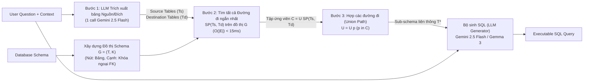

# SchemaGraphSQL: Efficient Schema Linking with Pathfinding Graph Algorithms for Text-to-SQL on Large-Scale Databases

| Thông tin | Chi tiết |
|---|---|
| **Tác giả** | AmirHossein Safdarian, Milad Mohammadi, Ehsan Jahanbakhsh, Mona Shahamat Naderi, Heshaam Faili |
| **Đơn vị** | University of Tehran; Sharif University of Technology (Iran) |
| **Năm / Venue** | arXiv:2505.18363v1 [cs.CL] (23/05/2025). Hội nghị chính thức: Không nêu rõ trong văn bản |
| **Loại bài** | Phương pháp (Zero-shot, training-free graph-based schema linking) |
| **Chủ đề** | Text-to-SQL, Schema Linking, Schema Graph, Pathfinding Algorithms, Foreign Key Reasoning, Minimal Connected Sub-schema |
| **File gốc** | [SchemaGraphSQL.pdf](../papers/SchemaGraphSQL.pdf) |

## 1. Tóm tắt nhanh (TL;DR)
SchemaGraphSQL đề xuất một giải pháp schema linking dạng zero-shot, không cần huấn luyện (training-free), kết hợp giữa một lần gọi LLM duy nhất (Gemini 2.5 Flash) để trích xuất bảng nguồn/đích và thuật toán tìm đường đi ngắn nhất (shortest path) cổ điển trên đồ thị khóa ngoại của cơ sở dữ liệu. Nhờ cơ chế lấy hợp (union) tất cả các đường đi ngắn nhất để đảm bảo tính liên thông của các phép JOIN, SchemaGraphSQL thiết lập SOTA mới trên BIRD dev set về độ phủ với **Recall 95.71%** và **$F_6$ 95.43%** (vượt qua cả các mô hình fine-tune chuyên biệt), đồng thời nâng Execution Accuracy của Gemini 2.5 Flash lên **62.91%** (chỉ cách oracle lý tưởng 1.5%), trong khi thời gian tìm kiếm đồ thị chỉ tốn dưới 15 ms.

## 2. Bối cảnh & Vấn đề nghiên cứu
- **Áp lực bùng nổ schema trong thực tế:** Các cơ sở dữ liệu doanh nghiệp chứa hàng trăm bảng và hàng nghìn cột. Việc đưa toàn bộ schema vào prompt làm cạn kiệt context window, gây nhiễu nghiêm trọng ("lost in the middle") và làm tăng chi phí API.
- **Điểm yếu của các phương pháp Schema Linking hiện tại:**
  1. *Mô hình học máy / Neural linkers:* Đòi hỏi dữ liệu gán nhãn lớn và quy trình fine-tuning phức tạp (khó thích ứng với cơ sở dữ liệu mới trong môi trường low-resource).
  2. *Phương pháp Prompting LLM đa bước / Dense Retrieval:* Dễ rơi vào bẫy đánh đổi precision–recall; đặc biệt LLM thường bỏ sót các bảng trung gian (bridge/junction tables) cần thiết để thực hiện liên kết JOIN, làm đứt gãy tính liên thông của truy vấn.
  3. *Mô hình đồ thị học sâu (GNNs, Relation-Aware Transformers):* Như RAT-SQL, LGESQL đòi hỏi thay đổi kiến trúc mô hình sâu và chi phí tính toán lớn.
- **Câu hỏi cốt lõi:** Liệu có thể thực hiện schema linking hiệu quả cao mà không cần fine-tune mô hình hay thiết kế chuỗi prompt phức tạp, chỉ dựa vào thuật toán tìm đường cổ điển trên đồ thị schema?

## 3. Phương pháp / Nội dung chính

### 3.1 Mô hình hóa Đồ thị Cơ sở Dữ liệu (Schema Graph)
- Cơ sở dữ liệu được biểu diễn dưới dạng đồ thị vô hướng $G = (T, K)$:
  - Tập đỉnh $T = \{T_1, \dots, T_n\}$: danh sách các bảng.
  - Tập cạnh $K \subseteq T \times T$: các liên kết khóa ngoại (foreign key - FK).
- **Cơ chế tăng cường đồ thị thưa:** Đối với các database có cấu trúc FK thưa thớt (dưới 2 cạnh FK), hệ thống tự động bổ sung cạnh giữa các bảng có chung tên cột chứa chuỗi `"id"`, đảm bảo đồ thị luôn đủ liên thông để tìm đường.

### 3.2 Quy trình 3 bước của SchemaGraphSQL
1. **Bước 1: Trích xuất bảng nguồn và bảng đích (Source & Destination Extraction):**
   - Chỉ dùng **duy nhất 1 lượt gọi LLM** (Gemini 2.5 Flash) với prompt hướng dẫn vai trò data engineer.
   - LLM phân tích câu hỏi và schema để phân loại:
     - $T_s$ (Source tables): Các bảng chứa cột dùng trong điều kiện lọc hoặc mệnh đề `WHERE` / `HAVING`.
     - $T_d$ (Destination tables): Các bảng chứa cột dữ liệu cần hiển thị trong kết quả cuối cùng (`SELECT`).
   - Định dạng đầu ra cực ngắn gọn (trung bình 14 tokens) chỉ gồm 1 dòng: `src=TableA,TableB, dst=TableC,TableD`.
2. **Bước 2: Liệt kê đường đi ngắn nhất (Candidate Path Enumeration):**
   - Với mọi cặp $(T_s, T_d) \in T_s \times T_d$, áp dụng thuật toán tìm đường (BFS/Dijkstra) liệt kê tất cả các đường đi đơn ngắn nhất kết nối chúng trong $G$:
     $$SP(T_s, T_d) = \{ p \mid p \text{ là đường đi đơn } T_s \leadsto T_d, |p| = \text{dist}_G(T_s, T_d) \}$$
   - Tập đường đi ứng viên: $C = \bigcup_{T_s \in T_s} \bigcup_{T_d \in T_d} SP(T_s, T_d)$.
3. **Bước 3: Lập Sub-schema liên thông (Path Selection / Union):**
   - Lấy hợp của toàn bộ các bảng xuất hiện trong các đường đi ngắn nhất:
     $$U = \bigcup_{p \in C} p$$
   - Cấu hình chuẩn (`SchemaGraphSQL_force-union`): Trả về toàn bộ tập bảng $T^* = U$. Phương pháp này đảm bảo tập bảng đầu ra vừa bao phủ đủ các bảng đích/nguồn, vừa chứa đầy đủ các bảng bắc cầu (bridge tables) cần thiết để thực hiện JOIN hợp lệ.

### 3.3 Các cấu hình khảo sát (Configurations)
Hệ thống định nghĩa 7 chế độ lựa chọn dựa trên số lượng bảng $(k_s, k_d)$ và chiến lược hợp/chọn đường:
- `Mode 1 (1, 1)`: Giới hạn 1 nguồn, 1 đích.
- `Mode 4 (n-n)`: Cho phép nhiều nguồn, nhiều đích, chọn đường đi tối ưu thông qua LLM reranker (đạt $F_1$ cao nhất).
- `Mode 5 (force-longest)`: Ép chọn đường đi dài nhất trong các đường ngắn nhất (thử nghiệm ablation).
- `Mode 6 (no-union)`: Không lấy hợp các đường đi mà chỉ chọn 1 đường đơn lẻ (thử nghiệm ablation).
- `Mode 7 (force-union)`: Cấu hình mặc định, tự động lấy hợp toàn bộ các đường đi ngắn nhất mà không cần thêm lượt gọi LLM nào.

## 4. Thực nghiệm & Kết quả chính

> **Cách đọc số liệu:** Các kết quả thuộc benchmark, split, metric và phiên bản mô hình của bài báo. “SOTA” chỉ áp dụng trong bối cảnh/thời điểm bài báo nêu; không so trực tiếp với PA của challenge.

### 4.1 Thiết lập thực nghiệm
- **Dataset:** BIRD Development set (1.534 câu hỏi trên 11 database) và MiniDev set.
- **Metric đánh giá Schema:** Precision, Recall, $F_1$, $F_6$ (gán trọng số recall gấp 6 lần precision vì việc thiếu bảng gây lỗi chết người hơn việc thừa bảng), Exact Match Rate (EMR).
- **Metric đánh giá End-to-End:** Execution Accuracy (EX) theo chuẩn chính thức của BIRD.
- **Mô hình sinh SQL:** Gemini-2.5-Flash-preview, Gemma-3-27B-it, Gemma-3-12B-it, Gemma-3-4B-it.

### 4.2 Kết quả Schema Linking trên BIRD Dev

**Bảng 1: So sánh hiệu năng Schema Linking (BIRD Dev)**

| Phương pháp | Loại / Đặc điểm | EMR (%) | Precision (%) | Recall (%) | $F_1$ (%) | $F_6$ (%) |
|---|---|---|---|---|---|---|
| LLM as Schema Linker | 1-step Gemini 2.5 Flash | 75.88 | 91.79 | 89.90 | 90.83 | 89.95 |
| Dense Retriever (Top 2) | E5-large-instruct | 26.79 | 66.59 | 67.80 | 67.19 | 67.77 |
| Dense Retriever (Top 6) | E5-large-instruct | 1.04 | 35.43 | 93.31 | 51.36 | 89.37 |
| DIN-SQL | In-context decomposition | - | 79.90 | 55.70 | 65.64 | 56.16 |
| MAC-SQL | Multi-agent selector | - | 76.30 | 56.20 | 64.73 | 56.60 |
| MCS-SQL | Multi-prompt | - | 79.60 | 76.90 | 78.23 | 76.97 |
| RSL-SQL | Bidirectional pruning | - | 78.10 | 77.50 | 77.80 | 77.52 |
| LinkAlign Agent | Agent-based router | - | 77.10 | 79.40 | 78.23 | 79.34 |
| DTS-SQL | SFT decomposed | - | 95.07 | 92.74 | 93.89 | 92.80 |
| ExSLf | Specialized extractor | - | 96.35 | 93.85 | 95.08 | 93.92 |
| **SchemaGraphSQL (n-n)** | Graph + shortest path | 78.29 | 90.87 | 95.10 | **92.93** | 94.98 |
| **SchemaGraphSQL (force-union)** | Graph + all shortest paths union | 76.60 | 86.21 | **95.71** | 90.71 | **95.43** |

*Nhận xét:* `SchemaGraphSQL_force-union` vượt qua tất cả các hệ thống đã công bố trên chỉ số $F_6$ (95.43%) và Recall (95.71%) mà không cần bất kỳ bước huấn luyện nào. Biến thể `n-n` đạt độ cân bằng $F_1$ cao nhất (92.93%) và EMR đạt 78.29%.

### 4.3 Kết quả End-to-End Execution Accuracy (BIRD Dev)

**Bảng 2: Độ chính xác thực thi SQL (EX%) trên BIRD Dev**

| LLM Generator | Phương pháp Schema Linking | Simple (%) | Moderate (%) | Challenging (%) | Tổng cộng EX (%) |
|---|---|---|---|---|---|
| **Gemini-2.5-Flash** | Ideal Schema Linking (Oracle) | 71.46 | 55.48 | 47.92 | 64.41 |
| | Baseline (không lọc) | 59.35 | 41.08 | 34.72 | 51.50 |
| | Dense Retrieval | 64.11 | 50.97 | 45.83 | 58.41 |
| | SchemaGraphSQL (1-1) | 66.81 | 51.61 | 43.06 | 59.97 |
| | SchemaGraphSQL (n-n) | 68.22 | 53.33 | 44.44 | 61.47 |
| | **SchemaGraphSQL (force-union)** | **68.32** | **56.13** | **50.00** | **62.91** |
| **Gemma-3-27B** | Ideal Schema Linking (Oracle) | 63.14 | 47.96 | 38.19 | 56.19 |
| | Baseline (không lọc) | 49.41 | 31.40 | 25.69 | 41.72 |
| | Dense Retrieval | 52.22 | 41.51 | 33.33 | 47.20 |
| | **SchemaGraphSQL (force-union)** | **61.19** | **44.73** | **37.50** | **53.98** |
| **Gemma-3-12B** | Ideal Schema Linking (Oracle) | 58.38 | 41.08 | 29.86 | 50.46 |
| | Baseline (không lọc) | 42.59 | 22.15 | 16.67 | 33.96 |
| | **SchemaGraphSQL (force-union)** | **54.38** | **35.27** | **26.39** | **45.96** |
| **Gemma-3-4B** | Ideal Schema Linking (Oracle) | 42.49 | 21.94 | 16.67 | 33.83 |
| | Baseline (không lọc) | 30.05 | 13.76 | 7.64 | 23.01 |
| | **SchemaGraphSQL (force-union)** | **35.35** | **18.92** | **20.83** | **29.01** |

### 4.4 Các phát hiện quan trọng (Ablation Insights)
1. **Tác động vượt trội trên câu hỏi Challenging:** Với Gemini-2.5-Flash, SchemaGraphSQL tạo ra mở rộng đáng kể **+15.28%** trên nhóm câu hỏi khó (từ 34.72% lên 50.00%), cho thấy ưu thế tuyệt đối của thuật toán tìm đường trên đồ thị khi xử lý các câu truy vấn đa bảng (multi-join).
2. **Khoảng cách sát mức Oracle:** Mức 62.91% của SchemaGraphSQL chỉ còn kém 1.5% so với mức trần Oracle "Ideal Schema Linking" (64.41%), cho thấy gần như toàn bộ lỗi còn lại thuộc về năng lực sinh SQL của mô hình chứ không phải do thiếu sót bảng.
3. **Triết lý "Union" vượt trội hơn "Compactness":** Bỏ bước union (`no-union`) làm giảm mạnh $F_1$ và EMR. Việc đưa thêm một số bảng liên quan ít gây hại cho LLM, nhưng việc bỏ sót dù chỉ 1 bảng nối sẽ làm LLM không thể nào sinh được câu lệnh JOIN đúng.
4. **Chi phí và độ trễ cực thấp:** Chỉ tốn trung bình 4.593 input tokens và 14 output tokens cho 1 lệnh gọi LLM; thuật toán tìm đường $O(|E|)$ chạy dưới **15 ms** trên CPU thông thường.

## 5. Tính mới (Novelty & Đóng góp)
1. **Tái sinh thuật toán đồ thị cổ điển trong thời đại LLM:** Khác với xu hướng dùng GNN phức tạp hoặc multi-agent prompting tốn kém, công trình cho thấy thuật toán tìm đường ngắn nhất (shortest path) hoàn toàn có thể trở thành "xương sống" vững chắc cho bài toán schema linking.
2. **Định hình lại bài toán Schema Linking:** Chuyển đổi tác vụ từ "liệt kê tất cả các bảng liên quan" (vốn rất khó và dễ sót với LLM) sang bài toán đơn giản hơn: "xác định bảng nguồn và bảng đích", sau đó giao toàn bộ việc tìm chuỗi kết nối trung gian cho thuật toán tất định (deterministic graph search).
3. **Hiệu năng Zero-Shot vượt qua Supervised Fine-Tuning:** Đạt Recall và $F_6$ dẫn đầu benchmark BIRD mà không cần huấn luyện lại bất kỳ trọng số mô hình nào.
4. **Chi phí suy luận và độ trễ tối thiểu:** Giảm thiểu số lượt gọi LLM xuống chỉ còn 1 lần duy nhất với số token đầu ra cực ngắn, phù hợp hoàn hảo cho các hệ thống Text-to-SQL yêu cầu thời gian thực.

## 6. Hạn chế

### 6.1 Hạn chế do tác giả thừa nhận
- **Chưa tối ưu cho truy vấn lồng sâu (Nested / Subqueries):** Các câu hỏi phức tạp yêu cầu subquery logic không theo đường liên kết JOIN trực tiếp giữa các bảng có thể không được bao phủ hoàn hảo bởi shortest path.
- **Hiện tượng bùng nổ đường đi trên đồ thị dày đặc (Dense Schema Graphs):** Nếu cơ sở dữ liệu có quá nhiều liên kết khóa ngoại chéo hoặc quan hệ đa-đa phức tạp, việc lấy hợp tất cả các đường đi ngắn nhất có thể kéo theo nhiều bảng không liên quan, làm giảm precision.
- **Coi các cạnh đồ thị là đồng trọng số (Unweighted Graphs):** Hệ thống xem mọi liên kết khóa ngoại đều bình đẳng, chưa áp dụng trọng số dựa trên độ quan trọng của quan hệ nghiệp vụ hay ước tính chi phí thực thi (join cost).

### 6.2 Nhận xét thêm của người review
- **Mới dừng lại ở Table-level linking:** SchemaGraphSQL mới chỉ lọc ở cấp độ Bảng (Table), chưa giải quyết khâu cắt tỉa Cột (Column pruning). Toàn bộ các cột của các bảng được giữ lại vẫn được nhồi vào prompt của bộ sinh SQL, điều này có thể gây quá tải nếu gặp các bảng chứa hàng trăm cột.
- **Rủi ro từ Heuristic đồ thị thưa:** Việc tự động nối cạnh giữa các bảng chỉ dựa trên tên cột có chứa chuỗi `"id"` khi số lượng FK < 2 là một heuristic tiềm ẩn rủi ro tạo ra các liên kết ngữ nghĩa sai lệch trong các database thiết kế kém chuẩn hoá.

## 7. Ý nghĩa ứng dụng (cho hệ thống agent phân tích dữ liệu / Text-to-SQL)

> **Phân biệt nguồn:** Khuyến nghị trong mục này là suy luận ứng dụng cho DataMate; bài báo không đánh giá trực tiếp trên challenge, trừ khi nêu rõ.
- **Plugin Schema Linker siêu tốc cho hệ thống Text-to-SQL:** SchemaGraphSQL là giải pháp hoàn hảo để tích hợp làm bộ tiền lọc schema (pre-filter) cho bất kỳ agent Text-to-SQL nào. Chỉ cần 15 ms xử lý cục bộ và 1 call LLM nhẹ, hệ thống đã có thể cắt giảm triệt để kích thước database lớn trước khi chuyển sang các agent giải luận phức tạp hơn.
- **Đảm bảo tính liên thông JOIN cho các câu hỏi đa bảng:** Khắc phục triệt để lỗi "ảo tưởng đường nối" (hallucinated joins) của LLM bằng cách cung cấp sẵn chuỗi đường đi (`join path string`) chuẩn xác theo ràng buộc toàn vẹn cơ sở dữ liệu.
- **Tương thích cao với LLM cục bộ (Local / Edge LLM):** Kết quả thực nghiệm cho thấy ngay cả mô hình nhỏ như Gemma-3-4B hoặc 12B khi được cung cấp sub-schema chuẩn từ SchemaGraphSQL cũng đạt mức tăng vọt từ 6% đến 12% Execution Accuracy.

## 8. Từ khóa
`Text-to-SQL`, `SchemaGraphSQL`, `Schema Linking`, `Pathfinding Algorithms`, `Shortest Path`, `Schema Graph`, `Foreign Key Reasoning`, `Zero-Shot`, `BIRD Benchmark`, `Graph Search`

## 9. Mức độ phù hợp với challenge DataMate

**Phân nhóm: Tham khảo.** Đồ thị khóa ngoại hữu ích khi database có quan hệ rõ; CSV/Excel không nhất thiết có khóa ngoại.

## 10. Nguồn và truy nguyên kết quả

- **PDF gốc:** liên kết ở bảng thông tin đầu review và bản lưu trong thư mục `../papers/`.
- **Vị trí kiểm chứng:** Method §3, pp. 4–6; results §§4–5, pp. 6–7; limitations/conclusion p. 8.
- Số liệu ở mục 4 là kết quả tác giả trên benchmark gốc; phần áp dụng DataMate tại mục 7 và mục 9 là nhận định của review.
