# OmniSQL: Synthesizing High-quality Text-to-SQL Data at Scale

| Thông tin | Chi tiết |
|---|---|
| **Tác giả** | Haoyang Li, Shang Wu, Xiaokang Zhang, Xinmei Huang, Jing Zhang, Fuxin Jiang, Shuai Wang, Tieying Zhang, Jianjun Chen, Rui Shi, Hong Chen, Cuiping Li |
| **Đơn vị** | Renmin University of China; ByteDance Inc |
| **Năm / Venue** | PVLDB, Vol. 18, No. 11 (2025); arXiv:2503.02240v2 [cs.CL] (13/07/2025; bản đầu 03/2025) |
| **Loại bài** | Phương pháp & Benchmark dữ liệu tổng hợp quy mô lớn (Data Synthesis Pipeline + Dataset SynSQL-2.5M + Model OmniSQL) |
| **Chủ đề** | Text-to-SQL Data Synthesis, Web Tables, Complexity-Aware SQL, Stylized Questions, Chain-of-Thought (CoT), Open-source LLM, Domain Generalization |
| **File gốc** | [Synthesizing High-quality Text-to-SQL Data at Scale.pdf](../papers/Synthesizing%20High-quality%20Text-to-SQL%20Data%20at%20Scale.pdf) |

## 1. Tóm tắt nhanh (TL;DR)
Bài báo giới thiệu framework tổng hợp dữ liệu Text-to-SQL tự động, đa tầng gồm 4 bước nhằm giải quyết bài toán thiếu hụt dữ liệu huấn luyện đa dạng trong thực tế: (1) sinh database từ bảng web (web tables), (2) sinh SQL nhận biết độ phức tạp (4 cấp độ), (3) dịch ngược SQL sang câu hỏi tự nhiên đa phong cách (9 văn phong) kèm bộ chọn nhất quán ngữ nghĩa, và (4) bổ sung chuỗi suy luận Chain-of-Thought (CoT) tự sửa lỗi. Nhóm tác giả xây dựng **SynSQL-2.5M**—tập dữ liệu Text-to-SQL quy mô hàng triệu đầu tiên gồm hơn 2.54 triệu mẫu trên 16.583 database tổng hợp, từ đó huấn luyện họ mô hình mã nguồn mở **OmniSQL** (7B, 14B, 32B) trên nền Qwen2.5-Coder. Kết quả đánh giá trên 9 benchmark cho thấy OmniSQL thiết lập SOTA mới, vượt trội các mô hình cùng quy mô và cạnh tranh sòng phẳng hoặc vượt qua các siêu mô hình như GPT-4o và DeepSeek-V3 (671B) trong thiết lập suy luận đơn bước.

## 2. Bối cảnh & Vấn đề nghiên cứu
- **Rào cản của hai trường phái Text-to-SQL hiện nay:**
  1. *Prompting-based (gọi API LLM thương mại):* Chi phí sử dụng cao, nguy cơ rò rỉ dữ liệu riêng tư doanh nghiệp, thiếu khả năng kiểm soát và tùy biến mô hình cục bộ.
  2. *Fine-tuning-based (tinh chỉnh LLM mã nguồn mở):* Phụ thuộc vào các bộ dữ liệu công khai ít ỏi (Spider, BIRD). Khi đem mô hình đã fine-tune sang các database chuyên ngành lạ (out-of-domain) như y tế (EHRSQL) hay khoa học (ScienceBenchmark), độ chính xác sụt giảm nghiêm trọng (ví dụ Qwen2.5-Coder-7B fine-tune trên Spider + BIRD chỉ đạt 43.8% trên ScienceBenchmark và 31.4% trên EHRSQL, thua xa GPT-4-Turbo đạt 59.2% và 43.1%).
- **Hạn chế của các phương pháp tăng cường dữ liệu (Data Augmentation) trước đây:**
  - Phần lớn dựa trên template cứng nhắc trích từ dataset cũ hoặc ngữ pháp cây cú pháp (AST) tốn nhiều công sức chuyên gia định nghĩa.
  - Hướng tiếp cận "Question-to-SQL" thường tạo ra nhãn SQL sai lệch do bộ phân tích cú pháp còn yếu.
  - Các công trình sinh dữ liệu bằng LLM như Sense (ACL 2024) phụ thuộc hoàn toàn vào GPT-4 đắt đỏ, chi phí bùng nổ khi mở rộng lên quy mô triệu mẫu, đồng thời thiếu chuỗi suy luận CoT giải thích.

## 3. Phương pháp / Nội dung chính

```mermaid
flowchart LR
    WT["Web Tables<br>(19.9k bảng sạch từ TabLib)"] --> S1["Bước 1: Sinh Database từ Web Table<br>+ Tăng cường schema (DE)"]
    S1 --> DB["16,583 Database SQLite<br>(Trung bình 10.15 bảng, 74 cột)"]
    
    DB --> S2["Bước 2: Sinh SQL nhận biết độ phức tạp<br>(Simple / Moderate / Complex / Highly complex)<br>+ Lọc cú pháp, Timeout & Deduplication"]
    S2 --> SQL["~2.5M SQL Queries hợp lệ"]
    
    SQL --> S3["Bước 3: Dịch ngược sang Câu hỏi (9 phong cách)<br>+ Bộ lọc Semantic Consistency (all-mpnet-base-v2)"]
    S3 --> Q["2.5M NL Questions"]
    
    Q & SQL & DB --> S4["Bước 4: Sinh lời giải CoT & Tự sửa lỗi<br>+ Majority Voting theo kết quả thực thi"]
    S4 --> DS["SynSQL-2.5M<br>(2,544,390 mẫu <DB, Q, SQL, CoT>)"]
    
    DS --> TRAIN["Supervised Fine-Tuning (SFT)<br>Qwen2.5-Coder (7B, 14B full; 32B LoRA)"]
    TRAIN --> MODEL["Mô hình OmniSQL-7B / 14B / 32B"]
```

### 3.1 Bốn bước trong Pipeline tổng hợp dữ liệu

1. **Web Table-Driven Database Synthesis:**
   - Khai thác kho dữ liệu bảng khổng lồ từ web (lọc ra 19.935 web tables sạch từ TabLib sau khi loại bỏ tiếng nước ngoài, bảng nhỏ $<5 \times 5$, trùng lặp và bảng nghèo ngữ nghĩa).
   - Hướng dẫn LLM tưởng tượng một kịch bản kinh doanh thực tế đằng sau bảng web và thiết kế $K \sim \mathcal{N}(10, 4^2)$ bảng quan hệ với đầy đủ Primary Key (PK), Foreign Key (FK), tên cột, kiểu dữ liệu, mô tả và 2 dòng dữ liệu ví dụ.
   - **Database Enhancement (DE):** Để khắc phục hiện tượng "học đường tắt" (shortcut learning - LLM ban đầu chỉ tạo bảng đơn giản trung bình 4 cột), bước tăng cường thúc đẩy LLM bổ sung thêm các cột liên quan và hoàn thiện toàn bộ liên kết PK-FK còn thiếu (nâng trung bình lên 10.15 bảng/DB và 7.3 cột/bảng).

2. **Complexity-Aware SQL Query Generation:**
   - Để giải quyết hiện tượng mất cân đối (mô hình nhỏ chỉ sinh câu quá dễ, mô hình lớn chỉ sinh câu quá khó), quy trình áp dụng phân loại 4 cấp độ: *Simple*, *Moderate*, *Complex*, *Highly complex*.
   - Đưa vào prompt: định nghĩa schema `CREATE TABLE`, các hàm nâng cao SQLite (như `STRFTIME`, `SUBSTR`, `CONCAT`), giá trị thực tế lấy mẫu từ ô dữ liệu, và ràng buộc số cột trả về theo phân phối hình học ($p=0.6$) để mô phỏng thực tế người dùng chỉ hỏi vài thông tin cụ thể.
   - Hậu xử lý: Thực thi trực tiếp trên SQLite để loại bỏ truy vấn lỗi cú pháp/timeout, trích xuất khung SQL (masking giá trị) để loại bỏ truy vấn trùng lặp cấu trúc.

3. **Stylized Natural Language Question Synthesis (Dịch ngược SQL $\rightarrow$ Question):**
   - Đảm bảo độ chính xác ngữ nghĩa bằng kỹ thuật back-translation (chuyển từ SQL sang ngôn ngữ tự nhiên ít mơ hồ hơn chiều ngược lại).
   - Bao phủ **9 văn phong ngôn ngữ thực tế**: Formal (trang trọng), Colloquial (thông tục), Imperative (mệnh lệnh), Interrogative (nghi vấn), Descriptive (mô tả), Concise (ngắn gọn), Vague (mơ hồ - kèm external knowledge bổ sung), Metaphorical (ẩn dụ - kèm external knowledge), và Conversational (đối thoại nhiều lượt làm rõ ý).
   - **Semantic Consistency Selector:** Sinh 8 câu hỏi ứng viên cho mỗi SQL, mã hóa bằng Sentence Transformer (`all-mpnet-base-v2`), tính cosine similarity và chọn câu hỏi nằm gần tâm trọng tâm ngữ nghĩa nhất.

4. **Chain-of-Thought (CoT) Solution Synthesis:**
   - Bổ sung chuỗi tư duy từng bước: phân tích câu hỏi $\rightarrow$ xác định bảng, cột, điều kiện lọc $\rightarrow$ ráp nối mệnh đề JOIN, WHERE, GROUP BY, ORDER BY.
   - **Cơ chế tự sửa lỗi (Self-Correction):** Tác giả phát hiện trong 93.98% trường hợp SQL ban đầu có chút sai sót logic, bước suy luận CoT từng bước của LLM đã tự động phát hiện và tinh chỉnh thành câu lệnh SQL chuẩn xác hơn.
   - Sinh nhiều candidate CoT và dùng majority voting trên kết quả thực thi SQLite để chọn CoT đại diện chuẩn nhất.

### 3.2 Huấn luyện mô hình OmniSQL
- Sử dụng các họ LLM nguồn mở phân tán công việc (Llama-3.1, DeepSeek-Coder, Qwen2.5, Qwen2.5-Coder) để tránh phụ thuộc vào thói quen của một mô hình đơn lẻ.
- Huấn luyện **OmniSQL-7B / 14B / 32B** trên nền Qwen2.5-Coder-Instruct:
  - 7B và 14B: Full fine-tuning (2 epochs, context length 8.192, DeepSpeed ZeRO bfloat16).
  - 32B: Fine-tuning qua LoRA ($r=256, \alpha=512$) gắn vào các lớp `q_proj`, `k_proj`, `v_proj`.
  - Dữ liệu train: SynSQL-2.5M kết hợp Spider và BIRD train set (đã được bổ sung CoT).

## 4. Thực nghiệm & Kết quả chính

> **Cách đọc số liệu:** Các kết quả thuộc benchmark, split, metric và phiên bản mô hình của bài báo. “SOTA” chỉ áp dụng trong bối cảnh/thời điểm bài báo nêu; không so trực tiếp với PA của challenge.

### 4.1 Quy mô dữ liệu SynSQL-2.5M so với các Dataset hiện có

| Dataset | Nguồn | Số mẫu (# Examples) | Số SQL duy nhất | Số Database | Phong cách câu hỏi | Chuỗi suy luận CoT |
|---|---|---|---|---|---|---|
| WikiSQL | Human + Template | 80,654 | 80,257 | 26,531 (bảng đơn) | Đơn giản | Không |
| Spider | Human | 10,181 | 4,489 | 200 | Tự nhiên | Không |
| BIRD | Human | 12,751 | - | 95 | Kèm Evidence | Không |
| ScienceBenchmark | LLM + Human + Template | 5,031 | 3,652 | 3 | Chuyên ngành | Không |
| EHRSQL | Human + Template | 20,108 | 18,253 | 2 | Y tế | Không |
| **SynSQL-2.5M** | **LLM hoàn toàn tự động** | **2,544,390** | **2,412,915** | **16,583** | **9 phong cách đa dạng** | **Có (100% mẫu)** |

*(Đặc trưng SQL của SynSQL-2.5M: trung bình 4.0 bảng, 1.75 phép JOIN, 1.49 hàm, 57.05 tokens mỗi câu; hơn 1.07 triệu câu dùng CTE và 612k câu có subquery; bao phủ 83 hàm SQLite).*

### 4.2 Đánh giá chất lượng dữ liệu
- **GPT-4o làm giám khảo (Equation 1):** SynSQL-2.5M đạt điểm cao hơn BIRD ở hầu hết các tiêu chí trên 4 khía cạnh: Database (chuẩn hoá, quan hệ), Question (tính mạch lạc, liên quan thực tế), SQL Query (tính đúng đắn, hiệu năng, bảo mật), và Data Sample (độ khớp kết quả và cấu trúc).
- **Chuyên gia con người thẩm định (1.000 mẫu ngẫu nhiên):** 96% database đạt tính thực tế và hoàn chỉnh cấu trúc; 97% câu hỏi có ý nghĩa; 89% SQL phù hợp; 86% toàn bộ mẫu đạt chuẩn xác hoàn hảo (silver-standard).

### 4.3 Kết quả hiệu năng trên 9 Benchmark (Table 4)

*Ghi chú: Đánh giá ở chế độ suy luận mô hình đơn lẻ, một bước duy nhất (single-model single-step), không dùng pipeline multi-agent phức tạp.*

**Bảng tóm tắt kết quả (Greedy decoding / Majority voting 8 candidates):**

| Nhóm mô hình | Mô hình | Spider Dev (TS%) | Spider Test (EX%) | BIRD Dev (EX%) | Spider2.0 SQLite (EX%) | Science Bench (EX%) | EHRSQL (EX%) | Trung bình 9 Datasets (%) |
|---|---|---|---|---|---|---|---|---|
| **Closed-source (Tham chiếu)** | GPT-4o-mini | 70.4 / 71.0 | 82.4 / 83.7 | 58.8 / 61.5 | 5.9 / 7.4 | 51.8 / 52.5 | 37.9 / 43.1 | 56.2 / 58.0 |
| | GPT-4-Turbo | 72.4 / 72.2 | 83.4 / 84.2 | 62.0 / 63.6 | 11.9 / 11.9 | 59.2 / 59.5 | 43.1 / 44.8 | 59.4 / 60.0 |
| | GPT-4o | 70.9 / 70.7 | 83.2 / 84.9 | 61.9 / 64.0 | 14.8 / 15.6 | 55.5 / 56.2 | 44.9 / 45.5 | 58.9 / 59.9 |
| **Open-source (~7B)** | Qwen2.5-Coder-7B-Inst. (Base) | 73.4 / 77.1 | 82.2 / 85.6 | 50.9 / 61.3 | 1.5 / 2.2 | 45.2 / 51.2 | 24.3 / 36.9 | 52.8 / 58.4 |
| | Llama-3.1-8B-Instruct | 61.8 / 67.7 | 72.2 / 78.5 | 42.0 / 53.1 | 3.0 / 2.2 | 36.8 / 43.1 | 24.6 / 33.7 | 46.0 / 52.1 |
| | **OmniSQL-7B** | **81.2 / 81.6** | **87.9 / 88.9** | **63.9 / 66.1** | **10.4 / 10.4** | **50.2 / 55.9** | **34.9 / 40.0** | **61.2 / 63.1** |
| **Open-source (14B–32B)** | Qwen2.5-Coder-14B-Inst. | 78.1 / 80.6 | 86.6 / 88.0 | 61.5 / 66.1 | 5.9 / 4.4 | 52.2 / 54.2 | 31.6 / 35.5 | 59.3 / 61.1 |
| | **OmniSQL-14B** | **81.4 / 82.0** | **88.3 / 88.3** | **64.2 / 65.9** | **10.4 / 13.3** | **56.9 / 56.9** | **39.9 / 43.6** | **62.2 / 63.9** |
| | Qwen2.5-Coder-32B-Inst. | 77.7 / 77.9 | 87.5 / 88.0 | 64.5 / 67.0 | 5.9 / 11.9 | 54.8 / 56.5 | 36.4 / 43.3 | 60.8 / 63.1 |
| | DeepSeek-V3 (671B MoE) | 73.1 / 73.5 | 85.5 / 85.8 | 63.2 / 63.8 | 12.6 / 15.6 | 56.2 / 57.9 | 43.2 / 43.5 | 59.9 / 60.7 |
| | Qwen2.5-72B-Instruct | 73.9 / 72.1 | 84.0 / 85.7 | 60.3 / 63.6 | 9.6 / 14.8 | 52.8 / 58.2 | 35.0 / 41.2 | 58.5 / 60.7 |
| | **OmniSQL-32B** | **80.9 / 80.9** | **87.6 / 89.8** | **64.5 / 67.0** | **11.9 / 13.3** | **57.2 / 58.5** | **42.4 / 46.8** | **63.2 / 64.8** |

### 4.4 Phân tích Ablation & Phát hiện cốt lõi
1. **Bước nhảy vọt từ SynSQL-2.5M:** Fine-tune base 7B chỉ với SynSQL-2.5M (không dùng Spider/BIRD) đã tăng độ chính xác trên 8/9 dataset (BIRD dev tăng từ 50.9% lên 59.9%, EHRSQL tăng từ 24.3% lên 37.2%). Khi kết hợp đầy đủ, OmniSQL-7B đạt trung bình 61.2% (tăng +8.4% so với base model).
2. **Khả năng tổng quát hoá phi thường của mô hình nhỏ:** Trên Spider2.0-SQLite (nhiệm vụ cực khó với ngữ cảnh dài và truy vấn hơn 100 dòng), các mô hình 7B khác chỉ đạt 0.7%–3.7%, nhưng OmniSQL-7B vươn lên đạt **10.4%**.
3. **Độ mở rộng dữ liệu (Data Scaling Curve):** Khi tăng tỷ lệ dữ liệu huấn luyện từ 20% lên 100%, đường hiệu năng tăng trưởng liên tục và chưa có dấu hiệu bão hòa, gợi ý tiềm năng nếu mở rộng dữ liệu vượt mức 2.5 triệu mẫu.
4. **Vượt qua các phương pháp Data Augmentation trước:** So với Sense-13B (+1.3% trên BIRD dev), phương pháp tổng hợp của OmniSQL tạo ra mức tăng vọt **+8.8%** trên BIRD dev cho mô hình 7B.

## 5. Tính mới (Novelty & Đóng góp)
1. **Pipeline tổng hợp dữ liệu 4 bước khép kín hoàn toàn tự động:** Lần đầu tiên đề xuất cơ chế biến đổi bảng web phi cấu trúc thành hàng chục nghìn database quan hệ có cấu trúc chuẩn hoá, kết hợp kiểm soát độ phức tạp SQL, đa dạng hóa 9 phong cách ngôn ngữ và bổ sung suy luận CoT.
2. **Dataset Text-to-SQL quy mô triệu mẫu đầu tiên (SynSQL-2.5M):** Cung cấp hơn 2.54 triệu cặp truy vấn chất lượng cao kèm chuỗi suy luận CoT hoàn chỉnh trên 16.583 cơ sở dữ liệu, phá vỡ thế bế tắc thiếu dữ liệu mở trong cộng đồng Text-to-SQL.
3. **Phát hiện khả năng tự sửa lỗi (Self-Correction) của CoT khi sinh dữ liệu:** Chứng minh thực nghiệm rằng việc yêu cầu LLM giải thích reasoning step-by-step giúp sửa chữa tới 93.98% các sai lệch logic của câu lệnh SQL ban đầu.
4. **Dòng mô hình mã nguồn mở OmniSQL dẫn đầu:** Chứng minh rằng một mô hình nhỏ gọn (7B hoặc 14B) được huấn luyện trên dữ liệu tổng hợp quy mô lớn và đa dạng có thể đánh bại hoặc ngang ngửa các mô hình thương mại và mô hình khổng lồ hàng trăm tỷ tham số.

## 6. Hạn chế

### 6.1 Hạn chế do tác giả thừa nhận
- **Tập trung vào hệ quản trị SQLite:** Bộ dữ liệu SynSQL-2.5M hiện được sinh và kiểm thử chủ yếu trên dialect SQLite, dù phương pháp có thể mở rộng cho PostgreSQL, MySQL hay BigQuery.
- **Hiện tượng suy giảm nhẹ trên tri thức ngầm (Spider-DK):** OmniSQL-14B và 32B có kết quả thấp hơn nhẹ so với base model gốc trên Spider-DK, do quá trình fine-tune tập trung vào cú pháp và logic cơ sở dữ liệu có thể làm phai nhạt một phần tri thức đời sống (commonsense knowledge) ẩn chứa trong câu hỏi.
- **Giới hạn tài nguyên huấn luyện cho bản 32B:** Do hạn chế hạ tầng GPU, bản OmniSQL-32B chỉ được huấn luyện qua LoRA thay vì full fine-tuning.

### 6.2 Nhận xét thêm của người review
- **Chi phí hạ tầng tiền xử lý lớn:** Việc quản lý, thực thi và lưu trữ 16.583 database SQLite cục bộ cùng 2.5 triệu mẫu CoT đòi hỏi dung lượng lưu trữ đĩa và năng lực tính toán phân tán rất lớn (máy chủ 8x A800 chạy liên tục 6 đến 20 ngày cho từng mô hình).
- **Rủi ro phụ thuộc vào phân phối bảng web (TabLib):** Web tables chủ yếu phản ánh dữ liệu thống kê, báo cáo công cộng; các cấu trúc cơ sở dữ liệu nghiệp vụ giao dịch nội bộ (OLTP phức tạp với hàng trăm bảng liên kết ràng buộc khắt khe) có thể chưa được phản ánh trọn vẹn qua các bảng web đơn lẻ.

## 7. Ý nghĩa ứng dụng (cho hệ thống agent phân tích dữ liệu / Text-to-SQL)

> **Phân biệt nguồn:** Khuyến nghị trong mục này là suy luận ứng dụng cho DataMate; bài báo không đánh giá trực tiếp trên challenge, trừ khi nêu rõ.
- **Thay thế hoàn hảo cho API thương mại đắt đỏ:** OmniSQL-7B và OmniSQL-14B mang lại hiệu năng ngang ngửa GPT-4o trên các tác vụ Text-to-SQL đơn bước nhưng hoàn toàn miễn phí, có thể chạy cục bộ trên 1 GPU cá nhân (VRAM 16GB–24GB), giải quyết trọn vẹn bài toán chi phí và bảo mật dữ liệu doanh nghiệp.
- **Nguồn dữ liệu huấn luyện tiêu chuẩn:** SynSQL-2.5M mở ra cơ hội cho các tổ chức sử dụng để tiếp tục pre-train hoặc fine-tune các agent phân tích dữ liệu chuyên biệt theo domain của riêng mình.
- **Khả năng tích hợp vào pipeline multi-agent:** OmniSQL được đánh giá ở cấu hình single-model, single-step. Kết hợp với CHESS, MAC-SQL hoặc XiYan-SQL là một giả thuyết cần kiểm thử; bài báo chưa báo cáo kết quả cho các kết hợp này.

## 8. Từ khóa
`Text-to-SQL`, `OmniSQL`, `SynSQL-2.5M`, `Data Synthesis`, `Web Tables`, `TabLib`, `Complexity-Aware SQL`, `Stylized Questions`, `Chain-of-Thought (CoT)`, `Qwen2.5-Coder`, `Domain Generalization`, `PVLDB 2025`

## 9. Mức độ phù hợp với challenge DataMate

**Phân nhóm: Tham khảo.** Hữu ích khi tạo dữ liệu SQL tổng hợp; cần kiểm tra domain shift và cỡ model vượt giới hạn.

## 10. Nguồn và truy nguyên kết quả

- **PDF gốc:** liên kết ở bảng thông tin đầu review và bản lưu trong thư mục `../papers/`.
- **Vị trí kiểm chứng:** Data synthesis §§3–5; experiments §6, pp. 9–12; ablations §6.3, p. 12.
- Số liệu ở mục 4 là kết quả tác giả trên benchmark gốc; phần áp dụng DataMate tại mục 7 và mục 9 là nhận định của review.
