# Table Question Answering in the Era of Large Language Models: A Comprehensive Survey of Tasks, Methods, and Evaluation

| Thông tin | Chi tiết |
|---|---|
| **Tác giả** | Wei Zhou, Bolei Ma, Annemarie Friedrich, Mohsen Mesgar |
| **Đơn vị** | Bosch Center for Artificial Intelligence, Renningen, Germany; LMU Munich & Munich Center for Machine Learning; University of Augsburg, Germany |
| **Năm / Venue** | arXiv:2510.09671v2 (Bản cập nhật 04/2026) |
| **Loại bài** | Survey (Tổng quan toàn diện về TQA trong kỷ nguyên LLM) |
| **Chủ đề** | Table Question Answering (TQA), Table Fact Verification, Multimodal Tables (Văn bản & Hình ảnh), Agentic Workflows & Tool Use, RLVR (Reinforcement Learning with Verifiable Rewards), Test-Time Scaling & PRM, Robustness, Interpretability |
| **File gốc** | [Table Question Answering in the Era of LLMs.pdf](../papers/Table%20Question%20Answering%20in%20the%20Era%20of%20LLMs.pdf) |

## 1. Tóm tắt nhanh (TL;DR)
Bài khảo cứu tổng hợp 277 công trình về Table Question Answering (TQA), chủ yếu từ 2022 đến 2026. Tác giả đề xuất hai hệ thống phân loại: (1) **Taxonomy of Task Setups** theo đặc trưng bảng, độ phức tạp câu hỏi, định dạng câu trả lời, đa phương thức đầu vào và miền đóng/mở; (2) **Taxonomy of Modeling Challenges** theo năm thách thức: Table Understanding, Complex Query, Large Inputs, Data Heterogeneity và Knowledge Integration. Bài cũng tổng hợp các hướng nghiên cứu gần đây như học tăng cường với phần thưởng kiểm chứng được (RLVR), test-time scaling và đánh giá độ bền vững trước nhiễu loạn cấu trúc.

## 2. Bối cảnh & Vấn đề nghiên cứu
- **Sự chuyển dịch mô hình:** TQA trước đây chủ yếu dựa trên semantic parsing truyền thống và mô hình tiền huấn luyện chuyên biệt (Tapas, Tapex). Sự bùng nổ của LLMs và MLLMs đã mở ra kỷ nguyên mới nhưng cũng làm phân mảnh các hướng tiếp cận.
- **Khoảng trống của các khảo cứu trước:**
  - Hầu hết survey cũ (Dong et al., 2022; Jin et al., 2022; Ren et al., 2025) chỉ tập trung vào bảng dạng văn bản đơn sắc hoặc mô hình thời kỳ tiền LLM.
  - Các survey có đề cập đến bảng dạng ảnh (Wu et al., 2025d) chỉ bàn về biểu diễn bảng mà thiếu phân tích phương pháp mô hình hóa; hoặc (Tian et al., 2026a) chỉ tập trung vào agent mà bỏ qua các kỹ thuật tinh chỉnh (fine-tuning).
  - Chưa có khảo cứu nào hệ thống hóa đầy đủ các tiến bộ mới nhất giai đoạn 2024–2026 như: Reinforcement Learning (RLVR/GRPO), Process Reward Models (PRMs), tính trung thực trong giải thích (faithfulness/interpretability) và đánh giá độ bền vững đối kháng (robustness).

## 3. Phương pháp / Nội dung chính (Taxonomy & Kiến trúc hệ thống)

### 3.1 Cấu trúc hai hệ thống phân loại cốt lõi

```mermaid
flowchart LR
    subgraph TaxTask ["1. Phân loại bài toán TQA (Task Setups)"]
        direction TB
        T1["Bảng dữ liệu: Text vs Image | Flat vs Hierarchical | Single vs Multi"]
        T2["Độ phức tạp câu hỏi: Cell Retrieval vs Multi-step Reasoning"]
        T3["Định dạng đáp án: Short Span vs Free-Form Text"]
        T4["Đa phương thức: Table Only | Table-Text | Table-Charts/Images/KG"]
        T5["Miền dữ liệu: Closed-domain vs Open-domain (Table Retrieval / RAG)"]
    end

    subgraph TaxModel ["2. Phân loại giải pháp theo thách thức (Modeling Challenges)"]
        direction TB
        M1["Hiểu cấu trúc bảng (Table Understanding): Visual MLLM, Graph, 2D LoRA"]
        M2["Truy vấn phức tạp (Complex Query): Tuning-Free (ReAct, Code, PRM) vs Tuning-Based (SFT, RLVR)"]
        M3["Đầu vào quy mô lớn (Large Inputs): Sub-table retrieval, TableRAG, Hypergraph"]
        M4["Dữ liệu dị thể (Data Heterogeneity): Unified Graph/DataFrame vs Dedicated Reasoners"]
        M5["Tích hợp tri thức (Knowledge Integration): Tool-based Search vs Parametric Memory"]
    end

    TaxTask --> TaxModel
```

### 3.2 Năm góc nhìn phân loại thiết lập tác vụ (Task Setups)
1. **Đặc trưng của bảng (Table Features):**
   - *Định dạng biểu diễn:* Bảng văn bản (Textual) vs Bảng dạng hình ảnh (Visual/Image tables).
   - *Cấu trúc:* Bảng phẳng 2 chiều thông thường (Flat tables) vs Bảng phân cấp phức tạp (Hierarchical tables chứa ô gộp, đa tầng tiêu đề).
   - *Số lượng:* Đơn bảng (Single-table) vs Đa bảng (Multi-table có liên kết quan hệ/foreign keys).
2. **Độ phức tạp câu hỏi (Question Complexity):**
   - *Truy xuất ô đơn giản (Retrieval):* Chỉ cần định vị đúng giá trị ô.
   - *Suy luận đa tầng (Reasoning):* Bao gồm suy luận số học (numerical), thời gian (temporal), tri thức chung (commonsense), phân tích dữ liệu chuyên sâu và suy luận dưới sự bất định (probabilistic TQA).
3. **Định dạng câu trả lời (Answer Formats):**
   - *Short-span:* Trích xuất thực thể hoặc con số ngắn gọn (đánh giá bằng Exact Match).
   - *Free-form:* Câu văn tự nhiên hoàn chỉnh, phân tích nhiều câu (đánh giá bằng ROUGE/BLEU hoặc LLM-as-a-judge).
4. **Phương thức bổ trợ (Modality):**
   - *Table-only:* Chỉ có bảng và câu hỏi.
   - *Table-Text:* Bảng đi kèm các đoạn văn bản mô tả (Hybrid QA, rất phổ biến trong báo cáo tài chính).
   - *Table-Others:* Bảng kết hợp biểu đồ (charts), hình ảnh tài liệu, hoặc đồ thị tri thức (Knowledge Graphs).
5. **Miền bài toán (Domains):**
   - *Closed-domain:* Bảng đích đã được cung cấp sẵn trong prompt.
   - *Open-domain:* Phải truy xuất bảng liên quan từ một kho dữ liệu khổng lồ (corpus) trước khi suy luận (Open-table QA / Table RAG).

### 3.3 Năm nhóm giải pháp giải quyết thách thức (Modeling Challenges)

#### 1. Hiểu cấu trúc bảng (Table Understanding - §3.1)
- **Visual Table Modeling:**
  - *OCR-then-LLM:* Dùng OCR chuyển ảnh bảng thành text rồi đưa vào LLM. Nghiên cứu chỉ ra quy trình này kém hơn hẳn việc tinh chỉnh trực tiếp trên ảnh bảng do OCR làm mất quan hệ không gian.
  - *Direct MLLM Fine-tuning:* Dùng bộ mã hóa thị giác kép (dual vision encoders) để nắm bắt cả bố cục không gian và nội dung ô; cơ chế cắt tỉa vùng nền dư thừa (progressive question conditioning).
- **Textual Table Modeling:**
  - Chuẩn hóa thành DataFrame, SQL tables, Spreadsheet với công thức.
  - Mô hình hóa bảng thành đồ thị dị thể (Heterogeneous Graphs: nút Table, Row, Header, Data cell).
  - Tinh chỉnh kiến trúc: Sử dụng 2D LoRA để nắm bắt tọa độ hàng/cột, hoặc cơ chế sparse attention mask chuyên cho bảng.

#### 2. Xử lý truy vấn phức tạp (Complex Query - §3.2)
- **Nhóm không cần huấn luyện (Tuning-Free - Agentic & Tool-use):**
  - Prompting đa bước kiểu ReAct (ReAcTable, Chain-of-Table, DataFactory).
  - Tích hợp công cụ sinh mã Python/SQL có cơ chế bắt lỗi và sửa mã dựa trên phản hồi thực thi (execution error feedback).
  - Cơ chế kiểm chứng (Verification) và Test-Time Scaling: Lấy mẫu tự nhất quán (self-consistency), tìm kiếm theo cây Monte Carlo (MCTS), hoặc huấn luyện Process Reward Models (PRM) để chấm điểm từng bước suy luận (Best-of-N).
- **Nhóm dựa trên huấn luyện (Tuning-Based):**
  - Chưng cất tri thức (Knowledge Distillation) từ mô hình đóng lớn sang mô hình mã nguồn mở nhỏ.
  - **Học tăng cường với phần thưởng kiểm chứng được (RLVR):** Áp dụng GRPO / RAPO với các tín hiệu thưởng: tính đúng đắn của đáp án, tính thực thi được của code, độ chuẩn xác định dạng đầu ra và căn chỉnh tọa độ ô.

#### 3. Đầu vào kích thước lớn (Large Inputs - §3.3)
- Bảng kích thước lớn (Large Tables): Huấn luyện dense retriever để cắt tỉa sub-table; dùng LLM lọc header và hàng liên quan; TableRAG đưa cell vào vector DB.
- Đa bảng (Multiple Tables): Biểu diễn toàn bộ kho bảng thành siêu đồ thị (hypergraph) hoặc đồ thị quan hệ để truy xuất theo mô hình coarse-to-fine.

#### 4. Dữ liệu dị thể (Data Heterogeneity - §3.4)

> **Cách đọc số liệu:** Các kết quả thuộc benchmark, split, metric và phiên bản mô hình của bài báo. “SOTA” chỉ áp dụng trong bối cảnh/thời điểm bài báo nêu; không so trực tiếp với PA của challenge.
- Xây dựng cấu trúc biểu diễn hợp nhất: Biểu diễn cả text và bảng trong cùng một DataFrame, hoặc xây dựng Hybrid Graphs / Condition Graphs kết nối entity giữa các phương thức.
- Tách rời bộ truy xuất chuyên biệt cho từng modality kết hợp multi-agent reasoner.

#### 5. Tích hợp tri thức ngoài (Knowledge Integration - §3.5)
- Tích hợp công cụ tìm kiếm bên ngoài (Search API, Wikipedia) vào bộ nhớ agent thay vì chỉ dựa vào tri thức tham số nội tại của LLM nhằm loại bỏ ảo giác định danh (hallucination).

## 4. Thực nghiệm, Đánh giá & Phát hiện then chốt

### 4.1 Thống kê số lượng nghiên cứu và dữ liệu (Figure 4 & Table 1)
- Khảo cứu phân tích **277 bài báo**, ghi nhận xu hướng tăng vọt: năm 2023 có 44 bài, năm 2024 có 63 bài, năm 2025 có **101 bài**.
- Cơ cấu thể loại: 58.1% bài về phương pháp mô hình (Modeling), 32.1% bài công bố bộ dữ liệu/benchmark (Datasets), 9.8% các hướng khác.

### 4.2 Nghịch lý giữa Textual Table và Image Table (Figure 5)
Khảo cứu trích dẫn số liệu đối sánh thực nghiệm then chốt từ Deng et al. (2024) và Zheng et al. (2024) trên benchmark chuẩn WTQ (đo bằng EM Accuracy %):

| Cấu hình mô hình | Textual Table | Image Table (Direct) | Image Table qua OCR Pipeline |
|---|:---:|:---:|:---:|
| **Gemini** | **58%** | 36% | – |
| **GPT-4** | **80%** | 65% | – |
| **Fine-tuned Model (7B)** | 65% (TableLlama-7B) | 18% (TableLlaVA-7B) | **14%** (OCR $\to$ TableLlama-7B) |

*Phát hiện quan trọng:*
- Xử lý bảng dạng hình ảnh khó hơn đáng kể so với bảng dạng text (sụt giảm từ 15% đến gần 50% độ chính xác).
- Phương pháp truyền thống chuyển đổi ảnh sang text bằng OCR rồi mới đưa vào LLM chuyên bảng đạt kết quả kém nhất (chỉ 14%), cho thấy OCR làm đứt gãy tính toàn vẹn về cấu trúc không gian và vị trí ô của bảng.

### 4.3 Đánh giá độ bền vững (Robustness) & Điểm yếu chí tử của LLM
- Khảo cứu chỉ ra LLM cực kỳ nhạy cảm và dễ bị tổn thương trước các biến đổi cấu trúc bảng:
  - **Đảo trật tự hàng/cột (Row/Column shuffling):** Hiệu năng của các mô hình LLM thuần suy giảm nghiêm trọng khi thứ tự dòng bị đảo lộn, trong khi các pipeline dựa trên SQL/biểu thức logic duy trì được độ ổn định cao hơn nhiều.
  - **Độ nhạy ngữ cảnh dài (Lost in the middle):** Khả năng định vị thông tin của LLM giảm sút khi bảng nằm ở giữa prompt.

### 4.4 Cảnh báo về ô nhiễm dữ liệu (Data Contamination)
- Các bộ dữ liệu kinh điển được dùng hàng chục năm qua như WikiTableQuestions (WTQ) và TabFact đã bị rò rỉ nghiêm trọng vào dữ liệu pre-training của các LLM hiện đại (Zhou et al., 2025d). Điều này dẫn đến các báo cáo hiệu năng lạc quan quá mức so với năng lực suy luận thực tế trên bảng doanh nghiệp ngoài đời thực.

## 5. Tính mới & Đóng góp của bài khảo cứu
1. **Bao quát thời gian và quy mô lớn nhất:** Là survey đầu tiên cập nhật toàn bộ bước tiến của TQA đến năm 2026 với 277 công trình, vượt trội so với các bài khảo cứu trước năm 2024.
2. **Hệ thống phân loại đa chiều hoàn chỉnh:** Định hình chuẩn mực phân loại tác vụ qua 5 góc nhìn và phân loại giải pháp theo 5 nhóm thách thức thực tiễn.
3. **Tiên phong phân tích RLVR và Test-time scaling trong TQA:** Đi sâu vào kỹ thuật huấn luyện tăng cường dựa trên quy tắc thực thi (rule-based verifiable rewards) và Process Reward Models (PRMs) cho bảng biểu.
4. **Phân tích cơ chế nội tại (Mechanistic Interpretability):** Làm rõ cơ chế 3 giai đoạn của LLM khi xử lý bảng: *Semantic binding* (khớp query với header) $\to$ *Coordinate localization* (định vị tọa độ bằng cách đếm dấu phân cách delimiters) $\to$ *Information extraction* (trích xuất giá trị).

## 6. Hạn chế

### 6.1 Hạn chế do tác giả thừa nhận
- **Phạm vi tác vụ:** Chỉ giới hạn ở bài toán hỏi đáp trên bảng (TQA) và kiểm chứng sự thật (TFV); không bao hàm các tác vụ khác trong vòng đời dữ liệu bảng như sinh bảng (table generation), tóm tắt bảng (table summarization) hoặc sửa lỗi dữ liệu bảng.
- **Rào cản ngôn ngữ tìm kiếm:** Chủ yếu thu thập tài liệu từ các hội nghị NLP/AI lớn bằng tiếng Anh (ACL, EMNLP, ICLR, NeurIPS, arXiv), có thể bỏ sót các công trình công bố bằng các ngôn ngữ khác hoặc trên các tạp chí chuyên ngành cơ sở dữ liệu thuần túy (như SIGMOD, VLDB).
- **Độ sâu kỹ thuật:** Do số lượng bài báo quá lớn (277 bài), tác giả không thể trình bày chi tiết toán học và tham số kỹ thuật của từng thuật toán.

### 6.2 Nhận xét thêm của người review
- **Thiếu đánh giá định lượng so sánh quy chuẩn (Meta-Benchmarking):** Khảo cứu chủ yếu liệt kê kết quả từ các bài báo gốc mà chưa thực hiện một thực nghiệm meta-evaluation độc lập trên cùng một nền tảng phần cứng và phiên bản LLM thống nhất để đối đầu trực tiếp các phương pháp agentic vs fine-tuning.
- **Chưa giải quyết rốt ráo bài toán đánh giá Free-form QA:** Dù chỉ ra nhược điểm của ROUGE/BLEU và sự thiếu nhất quán của LLM-as-a-judge, khảo cứu chưa đưa ra được một metric hoặc framework đánh giá tự động để thay thế.

## 7. Ý nghĩa ứng dụng (cho hệ thống agent phân tích dữ liệu / Text-to-SQL)

> **Phân biệt nguồn:** Khuyến nghị trong mục này là suy luận ứng dụng cho DataMate; bài báo không đánh giá trực tiếp trên challenge, trừ khi nêu rõ.
- **Tận dụng định vị tọa độ của LLM:** LLM định vị ô bảng bằng cách đếm các dấu phân cách (delimiters); do đó, biểu diễn bảng bằng định dạng rõ ràng (như Markdown với `|` hoặc phân tách bằng tab rõ ràng) hỗ trợ LLM định vị hàng/cột chính xác hơn văn bản tự do.
- **Chiến lược xử lý bảng lớn (Hybrid RAG + Code):** Đối với bảng dữ liệu doanh nghiệp vượt quá context, hệ thống agent nên áp dụng kiến trúc 2 tầng: Tầng 1 dùng code/SQL hoặc dense retriever để trích xuất sub-table chứa các cột/dòng mục tiêu; Tầng 2 mới dùng LLM để suy luận ngữ nghĩa phức tạp.
- **Đưa RLVR và PRM vào giám sát agent:** Thay vì chỉ đánh giá câu trả lời cuối cùng, hệ thống Text-to-SQL agent nên tích hợp các bộ chấm điểm quy trình (Process Reward) kiểm tra tính hợp lệ cú pháp SQL, sự tương thích kiểu dữ liệu và tính không rỗng của kết quả thực thi ở từng bước trung gian.
- **Cảnh giác với Row/Column Shuffling trong kiểm thử:** Khi xây dựng bộ kiểm thử (test suite) cho hệ thống agent, cần chủ động xáo trộn thứ tự các cột và dòng của database table để đo lường độ bền vững thực sự, tránh hiện tượng agent bị "học vẹt" vị trí ô.

## 8. Từ khóa
`Table Question Answering`, `Survey`, `LLM`, `MLLM`, `RLVR`, `Process Reward Model`, `Agentic Workflows`, `Table Understanding`, `Visual Tables`, `Robustness`, `WikiTQ`

## 9. Mức độ phù hợp với challenge DataMate

**Phân nhóm: Tham khảo.** Survey taxonomy table QA; đọc phần spreadsheet chọn lọc, không dùng điểm tổng hợp để dự báo PA.

## 10. Nguồn và truy nguyên kết quả

- **PDF gốc:** liên kết ở bảng thông tin đầu review và bản lưu trong thư mục `../papers/`.
- **Vị trí kiểm chứng:** Survey, không có benchmark mới: task/modeling taxonomies PDF pp. 2–9; limitations p. 10. Truy số liệu benchmark về nguồn sơ cấp.
- Số liệu ở mục 4 là kết quả tác giả trên benchmark gốc; phần áp dụng DataMate tại mục 7 và mục 9 là nhận định của review.
