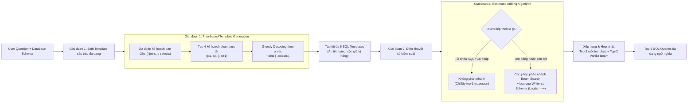

# Benchmarking and Improving Text-to-SQL Generation under Ambiguity

| Thông tin | Chi tiết |
|---|---|
| **Tác giả** | Adithya Bhaskar*, Tushar Tomar*, Ashutosh Sathe, Sunita Sarawagi (*Đồng tác giả chính) |
| **Đơn vị** | IIT Bombay (Ấn Độ), Princeton University (Hoa Kỳ) |
| **Năm / Venue** | 2023 / EMNLP 2023 (Proceedings of the 2023 Conference on Empirical Methods in Natural Language Processing, pages 7053–7074, Singapore, December 2023; arXiv:2310.13659v1 [cs.CL]; mã nguồn: `github.com/testzer0/AmbiQT`) |
| **Loại bài** | Benchmark & Phương pháp Giải mã (Benchmark & Decoding Algorithm) |
| **Chủ đề** | Text-to-SQL, Query Ambiguity, AmbiQT Benchmark, Logical Diversity, LogicalBeam Decoding, Template-based Generation, Constrained Infilling |
| **File gốc** | [Benchmarking and Improving Text-to-SQL Generation under Ambiguity.pdf](../papers/Benchmarking%20and%20Improving%20Text-to-SQL%20Generation%20under%20Ambiguity.pdf) |

## 1. Tóm tắt nhanh (TL;DR)
Bài báo tiên phong nghiên cứu bài toán xử lý tính mơ hồ trong Text-to-SQL bằng việc công bố **AmbiQT**—bộ benchmark đầu tiên gồm hơn 3.000 câu hỏi gắn với 2 câu lệnh SQL hợp lệ thuộc 4 dạng mơ hồ từ vựng và cấu trúc. Tác giả chứng minh các mô hình hàng đầu (T5-3B, RESDSQL, Codex, ChatGPT) đều thất bại trong việc bao phủ các cách diễn giải hợp lệ trong Top-5 do Beam Search và các thuật toán sampling chỉ tạo ra sự đa dạng vô nghĩa ở cấp độ token chuỗi. Để khắc phục, nhóm nghiên cứu đề xuất **LogicalBeam**, giải thuật giải mã 2 giai đoạn kết hợp sinh mẫu khung truy vấn đa dạng phản thực tế (*counterfactual plan-based templates*) và điền khuyết tên bảng/cột có kiểm soát (*restricted infilling*), giúp tăng độ bao phủ (BothInTopK) từ 1.5 đến 2.5 lần và cải thiện độ chính xác Top-5 trên cả Spider lẫn Kaggle DBQA.

## 2. Bối cảnh & Vấn đề nghiên cứu
- **Giả định phi thực tế của các benchmark Text-to-SQL:** Hầu hết các bộ dữ liệu phổ biến (WikiSQL, Spider, KaggleDBQA, SEDE) đều gắn mỗi câu hỏi tự nhiên với duy nhất một câu lệnh SQL đúng. Tuy nhiên, trong các hệ thống CSDL thực tế (đặc biệt là CSDL tích hợp nhiều nguồn dữ liệu), tính mơ hồ xuất hiện phổ biến do người dùng không thuộc tên cột/bảng, tên cột trùng lặp giữa các bảng, câu hỏi thiếu ràng buộc hoặc không rõ có cần tính toán trước các hàm tổng hợp hay không.
- **Yêu cầu đối với hệ thống Top-k trong môi trường mơ hồ:** Khi gặp câu hỏi mơ hồ, một bộ giải mã lý tưởng phải sinh ra được toàn bộ các cách diễn giải hợp lệ trong danh sách Top-k để người dùng có thể lựa chọn hoặc làm rõ (*disambiguation*).
- **Sự thất bại của các giải thuật giải mã hiện hành:**
  1. *Beam Search truyền thống:* Coi câu lệnh SQL như một chuỗi ký tự thông thường, dẫn tới việc các giả thuyết trong Top-k chỉ là các biến thể bề mặt vụn vặt (như đổi tên bí danh `t1`, `t2`, đảo thứ tự so sánh hoặc sinh biến thể lỗi chính tả của tên cột) mà không tạo ra sự khác biệt logic cốt lõi.
  2. *Các phương pháp Sampling hiện đại (Nucleus sampling, Typical sampling):* Được thiết kế cho văn bản tự nhiên, hoàn toàn bất lực trong việc sinh SQL vì mô hình ngôn ngữ sinh ra phân phối xác suất token cực kỳ lệch (*skewed distribution*, nhiều token chiếm xác suất $>0.99$), khiến các mẫu sinh ra hầu như giống hệt nhau.
  3. *Ngay cả các LLM mạnh nhất (ChatGPT, Codex):* Cũng gặp vấn đề tương tự khi được yêu cầu sinh danh sách các câu SQL ứng viên.

## 3. Phương pháp / Nội dung chính

### 3.1 Benchmark AmbiQT
AmbiQT được xây dựng bằng cách can thiệp có kiểm soát vào lược đồ (*schema perturbation*) và câu lệnh SQL của tập dữ liệu Spider thông qua ChatGPT và các bộ quy tắc cấu trúc. Mỗi câu hỏi trong AmbiQT đi kèm với đúng 2 câu lệnh SQL hợp lệ tương ứng với 4 loại mơ hồ:

1. **Column Ambiguity (C) - 1.240 mẫu:** Thay thế một cột trong CSDL bằng 2 cột đồng nghĩa (ví dụ: `roll_number` và `admission_number` cho câu hỏi hỏi về mã sinh viên).
2. **Table Ambiguity (T) - 1.417 mẫu:** Thay thế một bảng bằng 2 bảng đồng nghĩa (ví dụ: bảng `artist` và `performer` cho câu hỏi về ca sĩ).
3. **Join Ambiguity (J) - 288 mẫu:** Mô phỏng hiện tượng phân vùng dọc bảng trong CSDL thực tế: tách một bảng thành 2 bảng có chung khóa chính, khiến câu hỏi mơ hồ về việc có bắt buộc phải thực hiện phép `JOIN` hay không.
4. **Precomputed Aggregates (P) - 101 mẫu:** Thêm bảng chứa các cột đã tính toán tổng hợp sẵn (như `avg_weight`, `max_capacity`), dẫn đến việc truy vấn có thể dùng `SELECT AVG(...) ... GROUP BY` hoặc `SELECT avg_weight` trực tiếp.

### 3.2 Giải thuật giải mã LogicalBeam
LogicalBeam điều hướng không gian logic của SQL thay vì không gian chuỗi ký tự, gồm 2 giai đoạn:

#### Chi tiết các bước của LogicalBeam:
1. **Giai đoạn 1: Sinh Template dựa trên Kế hoạch (Plan-based Template Generation):**
   - *Khái niệm Template:* Là khung SQL đã trừu xuất hóa tên bảng, tên cột, số hằng và chuỗi ký tự thành các thẻ đại diện chung (`table`, `column`, `number`, `string`), chỉ giữ lại xương sống logic (`SELECT`, `JOIN`, `WHERE`, `GROUP BY`, toán tử).
   - *Kế hoạch cấu trúc (Prefix Plan):* Huấn luyện mô hình sinh tiền tố quy định số lượng JOIN và số cột SELECT: `<J> joins | <S> selects | <TEMPLATE>`.
   - *Nhiễu phản thực tế (Counterfactual Perturbation):* Dự đoán cấu trúc gốc $(j, s)$, sau đó tự động kích hoạt 4 kế hoạch lân cận $(j-1, s)$, $(j+1, s)$, $(j, s-1)$, $(j, s+1)$ và giải mã tham lam (*greedy decoding*) để ép mô hình tạo ra tối đa 5 khung template có cấu trúc thực sự khác biệt.
2. **Giai đoạn 2: Điền khuyết có kiểm soát Schema (Template Infilling with Diverse Schema):**
   - Thực hiện Beam Search để điền tên bảng, tên cột vào khung template.
   - *Kiểm soát phân nhánh:* Ở các vị trí token cú pháp/từ khóa SQL, cấm phân nhánh (chỉ lấy token có điểm số cao nhất). Chỉ cho phép phân nhánh ở các vị trí bắt đầu tên bảng hoặc tên cột.
   - *Whitelist Masking:* Khi phân nhánh ở tên bảng/cột, sử dụng `LogitsProcessor` để gán logit $-\infty$ cho toàn bộ các token không thuộc danh sách tên bảng/cột hợp lệ của CSDL.
3. **Chiến lược chọn Top-5 (Ranking):** Thay vì nhân xác suất chuỗi (vốn bị lệch nặng), hệ thống lấy Top-2 câu SQL từ mỗi template kết hợp với Top-2 từ Vanilla Beam Search, khử trùng lặp và lấy ra Top-5 câu truy vấn cuối cùng.

## 4. Thực nghiệm & Kết quả chính

### 4.1 Thiết lập thực nghiệm
- **Mô hình triển khai:** Cả 2 giai đoạn của LogicalBeam đều sử dụng mô hình fine-tuned Flan T5-3B (huấn luyện trên Spider).
- **Hệ thống đối chuẩn:**
  - LLM thương mại: ChatGPT (one-shot JSON prompt), OpenAI Codex (`code-davinci-002`, 2-shot).
  - Mô hình Text-to-SQL chuyên biệt: RESDSQL-3B (SOTA trên Spider tại thời điểm đó), T5-3B (PICARD), Flan T5-3B.
  - Các biến thể giải mã của T5-3B: Top-k sampling ($k=50$), Nucleus sampling ($p=0.9$), Typical sampling ($p=0.9$).
- **Thước đo:** Đánh giá trong Top-5 câu truy vấn:
  - *EitherInTopK (%):* Ít nhất một câu SQL đúng nằm trong Top-5.
  - *BothInTopK / Coverage (%):* Cả hai câu SQL đúng đều nằm trong Top-5 (thước đo năng lực giải quyết mơ hồ cốt lõi).
  - Báo cáo theo Execution Match (EXM) và Exact Set Match (EM).

### 4.2 Kết quả trên Benchmark AmbiQT (Top-5 Execution Match EXM)

| Loại mơ hồ | ChatGPT | Codex | RESDSQL | T5-3B (Beam) | T5-3B (Nucleus) | **LogicalBeam (Ours)** |
|---|---|---|---|---|---|---|
| **BothInTopK - Coverage (%)** | | | | | | |
| Column Ambiguity (C) | 22.7 | 10.4 | 10.8 | 11.7 | 2.5 | **28.0** *(gấp 2.4x T5-3B)* |
| Table Ambiguity (T) | 37.3 | 14.3 | 6.4 | 21.9 | 7.1 | **42.6** *(gấp gần 2x T5-3B)* |
| Join Ambiguity (J) | 15.6 | 43.8 | 0.0 | 27.8 | 1.7 | **59.4** *(gấp 1.4x Codex, 2.1x T5-3B)* |
| Precomputed Aggregates (P) | 8.9 | 24.7 | 8.9 | 15.8 | 3.0 | **24.8** *(vượt mọi mô hình)* |
| **EitherInTopK (%)** | | | | | | |
| Column Ambiguity (C) | 52.7 | 55.6 | 51.0 | 59.0 | 51.7 | **66.6** |
| Table Ambiguity (T) | 55.7 | 59.8 | 33.8 | 57.9 | 48.7 | **67.3** |
| Join Ambiguity (J) | 77.8 | 83.7 | 68.8 | 86.8 | 79.9 | **87.2** |
| Precomputed Aggregates (P) | 57.4 | **77.2** | 42.6 | 58.4 | 53.5 | 64.4 |

*Nhận xét quan trọng:*
- **Vượt trội hoàn toàn về độ bao phủ (BothInTopK):** LogicalBeam đánh bại toàn bộ các mô hình SOTA và LLM trên cả 4 dạng mơ hồ. Đặc biệt ở dạng Join Ambiguity, LogicalBeam đạt **59.4%**, trong khi RESDSQL hoàn toàn sụp đổ (0.0%) và ChatGPT chỉ đạt 15.6%.
- **Sự thất bại của các phương pháp Sampling:** Nucleus sampling và Typical sampling đạt độ bao phủ gần như bằng 0 (chỉ từ 0.0% đến 7.1%), do các token trong SQL bị áp đảo bởi các giá trị xác suất quá cao khiến việc lấy mẫu ngẫu nhiên không tạo ra bất kỳ đột phá nào.
- **Tăng Beam Width không giúp giải quyết mơ hồ:** Thử nghiệm nâng beam width từ 10 lên 20 thực tế làm *giảm* độ bao phủ (Figure 4), vì mô hình chỉ tận dụng độ rộng beam để đào sâu thêm vào các biến thể vô nghĩa của cách hiểu mặc định đầu tiên.

### 4.3 Hiệu năng trên các Benchmark không mơ hồ (Spider & Kaggle DBQA)
LogicalBeam không chỉ hiệu quả với câu hỏi mơ hồ mà còn nâng cao đáng kể chất lượng Top-5 trên các bài toán thông thường (Table 5):
- **Spider (dev split):** Top-5 Execution Accuracy tăng từ 78.2% lên **81.3%** (+3.1%); Exact Set Match tăng từ 76.1% lên 78.4%.
- **Kaggle DBQA (dev split):** Tăng vọt Top-5 Execution Accuracy từ 26.5% lên **35.4%** (+8.9%), chứng minh năng lực khám phá không gian giải pháp vượt trội trên các CSDL thực tế phức tạp.

### 4.4 Phân tích thành phần (Ablation Study - Table 4)
- **Đóng góp của Template Diversity:** Việc can thiệp tạo plan phản thực tế giúp tăng vọt độ phủ trên các loại mơ hồ cấu trúc: Join Ambiguity (từ 54.5% lên 62.2%) và Precomputed Aggregates (từ 9.9% lên 30.7%).
- **Đóng góp của Schema Diversity:** Giải thuật Restricted Infilling kiểm soát Whitelist đóng vai trò quyết định trong việc giải quyết mơ hồ từ vựng: Column Ambiguity (tăng từ 16.1% lên 28.0%) và Table Ambiguity (tăng từ 28.2% lên 42.6%).

## 5. Tính mới (Novelty & Đóng góp)
- **Công bố Benchmark AmbiQT:** Tập dữ liệu mở quy mô lớn đầu tiên chuyên biệt cho việc đánh giá năng lực giải quyết mơ hồ trong Text-to-SQL với hơn 3.000 mẫu thử và 4 loại mơ hồ thực tế.
- **Vạch rõ nguyên nhân cốt lõi của sự thiếu hụt đa dạng:** Phân tích thực nghiệm chứng minh vì sao Beam Search và Sampling thông thường không thể tạo ra sự đa dạng logic trong sinh mã SQL.
- **Đề xuất giải thuật giải mã LogicalBeam:** Kỹ thuật đột phá phân rã không gian tìm kiếm thành 2 bước: tạo khung cấu trúc phản thực tế (counterfactual plan) và điền khuyết tên thực thể bị ràng buộc bởi schema whitelist.
- **Cải thiện tính chính xác tổng thể:** Chứng minh rằng việc đa dạng hóa logic một cách có định hướng giúp nâng cao độ chính xác Top-5 ngay cả trên các benchmark Text-to-SQL truyền thống không chứa nhãn mơ hồ.

## 6. Hạn chế

### 6.1 Hạn chế do tác giả thừa nhận
- **Dữ liệu AmbiQT được tạo nhân tạo (Synthetic Perturbation):** AmbiQT được tạo bằng cách biến đổi từ tập Spider thông qua ChatGPT và luật thay thế, có thể chưa phản ánh hết sự phong phú và phức tạp của các câu hỏi tự nhiên ngoài đời thực.
- **Giới hạn ngôn ngữ:** Toàn bộ tập dữ liệu chỉ hỗ trợ tiếng Anh.
- **Tăng chi phí suy luận:** Do quy trình 2 giai đoạn nên số bước giải mã nhiều hơn mô hình sinh một lần, mặc dù giai đoạn 1 đã dùng greedy search để giảm tải.
- **Hiện tượng thiên vị template của mô hình gốc:** Đôi khi mô hình vẫn cố tình bẻ cong câu lệnh để bám vào một template quen thuộc (ví dụ sinh ra các alias lạ như `t1`, `t3` và bỏ qua `t2`).

### 6.2 Nhận xét thêm của người review
- **Giới hạn cứng ở 2 cách diễn giải:** Mỗi câu hỏi trong AmbiQT chỉ có đúng 2 câu lệnh SQL hợp lệ, trong khi thực tế người dùng có thể đặt các câu hỏi mở có 3, 4 hoặc nhiều cách hiểu khác nhau (như trong benchmark Ambrosia sau này).
- **Phụ thuộc vào mô hình mã nguồn mở có quyền can thiệp Logits:** Kỹ thuật Restricted Infilling yêu cầu can thiệp trực tiếp vào logits ở từng bước giải mã (`LogitsProcessor`), do đó không thể áp dụng trực tiếp cho các mô hình thương mại đóng (Closed LLM API như GPT-4 hay Claude) nếu không có quyền can thiệp decoder.
- **Chưa có khâu tương tác làm rõ với người dùng:** Bài báo chỉ dừng lại ở bài toán sinh ra danh sách Top-5 câu truy vấn tốt nhất, chưa xây dựng cơ chế hội thoại tương tác để hỗ trợ người dùng phi kỹ thuật chọn đúng phương án mong muốn.

## 7. Ý nghĩa ứng dụng (cho hệ thống agent phân tích dữ liệu / Text-to-SQL)
- **Không dựa dẫm vào Temperature để tạo đa dạng SQL:** Khi xây dựng agent cần đề xuất nhiều phương án truy vấn, việc tăng `temperature` hoặc dùng `top_p` sẽ chỉ sinh ra các câu SQL lỗi cú pháp hoặc trùng lặp bề mặt. Cần thiết kế prompt phân tách rõ ràng về mặt cấu trúc (ví dụ: yêu cầu agent chủ động sinh một phương án có `JOIN` và một phương án không có `JOIN`).
- **Ứng dụng cơ chế Skeleton-First Generation:** Trong workflow của agent, nên chia việc sinh SQL thành 2 bước: (1) Phác thảo khung logic truy vấn (Abstract Execution Plan / Skeleton), (2) Điền cụ thể các trường dữ liệu sau khi đã tra cứu schema.
- **Áp dụng Constrained Decoding / Schema Whitelisting:** Đối với các hệ thống Text-to-SQL cục bộ dùng mô hình mã nguồn mở (như Llama, Qwen-Coder), việc cài đặt bộ lọc logits theo schema whitelist là giải pháp triệt để nhất để loại bỏ 100% hiện tượng "bịa đặt" tên cột hoặc tên bảng (hallucinated schema linking).

## 8. Từ khóa
`Text-to-SQL`, `Query Ambiguity`, `AmbiQT`, `LogicalBeam`, `Template-based Generation`, `Diverse Decoding`, `Restricted Infilling`, `Constrained Decoding`, `Spider Benchmark`
