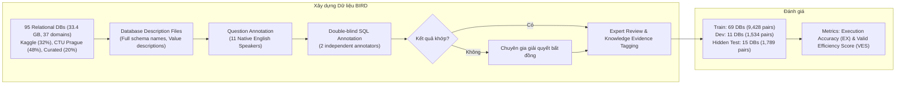

# Can LLM Already Serve as A Database Interface? A BIg Bench for Large-Scale Database Grounded Text-to-SQLs

| Thông tin | Chi tiết |
|---|---|
| **Tác giả** | Jinyang Li, Binyuan Hui, Ge Qu, Jiaxi Yang, Binhua Li, Bowen Li, Bailin Wang, Bowen Qin, Ruiying Geng, Nan Huo, Xuanhe Zhou, Chenhao Ma, Guoliang Li, Kevin C.C. Chang, Fei Huang, Reynold Cheng, Yongbin Li |
| **Đơn vị** | The University of Hong Kong; Alibaba DAMO Academy; Tsinghua University; Shanghai AI Laboratory; MIT CSAIL; The Chinese University of Hong Kong, Shenzhen; UIUC |
| **Năm / Venue** | NeurIPS 2023 (Track on Datasets and Benchmarks); arXiv:2305.03111v3 (15/11/2023) |
| **Loại bài** | Benchmark & Đánh giá thực nghiệm quy mô lớn |
| **Chủ đề** | Text-to-SQL, Large-Scale Database Grounding, Dirty Values, External Knowledge Reasoning, SQL Execution Efficiency (VES) |
| **File gốc** | [Can LLM Already Serve as A Database Interface.pdf](../papers/Can%20LLM%20Already%20Serve%20as%20A%20Database%20Interface.pdf) |

## 1. Tóm tắt nhanh (TL;DR)
Bài báo giới thiệu **BIRD**, benchmark Text-to-SQL đa miền quy mô lớn đầu tiên tập trung vào dữ liệu thực tế với 95 cơ sở dữ liệu (33.4 GB, 37 lĩnh vực) và 12,751 cặp câu hỏi – SQL. Khác với Spider hay WikiSQL chủ yếu xoay quanh cấu trúc schema và vài dòng dữ liệu mẫu, BIRD đặt ra 3 thách thức thực tế: giá trị dữ liệu bẩn/nhiễu (dirty values), suy luận tri thức ngoài (external knowledge), và hiệu năng thực thi SQL (thông qua metric mới Valid Efficiency Score - VES). Kết quả thực nghiệm cho thấy ngay cả mô hình mạnh nhất thời điểm đó là GPT-4 (+ DIN-SQL) chỉ đạt 55.90% Execution Accuracy (EX) trên tập test ẩn, còn cách rất xa hiệu năng con người (92.96%), khẳng định LLM vẫn chưa thể thay thế hoàn toàn con người làm giao diện cơ sở dữ liệu doanh nghiệp.

## 2. Bối cảnh & Vấn đề nghiên cứu
- **Khoảng cách giữa học thuật và thực tế:** Các benchmark tiêu chuẩn như WikiSQL và Spider đã thúc đẩy mạnh mẽ các mô hình Text-to-SQL (từ Seq2SQL, RAT-SQL đến DIN-SQL với GPT-4 đạt >85% trên Spider). Tuy nhiên, các benchmark này coi nhẹ giá trị dữ liệu (database values) và chỉ lưu trữ trung bình khoảng 2.000 dòng/DB trong Spider hoặc bảng đơn lẻ trong WikiSQL.
- **Thực tế cơ sở dữ liệu doanh nghiệp:**
  1. *Dữ liệu lớn và giá trị bẩn (Massive & Dirty Database Values):* Dữ liệu lưu sai định dạng (ví dụ tiền tệ lưu dạng string `"US$57,500.00"` đòi hỏi cắt chuỗi và `CAST` sang `REAL`), tên viết tắt khó hiểu, kiểu dữ liệu không chuẩn hóa.
  2. *Nén ngữ cảnh & Tri thức ngoài (External Knowledge Reasoning):* Khi cơ sở dữ liệu mở rộng, người dùng đặt câu hỏi ngắn gọn nhưng ẩn chứa tri thức miền (domain knowledge), quy ước tính toán (numeric formulas, percentages), từ đồng nghĩa (synonyms), hoặc giải nghĩa giá trị (value illustrations, ví dụ `pos = 'C'` đại diện cho vị trí Center).
  3. *Hiệu năng thực thi SQL (Execution Efficiency):* Một câu SQL đúng kết quả nhưng viết dưới dạng subquery lồng nhau không tối ưu có thể tốn hàng chục giây đến hàng phút trên bảng hàng triệu dòng, không thể đưa vào môi trường production.
- **Câu hỏi nghiên cứu cốt lõi:** *"Liệu LLM đã có thể đóng vai trò như một giao diện cơ sở dữ liệu tin cậy hay chưa?"* (Can LLM Already Serve as A Database Interface?).

## 3. Phương pháp / Nội dung chính

### 3.1 Nguồn dữ liệu & Quy mô
- **95 cơ sở dữ liệu quan hệ (relational databases):** Tổng dung lượng **33.4 GB**, bao phủ **37 domain chuyên nghiệp** (tài chính, y tế, thể thao, blockchain, giáo dục, bán lẻ...).
- **Nguồn:** 32% từ Kaggle, 48% từ CTU Prague Relational Learning Repository, 20% tự tổng hợp/chuẩn hóa từ các bảng dữ liệu mở.
- **Phân chia tập dữ liệu:**
  - Tập huấn luyện (Train): 69 DBs, 9,428 mẫu.
  - Tập phát triển (Dev): 11 DBs, 1,534 mẫu.
  - Tập kiểm thử ẩn (Hidden Test): 15 DBs, 1,789 mẫu (được thiết kế mới hoàn toàn để chống rò rỉ dữ liệu / data contamination vào dữ liệu tiền huấn luyện của LLM).
  - Chi phí xây dựng bộ dữ liệu lên đến **$97,654 USD** do Alibaba DAMO Academy tài trợ.

### 3.2 Quy trình gán nhãn Double-blind & Tài liệu mô tả DB
- **Database Description Files (.csv):** Hỗ trợ người gán nhãn hiểu schema: cung cấp tên đầy đủ của cột/bảng bị viết tắt và diễn giải giá trị cột.
- **4 nhóm tri thức ngoài (External Knowledge Evidence - $K$):**
  1. *Numeric Reasoning:* Phép toán cơ bản (+, -, *, /) và công thức phức tạp (tỉ lệ phần trăm, chỉ số). Chiếm 24.5%.
  2. *Domain Knowledge:* Kiến thức chuyên ngành (vd: tiêu chí tính khoản vay trong ngân hàng). Chiếm 23.6%.
  3. *Synonym Knowledge:* Từ đồng nghĩa trong ngôn ngữ tự nhiên và schema. Chiếm 7.2%.
  4. *Value Illustration:* Ánh xạ giữa khái niệm câu hỏi và chuỗi giá trị thực tế trong DB. Chiếm tới 70.1%.
- **Double-blind Annotation:** Hai kỹ sư DB độc lập viết SQL cho cùng một câu hỏi mà không trao đổi. Cả 2 câu SQL được thực thi trên SQLite; nếu kết quả trả về trùng khớp hoàn toàn, câu SQL tối ưu hơn được chọn làm Ground Truth. Nếu không khớp, 3 chuyên gia thẩm định (Database Research Scientist, PhD Text-to-SQL, Senior DBA) sẽ hội chẩn xử lý.

### 3.3 Độ khó câu hỏi
Được phân thành 3 mức độ dựa trên 4 chiều đánh giá (Question Understanding, Knowledge Reasoning, Data Complexity, SQL Complexity):
- **Simple (30%):** Câu hỏi cơ bản, ít JOIN, ít suy luận tri thức ngoài.
- **Moderate (60%):** Cần JOIN nhiều bảng, có tính toán số học hoặc ánh xạ giá trị.
- **Challenging (10%):** Schema phức tạp, điều kiện lọc đa tầng, suy luận tri thức sâu.

### 3.4 Metric đánh giá mới: Valid Efficiency Score (VES)
- **Execution Accuracy (EX):** Tỷ lệ câu SQL sinh ra có kết quả thực thi giống hệt Ground Truth ($\hat{V}_n = V_n$). Tác giả dùng `HashSet` thay vì danh sách để tránh thiên vị về thứ tự khi có/không có từ khóa `DISTINCT`.
- **Valid Efficiency Score (VES):** Đo lường hiệu năng thực thi của các câu SQL **hợp lệ** (chỉ tính điểm hiệu năng nếu SQL chạy đúng kết quả, SQL sai thì VES = 0):
  $$VES = \frac{1}{N} \sum_{n=1}^{N} \mathbb{I}(V_n = \hat{V}_n) \cdot \sqrt{\frac{E(Y_n)}{E(\hat{Y}_n)}}$$
  Trong đó $E(Y)$ là thời gian thực thi (chạy 100 lần trên cùng CPU, loại bỏ outlier $3\sigma$). Phép khai căn bậc hai $\sqrt{\cdot}$ giúp hạn chế ảnh hưởng của các trường hợp đột biến do tải máy.

## 4. Thực nghiệm & Kết quả chính

### 4.1 Kết quả tổng thể trên BIRD (Table 2 & Table 3)

| Model | Dev EX (w/o K) | Dev EX (w/ K) | Test EX (w/o K) | Test EX (w/ K) | Dev VES (w/ K) | Test VES (w/ K) |
|---|---|---|---|---|---|---|
| **T5-Base (FT)** | 6.32 | 11.54 | 7.06 | 12.89 | 12.90 | 14.71 |
| **T5-Large (FT)** | 9.71 | 19.75 | 10.38 | 20.94 | 22.74 | 25.00 |
| **T5-3B (FT)** | 10.37 | 23.34 | 11.17 | 24.05 | 25.57 | 27.80 |
| **Palm-2 (text-bison-001)** | 18.77 | 27.38 | 24.71 | 33.04 | 28.64 | 38.41 |
| **Codex (code-davinci-002)** | 25.42 | 34.35 | 24.86 | 36.47 | 43.41 | 41.60 |
| **ChatGPT (gpt-3.5-turbo)** | 24.05 | 37.22 | 26.77 | 39.30 | 43.81 | 51.40 |
| **ChatGPT + CoT** | 25.88 | 36.64 | 28.95 | 40.08 | 42.30 | 56.56 |
| **Claude-2** | 28.29 | 42.70 | 34.60 | 49.02 | 45.28 | 55.77 |
| **GPT-4 (gpt-4-32k)** | **30.90** | **46.35** | **34.88** | **54.89** | **49.77** | **60.77** |
| **GPT-4 + DIN-SQL** | – | **50.72** | – | **55.90** | **58.79** | **59.44** |
| **Human Performance** | – | – | 72.37 | **92.96** | – | **90.27** |

### 4.2 So sánh độ khó giữa BIRD và SPIDER (Figure 6)
Khi chạy cùng một thiết lập và prompt trên dev set của cả hai benchmark:
- **DIN-SQL:** Spider đạt **82.8%** $\rightarrow$ BIRD tụt xuống **50.7%** (−32.1%).
- **ChatGPT:** Spider đạt **72.1%** $\rightarrow$ BIRD tụt xuống **37.2%** (−34.9%).
- **Codex:** Spider đạt **74.1%** $\rightarrow$ BIRD tụt xuống **34.4%** (−39.7%).
- **T5-3B:** Spider đạt **71.5%** $\rightarrow$ BIRD tụt xuống **23.3%** (−48.2%).
Điều này chứng minh việc chuyển sang cơ sở dữ liệu thực tế với schema lớn và giá trị bẩn làm giảm hiệu năng của mọi mô hình từ 30% đến 48%.

### 4.3 Vai trò của External Knowledge Evidence
- Cung cấp tri thức ngoài giúp cải thiện vượt bậc hiệu năng cho tất cả các mô hình: GPT-4 tăng từ 34.88% lên 54.89% (+20.01% EX trên test); ChatGPT tăng từ 26.77% lên 39.30% (+12.53%).
- Đáng chú ý: Với ChatGPT, khi thêm CoT ("Let's think step by step"), hiệu năng w/ knowledge lại giảm nhẹ trên dev (37.22% $\rightarrow$ 36.64%), cho thấy cơ chế tự suy luận nội tại của LLM đôi khi mâu thuẫn hoặc chưa tương thích tốt với cấu trúc tri thức ngoài được cung cấp thẳng vào prompt.

### 4.4 Phân tích hiệu năng thực thi (Efficiency Analysis)
- **Tối ưu truy vấn 2 giai đoạn (Two-Stage Optimization):** Các chuyên gia DB viết lại 10 câu truy vấn do ChatGPT sinh ra dựa trên quy tắc (Rule-based Rewrite: dùng `INNER JOIN` thay vì subquery `WHERE IN`, dùng `COUNT(col)` thay cho `COUNT(*)`, dùng `WHERE col = (SELECT MAX(...))` thay vì `ORDER BY DESC LIMIT 1`). Kết quả: **tiết kiệm trung bình 77.75% thời gian chạy**.
- **Đánh chỉ mục (Index Selection):** Thêm chỉ mục phù hợp trên các cột filter/join giúp giảm thời gian thực thi lên tới **87.27%**.

### 4.5 Phân tích lỗi (Error Analysis trên 500 mẫu lỗi của ChatGPT)
1. **Wrong Schema Linking (41.6%):** Mô hình hiểu câu hỏi nhưng chọn sai bảng hoặc cột tương ứng (đặc biệt khi schema có nhiều cột mang tên na ná nhau).
2. **Misunderstanding Database Content (40.8%):** Mô hình ảo giác bảng/cột không tồn tại (schema hallucination) hoặc không hiểu định dạng giá trị cột (ví dụ đoán mò giá trị không có trong DB).
3. **Misunderstanding Knowledge Evidence (17.6%):** Không hiểu hoặc sao chép nguyên xi văn bản gợi ý (ví dụ copy thẳng chuỗi giả định `DIVIDE(SUM(spent), COUNT(spent))` vào SQL làm phát sinh lỗi cú pháp).
4. **Syntax Error (3.0%):** Dùng nhầm hàm của hệ quản trị khác (dùng hàm MySQL `YEAR()` thay vì hàm SQLite `STRFTIME('%Y', ...)`).

## 5. Tính mới (Novelty & Đóng góp)
- **Bước ngoặt chuyển dịch benchmark:** Là công trình tiên phong chuyển hướng Text-to-SQL từ các bộ dữ liệu đồ chơi (toy benchmarks) chỉ có cấu trúc bảng sang cơ sở dữ liệu thế giới thực với dữ liệu thực, kích thước lớn (33.4 GB) và giá trị nhiễu/bẩn.
- **Metric VES:** Lần đầu tiên đưa tiêu chí hiệu năng thực thi (execution efficiency) vào bài toán Text-to-SQL, thúc đẩy việc sinh SQL không chỉ đúng mà còn phải chạy nhanh.
- **Hệ thống hóa External Knowledge:** Phân loại và cấu trúc 4 dạng tri thức ngoài gắn liền với giá trị DB, tạo nền tảng cho các nghiên cứu RAG và Knowledge Grounding trong Text-to-SQL sau này.
- **Quy trình Double-blind & Hidden Test Set:** Đầu tư công phu về công sức và tài chính ($97k) để tạo ra tập test ẩn chống rò rỉ dữ liệu tiền huấn luyện, đồng thời thiết lập mốc so sánh hiệu năng người (Human Baseline: 92.96%).

## 6. Hạn chế

### 6.1 Hạn chế do tác giả thừa nhận
- **Chi phí gán nhãn rất đắt đỏ:** Quy trình gán nhãn double-blind tốn nhiều chi phí nhân lực và thời gian (~1,340 SQL/tuần).
- **Phụ thuộc vào SQLite:** SQLite dễ triển khai nhưng bị hạn chế về khả năng trích xuất Query Execution Plan (QEP) chi tiết để đo lường chi phí truy vấn lý thuyết, đồng thời thiếu các tính năng nâng cao của các hệ quản trị CSDL thương mại.
- **Độ nhập nhằng của DISTINCT / ORDER BY:** Việc so sánh kết quả bằng HashSet bỏ qua thứ tự dòng, có thể dẫn đến false positives cho các câu hỏi đòi hỏi sắp xếp cụ thể.

### 6.2 Nhận xét thêm của người review
- **Giả định "Oracle Knowledge":** Trong benchmark, chuỗi tri thức ngoài (Knowledge Evidence) được chuyên gia chuẩn bị sẵn và đưa trực tiếp vào prompt. Trong thực tế ứng dụng doanh nghiệp, người dùng cuối không bao giờ cung cấp sẵn gợi ý chính xác này; hệ thống Text-to-SQL thực tế bắt buộc phải tự động truy hồi (RAG) hoặc làm rõ nghĩa (clarification) với người dùng.
- **Chất lượng Ground Truth vẫn tồn tại lỗi:** Dù dùng double-blind, các nghiên cứu kế thừa (như MAC-SQL, Mini-Seek) chỉ ra rằng BIRD vẫn có khoảng 15–30% nhãn Ground Truth bị lỗi (dirty database values dẫn đến false negatives, hoặc logic SQL chuẩn chưa tối ưu).
- **VES đo thời gian thực tế (wall-clock time) trên CPU cá nhân:** Thời gian chạy thực tế dễ bị ảnh hưởng bởi bộ nhớ đệm (caching), cơ chế I/O của hệ điều hành và CPU throttling, dù đã chạy 100 lần. Việc đo số lượng block I/O hoặc CPU cycle / QEP cost sẽ có tính tái lập cao hơn giữa các phòng lab khác nhau.
- **Chưa phản ánh môi trường Big Data / Data Warehouse:** Cơ sở dữ liệu 33.4 GB là lớn so với SQLite nhưng vẫn rất nhỏ so với Data Warehouse doanh nghiệp (hàng chục Terabyte trên Snowflake/BigQuery). Các kỹ thuật như partition pruning, distributed join không xuất hiện trong benchmark này.

## 7. Ý nghĩa ứng dụng (cho hệ thống agent phân tích dữ liệu / Text-to-SQL)
- **Tập trung xử lý Schema Linking và Content Grounding:** Sai lệch về schema và nội dung bảng chiếm tới >82% tổng lỗi. Hệ thống agent cần trang bị module Semantic Schema Pruner và Vector Database để tìm kiếm chính xác các giá trị định danh mẫu trong DB trước khi sinh SQL.
- **Module tối ưu hóa truy vấn sau sinh (SQL Query Optimizer):** Agent không nên gửi thẳng câu SQL ban đầu xuống DB lớn; cần bổ sung một lượt phản hồi (Refiner/Rewriter) áp dụng các luật tối ưu (thay IN bằng JOIN, hạn chế COUNT(*), bổ sung LIMIT/Index hint) để tránh làm nghẽn DB doanh nghiệp.
- **Cơ chế quản lý Data Dictionary / Metadata Catalog:** Doanh nghiệp bắt buộc phải duy trì tài liệu mô tả dữ liệu (tương tự Database Description File của BIRD) để agent có thể tra cứu thuật ngữ nội bộ và công thức kinh doanh.

## 8. Từ khóa
`BIRD Benchmark`, `Text-to-SQL`, `Large-Scale Databases`, `Database Values`, `Dirty Data`, `External Knowledge Grounding`, `Valid Efficiency Score (VES)`, `Double-Blind Annotation`, `Execution Accuracy`, `In-Context Learning`, `GPT-4`