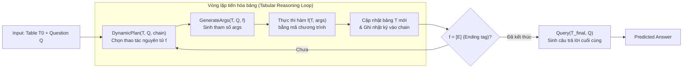

# CHAIN-OF-TABLE: Evolving Tables in the Reasoning Chain for Table Understanding

| Thông tin | Chi tiết |
|---|---|
| **Tác giả** | Zilong Wang, Hao Zhang, Chun-Liang Li, Julian Martin Eisenschlos, Vincent Perot, Zifeng Wang, Lesly Miculicich, Yasuhisa Fujii, Jingbo Shang, Chen-Yu Lee (corresponding), Tomas Pfister |
| **Đơn vị** | University of California, San Diego; Google Cloud AI Research; Google Research |
| **Năm / Venue** | ICLR 2024 (Conference paper; arXiv:2401.04398v2, 01/2024) |
| **Loại bài** | Phương pháp (Prompting framework / Iterative tabular reasoning) |
| **Chủ đề** | Table Reasoning, Table Question Answering, Table Fact Verification, Chain-of-Thought trên bảng dữ liệu, Dynamic Planning |
| **File gốc** | [Chain-of-Table.pdf](../papers/Chain-of-Table.pdf) |

## 1. Tóm tắt nhanh (TL;DR)
Chain-of-Table mở rộng khái niệm Chain-of-Thought (CoT) sang bài toán suy luận trên bảng bằng cách sử dụng chính các bảng dữ liệu biến đổi trung gian (intermediate tables) làm đại diện cho các bước tư duy (intermediate thoughts). Thay vì sinh văn bản giải thích tự do (free-form text) hay sinh toàn bộ mã lệnh trong một lần duy nhất (single-pass program generation), phương pháp hướng dẫn LLM lập kế hoạch động (*Dynamic Planning*) để chọn một thao tác bảng nguyên tử (*atomic operation*), sinh tham số (*GenerateArgs*), thực thi bằng mã nguồn để cập nhật bảng, rồi lặp lại cho đến khi kết thúc. Trên 3 benchmark chuẩn (WikiTQ, TabFact, FeTaQA), Chain-of-Table đạt SOTA trên cả PaLM 2, GPT-3.5 và LLaMA 2, đặc biệt duy trì độ chính xác vượt trội khi xử lý bảng kích thước lớn (>4.000 tokens) với chi phí mẫu sinh thấp hơn 50–75% so với các phương pháp self-consistency như Binder và Dater.

## 2. Bối cảnh & Vấn đề nghiên cứu
- **Bảng dữ liệu (semi-structured tables)** là định dạng phổ biến trong thực tế, mang lượng thông tin phong phú qua sự giao cắt giữa hàng và cột, nhưng cấu trúc 2 chiều này gây khó khăn lớn cho LLM so với văn bản thuần.
- **Hạn chế của Generic Reasoning (CoT, Least-to-Most, DecomP):** Các chuỗi suy luận bằng văn bản tự do không nắm bắt tốt ngữ nghĩa cấu trúc bảng phức tạp. Khi bảng chứa thông tin lồng ghép (ví dụ tên cầu thủ kèm quốc tịch chung một ô), văn bản CoT dễ suy luận sai sót hoặc bỏ sót chi tiết.
- **Hạn chế của Program-aided Reasoning (Text-to-SQL, Binder):** Dù tận dụng được khả năng tính toán chính xác của SQL hay Python interpreter, các phương pháp này chủ yếu hoạt động theo kiểu *single-pass* trên bảng tĩnh cố định. Nếu ô bảng chứa dữ liệu phi chuẩn, mã lệnh sinh ra không thể truy vấn chính xác vì thiếu các bước biến đổi bảng thích ứng với câu hỏi.
- **Hạn chế của Dater:** Dù có phân rã bảng thành sub-table, quy trình của Dater là quy trình cứng (fixed pipeline) và chỉ gói gọn ở việc cắt lọc hàng/cột như một bước tiền xử lý nhằm giảm độ dài prompt, chứ không xem việc biến đổi bảng là chuỗi tư duy động thích ứng theo từng câu hỏi.

## 3. Phương pháp / Nội dung chính

### 3.1 Quy trình thực thi tổng thể
Chain-of-Table xây dựng một vòng lặp suy luận tương tác giữa LLM và bộ thực thi chương trình bảng:

Quy trình gồm 3 bước lặp chính:
1. **Dynamic Planning (`DynamicPlan(T, Q, chain)`):**
   - Đầu vào gồm bảng trung gian mới nhất $T$, câu hỏi $Q$, và lịch sử các thao tác đã thực hiện `chain`.
   - LLM được cung cấp danh sách candidate operations từ tập thao tác (Operation Pool) và vài ví dụ in-context learning.
   - LLM sinh ra thao tác tiếp theo $f$. Mặc dù mô hình có thể dự đoán tiếp cả chuỗi còn lại, tác giả chỉ lấy thao tác đầu tiên $f_{i+1}$ (greedy execution) vì nó được lập kế hoạch dựa trên bảng thực tế cập nhật nhất, tránh ảo giác ở các bước sau.
2. **Argument Generation (`GenerateArgs(T, Q, f)`):**
   - LLM sinh các đối số tương ứng với $f$ (tên cột cần thêm, hàng cần lọc, cột cần group...).
   - Hệ thống dùng các biểu thức chính quy (Regular Expressions) tiền định nghĩa để trích xuất đối số từ văn bản do LLM sinh ra.
3. **Thực thi và cập nhật bảng (Execution & Evolution):**
   - Thao tác $f(T, \text{args})$ được thực thi tự động bằng code (Python/DataFrame) để tạo bảng mới $T_{i+1}$.
   - Cặp $(f, \text{args})$ được ghi thêm vào `chain`.
   - Quá trình lặp dừng lại khi $f$ được chọn là tag kết thúc `[E]`.
4. **Final Query (`Query(T, Q)`):**
   - Đưa bảng cuối cùng (đã được tinh gọn, bổ sung cột tính toán hoặc gom nhóm phù hợp nhất) cùng câu hỏi ban đầu vào LLM để rút ra câu trả lời trực tiếp mà không cần sinh chuỗi CoT phức tạp nữa.

### 3.2 Tập thao tác nguyên tử (Operation Pool)
Framework định nghĩa 5 thao tác bảng nguyên tử phổ biến trong SQL/DataFrame:
- `f_add_column()`: Trích xuất hoặc tính toán thông tin từ các cột hiện có để tạo cột mới (hỗ trợ kiểu dữ liệu số, ngày tháng, chuỗi). Ví dụ: tách quốc tịch "ESP" từ ô "Alejandro Valverde (ESP)".
- `f_select_row()`: Lọc các hàng liên quan trực tiếp đến câu hỏi, loại bỏ dữ liệu nhiễu.
- `f_select_column()`: Lọc bỏ các cột không liên quan, giữ lại các thuộc tính thiết yếu.
- `f_group_by()`: Gom nhóm các hàng theo giá trị của một cột và đếm số lượng xuất hiện (giải quyết điểm yếu đếm số lượng của LLM).
- `f_sort_by()`: Sắp xếp các hàng tăng dần hoặc giảm dần theo một cột (giải quyết các câu hỏi so sánh cực trị min/max).

### 3.3 Biểu diễn bảng (Tabular Encoding)
- Tác giả so sánh 4 định dạng mã hóa bảng thành text: **PIPE** (`col1 | col2`), **HTML**, **TSV**, và **Markdown**.
- Định dạng PIPE mang lại hiệu năng cao nhất (60.6% so với HTML 56.1%, TSV 58.1%, Markdown 58.0% trên WikiTQ) và được sử dụng xuyên suốt toàn bộ framework.

## 4. Thực nghiệm & Kết quả chính

### 4.1 Thiết lập thực nghiệm
- **Datasets:**
  - **WikiTQ:** Table Question Answering, câu trả lời dạng text span ngắn; đánh giá bằng *denotation accuracy*.
  - **TabFact:** Table Fact Verification, bài toán phân loại nhị phân (True/False); đánh giá bằng *binary classification accuracy*.
  - **FeTaQA:** Free-form Table QA, câu trả lời tự do dài; đánh giá bằng *BLEU* và *ROUGE-1/2/L*.
- **Mô hình nền tảng (Backbone LLMs):** PaLM 2-S, GPT-3.5 (`gpt-3.5-turbo-16k-0613`), LLaMA 2 (`Llama-2-17B-chat`).
- **Baselines:**
  - *Generic reasoning:* End-to-End QA, Few-Shot QA, Chain-of-Thought (Chen, 2023).
  - *Program-aided reasoning:* Text-to-SQL (Rajkumar et al., 2022), Binder (Cheng et al., 2022), Dater (Ye et al., 2023).

### 4.2 Kết quả trên WikiTQ và TabFact (Table 1)

| Phương pháp | Backbone | TabFact Accuracy (%) | WikiTQ Accuracy (%) |
|---|---|:---:|:---:|
| End-to-End QA | PaLM 2 | 77.92 | 60.59 |
| Few-Shot QA | PaLM 2 | 78.06 | 60.33 |
| Chain-of-Thought | PaLM 2 | 79.05 | 60.43 |
| Text-to-SQL | PaLM 2 | 68.37 | 52.42 |
| Binder | PaLM 2 | 76.98 | 54.88 |
| Dater | PaLM 2 | 84.63 | 61.48 |
| **CHAIN-OF-TABLE (ours)** | **PaLM 2** | **86.61** (+1.98) | **67.31** (+5.83) |
| End-to-End QA | GPT-3.5 | 70.45 | 51.84 |
| Few-Shot QA | GPT-3.5 | 71.54 | 52.56 |
| Chain-of-Thought | GPT-3.5 | 65.37 | 53.48 |
| Text-to-SQL | GPT-3.5 | 64.71 | 52.90 |
| Binder | GPT-3.5 | 79.17 | 56.74 |
| Dater | GPT-3.5 | 78.01 | 52.81 |
| **CHAIN-OF-TABLE (ours)** | **GPT-3.5** | **80.20** (+1.03) | **59.94** (+3.20) |
| End-to-End QA | LLaMA 2 | 44.86 | 23.90 |
| Few-Shot QA | LLaMA 2 | 62.01 | 35.52 |
| Chain-of-Thought | LLaMA 2 | 60.52 | 36.05 |
| Text-to-SQL | LLaMA 2 | 64.03 | 36.14 |
| Binder | LLaMA 2 | 62.76 | 30.92 |
| Dater | LLaMA 2 | 65.12 | 41.44 |
| **CHAIN-OF-TABLE (ours)** | **LLaMA 2** | **67.24** (+2.12) | **42.61** (+1.17) |

*(Ghi chú: Giá trị trong ngoặc biểu thị mức tăng so với phương pháp đứng thứ 2).*

### 4.3 Kết quả trên FeTaQA với PaLM 2 (Table 6)
- **CHAIN-OF-TABLE** đạt **32.61 BLEU** (+3.14 so với Dater 29.47 và End-to-End QA 28.37).
- Các chỉ số ROUGE cải thiện nhẹ: ROUGE-1 đạt **0.66** (+0.03), ROUGE-2 đạt **0.44** (+0.03), ROUGE-L đạt **0.56** (+0.03). Tác giả chỉ ra rằng thước đo n-gram ROUGE quá nhạy với phong cách câu chữ nên chưa phản ánh hết tính chính xác của câu trả lời.

### 4.4 Phân tích độ dài chuỗi thao tác & Kích thước bảng
- **Phân bố độ dài chuỗi thao tác (Table 2):** Phần lớn mẫu trên WikiTQ và TabFact cần từ **2 đến 4 thao tác** để giải quyết (trên WikiTQ: 1.308 mẫu cần 2 bước, 1.481 mẫu cần 3 bước, 1.084 mẫu cần 4 bước; chỉ 95 mẫu cần 1 bước và 341 mẫu cần 5 bước).
- **Khả năng duy trì độ chính xác (Figure 3):** Khi độ dài chuỗi thao tác tăng từ 1 lên 5, độ chính xác của CoT sụt giảm mạnh từ 69.3% xuống 40.0% (-29.3%), Dater giảm từ 67.7% xuống 49.5% (-18.2%), trong khi Chain-of-Table giảm rất chậm và ổn định (từ 73.0% ở 2 bước xuống 51.6% ở 5 bước, vượt CoT tới 11.6%).
- **Khả năng chịu tải theo kích thước bảng trên WikiTQ (Table 3):**

| Kích thước bảng (tokens) | Binder | Dater | CHAIN-OF-TABLE | Chênh lệch so với tốt nhì |
|---|:---:|:---:|:---:|:---:|
| Small (< 2.000) | 56.54 | 62.50 | **68.13** | +5.63 |
| Medium (2.000 – 4.000) | 26.13 | 42.34 | **52.25** | +9.91 |
| Large (> 4.000) | 6.41 | 34.62 | **44.87** | **+10.25** |

*(Binder sụp đổ hoàn toàn trên bảng lớn >4k tokens chỉ còn 6.41% do context dài làm nghẽn single-pass SQL, trong khi Chain-of-Table duy trì 44.87% nhờ cắt tỉa bảng qua từng bước).*

### 4.5 Hiệu quả truy vấn (Efficiency - Table 4)
- **Binder:** Cần 50 mẫu sinh (Neural-SQL self-consistency).
- **Dater:** Cần tới 100 mẫu sinh (Decompose Table: 40, Cloze: 20, SQL: 20, Query: 20 do áp dụng self-consistency ở từng chặng).
- **Chain-of-Table:** Chỉ cần **≤ 25 mẫu sinh** (DynamicPlan ≤ 5, GenerateArgs ≤ 19, Query = 1) nhờ dùng chiến lược greedy search đơn lẻ tại mỗi bước lập kế hoạch. Giảm **50% số lượt gọi** so với Binder và **75%** so với Dater.

### 4.6 Ablation Study từng thao tác (Table 5 trên PaLM 2)
- Khi bỏ từng hàm khỏi pool:
  - Bỏ `f_select_row()`: TabFact giảm mạnh nhất **-4.40%** (86.61 $\to$ 82.21), WikiTQ giảm -2.25%.
  - Bỏ `f_select_column()`: TabFact giảm **-4.00%** (86.61 $\to$ 82.61), WikiTQ giảm -1.63%.
  - Bỏ `f_group_by()`: WikiTQ giảm mạnh nhất **-5.43%** (67.31 $\to$ 61.88), TabFact giảm -1.83%.
  - Bỏ `f_add_column()`: TabFact giảm -1.38%, WikiTQ giảm -1.43%.
  - Bỏ `f_sort_by()`: TabFact giảm -0.40%, WikiTQ giảm -1.46%.
- Kết luận: Các bài toán kiểm chứng sự thật (Fact Verification) phụ thuộc lớn vào việc định vị chính xác hàng và cột hỗ trợ; trong khi bài toán Table QA phức tạp phụ thuộc rất lớn vào khả năng gom nhóm (`group_by`) và tính toán tổng hợp.

## 5. Tính mới (Novelty & Đóng góp)
1. **Khái niệm "Evolving Tables as Intermediate Thoughts":** Lần đầu tiên chính thức hóa quá trình tư duy từng bước trên bảng thành chuỗi các bảng trung gian biến đổi thay vì chuỗi văn bản tự do hay đoạn mã tĩnh.
2. **Cơ chế Dynamic Planning thích ứng:** Cho phép LLM chủ động quyết định bước tiếp theo dựa trên kết quả thực tế của bước trước, chuyển từ quy trình tĩnh (fixed pipeline như Dater) sang quy trình thích ứng linh hoạt.
3. **Kết hợp sức mạnh biểu diễn LLM và tính chính xác của Code:** LLM đảm nhận việc trích xuất thông tin ngữ nghĩa mập mờ (như `f_add_column` bóc tách text trong cell), trong khi các phép biến đổi cấu trúc (grouping, sorting, slicing) được ủy quyền cho bộ thực thi chương trình, tránh sai số số học.
4. **Hiệu quả tính toán vượt trội:** Đạt SOTA mà không cần cơ chế lấy mẫu đa dạng (self-consistency) tốn kém, cắt giảm 50–75% số lượng lời gọi mô hình so với các framework tiền nhiệm.

## 6. Hạn chế

### 6.1 Hạn chế do tác giả thừa nhận
- **Tập thao tác nguyên tử còn giới hạn:** Nghiên cứu mới chỉ định nghĩa 5 thao tác cơ bản (`add_column`, `select_row`, `select_column`, `group_by`, `sort_by`). Chưa hỗ trợ các phép nối nhiều bảng (JOIN), các phép toán thống kê phức tạp hoặc pivot bảng.
- **Phụ thuộc vào Regex để phân tích tham số:** Khâu `GenerateArgs` vẫn dùng regular expressions cố định để parse đầu ra của LLM, dễ gặp lỗi cú pháp nếu LLM sinh lệch format định sẵn.
- **Đánh giá trên tác vụ sinh tự do (FeTaQA):** Các độ đo n-gram (BLEU/ROUGE) chưa đánh giá chuẩn xác chất lượng câu trả lời phong cách mở dù nội dung thực tế là chính xác.

### 6.2 Nhận xét thêm của người review
- **Hiện tượng lan truyền lỗi (Error Propagation):** Nếu ở bước đầu tiên, `f_select_row` hoặc `f_select_column` loại bỏ nhầm hàng/cột quan trọng, các bước sau hoàn toàn không có cơ chế hoàn tác (backtracking) hay khôi phục lại dữ liệu đã mất.
- **Độ trễ tuần tự (Sequential Latency):** Dù tổng số lượng token/mẫu sinh ít hơn self-consistency, việc phải gọi LLM qua nhiều vòng tuần tự (DynamicPlan $\to$ GenerateArgs $\to$ Exec $\to$ DynamicPlan...) làm tăng độ trễ phản hồi (time-to-first-token và total latency), có thể gây khó chịu trong ứng dụng thời gian thực.
- **Chi phí context cộng dồn:** Tại mỗi vòng lặp, toàn bộ bảng trung gian và lịch sử `chain` đều được nhồi vào prompt của bước kế tiếp; nếu bảng trung gian sinh thêm nhiều cột dài, lượng token đầu vào tích lũy có thể tăng nhanh.
- **Ranh giới mờ giữa `f_add_column` và logic suy luận:** Khi LLM sinh giá trị cho cột mới (`f_add_column`), bản chất LLM phải tự tính toán hoặc trích xuất hàng loạt ô cùng lúc trong prompt; nếu bảng có hàng trăm dòng, bước này có nguy cơ hallucination rất cao.

## 7. Ý nghĩa ứng dụng (cho hệ thống agent phân tích dữ liệu / Text-to-SQL)
- **Ý tưởng "Biến đổi dữ liệu thành thought steps":** Thay vì cố bắt LLM viết một câu SQL siêu phức tạp gồm nhiều tầng subquery / window functions, agent có thể phân rã thành quy trình tạo các bảng phụ/bảng tạm (temporary views / CTEs / DataFrames) trung gian để quan sát và kiểm chứng từng bước.
- **Phối hợp trích xuất ngữ nghĩa và thực thi cấu trúc:** Học hỏi cách `f_add_column` dùng LLM để chuẩn hóa/bóc tách các trường phi cấu trúc trong ô trước (semi-structured string parsing), sau đó mới chạy SQL chuẩn (GROUP BY, ORDER BY).
- **Cắt tỉa schema & data linh hoạt:** Kết hợp thao tác chọn hàng/cột động để thu hẹp không gian tìm kiếm trước khi đưa vào bộ sinh câu trả lời cuối cùng, đặc biệt hữu ích khi xử lý bảng dữ liệu lớn vượt context window.

## 8. Từ khóa
`Chain-of-Table`, `Table Question Answering`, `Table Fact Verification`, `Dynamic Planning`, `Tabular Reasoning`, `In-Context Learning`, `WikiTQ`, `TabFact`, `FeTaQA`
