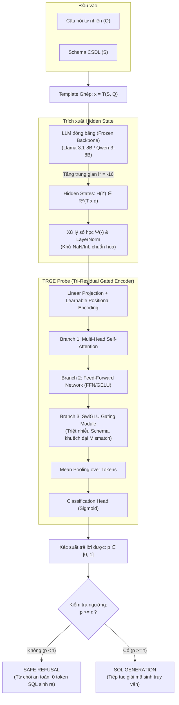

# LatentRefusal: Latent-Signal Refusal for Unanswerable Text-to-SQL Queries

| Thông tin | Chi tiết |
|---|---|
| **Tác giả** | Xuancheng Ren, Shijing Hu, Zhihui Lu* (Corresponding author), Jiangqi Huang, Qiang Duan |
| **Đơn vị** | Fudan University (Phục Đán) & Pennsylvania State University Abington College |
| **Năm / Venue** | 2026 / arXiv:2601.10398v3 [cs.AI], 14 Apr 2026 |
| **Loại bài** | Phương pháp & Hệ thống an toàn (Methodology & Safety Architecture) |
| **Chủ đề** | Text-to-SQL, Latent Representation Probing, Safe Refusal, Answerability Gating, Hallucination Prevention |
| **File gốc** | [LatentRefusal.pdf](../papers/LatentRefusal.pdf) |

## 1. Tóm tắt nhanh (TL;DR)
LatentRefusal đề xuất cơ chế an toàn tiền sinh mã (*pre-generation safety gate*) cho các hệ thống Text-to-SQL, cho phép quyết định từ chối trả lời (*refusal*) ngay từ các vector kích hoạt ẩn (*intermediate hidden states*) của LLM đóng băng mà không cần sinh hoặc thực thi bất kỳ câu lệnh SQL nào. Nhằm giải quyết đặc thù schema cơ sở dữ liệu chiếm dung lượng prompt quá lớn làm lu mờ các tín hiệu thiếu hụt thông tin, tác giả thiết kế bộ thăm dò chuyên biệt **TRGE (Tri-Residual Gated Encoder)** với nhánh SwiGLU-gating thứ ba để triệt tiêu nhiễu schema và khuếch đại sự bất tương thích giữa câu hỏi và cấu trúc bảng. Đạt F1 trung bình 88.5% trên Llama-3.1-8B và 88.8% trên Qwen-3-8B qua 4 benchmark, LatentRefusal chỉ tốn thêm ~2ms độ trễ (nhanh gấp 13.7 lần Semantic Entropy) và huấn luyện vỏn vẹn 10 phút trên 1 GPU A100.

## 2. Bối cảnh & Vấn đề nghiên cứu
- **Nguy cơ chí mạng của ảo giác trong Text-to-SQL:** Khác với bài toán hội thoại tự do (nơi ảo giác chỉ sinh ra câu chữ sai), trong Text-to-SQL ảo giác của LLM sinh ra **mã chương trình khả thi (executable programs)**. Khi gặp câu hỏi vô nghiệm (*unanswerable*) hoặc thiếu dữ kiện (*underspecified*), LLM vì tối ưu tính "hữu ích" (helpfulness) vẫn cố gắng sinh ra một câu SQL trông rất hợp lý; câu lệnh này thực thi trơn tru nhưng trả về kết quả sai lệch âm thầm, làm sai lệch báo cáo tài chính hoặc vi phạm nghiêm trọng an toàn dữ liệu.
- **Hạn chế của các giải pháp từ chối hiện nay:**
  1. *Prompt-based Refusal (Dựa trên chỉ dẫn văn bản):* Yêu cầu mô hình "hãy từ chối nếu không chắc chắn". Cách này rất giòn gãy (*brittle*), cực kỳ nhạy cảm với cách viết prompt và hoàn toàn tê liệt khi mô hình rơi vào trạng thái ảo giác tự tin (*confident hallucination*).
  2. *Uncertainty-based Refusal (Ước lượng độ bất định qua output):* Các kỹ thuật như Self-consistency, Semantic Entropy đòi hỏi sinh đa mẫu ($K=10$), gây độ trễ cực lớn. Nghiêm trọng hơn, việc đối chiếu tương đương ngữ nghĩa giữa các câu SQL thường đòi hỏi phải đem chạy thử vào CSDL (*query execution*)—điều này trực tiếp phá vỡ nguyên tắc an toàn (không được chạy mã độc hại/sai lệch).
- **Phát hiện nền tảng:** Trạng thái ẩn tại các tầng trung gian (*middle layers*) của LLM đã mã hóa đầy đủ tính nhất quán và bất định nhận thức (*epistemic uncertainty*) trước khi bị sụp đổ thành ảo giác tự tin ở tầng giải mã cuối cùng. Do đó, cần một chốt chặn an toàn can thiệp trực tiếp vào không gian biểu diễn ẩn trước khi sinh mã.

## 3. Phương pháp / Nội dung chính

### 3.1 Bài toán Cổng kiểm soát khả năng trả lời (Answerability-Gating)

LatentRefusal đặt ra 4 tiêu chí thiết kế khắt khe cho môi trường triển khai thực tế (như tài chính, y tế):
1. *Single-pass:* Chỉ cần 1 lượt lan truyền xuôi (*forward pass*) duy nhất qua LLM gốc đã đóng băng (không cần sinh thêm token).
2. *Pre-generation:* Ra quyết định từ chối trước khi token SQL đầu tiên được sinh ra.
3. *Execution-free:* Tuyệt đối không tương tác hay chạy thử truy vấn trên CSDL.
4. *Architecture-independent:* Áp dụng được cho bất kỳ LLM mã nguồn mở nào có quyền truy cập hidden state.

### 3.2 Bộ thăm dò TRGE (Tri-Residual Gated Encoder)
- **Thách thức:** Schema CSDL trong prompt rất dài (hàng trăm đến hàng nghìn tokens nhiễu), trong khi manh mối khiến câu hỏi không trả lời được (như một cột bị thiếu, một thực thể không tồn tại, một điều kiện join vô lý) lại cực kỳ cục bộ và thưa thớt (*sparse cues*). Bộ phân loại tuyến tính (*Linear Probe*) hoặc Transformer thông thường dễ bị chìm trong nhiễu schema.
- **Kiến trúc Tri-Residual:** Mỗi block TRGE bổ sung thêm nhánh phần dư thứ ba chứa cổng SwiGLU:
  $$\mathbf{U} = \mathbf{Z}^{(k-1)} + \text{Attn}(\text{LN}(\mathbf{Z}^{(k-1)}))$$
  $$\mathbf{V} = \mathbf{U} + \text{MLP}(\text{LN}(\mathbf{U}))$$
  $$\mathbf{Z}^{(k)} = \mathbf{V} + \text{SwiGLU}(\text{LN}(\mathbf{V}))$$
  Trong đó:
  $$\text{SwiGLU}(\mathbf{x}) = \mathbf{W}_d (\text{SiLU}(\mathbf{W}_g \mathbf{x}) \odot (\mathbf{W}_u \mathbf{x}))$$
- **Cơ chế hoạt động:** Nhánh SwiGLU đóng vai trò như một bộ lọc mềm (*soft feature selector*) phụ thuộc nội dung; nó dập tắt các biểu diễn khuôn mẫu lặp đi lặp lại của schema, đồng thời mở đường truyền trực tiếp tích lũy các đặc trưng bất tương thích (*question-schema mismatch*) qua các tầng probe mà không bị nhạt nhòa bởi phép trộn attention/MLP.

### 3.3 Thiết lập huấn luyện và Siêu tham số
- **Cấu hình TRGE:** 4 tầng probe, ẩn số $d=512$, feed-forward dimension 4096, SwiGLU intermediate dimension 2048, 8 attention heads, tổng số tham số chỉ **19M** (< 0.3% so với backbone 8B).
- **Hàm mất mát:** Binary Cross-Entropy kết hợp **Label Smoothing** ($\epsilon = 0.1$) giúp làm mượt biên quyết định và ngăn ngừa overconfidence.
- **Vị trí tầng trích xuất ($l^*$):** Tầng $-16$ (chính giữa mô hình 32 tầng của Llama/Qwen).
- **Thời gian huấn luyện:** Chỉ cần khoảng 300 mẫu gán nhãn, huấn luyện hoàn tất trong **10 phút** trên 1 GPU NVIDIA A100-80GB.

## 4. Thực nghiệm & Kết quả chính

### 4.1 Đánh giá trên 4 Benchmark Đa dạng
Nghiên cứu kiểm thử trên 4 bộ dữ liệu bao phủ các khía cạnh khác nhau của câu hỏi không thể trả lời:
1. `MD-Enterprise`: Benchmark công nghiệp thực tế gồm 6 lĩnh vực tài chính/doanh nghiệp (Cổ phiếu, Nhân sự, Cho vay, Bán lẻ, Kiểm soát rủi ro, Giám sát), nhãn do chuyên gia nghiệp vụ gắn.
2. `AMBROSIA`: Benchmark kiểm tra độ nhạy với câu hỏi mơ hồ ngữ nghĩa ngôn ngữ tự nhiên (linguistic ambiguity).
3. `SQuAD 2.0`: Đánh giá khả năng tổng quát hóa chéo tác vụ (từ Text-to-SQL sang Machine Reading Comprehension).
4. `TriageSQL`: Benchmark y tế với các câu hỏi Text-to-SQL chứa ý định không thể đáp ứng.

| Mô hình Backbone | Phương pháp | MD-Enterprise (F1 %) | AMBROSIA (F1 %) | SQuAD 2.0 (F1 %) | TriageSQL (F1 %) | **Trung bình F1 (%)** |
|---|---|---|---|---|---|---|
| **Llama-3.1-8B** | Semantic Entropy | 66.1 | 62.1 | 82.3 | 66.7 | 69.3 |
| | CCS (Unsupervised) | 53.1 | 54.1 | 62.6 | 62.9 | 58.2 |
| | Self-evaluation | 66.7 | 64.6 | 74.2 | 67.2 | 68.2 |
| | Eigenscore | 82.5 | 63.2 | 72.4 | 77.8 | 73.8 |
| | HaloScope | 97.0 | 73.7 | 66.1 | 82.8 | 79.9 |
| | TSV | 97.4 | 74.3 | 74.7 | 85.2 | 82.9 |
| | SAPLMA | 97.5 | 77.7 | 75.4 | 81.0 | 82.9 |
| | **LATENTREFUSAL (TRGE)** | **99.6** | **80.2** | **86.6** | **87.7** | **88.5** |
| **Qwen-3-8B** | Semantic Entropy | 72.7 | 58.0 | 82.4 | 66.6 | 70.0 |
| | Eigenscore | 80.0 | 59.1 | 70.0 | 77.8 | 71.7 |
| | TSV | 98.9 | 73.3 | 78.0 | 85.0 | 83.8 |
| | SAPLMA | 97.8 | 81.2 | 76.8 | 82.6 | 84.6 |
| | **LATENTREFUSAL (TRGE)** | **98.8** | **80.9** | **88.6** | **87.1** | **88.8** |
| *Black-box API* | **DeepSeek-Chat (Prompt)** | 97.2 | 70.3 | 87.4 | 77.8 | 83.2 |

### 4.2 Phân tích Hiệu năng & Độ trễ (Pareto Frontier)
- **Độ trễ cực thấp:** Trên Qwen-3-8B (GPU A100, bfloat16, seq len 2048):
  - Semantic Entropy ($N=10$ samples): **740 ms** (52ms $\times$ 10 + entropy calc).
  - CCS: 100 ms.
  - TSV / SAPLMA: 52–53 ms.
  - **LATENTREFUSAL:** **54 ms** (Forward pass 52 ms + TRGE probe **2.6 ms**).
  - Nhanh gấp **13.7 lần** so với Semantic Entropy trong khi F1 cao hơn gần 19 điểm phần trăm!
- **Khắc phục điểm yếu của phân tích phổ (Spectral Failure):** Eigenscore dựa vào sự biến thiên trị riêng qua nhiều lần lấy mẫu. Trong Text-to-SQL, LLM có thể sinh ra các câu SQL khác nhau về mặt cú pháp (`JOIN` order, alias) nhưng cùng ngữ nghĩa; sự đa dạng cú pháp này làm sai lệch ma trận hiệp phương sai khiến Eigenscore tưởng là mô hình đang phân vân. LatentRefusal giải quyết triệt để vì thăm dò trực tiếp biểu diễn bất tương thích prompt-schema, bất biến với chuỗi token giải mã.

### 4.3 Kết quả Ablation quan trọng
1. **Vai trò sống còn của nhánh Gating:**
   - TRGE hoàn chỉnh: **87.1% F1**.
   - Bỏ nhánh SwiGLU: giảm xuống 85.4% F1.
   - Thay SwiGLU bằng MLP thông thường: giảm xuống 83.0% F1.
   - Thay SwiGLU bằng Linear Probe: tụt dốc thảm hại xuống **70.4% F1** (chênh lệch tới **16.7%**). Chứng minh việc phát hiện mismatch đòi hỏi tương tác phi tuyến tính phức tạp.
2. **Vị trí tầng tối ưu (Layer Selection):**
   - Tầng $-16$ đạt F1 cao nhất (87.1%) và Recall gần như tuyệt đối (**99.8%**).
   - Tầng cuối cùng ($-1$) có Recall tụt xuống 99.0% và F1 còn 86.5%. Điều này xác thực giả thuyết cơ chế nội tại (*mechanistic interpretability*): sự nghi ngờ về tính không thể trả lời xuất hiện rõ nhất ở tầng giữa, sau đó bị "xóa nhòa" thành ảo giác tự tin khi tiến gần tới tầng output.
3. **Độ sâu Probe:** 4 tầng cho kết quả tối ưu (87.1% F1, 19M params, 2.6ms). Dưới 4 tầng bị underfitting, trên 4 tầng (8–12 tầng) bị overfitting trên tập train nhỏ.

## 5. Tính mới (Novelty & Đóng góp)
- **Định hình lại bài toán Safe Refusal trong Text-to-SQL:** Chuyển từ bài toán tuân thủ chỉ dẫn ở tầng output (output-level instruction following) sang **bài toán cổng phân loại biểu diễn nội tại tiền sinh mã (pre-generation latent-signal gating)**.
- **Kiến trúc TRGE tiên phong:** Thiết kế khối Transformer 3 nhánh phần dư (Tri-Residual) với cơ chế SwiGLU-gating giải quyết bài toán cốt lõi của Text-to-SQL: dập nhiễu schema dài hàng nghìn token và khuếch đại manh mối thiếu hụt cục bộ.
- **Bảo toàn tính an toàn tuyệt đối trước khi chạy mã:** Loại bỏ hoàn toàn nhu cầu chạy thử SQL hoặc sinh chuỗi token để đo entropy, ngăn chặn triệt để rủi ro rò rỉ dữ liệu hoặc phá hỏng CSDL.
- **Tính khả thi triển khai công nghiệp cực cao:** Probe chỉ 19M tham số, overhead 2ms, chỉ cần 300 mẫu gán nhãn và 10 phút fine-tuning trên 1 GPU để chuyển giao sang miền dữ liệu doanh nghiệp mới.

## 6. Hạn chế

### 6.1 Hạn chế do tác giả thừa nhận
- **Khả năng tổng quát hóa zero-shot xuyên miền (Cross-domain generalization):** Probe hiện tại cần được fine-tune thích ứng cho từng miền triển khai cụ thể (cần ~300 mẫu của miền đó) chứ chưa đạt mức "universal probe" cắm vào mọi CSDL lạ mà không cần học lại.
- **Yêu cầu quyền truy cập White-box:** Phương pháp bắt buộc phải trích xuất được hidden activations của mô hình, không thể áp dụng cho các mô hình đóng hoàn toàn chỉ qua Black-box API (như GPT-4o hay Claude Sonnet).

### 6.2 Nhận xét thêm của người review
- **Khó khăn với lỗi ngữ nghĩa cận kề (Semantic Near-Misses):** Như tác giả đề cập trong error analysis, khi một cột bị thiếu nhưng CSDL lại có một cột khác mang tên gần tương tự (ví dụ hỏi `gross_profit` nhưng schema chỉ có `revenue`), probe đôi khi bị đánh lừa là đã tìm thấy cột phù hợp.
- **Hạn chế với các truy vấn suy luận đa bước phức tạp (Deep Reasoning Chains):** Với các câu hỏi đòi hỏi join qua 4–5 bảng trung gian phức tạp, tín hiệu mismatch ở tầng $-16$ có thể chưa hội tụ đủ rõ ràng so với các câu hỏi thiếu cột trực tiếp.
- **Chưa kết hợp cơ chế phản hồi giải thích (Clarification/Explanation):** Gating hiện tại chỉ đưa ra nhãn nhị phân (chấp nhận sinh SQL hoặc từ chối). Sẽ hoàn hảo hơn nếu probe chỉ điểm được chính xác token/thực thể nào trong câu hỏi bị thiếu để sinh câu hỏi làm rõ (clarification question) cho người dùng.

## 7. Ý nghĩa ứng dụng (cho hệ thống agent phân tích dữ liệu / Text-to-SQL)
- **Kiến trúc chốt chặn an toàn (Pre-generation Guardrail) lý tưởng:** Đây là mô hình chuẩn mực để nhúng vào pipeline Text-to-SQL tự vận hành (*autonomous data agents*). Trước khi để LLM tốn thời gian và token sinh mã, một probe siêu nhẹ 2ms sẽ gác cổng để chặn đứng mọi truy vấn rác, truy vấn ngoài phạm vi CSDL hoặc truy vấn mơ hồ.
- **Tiết kiệm tài nguyên hạ tầng:** Thay vì để LLM sinh cả câu SQL dài rồi sau đó bộ parser mới phát hiện lỗi cú pháp/lỗi schema, việc ngắt sớm (*early-exit*) giúp tiết kiệm tới 90% chi phí suy luận đối với các câu truy vấn không hợp lệ trong môi trường doanh nghiệp.
- **Phương pháp luận khai thác tầng ẩn (Middle-layer inspection):** Khẳng định bài học quan trọng cho kỹ nghệ agent: không nên chỉ tin vào văn bản output của LLM. Tầng ẩn trung gian (layer -16) là nơi chứa sự thật trung thực nhất về tri thức của mô hình trước khi bị lớp căn chỉnh (RLHF/DPO) ép sinh câu trả lời tự tin giả tạo.
- **Chiến lược fine-tune domain giá rẻ:** Doanh nghiệp có thể dễ dàng xây dựng bộ lọc an toàn cho CSDL nội bộ chỉ với vài trăm câu hỏi mẫu và 10 phút huấn luyện trên GPU văn phòng mà không làm ảnh hưởng hay làm "quên" năng lực của LLM nền tảng.

## 8. Từ khóa
`LatentRefusal`, `Text-to-SQL`, `Unanswerable Queries`, `Representation Probing`, `Tri-Residual Gated Encoder (TRGE)`, `SwiGLU Gating`, `Safety Gate`, `Hidden Activations`, `Hallucination Prevention`, `Selective Classification`