# MiMoTable: A Multi-scale Spreadsheet Benchmark with Meta Operations for Table Reasoning

| Thông tin | Chi tiết |
|---|---|
| **Tác giả** | Zheng Li*, Yang Du*, Mao Zheng*, Mingyang Song* (*Đồng tác giả thứ nhất) |
| **Đơn vị** | Tencent Hunyuan |
| **Năm / Venue** | arXiv:2412.11711v2 [cs.CL] (24/12/2024; bản đầu 16/12/2024). Hội nghị chính thức: Không nêu rõ trong văn bản |
| **Loại bài** | Benchmark / Dataset & Taxonomy (Bộ dữ liệu bảng tính thực tế + Khung phân loại thao tác nguyên tử) |
| **Chủ đề** | Table Reasoning, Spreadsheets (.xlsx), Hierarchical Headers, Multi-Sheet / Multi-File, Meta Operations, Code Interpreter vs. Text Prompting |
| **File gốc** | [MiMoTable.pdf](../papers/MiMoTable.pdf) |

## 1. Tóm tắt nhanh (TL;DR)
MiMoTable là một benchmark bảng tính đa tỷ lệ (multi-scale spreadsheet benchmark) gồm 428 file Excel thực tế từ 7 lĩnh vực (kiến trúc, tài chính, văn phòng, giáo dục, kế toán, thương mại điện tử, sản xuất) với 1.719 bộ câu hỏi–đáp được chuyên gia kiểm duyệt, mô phỏng cấu trúc phức tạp thực tế: tiêu đề phân cấp (hierarchical headers), nhiều sheet, nhiều file, và nhiều bảng trên cùng một sheet. Bài báo cũng đề xuất một hệ thống phân loại độ khó khách quan dựa trên 6 thao tác nguyên tử (**Meta Operations**: Lookup, Edit, Calculate, Compare, Visualize, Reasoning). Thực nghiệm trên 16 LLM cho thấy mô hình mạnh nhất là Claude-3.5-Sonnet chỉ đạt **77.4%** độ chính xác, trong khi các LLM mã nguồn mở hàng đầu đều dưới 60%, phản ánh khoảng cách rất lớn giữa các benchmark học thuật đơn giản và bài toán bảng tính thực tế.

## 2. Bối cảnh & Vấn đề nghiên cứu
- **Sự lệch pha giữa benchmark học thuật và bảng tính thực tế:**
  1. Đa số các benchmark suy luận bảng hiện có (WikiTableQuestions, WikiSQL, FeTaQA, ToTTo, DAEval...) chỉ sử dụng các bảng phẳng đơn giản, một sheet duy nhất và tiêu đề đơn dòng. Ngược lại, bảng tính doanh nghiệp (Excel) thường chứa tiêu đề phân cấp lồng nhau (merged/hierarchical headers), nhiều sheet liên kết, hoặc nhiều bảng rời rạc nằm chung trong một sheet.
  2. Các benchmark trước đây phân chia theo tác vụ lớn (TableQA, Table2Text, Table Manipulation, Advanced Data Analysis) nhưng không định lượng được sự chênh lệch độ khó giữa các câu hỏi trong cùng một tác vụ (ví dụ WikiSQL đơn giản hơn WikiTableQuestions dù cùng là TableQA).
- **Hạn chế trong đánh giá năng lực LLM:** Thiếu một hệ thống thao tác cơ bản (atomic operations) để đo lường chính xác điểm mạnh/yếu của mô hình (ví dụ: mô hình yếu ở khâu tra cứu vị trí, tính toán số học, hay suy luận logic ngầm).

## 3. Phương pháp / Nội dung chính

```mermaid
flowchart LR
    subgraph Collection["1. Thu thập Bảng tính Thực tế"]
        RAW["428 Spreadsheets (.xlsx) từ Internet<br>(Baidu Wenku & Google)"] --> CAT["Phân loại theo 4 chiều:<br>Header, Sheet num, File num, Table num"]
        CAT --> DIFF["3 Mức độ khó Bảng:<br>Simple (33.6%), Medium (32.5%), Hard (33.9%)"]
    end

    subgraph Generation["2. Xây dựng Câu hỏi & Thao tác"]
        DIFF --> Q_GEN["GPT-4o sinh câu hỏi theo 6 Meta Operations"]
        Q_GEN --> META["6 Meta Operations:<br>Lookup, Edit, Calculate, Compare, Visualize, Reasoning"]
        META --> FORMULA["Công thức tính Điểm độ khó câu hỏi qs in [1, 4]"]
    end

    subgraph Validation["3. Sinh Lời giải & Kiểm định"]
        FORMULA --> SOL_GEN["GPT-4o + Code Interpreter (Python Sandbox)<br>Sinh câu trả lời (Text / Excel / Charts)"]
        SOL_GEN --> HUMANS["10 Chuyên gia phân tích dữ liệu rà soát 2 lần<br>(Độ đồng thuận Cohen's Kappa = 0.83)"]
        HUMANS --> FINAL_DS["MiMoTable Benchmark<br>(1,719 triplets hoàn chỉnh)"]
    end

    Collection --> Generation --> Validation
```

### 3.1 Phân loại Cấu trúc và Độ khó Bảng tính (Table Difficulty)
Bảng tính được phân loại theo 4 chiều: Loại tiêu đề (simple vs. complex header), Số sheet (single vs. multiple), Số file (single vs. multiple), và Số bảng trên 1 sheet (single vs. multiple):
- **Simple Table (33.6%):** File đơn + 1 sheet + tiêu đề đơn (144 bảng).
- **Medium Table (32.5%):** Gồm các bảng có nhiều sheet với tiêu đề đơn (30 bảng), nhiều file với tiêu đề đơn (37 bảng), hoặc 1 sheet nhưng tiêu đề phức tạp/phân cấp (72 bảng).
- **Hard Table (33.9%):** Gồm nhiều sheet với tiêu đề phức tạp (63 bảng), nhiều file với tiêu đề phức tạp (32 bảng), hoặc nhiều bảng nằm chung trong 1 sheet (50 bảng).

### 3.2 Khung phân loại 6 Meta Operations và Điểm độ khó
Bài báo định nghĩa 6 thao tác nguyên tử không trùng lặp, chia làm 3 cấp độ (Grade):
- **Grade 1 (Định vị & Thao tác cơ bản):**
  - `Lookup`: Định vị vị trí của mục tiêu cụ thể.
  - `Edit`: Chỉnh sửa, xóa, thêm mới hoặc đổi định dạng (highlight).
- **Grade 2 (Thao tác logic & Số học):**
  - `Calculate`: Tính toán số học (SUM, AVG, COUNT, MAX, MIN...).
  - `Compare`: So sánh từ hai mục tiêu trở lên trong bảng.
  - `Visualize`: Chuyển đổi dữ liệu thành biểu đồ trực quan (line chart, bar chart...).
- **Grade 3 (Suy luận nâng cao):**
  - `Reasoning`: Suy luận thông tin ngầm từ nội dung bảng mà không được nêu rõ ràng trực tiếp.

**Công thức tính điểm độ khó câu hỏi $qs_i \in [1, 4]$:**
$$qs_i = ms_{q_i} + \frac{\sum_{k=1}^{K_i} s_k - ms_{q_i}}{M_{ms_{q_i}}}$$
Trong đó $ms_{q_i} = \max(S_{q_i})$ là cấp độ khó nhất của các thao tác trong câu hỏi; $M_1=1, M_2=6, M_3=8$ là giá trị tối đa có thể đạt được của các thao tác còn lại; và điểm độ khó trung bình của toàn bộ dataset $ds$ là trung bình cộng của tất cả $qs_i$.

### 3.3 Quy trình xây dựng dữ liệu nghiêm ngặt
1. **Thu thập và Ẩn danh hóa:** Thu thập 428 file .xlsx từ 7 lĩnh vực (kiến trúc 23%, giáo dục 16%, sản xuất 16%, văn phòng 15%, thương mại điện tử 11%, tài chính 10%, kế toán 9%). Toàn bộ thông tin định danh cá nhân (tên, số điện thoại, địa chỉ) đều được làm mờ (masked) và sinh lại ngẫu nhiên; đồng thời được kiểm định bởi chuyên gia pháp lý.
2. **Sinh câu hỏi:** Trích xuất bảng sang markdown, dùng GPT-4o sinh câu hỏi theo các tổ hợp meta operations đa dạng (yêu cầu phân tích xuyên sheet/xuyên file nếu có).
3. **Sinh đáp án và Thẩm định con người:** GPT-4o kết hợp Code Interpreter (chạy mã Python trong sandbox) để tạo đáp án (kể cả sinh file Excel đã sửa hoặc biểu đồ chart). Loại bỏ các mẫu mã lỗi hoặc kết quả không nhất quán qua nhiều lần inference. Cuối cùng, 10 chuyên gia phân tích dữ liệu (5 bản ngữ tiếng Trung, 5 bản ngữ tiếng Anh) độc lập dán nhãn lại toàn bộ; hệ số thỏa thuận liên chuyên gia đạt **Cohen's Kappa 0.83**.

## 4. Thực nghiệm & Kết quả chính

### 4.1 Thiết lập thực nghiệm
- **16 Mô hình đánh giá:**
  - *Closed-source:* Claude-3.5-Sonnet, GPT-4o (TXT và Code Interpreter), Gemini-1.5-Pro.
  - *Open-source:* Llama-3.1 (70B, 8B), Llama-3 (70B, 8B), Qwen2 (72B, 7B), Qwen1.5 (72B, 14B, 7B), Mistral-7B, DeepSeek-Coder-7B, Gemma-7B.
  - *Tabular-specific:* Tablellama (7B).
- **Metric:** Accuracy (chấm điểm bằng GPT-4o đối chiếu với câu trả lời chuẩn của chuyên gia; các câu hỏi mở được chấm điểm liên tục từ 0 đến 1).
- **Phương thức nhập:** Biểu diễn markdown (Text-based) cho hầu hết các mô hình; và nạp trực tiếp file Excel kết hợp Code Interpreter (GPT-4o-CI).

### 4.2 Bảng kết quả tổng hợp (Table 6)

| Mô hình | Tổng thể | Tiếng Anh | Tiếng Trung | Bảng Simple | Bảng Medium | Bảng Hard | Lookup | Compare | Calculate | Reasoning |
|---|---|---|---|---|---|---|---|---|---|---|
| **Claude-3.5-Sonnet** | **77.4%** | **79.0%** | 76.2% | **81.3%** | **75.5%** | **72.1%** | **89.0%** | **79.7%** | **76.1%** | **63.3%** |
| GPT-4o-CI (Code Interp.) | 69.2% | 70.8% | 68.1% | 81.7% | 67.1% | 50.8% | 81.0% | 73.1% | 70.6% | 45.8% |
| GPT-4o-TXT (Markdown) | 69.0% | 69.3% | 68.8% | 73.8% | 66.2% | 62.1% | 85.1% | 73.1% | 64.5% | 53.9% |
| Gemini-1.5-Pro | 60.2% | 61.6% | 59.1% | 64.9% | 57.4% | 55.3% | 86.1% | 60.3% | 50.2% | 47.6% |
| Llama-3.1-70B-Instruct | 57.0% | 56.6% | 57.3% | 64.0% | 51.6% | 51.3% | 82.0% | 57.7% | 48.8% | 45.1% |
| Qwen2-72B-Instruct | 55.7% | 51.5% | **58.8%** | 61.4% | 52.6% | 49.2% | 80.4% | 56.3% | 45.5% | 46.9% |
| Llama-3-70B-Instruct | 53.7% | 52.3% | 54.8% | 60.1% | 48.6% | 48.5% | 78.9% | 51.5% | 44.4% | 46.1% |
| Qwen1.5-72B-Chat | 47.5% | 46.1% | 48.5% | 51.6% | 45.1% | 43.2% | 75.2% | 42.7% | 40.1% | 37.5% |
| Llama-3.1-8B-Instruct | 44.1% | 44.0% | 44.2% | 49.0% | 43.3% | 36.4% | 70.0% | 41.0% | 35.6% | 34.9% |
| Qwen2-7B-Instruct | 41.6% | 40.5% | 42.4% | 45.6% | 40.7% | 35.5% | 70.9% | 35.8% | 32.4% | 35.1% |
| Qwen1.5-14B-Chat | 40.2% | 38.6% | 41.3% | 44.1% | 38.4% | 35.3% | 73.8% | 32.2% | 30.9% | 28.9% |
| Llama-3-8B-Instruct | 39.9% | 39.8% | 40.0% | 45.0% | 37.0% | 34.4% | 68.4% | 36.1% | 31.6% | 27.5% |
| Mistral-7B-Instruct-v0.3 | 35.2% | 35.2% | 35.1% | 40.5% | 31.6% | 30.1% | 71.7% | 25.0% | 23.4% | 27.2% |
| Qwen1.5-7B-Chat | 34.4% | 33.6% | 35.0% | 40.1% | 29.9% | 29.7% | 69.3% | 24.8% | 22.9% | 28.3% |
| Deepseek-Coder-7B-v1.5 | 34.1% | 33.9% | 34.2% | 38.4% | 33.0% | 27.6% | 68.4% | 22.7% | 24.2% | 26.5% |
| Gemma-7B-Instruct | 23.3% | 20.6% | 25.3% | 28.7% | 18.2% | 19.9% | 48.2% | 13.5% | 14.9% | 22.9% |
| Tablellama (7B chuyên bảng) | 21.1% | 23.9% | 19.1% | 25.4% | 20.0% | 14.9% | 45.4% | 15.5% | 14.4% | 9.9% |

### 4.3 Phát hiện & Phân tích chuyên sâu

1. **Text-based vs. Code-based (Code Interpreter) trên Bảng phức tạp:**
   - So sánh GPT-4o-CI và GPT-4o-TXT mang lại phát hiện mang tính bước ngoặt:
     - Trên bảng **Simple/Medium**: GPT-4o-CI áp đảo ở các bài toán tính toán số học (`Calculate`: 70.6% vs 64.5%) và so sánh (`Compare`: 73.1% vs 73.1%).
     - Trên bảng **Hard**: GPT-4o-CI sụp đổ nghiêm trọng, độ chính xác giảm xuống chỉ còn **50.8%**, thấp hơn nhiều so với GPT-4o-TXT (**62.1%**).
     - *Nguyên nhân:* Với bảng có cấu trúc phức tạp (tiêu đề phân cấp lồng nhau, nhiều bảng trong 1 sheet), mô hình không thể viết mã Python thư viện pandas để định vị đúng hàng/cột (chỉ mục index bị sai lệch hoàn toàn). Trong khi đó, cách tiếp cận Text-based đưa bảng markdown vào context giúp LLM "quan sát toàn cục" và suy luận vị trí tốt hơn.
2. **Sự thất bại của các Tabular LLM hiện có:**
   - Tablellama chỉ đạt 21.1%, thua cả các LLM đa năng 7B thông thường, do mô hình này bị "overfit" với các bảng học thuật chuẩn mực có tiêu đề đơn giản; khi gặp bảng thực tế có tiêu đề phân cấp và merged cells thì hoàn toàn mất khả năng phân tích.
3. **Mối tương quan nghịch giữa Điểm độ khó Meta Operations và Hiệu năng:**
   - Tác giả chấm điểm độ khó khách quan cho 3 dataset: WikiSQL (1.5) $\rightarrow$ WikiTableQuestions (2.0) $\rightarrow$ MiMoTable-Simple (2.2).
   - Đường cong độ chính xác của tất cả các mô hình (Claude-3.5, GPT-4o, Gemini, Llama3) đều giảm tuyến tính đều đặn khi độ khó $ds$ tăng lên (Figure 10), chứng minh công thức độ khó Meta Operations là một thước đo đánh giá định lượng khoa học và tổng quát hóa cao.

## 5. Tính mới (Novelty & Đóng góp)
1. **Benchmark Bảng tính thực tế đa tỷ lệ đầu tiên (Multi-scale Spreadsheets):** Vượt ra khỏi các bảng Wikipedia phẳng, MiMoTable là tập dữ liệu đầu tiên tích hợp đầy đủ các đặc trưng phức tạp của Excel doanh nghiệp: tiêu đề phân cấp, đa sheet, đa file, và đa bảng/sheet, bao phủ trọn vẹn cả 4 tác vụ lớn của Table Reasoning.
2. **Khung phân loại Meta Operations định lượng:** Đề xuất hệ thống 6 thao tác nguyên tử kèm công thức toán học tính điểm độ khó khách quan cho từng câu hỏi và toàn bộ benchmark, khắc phục hạn chế phân loại định tính theo tác vụ truyền thống.
3. **Phát hiện quan trọng về ranh giới Code Interpreter vs. Text Prompting:** Làm rõ thực tế rằng Code Interpreter không phải là "chìa khóa vạn năng"; trên bảng phức tạp, khả năng định vị chỉ mục của code pandas bị tê liệt và phương pháp văn bản trực quan lại chiếm ưu thế.
4. **Bộ tài nguyên đánh giá mở:** Cung cấp 1.719 bộ câu hỏi–đáp song ngữ (Anh–Trung) có thẩm định pháp lý và chuyên gia, kèm mã nguồn mở phân tích.

## 6. Hạn chế

### 6.1 Hạn chế do tác giả thừa nhận
- **Chưa thử nghiệm Supervised Fine-Tuning (SFT):** Nghiên cứu mới dừng lại ở đánh giá zero-shot các LLM nền tảng; chưa huấn luyện chuyên sâu mô hình trên tập dữ liệu này để kiểm tra tiềm năng cải thiện theo từng meta operation.
- **Dùng chung một prompt chuẩn:** Tất cả các mô hình tổng quát đều được kiểm thử trên cùng một mẫu prompt markdown, chưa tối ưu prompt riêng theo phong cách nhận thức của từng mô hình.
- **Chưa khảo sát Context cực dài:** Kích thước bảng trong tập dữ liệu mới ở mức vừa và trung bình; chưa mở rộng lên các bảng tính hàng chục nghìn dòng cần năng lực Long-context reasoning.

### 6.2 Nhận xét thêm của người review
- **Kích thước mẫu tương đối nhỏ:** 428 file bảng tính và 1.719 câu hỏi là quy mô phù hợp cho mục đích đánh giá (benchmark), nhưng chưa đủ lớn để dùng làm tập huấn luyện (training set) diện rộng cho các mô hình nền tảng bảng tính.
- **Phương pháp chuyển đổi Markdown làm mất định dạng gốc:** Việc chuyển đổi bảng tính phức tạp thành bảng markdown phẳng vô tình làm biến dạng các ô hợp nhất (merged cells) và liên kết cấu trúc cha–con, gây bất lợi cho các LLM không có khả năng thị giác (Vision-LLMs) hoặc không đọc trực tiếp file XML của bảng tính.

## 7. Ý nghĩa ứng dụng (cho hệ thống agent phân tích dữ liệu / Text-to-SQL)
- **Thiết kế cơ chế lai (Hybrid Engine) cho Trợ lý Bảng tính:** Không nên chỉ dựa vào một phương thức thực thi duy nhất (Code Interpreter). Hệ thống agent thông minh cần: dùng Text-based reasoning để phân tích cấu trúc tiêu đề phức tạp và xác định tọa độ vùng dữ liệu trước, sau đó mới gọi Code Interpreter để thực hiện các phép tính số học nặng (`Calculate`).
- **Phân tách nhiệm vụ của Agent theo Meta Operations:** Thay vì một prompt chung chung "hãy phân tích bảng này", agent phân tích dữ liệu có thể bóc tách câu hỏi người dùng thành chuỗi hành động nguyên tử (ví dụ: `Lookup` vùng dữ liệu $\rightarrow$ `Compare` giữa các chi nhánh $\rightarrow$ `Calculate` tốc độ tăng trưởng $\rightarrow$ `Visualize` ra biểu đồ).
- **Bộ kiểm thử năng lực thực tế cho Agent doanh nghiệp:** MiMoTable là thước đo tiêu chuẩn để kiểm tra tính sẵn sàng của các trợ lý AI trước khi tích hợp vào các phòng ban nghiệp vụ xử lý bảng tính Excel nội bộ (kế toán, tài chính, kiểm toán).

## 8. Từ khóa
`MiMoTable`, `Table Reasoning`, `Spreadsheets`, `Excel Analysis`, `Meta Operations`, `Hierarchical Headers`, `Multi-Sheet`, `Table Difficulty`, `Code Interpreter`, `Claude-3.5-Sonnet`, `Benchmark`
