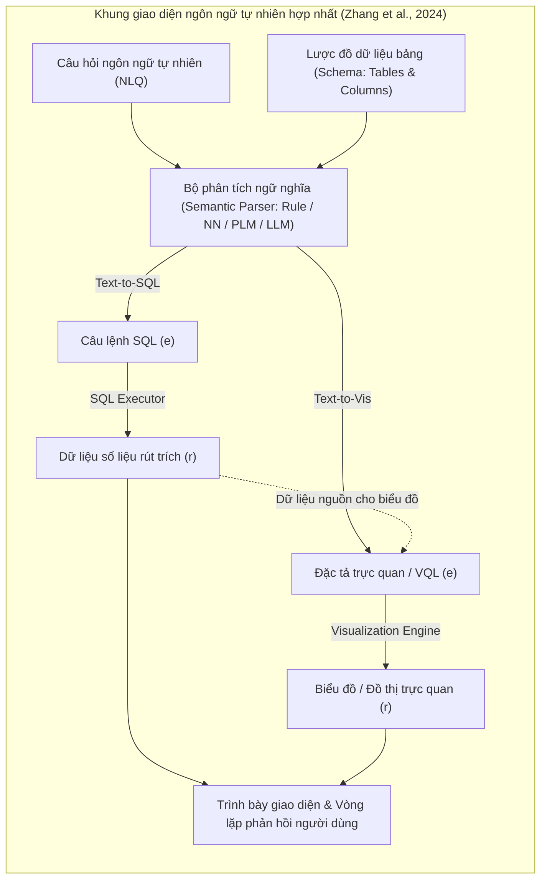

# Natural Language Interfaces for Tabular Data Querying and Visualization: A Survey

| Thông tin | Chi tiết |
|---|---|
| **Tác giả** | Weixu Zhang, Yifei Wang, Yuanfeng Song, Victor Junqiu Wei, Yuxing Tian, Yiyan Qi, Jonathan H. Chan, Raymond Chi-Wing Wong, Haiqin Yang* (*tác giả liên hệ) |
| **Đơn vị** | IDEA (Shenzhen), Xi'an Jiaotong University, Univ. of Toronto, WeBank, HKUST, KMUTT |
| **Năm / Venue** | 2024 (cập nhật v2 tháng 5/2024), IEEE Transactions on Knowledge and Data Engineering (TKDE), arXiv:2310.17894 [cs.CL] |
| **Loại bài** | Survey (Tổng quan) |
| **Chủ đề** | Natural Language Interfaces (NLI), Text-to-SQL, Text-to-Visualization (Text-to-Vis), Semantic Parsing, Large Language Models, System Architecture, User-Centric Design |
| **File gốc** | [Natural Language Interfaces for Tabular Data Querying and Visualization.pdf](../papers/Natural%20Language%20Interfaces%20for%20Tabular%20Data%20Querying%20and%20Visualization.pdf) |

## 1. Tóm tắt nhanh (TL;DR)
Khảo sát trên IEEE TKDE là công trình đầu tiên hợp nhất hai bài toán cốt lõi trong tương tác dữ liệu bảng: Truy vấn dữ liệu (Text-to-SQL) và Trực quan hóa dữ liệu (Text-to-Vis) dưới lăng kính phân tích ngữ nghĩa (semantic parsing). Tác giả hệ thống hóa toàn bộ tiến trình phát triển từ các hệ thống truyền thống dựa trên tập luật, mạng nơ-ron sâu đến mô hình nền tảng (PLM và LLM), đồng thời phân tích chi tiết các bộ dữ liệu, độ đo đánh giá, 4 mô hình kiến trúc hệ thống và hướng dẫn lựa chọn giải pháp định hướng theo người dùng (User-centric analysis).

## 2. Bối cảnh & Vấn đề nghiên cứu
- **Bối cảnh**: Dữ liệu có cấu trúc (bảng/CSDL) là xương sống của mọi phân tích kinh doanh, y tế và khoa học. Tuy nhiên, việc trích xuất và hiển thị dữ liệu đòi hỏi kiến thức chuyên môn sâu về ngôn ngữ SQL và các thư viện đồ họa (Vega-Lite, D3.js, Matplotlib). Giao diện ngôn ngữ tự nhiên (NLI) như tính năng Q&A trong Microsoft Power BI hay Ask Data trong Tableau đang thay đổi căn bản cách người dùng tương tác với dữ liệu.
- **Tính gắn kết giữa Truy vấn và Trực quan hóa**: Trong thực tế phân tích dữ liệu, hai tác vụ này không tách rời: truy vấn SQL là bước tiền đề để rút trích tập dữ liệu con cần thiết, sau đó đặc tả trực quan (visualization specification) được tạo ra để vẽ biểu đồ tương ứng nhằm sinh báo cáo tổng hợp.
- **Khoảng trống của các khảo sát trước**: Các bài tổng quan trước đây thường tách biệt hoàn toàn giữa Text-to-SQL (cộng đồng CSDL/NLP) và Text-to-Vis (cộng đồng HCI/Visualization), thiếu một góc nhìn thống nhất dưới cùng một bài toán phân tích cú pháp ngữ nghĩa (semantic parsing). Ngoài ra, tác động mang tính đột phá của các LLM thế hệ mới (ChatGPT, CodeX, PaLM-2) đối với luồng công việc hợp nhất này vẫn chưa được tổng kết thấu đáo.

## 3. Phương pháp / Nội dung chính
Khảo sát định nghĩa bài toán phân tích ngữ nghĩa tổng quát: Cho đầu vào $x = \{q, s\}$ gồm câu hỏi ngôn ngữ tự nhiên $q$ và lược đồ dữ liệu $s$ (các bảng $T$ và cột $C$), bộ phân tích cú pháp $P$ dịch $q$ thành biểu diễn chức năng $e$ (functional expression), sau đó công cụ thực thi $E$ chạy $e$ trên CSDL $D$ để trả về kết quả $r$:
$$E(e, D) \to r$$
- Trong **Text-to-SQL**: $e$ là câu truy vấn SQL; $r$ là tập dữ liệu bảng/bản ghi.
- Trong **Text-to-Vis**: $e$ là đặc tả trực quan hóa (Vega-Lite, VQL - Visual Query Language); $r$ là biểu đồ đồ họa (cột, đường, tròn, phân tán...).

### 3.1 Ba giai đoạn tiến hóa của Text-to-SQL và Text-to-Vis (Figure 4 & Table 2)
1. **Giai đoạn truyền thống (Traditional Stage - trước 2016)**:
   - *Text-to-SQL*: Hệ thống dựa trên luật (CHAT-80, TEAM, PRECISE, NaLIR, ATHENA, SQLizer). Tận dụng ontology hoặc cây ngữ pháp trung gian; chính xác trong phạm vi hẹp nhưng cực kỳ nhạy cảm với cách diễn đạt của người dùng.
   - *Text-to-Vis*: Dựa trên mẫu (template-based) và widget giao diện (DataTone xử lý nhập nhằng bằng widget; ADVISor; NL4DV sinh JSON analytic specs).
2. **Giai đoạn Mạng nơ-ron sâu (Neural Network Stage - 2016–2021)**:
   - *Bộ mã hóa (Encoders)*:
     - Dạng chuỗi (Sequence-based): Bi-LSTM (SQLNet, TypeSQL, IncSQL, EditSQL; Seq2Vis, MMCoVisNet) và Transformer tự chú ý (ncNet).
     - Dạng đồ thị (Graph-based): GNN, Global-GNN, RAT-SQL (quan hệ tương quan chú ý giữa từ và bảng/cột), LGESQL, S²SQL, RGVisNet (kết hợp AST graph của VQL với LSTM của NLQ).
   - *Bộ giải mã (Decoders)*:
     - Đơn khối (Monolithic): RNN/LSTM sinh token tuần tự (Seq2Vis).
     - Khung phác thảo (Skeleton-based): Điền vào chỗ trống theo sketch định sẵn (SQLNet, HydraNet, RYANSQL).
     - Cú pháp ngữ pháp (Grammar-based): Sinh cây cú pháp trừu tượng (Seq2AST, SyntaxSQLNet, IRNet/SemQL, NatSQL, PICARD). RGVisNet áp dụng cấu trúc ngữ pháp SemSQL sang VQL.
     - Định hướng thực thi (Execution-based): Suhr et al., SQLova loại bỏ nhánh sinh lỗi cú pháp ngay trong quá trình giải mã.
3. **Giai đoạn Mô hình ngôn ngữ nền tảng (Foundation Language Models - 2019–nay)**:
   - *PLM-based*: Encoder-only (BERT, RoBERTa, BRIDGE, X-SQL); Encoder-Decoder (T5, UnifiedSKG, Graphix-T5, RESDSQL đạt 80.5% EM trên Spider dev); Tiền huấn luyện bổ trợ với dữ liệu bảng (TaBERT, GraPPa, GAP).
   - *LLM-based*:
     - Zero-shot Prompting: Khảo sát của Rajkumar et al., Liu et al.; C3 (kết hợp clear prompt, calibration hints và output consistency); ZERoNL2SQL (kết hợp sketch từ PLM với suy luận của LLM); Chat2VIS cho trực quan hóa.
     - Few-shot Prompting: DIN-SQL (phân rã 4 bước), Divide-and-Prompt, SC-Prompt, Prompt4Vis (đạt 52.69% accuracy trên nvBench bằng ICL).

### 3.2 Phân tích Kiến trúc hệ thống và Thiết kế hướng người dùng (Section 5.3 & 5.4, Table 4)
Khảo sát phân loại toàn bộ hệ thống thành 4 mô hình kiến trúc:
1. **Rule-based System (NaLIR, PRECISE; DataTone)**: Ánh xạ cứng các mẫu câu; bền vững và nhất quán cho truy vấn quen thuộc, nhưng thiếu khả năng mở rộng.
2. **Parsing-based System (SQLova, Seq2Tree; ncNet)**: Chú trọng cấu trúc ngữ pháp ngôn ngữ học; nắm bắt ngữ nghĩa sâu nhưng dễ vấp khi câu hỏi mơ hồ.
3. **Multi-stage System (DIN-SQL; DeepEye)**: Chia nhỏ thành pipeline nhiều chặng (lọc schema, phân loại, sinh mã, kiểm tra); độ chính xác và tính linh hoạt cao nhất nhưng độ phức tạp và chi phí đồng bộ lớn.
4. **End-to-end System (Photon, VoiceQuerySystem; Sevi, DeepTrack)**: Một bước duy nhất từ câu hỏi (hoặc giọng nói) ra kết quả; thích ứng cao, độ trễ thấp nhưng khó giải thích và debug.

*Khuyến nghị theo nhóm người dùng (User-Centric Recommendations)*:
- **Người dùng cơ bản (Basic Users)**: Ưu tiên hệ thống *Rule-based* trong phạm vi tác vụ cố định vì tính dễ hiểu; hoặc hệ thống *End-to-end* khi cần sự linh hoạt, không phải cấu hình tham số.
- **Chuyên gia / Doanh nghiệp (Professional Users)**: Ưu tiên hệ thống *Multi-stage* khi phải xử lý CSDL phức tạp nhiều tầng; hoặc *End-to-end* cho các tình huống cần phản hồi tức thì với tần suất truy vấn cao.

## 4. Thực nghiệm & Benchmarks
### 4.1 So sánh dữ liệu Text-to-SQL và Text-to-Vis (Table 1)
- **Text-to-SQL**: Phát triển mạnh mẽ từ đơn miền (ATIS, GeoQuery, Advising) sang đa miền (WikiSQL: 80.654 câu; Spider: 10.181 câu trên 138 miền), hội thoại nhiều lượt (SParC, CoSQL: 15.598 câu), đa ngôn ngữ (CSpider, DuSQL, ViText2SQL), đến gán nhãn tri thức phức tạp (Spider-DK, knowSQL, BIRD: 12.751 câu, 95 DB lớn).
- **Text-to-Vis**: Phát triển chậm hơn và kế thừa nhiều từ Text-to-SQL:
  - *nvBench* (Luo et al., 2021): Bộ dữ liệu lớn nhất với 25.750 cặp (NLQ, Vis) trên 105 miền, được tổng hợp trực tiếp từ benchmark Spider.
  - *Dial-NVBench* (Song et al., 2023): 4.495 phiên hội thoại đa lượt cho trực quan hóa.
  - *CNvBench* (Ge et al., 2023): Phiên bản tiếng Trung hóa từ nvBench.

### 4.2 Thước đo đánh giá (Table 3)
- **So khớp chuỗi (String-based)**: Exact String Match (quá khắt khe, không nhận diện được alias), Fuzzy Match (BLEU score - thiếu độ chính xác ngữ nghĩa), Component Match (đánh giá độc lập từng thành phần `SELECT`, `WHERE`, hoặc loại biểu đồ `mark`, `encoding`).
- **So khớp thực thi (Execution-based)**: Naive Execution Match (chính xác về dữ liệu trả về, nhưng có thể gặp false positive) và Test Suite Match (kiểm thử trên nhiều biến thể CSDL đột biến để xác thực tính tương đương ngữ nghĩa tuyệt đối).
- **Đánh giá thủ công (Manual / User Studies)**: Đo lường mức độ hài lòng, tính trực quan, thời gian hoàn thành tác vụ và tính thẩm mỹ của biểu đồ.

## 5. Tính mới (Novelty & Đóng góp)
- **Cái nhìn hợp nhất đầu tiên (First Unified Survey)**: Lần đầu tiên kết nối hai mảng nghiên cứu rời rạc (Text-to-SQL và Text-to-Vis) thành một bức tranh toàn cảnh dưới cơ chế semantic parsing tổng quát.
- **Phân tích chuyển giao công nghệ liên ngành**: Chỉ ra rõ ràng cách mà Text-to-Vis kế thừa các đột phá của Text-to-SQL: từ việc tổng hợp benchmark (nvBench sinh từ Spider) đến việc chuyển đổi ngữ pháp AST (RGVisNet kế thừa SemSQL sang VQL).
- **Phân loại kiến trúc hệ thống kèm định hướng người dùng**: Đưa ra ma trận so sánh 4 loại hình kiến trúc (Rule, Parsing, Multi-stage, End-to-end) gắn liền với hồ sơ người dùng thực tế (người dùng cơ bản vs. chuyên gia phân tích doanh nghiệp).
- **Lộ trình tương lai toàn diện (Table 5 & Section 6)**: So sánh đối chiếu 6 khía cạnh giữa hai tác vụ, mở ra các hướng đi mới như giao diện đa phương thức (giọng nói + cử chỉ + hình ảnh) và tích hợp LLM sâu rộng.

## 6. Hạn chế
### 6.1 Hạn chế do tác giả thừa nhận
- **Sự phát triển không đồng đều**: Nghiên cứu nơ-ron và LLM cho Text-to-Vis vẫn còn sơ khai và đi sau Text-to-SQL khá nhiều (số lượng mô hình và benchmark ít hơn hẳn).
- **Thiên vị ngôn ngữ tiếng Anh**: Phần lớn benchmark CSDL và trực quan hóa đều bằng tiếng Anh; các ngôn ngữ ít tài nguyên còn thiếu dữ liệu kiểm chuẩn nghiêm ngặt.
- **Khả năng tổng quát hóa thành phần (Compositional Generalization)**: Cả hai lĩnh vực đều gặp khó khăn khi người dùng kết hợp nhiều khái niệm đã biết theo một cấu trúc hoàn toàn mới lạ trong thế giới thực.

### 6.2 Nhận xét thêm của người review
- **Tính phân mảnh của đặc tả trực quan (Vis Specification Fragmentation)**: Trong khi SQL là chuẩn công nghiệp thống nhất toàn cầu, các ngôn ngữ trực quan hóa lại phân mảnh nghiêm trọng (Vega-Lite, D3, Python Matplotlib/Seaborn, ECharts, cú pháp nội bộ VQL). Điều này khiến việc đánh giá công bằng giữa các mô hình Text-to-Vis khó khăn hơn nhiều so với Text-to-SQL.
- **Chưa đào sâu khía cạnh thẩm mỹ và nhận thức thị giác**: Khảo sát xem biểu đồ đầu ra như một chuỗi mã code thực thi, chưa tích hợp các lý thuyết về thiết kế trực quan (Visual Cognition, Data-to-Ink ratio) để đánh giá xem biểu đồ sinh ra có thực sự truyền tải thông điệp kinh doanh hiệu quả hay không.

## 7. Ý nghĩa ứng dụng (cho hệ thống agent phân tích dữ liệu / Text-to-SQL)
- **Thiết kế luồng Agent Phân tích & Trực quan hóa đầu cuối (Full-Stack Data Agent)**: Agent không nên dừng lại ở việc trả về bảng số liệu thô; cần tích hợp mô-đun sinh đặc tả biểu đồ (ví dụ sinh JSON Vega-Lite hoặc code Python Matplotlib) ngay sau khi câu lệnh SQL thực thi thành công để hiển thị trực tiếp cho người dùng.
- **Kế thừa kỹ thuật Semantics từ SQL sang Visualization**: Áp dụng cơ chế Schema Linking và Skeleton Decoding của SQL vào việc suy luận trục tọa độ ($x, y$), kiểu biểu đồ (bar, line, scatter) và phép tổng hợp (aggregation) cho trực quan hóa.
- **Lựa chọn kiến trúc Multi-Stage cho hệ thống BI doanh nghiệp**: Tách biệt rõ ràng: Giai đoạn 1 (Hiểu ý định & Rút trích dữ liệu qua Text-to-SQL) $\rightarrow$ Giai đoạn 2 (Xác định kênh trực quan hóa tối ưu) $\rightarrow$ Giai đoạn 3 (Render và thu thập phản hồi tinh chỉnh từ người dùng).
- **Hỗ trợ tương tác hội thoại đa lượt (Multi-turn conversational refining)**: Cho phép người dùng chỉnh sửa biểu đồ bằng các câu lệnh ngắn tiếp nối (ví dụ: "chuyển sang biểu đồ tròn", "chỉ lọc top 5", "đổi màu cột cao nhất").

## 8. Từ khóa
`Natural Language Interface`, `Text-to-SQL`, `Text-to-Visualization`, `Semantic Parsing`, `Large Language Models`, `nvBench`, `Spider`, `System Architecture`, `Multi-Stage Architecture`, `User-Centric Design`, `VQL`
