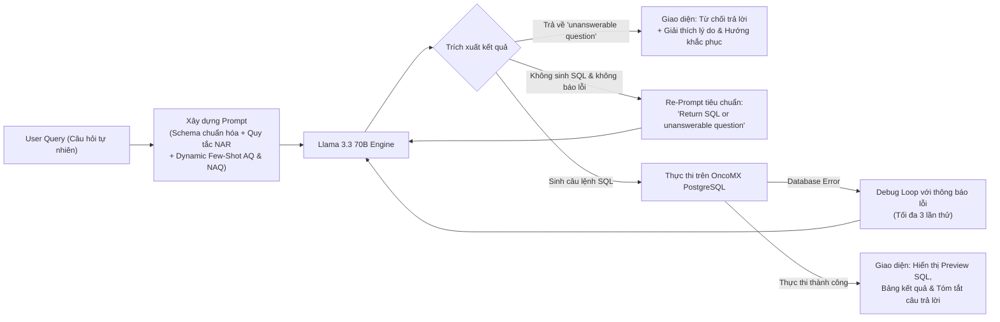

# Query Carefully: Detecting the Unanswerables in Text-to-SQL Tasks

| Thông tin | Chi tiết |
|---|---|
| **Tác giả** | Jasmin Saxer, Isabella Maria Aigner, Luise Linzmeier, Andreas Weiler, Kurt Stockinger |
| **Đơn vị** | Zurich University of Applied Sciences (ZHAW), University of Zurich, University Hospital Zurich (Thụy Sĩ) |
| **Năm / Venue** | 2025 / arXiv:2512.21345v1 [cs.DB] (Tháng 12/2025; mã nguồn: `github.com/JasminSaxer/QueryCarefully.git`) |
| **Loại bài** | Phương pháp & Mở rộng Benchmark (Methodology & Benchmark Extension) |
| **Chủ đề** | Text-to-SQL, Unanswerable Question Detection, Query Ambiguity, Abstention, Biomedical Database, In-Context Learning |
| **File gốc** | [Query Carefully.pdf](../papers/Query%20Carefully.pdf) |

## 1. Tóm tắt nhanh (TL;DR)
Bài báo giới thiệu *Query Carefully*, một quy trình Text-to-SQL kết hợp mô hình Llama 3.3 70B với cơ chế phát hiện và từ chối trả lời (*abstention*) đối với các câu hỏi không thể trả lời hoặc mơ hồ trong cơ sở dữ liệu y sinh học OncoMX. Tác giả xây dựng tập dữ liệu OncoMX-NAQ gồm 80 câu hỏi không thể trả lời chia làm 8 danh mục chi tiết, đồng thời chứng minh rằng chiến lược *Balanced Prompting* (kết hợp cân bằng cả ví dụ trả lời được lẫn không trả lời được thông qua truy xuất embedding động) giúp hệ thống đạt độ chính xác phát hiện unanswerable lên tới 80%, trong đó câu hỏi thiếu cột và ngoài miền đạt độ chính xác gần như tuyệt đối, dù thách thức vẫn tồn tại lớn ở nhóm thiếu giá trị trong CSDL (50%) và mơ hồ về cột (30%).

## 2. Bối cảnh & Vấn đề nghiên cứu
- **Nguy cơ tiềm ẩn của Text-to-SQL trong các lĩnh vực nhạy cảm:** Các hệ thống Text-to-SQL hiện đại (dựa trên LLM) có xu hướng "cố quá" (*over-eager*): luôn cố gắng sinh ra một câu lệnh SQL có thể thực thi được ngay cả khi câu hỏi của người dùng là mơ hồ, nằm ngoài phạm vi lược đồ hoặc hoàn toàn không thể trả lời được. Trong y sinh học và chăm sóc sức khỏe (như dữ liệu về dấu ấn ung thư OncoMX), việc sinh ra các câu SQL sai lệch nhưng trông có vẻ hợp lệ dẫn đến các kết quả ngụy tạo (*misleading results*), gây rủi ro đặc biệt nghiêm trọng cho các quyết định nghiên cứu và điều trị lâm sàng.
- **Thực tế người dùng phi kỹ thuật:** Đa số người dùng không phải chuyên gia cơ sở dữ liệu nên họ thường xuyên đặt các câu hỏi:
  1. Hỏi các thông tin giải thích nguyên nhân/cơ chế không thể truy vấn bằng SQL (*Non-SQL*).
  2. Hỏi các thông tin không có trong lược đồ (*Out of Schema - Missing Columns/Values*).
  3. Hỏi thông tin ngoài miền tri thức CSDL (*Out of Domain*).
  4. Đặt câu hỏi mơ hồ về cột, giá trị, ngữ cảnh hoặc toán tử so sánh (*Ambiguous*).
- **Hạn chế của các nghiên cứu trước:** Các benchmark phổ biến như Spider hầu hết chỉ chứa các câu hỏi trả lời được ($100\%$ answerable). Một số tập dữ liệu gần đây đã đề cập đến unanswerable (TriageSQL, Wang et al., EHRSQL 2024, PRACTIQ) nhưng chưa khảo sát sâu trên các CSDL y sinh học quy mô lớn, phức tạp (như OncoMX với 25 bảng, 106 cột và trung bình 2.6 triệu dòng mỗi bảng) và chưa phân tích rõ tác động của các chiến lược kết hợp ví dụ in-context learning đối với từng loại câu hỏi không trả lời được.

## 3. Phương pháp / Nội dung chính

### 3.1 Tập dữ liệu OncoMX-NAQ (No-Answer Questions)
Xây dựng trên nền tảng CSDL OncoMX (thuộc ScienceBenchmark), nhóm tác giả tạo ra 80 câu hỏi không thể trả lời bằng cách dùng GPT-4o kết hợp rà soát thủ công, chia đều thành 8 danh mục (10 câu mỗi loại):

1. **Non-SQL Questions:** Câu hỏi mang tính giải thích cơ chế, định tính, không thể giải quyết bằng SQL thuần túy (ví dụ: *"Tại sao gen TP53 gây ung thư ở bệnh nhân này mà không ở bệnh nhân khác?"*).
2. **Out of Schema - Columns Missing:** Thông tin được hỏi không tồn tại ở bất kỳ cột nào trong schema (ví dụ: *"Cấu trúc protein 3D của sản phẩm gen EGFR là gì?"*).
3. **Out of Schema - Values Missing:** Cột có tồn tại nhưng giá trị cụ thể được hỏi hoàn toàn không có trong CSDL (ví dụ: *"Liệt kê các gen biểu hiện quá mức trong mô ung thư người Sao Hỏa"*).
4. **Out of Domain Questions:** Đòi hỏi tri thức ngoài phạm vi ứng dụng của CSDL (ví dụ: *"Biomarker nào được nhắc đến trong nghiên cứu giải Nobel 2023?"*).
5. **Column Ambiguous:** Nhiều cột cùng thỏa mãn câu hỏi nhưng không rõ người dùng muốn cột nào (ví dụ: *"Điểm số (score) cho EGFR trong ung thư phổi là gì?"* khi có nhiều loại điểm).
6. **Value Ambiguous:** Giá trị tham chiếu tương ứng với nhiều thực thể/khái niệm khác nhau (ví dụ: *"Tìm các gen liên quan đến 'growth'"*).
7. **Contextual Ambiguous:** Thiếu ngữ cảnh cần thiết (ví dụ: *"Những gen nào gây ra điều đó?"* - không rõ "điều đó" là gì).
8. **Operator Ambiguous:** Điều kiện so sánh mập mờ, thiếu toán tử hoặc ngưỡng cụ thể (ví dụ: *"Biomarker nào đáng tin cậy hơn?"*).

### 3.2 Quy trình Query Carefully (Pipeline)

### 3.3 Thiết kế Prompt & In-Context Learning
- **Chuẩn hóa lược đồ (Schema Representation):** Lược đồ 25 bảng của OncoMX được chuẩn hóa bằng GPT-4o để tăng tính thân thiện với LLM, giữ đầy đủ kiểu dữ liệu, khóa ngoại và chú thích ngữ nghĩa của từng cột.
- **Quy tắc không trả lời (No-Answer Rules - NAR):** Hệ thống tích hợp các chỉ dẫn chặt chẽ trong System Prompt, yêu cầu mô hình xuất chính xác chuỗi `"unanswerable question"` khi gặp câu hỏi thiếu thông tin, nằm ngoài phạm vi hoặc mơ hồ, thay vì tự suy diễn.
- **Truy xuất ví dụ động (Dynamic Few-Shot Retrieval):** Sử dụng mô hình embedding `Alibaba-NLP/gte-Qwen2-1.5B-instruct` để tính độ tương đồng cosine:
  - Truy xuất các ví dụ trả lời được (*Answerable Questions - AQ*) tương đồng nhất từ tập Seed của ScienceBenchmark.
  - Truy xuất các ví dụ không trả lời được (*No-Answer Questions - NAQ*) tương đồng nhất từ OncoMX-NAQ.
- **Thiết kế giao diện Web UI:** Hiển thị rõ ràng các bước trung gian: xem trước SQL (*SQL preview*), trạng thái thực thi và giải thích lý do khi từ chối trả lời.

## 4. Thực nghiệm & Kết quả chính

### 4.1 Thiết lập thực nghiệm
- **Mô hình chính:** `llama3.3:70b` (chạy local qua Ollama / máy chủ nội bộ).
- **Bộ dữ liệu kiểm thử:**
  - `OncoMX Dev` (ScienceBenchmark): 99 câu hỏi trả lời được (Answerable).
  - `OncoMX-NAQ`: 80 câu hỏi không thể trả lời (Unanswerable).
- **Thước đo:**
  - *SQL Exact Match Accuracy:* Khớp chuỗi SQL chuẩn hóa với SQL gốc.
  - *Result Accuracy:* Thực thi SQL trên OncoMX và so sánh kết quả (Exact Match, Soft Correct - chấp nhận sai lệch thứ tự dòng/cột định danh, DB Error).
  - *Unanswerable Question Detection Accuracy:* Tỷ lệ nhận diện chính xác các câu hỏi không trả lời được (tránh false positive và false negative).

### 4.2 Hiệu năng tổng thể theo chiến lược Prompting

| Cấu hình Prompt | Độ chính xác OncoMX Dev (Answerable - Soft Correct) | Độ chính xác OncoMX-NAQ (Unanswerable Detection) |
|---|---|---|
| Chỉ dùng quy tắc NAR (Zero-shot) | ~0.50 | 0.37 |
| NAR + Ví dụ Answerable (AQ) | ~0.60 *(tốt nhất ở 5-shot)* | 0.49 |
| NAR + Ví dụ Unanswerable (NAQ) | ~0.50 | 0.43 |
| **NAR + Cân bằng AQ & NAQ (Balanced Prompting)** | **~0.60** | **~0.80** |

*Phát hiện quan trọng:*
1. **Không làm suy giảm độ chính xác câu hỏi hợp lệ:** Việc đưa các câu hỏi unanswerable vào prompt không hề làm mô hình trở nên "nhát tay" hay làm giảm độ chính xác trên tập OncoMX Dev (vẫn giữ vững mức 0.60).
2. **Sức mạnh của Balanced Prompting:** Kết hợp cân bằng cả ví dụ AQ và NAQ nâng độ chính xác phát hiện câu hỏi unanswerable từ 0.37 (NAR đơn thuần) lên gần **0.80** (80%).
3. **Ví dụ dương tính giúp ích hơn ví dụ âm tính:** Đưa ví dụ Answerable (AQ) đơn lẻ giúp phát hiện câu hỏi unanswerable tốt hơn so với chỉ đưa ví dụ Unanswerable (NAQ) (trung bình 0.49 vs 0.43). Điều này chứng minh rằng việc cho LLM thấy rõ "thế nào là một câu hỏi trả lời được chuẩn mực" giúp mô hình tự suy luận ranh giới để phát hiện các câu hỏi bất thường tốt hơn.

### 4.3 Khả năng phát hiện theo từng loại câu hỏi không trả lời được (Figure 4)

- **Nhóm cấu trúc rõ ràng (Structurally defined):**
  - `Non-SQL`, `Columns Missing`, `Out of Domain`: Đạt độ chính xác cơ bản 0.60–0.65 chỉ với NAR, và đạt mức **gần như tuyệt đối (~1.0)** khi áp dụng balanced few-shot prompting. Lược đồ CSDL cung cấp bằng chứng rõ ràng để mô hình khẳng định một cột không hề tồn tại.
- **Nhóm thiếu giá trị (Values Missing):**
  - Rất khó nhận diện: Baseline chỉ đạt 0.30 và khi có balanced prompting chỉ đạt tối đa **0.50**. Lý do: LLM chỉ nhìn vào lược đồ (*schema*) chứ không thấy toàn bộ dữ liệu bảng, nên khi cột tồn tại, mô hình vẫn ngây thơ sinh ra câu SQL lọc giá trị đó mà không biết rằng giá trị đó không tồn tại.
- **Nhóm câu hỏi mơ hồ (Ambiguity):**
  - `Column Ambiguous`: Là loại câu hỏi **thất bại nặng nề nhất**, độ chính xác phát hiện tối đa chỉ đạt **0.30** (30%). Nguyên nhân: Khi có nhiều cột cùng có vẻ phù hợp, bộ Text-to-SQL có xu hướng tự tiện chọn đại một cột khả dĩ nhất và sinh SQL thành công thay vì nhận thức được tính mơ hồ để hỏi lại.
  - `Value Ambiguous`: Đạt kết quả phát hiện khả quan hơn Column Ambiguous (đặc biệt khi có ví dụ NAQ).
  - `Contextual Ambiguous`: Đạt 100% độ chính xác phát hiện khi có balanced prompting.
  - `Operator Ambiguous`: Đạt 90% độ chính xác phát hiện khi có đủ 2 loại ví dụ.

## 5. Tính mới (Novelty & Đóng góp)
- **Tập dữ liệu OncoMX-NAQ có taxonomy toàn diện:** Xây dựng bộ dữ liệu đầu tiên về các câu hỏi không thể trả lời và mơ hồ chuyên biệt cho cơ sở dữ liệu y sinh học OncoMX, phân loại chi tiết thành 8 danh mục thực tế.
- **Chứng minh vai trò của Balanced Prompting:** Chỉ ra rằng chiến lược kết hợp cân bằng cả mẫu câu hỏi trả lời được và không trả lời được là chìa khóa để đạt độ chính xác phát hiện unanswerable cao (80%) mà không làm tổn hại đến năng lực sinh SQL của các câu hỏi hợp lệ.
- **Phát hiện nghịch lý trong in-context learning:** Cung cấp bằng chứng thực nghiệm cho thấy việc đưa ví dụ dương tính (AQ) có đóng góp lớn hơn ví dụ âm tính (NAQ) trong việc định hình ranh giới nhận diện câu hỏi lỗi.
- **Vạch trần điểm mù lớn của LLM Text-to-SQL:** Xác định rõ hai "tử huyệt" của các hệ thống Text-to-SQL hiện nay là *Values Missing* (tỷ lệ phát hiện chỉ 50%) và *Column Ambiguity* (tỷ lệ phát hiện chỉ 30%) do bản tính tự biên tự diễn của LLM khi nhìn thấy schema.

## 6. Hạn chế

### 6.1 Hạn chế do tác giả thừa nhận
- **Tỷ lệ phát hiện còn rất thấp ở các danh mục mơ hồ quan trọng:** Khả năng nhận diện câu hỏi thiếu giá trị (*Values Missing* - max 0.5) và mơ hồ về cột (*Column Ambiguous* - max 0.3) vẫn là rào cản lớn chưa giải quyết được.
- **Mới dừng lại ở việc từ chối trả lời (Abstention):** Hệ thống chỉ mới dừng ở khâu phát hiện và từ chối ("unanswerable question"), chưa tích hợp cơ chế chủ động đối thoại hỏi lại hoặc gợi ý cách giải quyết (clarification resolution) như trong PRACTIQ hay Sphinteract.
- **Quy mô tập dữ liệu NAQ còn khiêm tốn:** Tập OncoMX-NAQ gồm 80 câu hỏi (10 câu mỗi loại), cần được mở rộng quy mô lớn hơn để kiểm chứng thống kê sâu rộng.

### 6.2 Nhận xét thêm của người review
- **Thiếu bước kiểm tra dữ liệu thực tế (Value Existence Check):** Việc phụ thuộc hoàn toàn vào schema trong prompt khiến mô hình không thể nào biết được giá trị có nằm trong CSDL hay không. Một giải pháp đơn giản là trang bị cho hệ thống một công cụ truy vấn kiểm tra giá trị tồn tại (`SELECT EXISTS(...)` hoặc `LIKE`) trước khi kết luận.
- **Cơ chế phân loại đơn tầng (Single-stage prompting):** Việc gộp chung cả nhiệm vụ phân loại câu hỏi lẫn sinh SQL vào một prompt duy nhất khiến LLM dễ bị thiên vị sinh code (code-generation bias) hơn là cẩn trọng kiểm tra tính hợp lệ. Phân tách thành một bước tiền kiểm tra (*Triage / Guardrail*) chuyên biệt sẽ hiệu quả hơn.
- **Khả năng tổng quát hóa ngoài miền y sinh:** Toàn bộ thí nghiệm được tiến hành trên OncoMX (PostgreSQL), cần đánh giá thêm trên các cơ sở dữ liệu thuộc các ngành khác (tài chính, thương mại điện tử) để khẳng định tính phổ quát của phân loại 8 nhóm.

## 7. Ý nghĩa ứng dụng (cho hệ thống agent phân tích dữ liệu / Text-to-SQL)
- **Thiết lập cơ chế Abstention an toàn (Guardrail):** Đối với các tác nhân AI làm việc với dữ liệu nhạy cảm, nguyên tắc "thà từ chối còn hơn trả lời sai" là bắt buộc. Cần cấu hình No-Answer Rules rõ ràng để ngăn agent tự bịa ra các truy vấn SQL khi câu hỏi thiếu căn cứ.
- **Chiến lược Few-Shot cân bằng cho Agent:** Khi thiết kế context mẫu (dynamic few-shot examples) cho agent, luôn đưa cả các trường hợp câu hỏi bình thường kèm SQL lẫn các trường hợp câu hỏi dị biệt kèm hành động từ chối/yêu cầu làm rõ để agent học được ranh giới an toàn.
- **Cảnh báo nguy cơ cao về Column Ambiguity:** Tuyệt đối không để agent tự ý phán đoán một cột duy nhất khi trong bảng có nhiều cột tương tự nhau (như `created_at`, `updated_at`, `approved_at`); cần có quy tắc bắt buộc agent phải dừng lại và hỏi người dùng khi gặp độ tương đồng cao giữa các cột.
- **Tích hợp công cụ Metadata & Value Inspector:** Trang bị cho agent công cụ tra cứu nhanh danh mục giá trị trong bảng (ví dụ: truy vấn bảng danh mục hoặc tìm kiếm chỉ mục) để phát hiện sớm các câu hỏi chứa giá trị không tồn tại (Values Missing) trước khi viết truy vấn lớn.

## 8. Từ khóa
`Text-to-SQL`, `Unanswerable Questions`, `No-Answer Rules`, `Balanced Prompting`, `Query Ambiguity`, `Abstention`, `OncoMX-NAQ`, `ScienceBenchmark`, `Biomedical Database`
