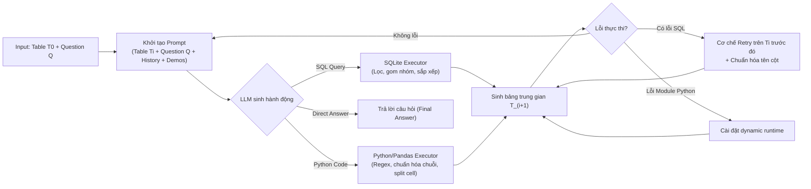

# ReAcTable: Enhancing ReAct for Table Question Answering

| Thông tin | Chi tiết |
|---|---|
| **Tác giả** | Yunjia Zhang, Jordan Henkel, Avrilia Floratou, Joyce Cahoon, Shaleen Deep, Jignesh M. Patel (corresponding) |
| **Đơn vị** | University of Wisconsin-Madison; Microsoft; Carnegie Mellon University |
| **Năm / Venue** | PVLDB (Proceedings of the VLDB Endowment / arXiv:2310.00815, 2023/2024; mã nguồn mở trên GitHub: yunjiazhang/ReAcTable) |
| **Loại bài** | Phương pháp (Agentic reasoning framework for TQA) |
| **Chủ đề** | Table Question Answering (TQA), ReAct paradigm, Dual Code Execution (SQL & Python), Intermediate Table Evolution, Majority Voting |
| **File gốc** | [ReAcTable.pdf](../papers/ReAcTable.pdf) |

## 1. Tóm tắt nhanh (TL;DR)
ReAcTable là framework đầu tiên áp dụng mô hình tương tác ReAct (Reasoning + Acting) vào bài toán Table Question Answering (TQA) bằng cách kết hợp LLM với hai môi trường thực thi mã chuyên biệt: **SQL** (cho lọc/gom nhóm dữ liệu) và **Python/Pandas** (cho bóc tách/chuẩn hóa chuỗi phức tạp). Thay vì sinh code trong một lần duy nhất hay chỉ suy luận bằng văn bản, ReAcTable thực hiện lặp: LLM chọn sinh SQL, Python hoặc trả lời trực tiếp; mã sinh ra được thực thi ngay để tạo bảng trung gian (*intermediate table*), đưa trở lại prompt làm ngữ cảnh cho bước kế tiếp. Kết hợp cùng cơ chế bỏ phiếu đa số (*majority voting*), ReAcTable đạt độ chính xác **68.0% trên WikiTQ** (vượt qua mọi mô hình fine-tune và không fine-tune tại thời điểm công bố) và **ROUGE-L 0.61 trên FeTaQA**.

## 2. Bối cảnh & Vấn đề nghiên cứu
- **Thách thức cốt lõi của TQA:** Khác với hỏi đáp văn bản thuần, TQA đòi hỏi ba năng lực phối hợp: (1) hiểu ngữ nghĩa phức tạp trong từng ô dữ liệu (ví dụ ô chứa cả tên và mã quốc gia trong ngoặc đơn); (2) xử lý dữ liệu nhiễu/bất nhất; (3) thực hiện các phép biến đổi dữ liệu nhiều tầng.
- **Hạn chế của mô hình fine-tuned (Tapas, Tapex, TaCube, OmniTab):** Đòi hỏi chi phí huấn luyện trước khổng lồ trên dữ liệu tổng hợp (pre-training với synthetic SQL), kém linh hoạt khi chuyển đổi domain hoặc khi cấu trúc bảng thay đổi.
- **Hạn chế của phương pháp sinh code một lần (single-pass code generation như Binder):** Khi gặp các bảng có ô dữ liệu phức tạp hoặc không chuẩn hóa, LLM không thể viết một câu SQL đơn lẻ để giải quyết toàn bộ bài toán; nếu không có bảng trung gian để quan sát kết quả từng chặng, mô hình rất dễ gặp lỗi thực thi hoặc ảo giác.
- **Thiếu vắng ReAct trong TQA:** Dù ReAct đã rất thành công trong web browsing và generic agent, việc tích hợp tương tác công cụ vòng lặp (interleaved reasoning and tool execution) để liên tục tinh chỉnh bảng dữ liệu chưa từng được nghiên cứu bài bản cho TQA.

## 3. Phương pháp / Nội dung chính

### 3.1 Quy trình thực thi ReAcTable
ReAcTable thiết lập một vòng lặp ReAct lặp lại giữa LLM và hai công cụ thực thi mã:

Quy trình hoạt động:
1. **Prompting theo ngữ cảnh:** Mỗi lượt lặp, prompt chứa bảng hiện tại $T_i$ (định dạng `[HEAD]` và `[ROW]`), câu hỏi $Q$, lịch sử code và bảng trung gian ở các bước trước, cùng các few-shot demonstrations.
2. **Không gian hành động của LLM:** Tại mỗi bước, LLM được quyền chọn 1 trong 3 hành động:
   - Sinh câu truy vấn **SQL** (chạy trên SQLite).
   - Sinh đoạn mã **Python** (thao tác trên Pandas DataFrame).
   - Đưa ra câu trả lời trực tiếp (**Answer**).
3. **Phân vai công cụ tự nhiên:** Tác giả quan sát thấy mô hình tự động chọn SQL cho các tác vụ cấu trúc (lọc dòng, chiếu cột, `GROUP BY`, `ORDER BY`) và chọn Python khi cần bóc tách chuỗi phức tạp bằng regex/string manipulation (ví dụ tách mã quốc tịch từ chuỗi `Alejandro Valverde (ESP)`).
4. **Cơ chế xử lý ngoại lệ (Exception Handling):**
   - *Lỗi cột SQL không tồn tại:* Thường do bảng trung gian $T_i$ đã bị cắt bớt cột ở bước trước. ReAcTable tự động kích hoạt cơ chế retry: thực thi truy vấn ngược lại trên các bảng trung gian trước đó hoặc bảng gốc $T_0$. Tên cột cũng được chuẩn hóa (loại bỏ khoảng trắng, số đứng đầu, ký tự đặc biệt).
   - *Lỗi thiếu module Python:* Tự động cài đặt gói thư viện trong thời gian chạy (runtime installation) và chạy lại.
   - *Ngoại lệ khác:* Bổ sung từ khóa `Answer:` vào cuối prompt để buộc LLM chuyển sang suy luận trực tiếp.

### 3.2 Các cơ chế bỏ phiếu đa số (Majority Voting Mechanisms)
Để tăng độ tin cậy và xử lý sự nhập nhằng, ReAcTable tích hợp 3 chiến lược voting (chạy với temperature 0.6):

```mermaid
flowchart TD
    subgraph S_VOTE ["1. Simple Majority Voting (s-vote)"]
        S1["Chạy N chuỗi hoàn chỉnh độc lập"] --> S2["Thu thập N câu trả lời cuối cùng"]
        S2 --> S3["Chọn đáp án có tần suất cao nhất"]
    end
    
    subgraph T_VOTE ["2. Tree-Exploration Voting (t-vote)"]
        T1["Tại mỗi bước, lấy mẫu N hành động (fanout N)"] --> T2["Khám phá toàn bộ cây đến khi ra đáp án lá"]
        T2 --> T3["Chọn đáp án đa số từ các lá"]
    end
    
    subgraph E_VOTE ["3. Execution-Based Voting (e-vote)"]
        E1["Tại mỗi bước, lấy mẫu N hành động code"] --> E2["Thực thi code lấy bảng trung gian"]
        E2 --> E3["Gộp log-prob nếu bảng kết quả giống nhau"]
        E3 --> E4["Chọn bước đi có điểm cao nhất để đi tiếp"]
    end
```

- **`s-vote` (Simple majority voting):** Lấy mẫu $N$ chuỗi suy luận trọn vẹn từ đầu đến cuối, chọn câu trả lời xuất hiện nhiều nhất. Phù hợp khi có nhiều đường hướng giải khác nhau cùng dẫn về một kết quả.
- **`t-vote` (Tree-exploration voting):** Rẽ nhánh đầy đủ theo dạng cây với hệ số phân nhánh $N$. Duyệt tất cả nhánh cho đến nút lá.
- **`e-vote` (Execution-based voting):** Đánh giá tính đúng đắn dựa trên thực thi ngay tại từng bước trung gian. Các đoạn code sinh ra bảng trung gian tương đương sẽ được hợp nhất xác suất (max log-prob), chọn bước tối ưu nhất để tiếp tục.

## 4. Thực nghiệm & Kết quả chính

### 4.1 Thiết lập thực nghiệm
- **Benchmarks:**
  - **WikiTQ:** 4.344 mẫu test (QA trên bảng, đánh giá bằng denotation accuracy).
  - **TabFact:** 1.998 mẫu test rút gọn (Fact verification, nhãn nhị phân True/False).
  - **FeTaQA:** 2.006 mẫu test (Free-form QA sinh câu tự nhiên, đánh giá bằng ROUGE-1/2/L).
- **Mô hình nền tảng:** Mặc định dùng OpenAI Codex (`code-davinci-002`). Đánh giá mở rộng trên `text-davinci-003` và `gpt-3.5-turbo`.
- **Baselines:**
  - *Cần huấn luyện (Trained/Fine-tuned):* Tapas, Tapex, TaCube, OmniTab, Lever, SaMoE, PASTA, T5 (Small/Base/Large).
  - *Không cần huấn luyện (In-context learning):* Binder, Dater.

### 4.2 Kết quả trên 3 Benchmarks chính

**Kết quả trên WikiTQ (Table 1):**

| Phương pháp | Cần huấn luyện? | Accuracy (%) |
|---|:---:|:---:|
| Tapex | Có | 57.5% |
| TaCube | Có | 60.8% |
| OmniTab | Có | 62.8% |
| Lever | Có | 62.9% |
| Binder | Không | 61.9% |
| Dater | Không | 65.9% |
| **ReAcTable (greedy, no vote)** | Không | **65.8%** |
| **ReAcTable + t-vote** | Không | **66.4%** |
| **ReAcTable + e-vote** | Không | **67.2%** |
| **ReAcTable + s-vote** | Không | **68.0%** (+2.1% so với SOTA) |

**Kết quả trên TabFact (Table 2):**

| Phương pháp | Cần huấn luyện? | Accuracy (%) |
|---|:---:|:---:|
| TaPas | Có | 83.9% |
| Tapex / SaMoE | Có | 86.7% |
| PASTA (specialized pretraining) | Có | **90.8%** |
| Binder | Không | 85.1% |
| Dater | Không | 85.6% |
| **ReAcTable (greedy)** | Không | **83.1%** |
| **ReAcTable + t-vote** | Không | **84.2%** |
| **ReAcTable + e-vote** | Không | **84.9%** |
| **ReAcTable + s-vote** | Không | **86.1%** (+0.5% so với baseline không train) |

**Kết quả trên FeTaQA (Table 3):**

| Phương pháp | Cần huấn luyện? | ROUGE-1 | ROUGE-2 | ROUGE-L |
|---|:---:|:---:|:---:|:---:|
| T5-Large | Có | 0.63 | 0.41 | 0.53 |
| Dater | Không | 0.66 | 0.45 | 0.56 |
| **ReAcTable** | Không | **0.71** | **0.46** | **0.61** |

*(ReAcTable vượt trội toàn diện trên cả 3 chỉ số sinh câu trả lời tự do).*

### 4.3 Phân tích Ablation & Phát hiện cốt lõi

#### Đóng góp sống còn của Intermediate Tables (Table 4 & 5)
Tác giả so sánh ReAcTable với biến thể **Codex-CoT** (loại bỏ bảng trung gian, LLM chỉ sinh một chuỗi code duy nhất trong 1 lượt rồi thực thi):
- Trên WikiTQ: ReAcTable đạt **65.8%**, trong khi Codex-CoT chỉ đạt **49.4%** (sụt giảm tới **-16.4%**). Khi áp dụng `s-vote` cho Codex-CoT, độ chính xác thậm chí giảm tiếp xuống **47.7%** (do nhiệt độ cao khuếch đại sự mơ hồ khi không có bảng neo giữ).
- Trên TabFact: ReAcTable đạt **83.1%** vs Codex-CoT **71.1%** (-12.0%).

#### Phân tích số lượt lặp (Iterations - Table 6 & 7, Figure 4)
- **Phân bố số lượt lặp:** 100% câu hỏi được giải quyết trong vòng 5 lượt lặp; trong đó hơn **70% câu hỏi được giải quyết chỉ trong 2 lượt lặp**.
- **Độ chính xác theo số bước:** Trên WikiTQ, câu hỏi giải xong ở 2 lượt lặp đạt độ chính xác cao nhất (**72.3%** với 3.426 mẫu). Các câu hỏi cần 3, 4, 5 lượt lặp có độ chính xác giảm dần (60.3%, 59.3%, 46.2%), phản ánh độ khó nội tại của bài toán.
- **Giới hạn số bước (Iteration limits):** Giới hạn tối đa 1 bước chỉ đạt 49.2%, 2 bước đạt 65.1%, 3 bước đạt 67.3%, và không giới hạn đạt 68.0%.

#### Vai trò của Python Executor (Table 8 & 9)
Khi loại bỏ Python executor (chỉ dùng duy nhất SQL):
- Trên WikiTQ: Độ chính xác giảm từ 68.0% xuống **64.5%** (-3.5%).
- Trên TabFact: Độ chính xác sụt giảm rất nặng từ 86.1% xuống **76.2%** (**-9.9%**).
- Nguyên nhân: SQL rất vụng về trong việc xử lý các chuỗi lồng ghép, regex, bóc tách đơn vị đo hoặc ngày tháng bất thường trong bảng web.

#### Khả năng tổng quát hóa trên các họ LLM (Table 10 & 11)

| LLM Backbone | WikiTQ (s-vote) | WikiTQ (t-vote) | WikiTQ (e-vote) | TabFact (s-vote) | TabFact (t-vote) | TabFact (e-vote) |
|---|:---:|:---:|:---:|:---:|:---:|:---:|
| `code-davinci-002` (Codex) | **68.0%** | 66.4% | 67.2% | **86.1%** | 84.2% | 84.9% |
| `text-davinci-003` | 64.1% | 64.5% | **65.0%** | 83.1% | 82.9% | **83.6%** |
| `gpt-3.5-turbo` | 51.8% | 52.5% | N/A | 72.8% | 74.4% | N/A |

*Nhận xét:*
- Codex chuyên về code mang lại kết quả cao nhất.
- Với mô hình chuyên văn bản như `text-davinci-003`, cơ chế **e-vote** lại vượt trội hơn s-vote vì e-vote trực tiếp kiểm tra tính đúng đắn của việc thực thi mã.
- `gpt-3.5-turbo` đạt kết quả thấp hơn đáng kể một phần do xu hướng trả lời dạng câu thoại dài dòng (chatty conversational output), khiến bộ đánh giá chuẩn định dạng (denotation evaluator) chấm trượt dù câu trả lời đúng nghĩa.

## 5. Tính mới (Novelty & Đóng góp)
1. **Thiết lập mô hình ReAct chuyên biệt cho TQA:** Tiên phong đưa mô hình suy luận đa bước tương tác kèm công cụ (ReAct) vào xử lý câu hỏi trên bảng dữ liệu.
2. **Kiến trúc công cụ kép SQL + Python bổ trợ hoàn hảo:** Khai thác thế mạnh cấu trúc của SQL (lọc hàng, nhóm cột) và thế mạnh linh hoạt của Python/Pandas (regex, chuẩn hóa chuỗi bẩn), phản ánh chính xác hành vi làm việc của một Data Scientist con người.
3. **Cơ chế phục hồi lỗi SQL thông minh (Fault Tolerance):** Khả năng tự động truy vấn ngược về các bảng trung gian trước đó hoặc bảng gốc khi phát hiện thiếu cột, giúp khắc phục nhược điểm mất mát thông tin khi cắt tỉa bảng.
4. **Hệ thống hóa 3 cơ chế Majority Voting:** Đánh giá định lượng toàn diện giữa Simple voting, Tree exploration, và Execution-based voting, chỉ ra sự phụ thuộc của phương pháp voting vào năng lực từng dòng LLM.

## 6. Hạn chế

### 6.1 Hạn chế do tác giả thừa nhận
- **Thiết kế few-shot thủ công:** Các ví dụ mẫu trong prompt được lựa chọn và viết tay từ tập train, chưa có cơ chế tự động chọn hoặc tối ưu hóa prompt (automatic prompt tuning).
- **Phạm vi đơn bảng (Single Table):** Bài báo mới chỉ xử lý trên một bảng quan hệ đơn lẻ, chưa giải quyết bài toán multi-table QA phức tạp có khóa ngoại liên kết giữa nhiều bảng.
- **Lựa chọn cơ chế voting chưa tự động:** Hiện chưa có bộ định tuyến (router) để tự động quyết định khi nào nên dùng s-vote, t-vote hay e-vote tùy theo độ phức tạp của câu hỏi.

### 6.2 Nhận xét thêm của người review
- **Phụ thuộc vào mô hình Codex đã bị khai tử:** Hầu hết kết quả SOTA 68.0% của bài báo đạt được trên `code-davinci-002`, vốn đã bị OpenAI đóng API. Trên `gpt-3.5-turbo`, hiệu năng giảm mạnh xuống 52.5%, cho thấy tính nhạy cảm rất cao của framework đối với khả năng tuân thủ định dạng sinh code của backbone model.
- **Rủi ro an toàn và tài nguyên khi cài package động:** Cơ chế tự động `pip install` thư viện Python tại thời gian chạy (runtime installation) tiềm ẩn lỗ hổng bảo mật nghiêm trọng (arbitrary code execution) nếu triển khai trong môi trường production không có sandbox cô lập tuyệt đối.
- **Chi phí token và độ trễ nhân theo voting:** Khi kết hợp ReAct (3–5 vòng lặp) với majority voting ($N$ mẫu hoặc duyệt nhánh cây), số lượng token tiêu thụ và độ trễ tổng thể tăng theo cấp số nhân, gây tốn kém đáng kể chi phí API.

## 7. Ý nghĩa ứng dụng (cho hệ thống agent phân tích dữ liệu / Text-to-SQL)
- **Mô hình kiến trúc phân nhiệm SQL + Python:** Các agent phân tích dữ liệu thực tế (DataMate / Text-to-SQL) nên trang bị cả hai môi trường: SQL cho truy vấn database quan hệ lớn và Python Sandbox cho làm sạch dữ liệu bẩn, parse datetime phức tạp hoặc vẽ đồ thị.
- **Lưu trữ bảng trung gian làm checkpoint suy luận:** Thay vì bắt agent hoàn thành truy vấn trong một lệnh SQL duy nhất, hãy xây dựng cơ chế tạo DataFrame trung gian hoặc SQL CTEs/bảng tạm, cho phép agent quan sát schema và mẫu dữ liệu mới trước khi tiến hành bước tiếp theo.
- **Cơ chế Fallback/Retry ngược dòng (Backtracking):** Khi một câu truy vấn bị lỗi "column not found" trên bảng trung gian, agent nên tự động kiểm tra lại bảng gốc hoặc các bảng bước trước để truy xuất lại dữ liệu gốc thay vì lập tức báo lỗi người dùng.

## 8. Từ khóa
`ReAcTable`, `Table Question Answering`, `ReAct Paradigm`, `SQL Executor`, `Python Pandas Executor`, `Intermediate Tables`, `Majority Voting`, `WikiTQ`, `TabFact`, `FeTaQA`
