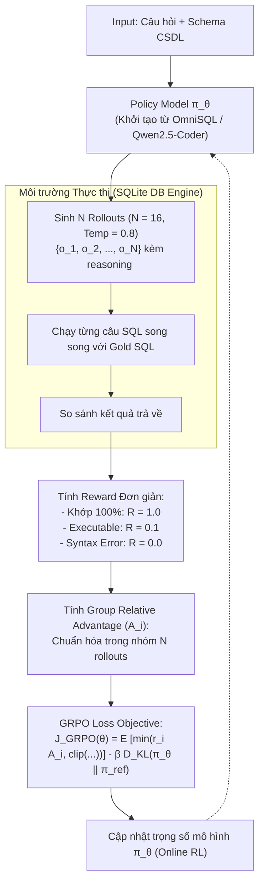

# Arctic-Text2SQL-R1: Simple Rewards, Strong Reasoning in Text-to-SQL

| Thông tin | Chi tiết |
|---|---|
| **Tác giả** | Zhewei Yao* (Project lead), Guoheng Sun, Lukasz Borchmann, Gaurav Nuti, Zheyu Shen, Minghang Deng, Bohan Zhai, Hao Zhang, Ang Li, Yuxiong He |
| **Đơn vị** | Snowflake AI Research, University of Maryland College Park, University of California San Diego |
| **Năm / Venue** | 2026 / arXiv:2505.20315v2 [cs.CL], 12 Jan 2026 (Under review) |
| **Loại bài** | Phương pháp & Huấn luyện mô hình (Methodology & Model Family) |
| **Chủ đề** | Text-to-SQL, Reinforcement Learning, GRPO, Reasoning Chain-of-Thought, Simple Reward Design, Execution Accuracy |
| **File gốc** | [Simple Rewards, Strong Reasoning in Text-to-SQL.pdf](../papers/Simple%20Rewards,%20Strong%20Reasoning%20in%20Text-to-SQL.pdf) |

## 1. Tóm tắt nhanh (TL;DR)
Arctic-Text2SQL-R1 là framework học tăng cường (RL) tiên phong chứng minh rằng việc huấn luyện mô hình suy luận chuỗi CoT cho Text-to-SQL không cần các hàm thưởng phức tạp đa thành phần mà chỉ cần **tín hiệu thưởng cực kỳ đơn giản dựa trên tính đúng đắn khi thực thi (Execution Correctness)**. Kết hợp thuật toán GRPO (Group Relative Policy Optimization), cơ chế lọc dữ liệu khắt khe (loại bỏ truy vấn rỗng và timeout) cùng điểm khởi đầu SFT chất lượng cao (OmniSQL), dòng mô hình Arctic-Text2SQL-R1 (7B, 14B, 32B) đã xác lập kỷ lục thế giới mới: chiếm lĩnh vị trí **#1 BIRD Leaderboard (Single-Model)** với độ chính xác thực thi **71.83%** trên tập Test, trong đó bản 7B vượt mặt các mô hình 70B và GPT-4o trên 6 benchmark chuẩn.

## 2. Bối cảnh & Vấn đề nghiên cứu
- **Nghẽn cổ chai trong Text-to-SQL phức tạp:** Mặc dù LLM đã giúp việc sinh SQL trở nên trôi chảy, việc sinh ra các truy vấn SQL vừa đúng cú pháp vừa bảo đảm tính đúng đắn ngữ nghĩa khi thực thi (*execution correctness*)—đặc biệt với các truy vấn join nhiều bảng, lồng ghép logic sâu và schema phức tạp—vẫn là bài toán rất hóc búa.
- **Hạn chế của Supervised Fine-Tuning (SFT) truyền thống:** Huấn luyện SFT trực tiếp trên các cặp `(câu hỏi, SQL)` thường chỉ bắt chước bề mặt cú pháp mà không khuyến khích mô hình phát triển năng lực suy luận từng bước (*intermediate reasoning*), dẫn tới khả năng tổng quát hóa kém trên các schema lạ.
- **Cái bẫy của việc thiết kế hàm thưởng phức tạp (Reward Hacking):** Gần đây, các công trình đưa RL vào Text-to-SQL (như Reasoning-SQL, SQL-R1, Think2SQL) thường cố gắng "nắn dòng" mô hình bằng cách nhồi nhét hàm thưởng đa thành phần: kết hợp n-gram overlap, độ tương đồng schema, độ dài token, đánh giá của LLM judge, v.v. Tác giả chỉ ra rằng thiết kế thưởng rườm rà này phản tác dụng:
  1. Dễ dẫn tới hiện tượng *Reward Hacking* (mô hình tìm cách "lách luật" để tối đa hóa điểm số cục bộ dễ ăn thay vì tối ưu tính đúng đắn tổng thể).
  2. Tạo ra các hành vi "lười biếng" (*lazy behaviors*), làm mất ổn định quá trình tối ưu hóa chính sách RL.

## 3. Phương pháp / Nội dung chính

### 3.1 Thiết kế Hàm thưởng Tối giản (Minimal Execution-driven Reward)
Thay vì dùng hàm thưởng hỗn hợp nhiều trọng số, Arctic-Text2SQL-R1 chỉ sử dụng một hàm thưởng rời rạc 3 mức duy nhất dựa trên thực thi:

$$R = \begin{cases} 
1.0 & \text{nếu kết quả thực thi SQL khớp hoàn toàn với Ground Truth} \\
0.1 & \text{nếu cú pháp SQL hợp lệ và thực thi thành công nhưng sai kết quả} \\
0.0 & \text{nếu lỗi cú pháp hoặc không thể thực thi}
\end{cases}$$

- **Mục đích của mức thưởng $0.1$:** Đóng vai trò như tín hiệu định hướng (*syntax bonus*) để mô hình không bị nản lòng trong giai đoạn đầu học cách định dạng và cấu trúc câu lệnh SQL hợp lệ.
- **Loại bỏ nhiễu:** Không dùng partial matching, không dùng string distance. Tín hiệu đúng/sai tuyệt đối từ database engine cung cấp gradient phản hồi trong sạch và không thể bị gian lận.

### 3.2 Thuật toán Tối ưu hóa: GRPO (Group Relative Policy Optimization)

- Mô hình sinh $N=16$ câu SQL ứng viên (rollouts) cho mỗi câu hỏi.
- Lợi thế tương đối (*advantage* $A_i$) được tính toán bằng cách chuẩn hóa điểm thưởng trong nội bộ nhóm 16 ứng viên, loại bỏ hoàn toàn nhu cầu phải huấn luyện một mô hình Critic cồng kềnh (tiết kiệm đáng kể VRAM so với PPO).
- Duy trì khoảng cách KL-divergence ($\beta = 0.001$, clip ratio $\epsilon = 0.2$) so với mô hình tham chiếu ban đầu để tránh sụp đổ chính sách (*policy collapse*).

### 3.3 Quy trình Lọc và Chuẩn bị Dữ liệu Huấn luyện Khắt khe
Nghiên cứu chỉ ra dữ liệu huấn luyện sạch quyết định 80% thành bại của RL trong Text-to-SQL:
1. **Khử mẫu rỗng và Timeout (Empty Gold & Timeout Filtering):** Phân tích tập train BIRD và Spider phát hiện hàng nghìn câu truy vấn mẫu trả về kết quả rỗng `Null` hoặc `[]`. Trong RL thực thi, các mẫu này tạo ra reward giả tạo. Tác giả lọc bỏ triệt để các mẫu này và các câu chạy quá 5 giây (loại ~1.400 mẫu BIRD và ~1.700 mẫu Spider), giúp RL hội tụ nhanh và ổn định.
2. **Tổng hợp dữ liệu nhân tạo có kiểm soát (Curated Gretel-Synth):** Lấy schema từ Gretel-Synth, dùng GPT-4o sinh các câu lệnh `INSERT` để bơm dữ liệu vào bảng sao cho gold query luôn trả về dữ liệu thật; bổ sung thêm các bảng gây nhiễu (*distractor tables*). Sau đó, dùng chính mô hình Qwen2.5-Coder-32B để lọc (*model-based filtering*): chỉ giữ lại các câu hỏi mà mô hình sinh đúng ít nhất 1 trong 10 lần thử (nâng cao chất lượng lên 11.811 mẫu).
3. **Thất bại của Data Augmentation bằng LLM:** Thử nghiệm dùng LLM diễn đạt lại câu hỏi (paraphrase) hoặc sinh thêm câu hỏi từ schema thất bại trong việc cải thiện generalization vì thiếu tính đa dạng cấu trúc và gây overfitting vào schema.

## 4. Thực nghiệm & Kết quả chính

### 4.1 Bảng Xếp hạng BIRD Leaderboard (Single-Model, Test Split)
Arctic-Text2SQL-R1 độc chiếm vị trí số 1 thế giới trên bảng xếp hạng BIRD dưới điều kiện nghiêm ngặt (Single-Model, Single-Inference / Greedy Decoding):

| Thứ hạng | Mô hình | Kích thước tham số | BIRD Dev Execution Accuracy (%) | BIRD Test Execution Accuracy (%) |
|---|---|---|---|---|
| **Top-1** | **Arctic-Text2SQL-R1-32B** | 32B | **70.5** | **71.83** |
| Top-2 | Infly-RL-SQL-32B | 32B | 70.1 | 70.6 |
| **Top-3** | **Arctic-Text2SQL-R1-14B** | 14B | **70.1** | **70.0** |
| Top-4 | XiYan-32B [7] | 32B | 67.0 | 69.0 |
| Top-5 | Arctic-ExCoT-70B [53] | 70B | 68.5 | 68.5 |
| **Top-6** | **Arctic-Text2SQL-R1-7B** | 7B | **68.9** | **68.5** |
| Top-8 | Command-A-111B [42] | 111B | 63.5 | 65.7 |

> **Điểm nhấn:** Lần đầu tiên các mô hình mở 14B và 32B vượt mốc 70% trên BIRD Test. Bản 7B đạt 68.5%, ngang ngửa mô hình 70B tiền nhiệm (ExCoT-70B) dù kích thước nhỏ hơn gấp 10 lần!

### 4.2 Đánh giá Toàn diện trên 6 Benchmark Đa dạng
Để chứng minh mô hình không bị học vẹt (overfit) trên BIRD, nhóm tác giả đánh giá trên 6 benchmark có độ phức tạp schema và miền ứng dụng khác nhau: BIRD-dev, Spider-test, Spider2.0-SQLite, Spider-DK (chứa nhiễu tri thức miền), EHRSQL (y tế lâm sàng), và ScienceBenchmark.

| Mô hình | Kích thước | BIRD (dev) | SPIDER (test) | Spider2.0 (SQLite) | Spider-DK | EHRSQL | Science Bench | **Trung bình 6 Bench (%)** |
|---|---|---|---|---|---|---|---|---|
| Meta-Llama-3.1-8B-Inst | 8B | 42.0 | 72.2 | 1.5 | 62.6 | 24.6 | 36.8 | 40.0 |
| Qwen2.5-Coder-7B-Inst | 7B | 50.9 | 82.2 | 4.4 | 67.5 | 24.3 | 45.2 | 45.8 |
| OmniSQL-7B | 7B | 63.9 | 87.9 | 13.3 | 76.1 | 34.9 | 50.2 | 54.4 |
| **Arctic-Text2SQL-R1-7B** | 7B | **68.9** | **88.8** | **15.6** | **81.5** | **36.7** | **51.8** | **57.2** |
| OmniSQL-14B | 14B | 64.2 | 88.3 | 12.6 | 72.9 | 39.9 | 56.9 | 55.8 |
| Reasoning-SQL-14B | 14B | 64.2 | 81.4 | – | 73.0 | – | – | – |
| **Arctic-Text2SQL-R1-14B** | 14B | **70.1** | **89.4** | **16.3** | **79.4** | **40.7** | **58.2** | **59.0** |
| Meta-Llama-3.1-70B-Inst | 70B | 65.1 | 84.3 | 7.4 | 75.1 | 37.4 | 55.2 | 54.1 |
| DeepSeek-V3 (MoE) | 671B (37B active) | 63.2 | 85.5 | 14.8 | 72.9 | 43.2 | 56.2 | 55.6 |
| GPT-4-Turbo | Proprietary | 62.0 | 83.4 | 13.3 | 72.3 | 43.1 | 59.2 | 55.6 |
| GPT-4o | Proprietary | 61.9 | 83.2 | **17.0** | 72.9 | **44.9** | 55.5 | 55.9 |
| **Arctic-Text2SQL-R1-32B** | 32B | **70.5** | **88.7** | 16.3 | **80.6** | 40.1 | **60.9** | **59.5** |

### 4.3 So sánh Đối đầu với các Framework Reasoning RL Khác
- **So với Reasoning-SQL [35]** (trên cùng base Qwen2.5-Coder-14B-Inst, cùng 3 epochs BIRD): Arctic-R1 dùng hàm thưởng đơn giản đạt **66.49%** trên BIRD-dev (vượt +2.28 điểm), **87.20%** trên Spider-test (+5.77 điểm) và **75.10%** trên Spider-DK (+2.07 điểm) so với thiết kế thưởng phức tạp của Reasoning-SQL.
- **So với SQL-R1 [26] & Think2SQL [34]:** Arctic-Text2SQL-R1-7B đạt 67.6% (greedy) và 69.4% (majority voting), đánh bại SQL-R1-7B (66.6% MV) và Think2SQL-7B (56.1% greedy).
- **Mở rộng thời gian suy luận (Inference-time Extensions):**
  - Tích hợp Value Retrieval (truy xuất giá trị thực trong CSDL) + Majority Voting ($K=8$ ứng viên) nâng hiệu năng của bản 32B từ 70.5% lên **71.5%** trên BIRD-dev.

## 5. Tính mới (Novelty & Đóng góp)
- **Minh oan cho Hàm thưởng Đơn giản (Minimalist Reward Paradigm):** Phá vỡ xu hướng phức tạp hóa hàm thưởng trong cộng đồng RL reasoning; chứng minh bằng thực nghiệm thuyết phục rằng chỉ cần execution correctness và cú pháp là đủ để kích hoạt năng lực tự phản tỉnh CoT sâu sắc.
- **Hiệu quả tham số vượt bậc (Unprecedented Parameter Efficiency):** Bản 7B đánh bại các mô hình 70B và các LLM hàng đầu thế giới (GPT-4o, DeepSeek-V3) trên bài toán Text-to-SQL.
- **Bộ kinh nghiệm thực chiến giá trị cao (Empirical Cookbook):** Công bố minh bạch các bài học thành công (Online RL > Batch RL; GRPO > PPO; khởi tạo từ SFT Coder mạnh; lọc bỏ mẫu gold rỗng) lẫn các thử nghiệm thất bại (LLM data augmentation gây overfitting; hàm thưởng phức tạp gây lười biếng).
- **Mở mã nguồn hoàn chỉnh:** Cung cấp checkpoint mô hình trên HuggingFace (`Snowflake/Arctic-Text2SQL-R1-7B`) và mã nguồn huấn luyện trên GitHub.

## 6. Hạn chế

### 6.1 Hạn chế do tác giả thừa nhận
- **Chưa thử nghiệm PPO thấu đáo:** Kết luận GRPO vượt trội hơn PPO có thể một phần do chưa tối ưu hết hyperparameter của PPO.
- **Phụ thuộc vào Prompt Template:** Hiệu năng rất nhạy cảm với định dạng prompt và cách tuần tự hóa schema CSDL (dùng prompt OmniSQL đạt 70.5%, dùng prompt tự chế chỉ đạt 67.9%).
- **Giới hạn họ mô hình:** Mới chỉ thử nghiệm mở rộng trên họ Qwen2.5-Coder, chưa kiểm chứng trên các họ mô hình khác như DeepSeek hay Llama.

### 6.2 Nhận xét thêm của người review (Góc nhìn Reliability & Abstention)
- **Thiếu vắng hoàn toàn cơ chế Abstention (Điểm mù về độ tin cậy):** 
  - Mô hình được tối ưu hóa cực đoan để giải quyết đúng các bài toán khả thi (maximize Execution Accuracy). Tuy nhiên, đúng như các kết quả trong **AbstentionBench** và **TrustSQL** đã cảnh báo: **việc huấn luyện RL với verifiable reward thúc ép mô hình luôn phải đưa ra câu lệnh SQL**.
  - Khi người dùng đưa vào câu hỏi vô nghiệm (*infeasible question*), câu hỏi thiếu cột (*underspecified context*) hoặc yêu cầu ngoài schema, Arctic-Text2SQL-R1 gần như chắc chắn sẽ bị ảo giác, bịa ra tên cột và sinh ra một câu SQL chạy được nhưng sai bản chất (rơi vào Vùng IV của TrustSQL với mức phạt $-c$).
- **Chi phí sinh chuỗi Reasoning CoT:** Việc ép mô hình sinh chuỗi `<think>` dài (hàng nghìn tokens) làm tăng đáng kể độ trễ (latency) và chi phí token khi triển khai phục vụ thời gian thực so với các giải pháp không CoT.

## 7. Ý nghĩa ứng dụng (cho hệ thống agent phân tích dữ liệu / Text-to-SQL)
- **Lõi sinh SQL lý tưởng cho Agent (Engine Backbone):** Với độ chính xác thực thi 71.8% trên BIRD, Arctic-Text2SQL-R1 là ứng viên hoàn hảo để làm bộ tạo mã SQL chính trong các agent phân tích dữ liệu doanh nghiệp.
- **Công thức vàng khi huấn luyện mô hình SQL nội bộ:** Các tổ chức muốn fine-tune LLM cho CSDL nội bộ nên học tập bài học:
  1. Không tốn công viết hàm thưởng phức tạp; chỉ cần kết nối với môi trường sandbox để chạy thử SQL.
  2. Bắt buộc phải lọc sạch dữ liệu huấn luyện: bỏ toàn bộ các câu hỏi mà gold query trả về bảng rỗng hoặc chạy quá lâu.
  3. Áp dụng GRPO kết hợp checkpoint khởi đầu chuyên code (như Qwen2.5-Coder hoặc OmniSQL).
- **Cần kết hợp với chốt chặn an toàn (Pre-generation Guardrail):** Để khắc phục nhược điểm không biết từ chối của Arctic-R1, hệ thống agent bắt buộc phải kết hợp mô hình này với cơ chế cổng an toàn như **LatentRefusal** hoặc bộ phân loại **TrustSQL** (CLSP/CLSM) đứng trước: nếu câu hỏi khả thi thì chuyển cho Arctic-R1 sinh SQL, nếu không khả thi thì chặn lại từ chối ngay.

## 8. Từ khóa
`Arctic-Text2SQL-R1`, `Text-to-SQL`, `Reinforcement Learning`, `GRPO`, `Execution Correctness`, `Chain-of-Thought (CoT)`, `BIRD Leaderboard`, `OmniSQL`, `Reward Design`, `Online RL`