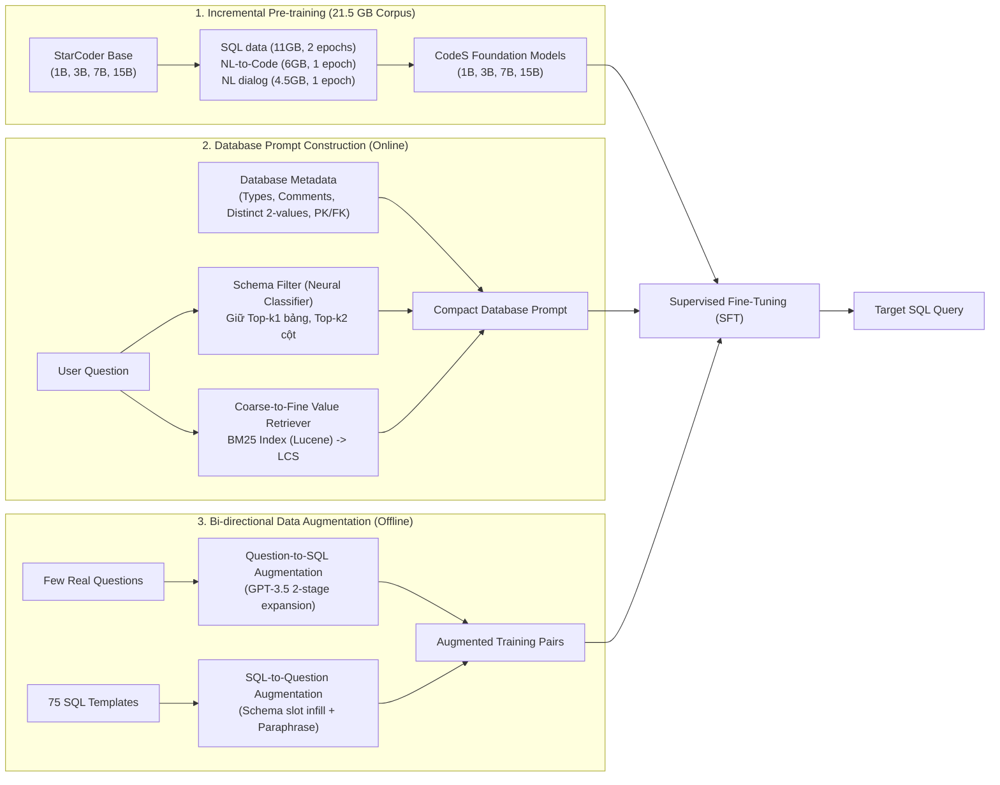

# CodeS: Towards Building Open-source Language Models for Text-to-SQL

| Thông tin | Chi tiết |
|---|---|
| **Tác giả** | Haoyang Li, Jing Zhang (corresponding), Hanbing Liu, Ju Fan, Xiaokang Zhang, Jun Zhu, Renjie Wei, Hongyan Pan, Cuiping Li, Hong Chen |
| **Đơn vị** | Renmin University of China; AI-Finance, China |
| **Năm / Venue** | SIGMOD 2024 / Proceedings of the ACM on Management of Data (PACMMOD 2024, Vol 2, No 3); arXiv:2402.16347 (26/02/2024) |
| **Loại bài** | Phương pháp / Mô hình nền tảng mã nguồn mở chuyên dụng (Open-source Foundation Models) |
| **Chủ đề** | Open-source Text-to-SQL, Incremental Pre-training, Schema Linking / Pruning, Coarse-to-fine Value Retrieval (BM25 + LCS), Bi-directional Data Augmentation, On-premise Deployment |
| **File gốc** | [Towards Building Open-source Language Models for Text-to-SQL.pdf](../papers/Towards%20Building%20Open-source%20Language%20Models%20for%20Text-to-SQL.pdf) |

## 1. Tóm tắt nhanh (TL;DR)
Bài báo giới thiệu **CodeS**, một họ mô hình ngôn ngữ mã nguồn mở chuyên dụng cho bài toán Text-to-SQL với dải tham số từ 1B đến 15B, xây dựng dựa trên StarCoder. Để giải quyết các hạn chế của các LLM thương mại đóng (GPT-4, ChatGPT) về chi phí, quyền riêng tư dữ liệu và độ trễ, CodeS áp dụng kỹ thuật tiền huấn luyện gia tăng (incremental pre-training) trên 21.5 GB dữ liệu tập trung vào SQL, kết hợp bộ lọc schema (Schema Filter), bộ truy hồi giá trị hai giai đoạn (Coarse-to-fine Value Retriever bằng BM25 + LCS), và kỹ thuật tăng cường dữ liệu hai chiều (Bi-directional Data Augmentation) cho miền mới. Thực nghiệm sâu rộng cho thấy khi được tinh chỉnh (SFT), **CodeS-7B** và **CodeS-15B** thiết lập đỉnh cao mới (SOTA) trên cả Spider (85.4% EX / 80.3% TS) và BIRD test (60.37% EX / 64.22% VES), vượt qua cả các hệ thống phức tạp dựa trên GPT-4 (như DIN-SQL và DAIL-SQL) với tốc độ sinh nhanh gấp ~50 lần (chỉ ~1.1 giây/truy vấn) và khả năng triển khai cục bộ an toàn.

## 2. Bối cảnh & Vấn đề nghiên cứu
- **Sự thống trị của các mô hình hộp đen đóng:** Phần lớn các giải pháp Text-to-SQL tiên tiến nhất (như DIN-SQL, DAIL-SQL, C3, SQL-PaLM) đều dựa vào in-context learning trên các mô hình đóng khổng lồ (GPT-4, ChatGPT 175B, PaLM-2). Điều này mang lại 3 hạn chế nghiêm trọng trong triển khai công nghiệp:
  1. *Thiếu minh bạch (L1):* Kiến trúc và dữ liệu của mô hình đóng bị che giấu, cản trở việc nghiên cứu và tối ưu hóa chuyên biệt cho từng hệ thống.
  2. *Rủi ro bảo mật dữ liệu (L2 - Data Privacy):* Doanh nghiệp (ngân hàng, tài chính, viễn thông) không thể gửi schema bảng, tên cột và dữ liệu nhạy cảm qua API đám mây công cộng.
  3. *Chi phí và độ trễ khổng lồ (L3):* Các pipeline phức tạp gọi GPT-4 nhiều lượt (như DIN-SQL) mất khoảng 60 giây cho một câu hỏi và tốn chi phí API rất cao.
- **Rào cản của mô hình nguồn mở kích thước nhỏ:** Các mô hình nguồn mở đa năng (LLaMA-2, StarCoder) được tiền huấn luyện trên hàng chục ngôn ngữ lập trình, trong đó SQL chỉ chiếm tỉ lệ rất nhỏ (< vài %). Khi áp dụng vào Text-to-SQL, mô hình nhỏ (1B–15B) thiếu hụt năng lực suy luận cấu trúc logic SQL phức tạp, dễ bị ảo giác cột và nối sai bảng.

## 3. Phương pháp / Nội dung chính

### 3.1 Tiền huấn luyện gia tăng (Incremental Pre-training)
Để trang bị năng lực sinh SQL cho các mô hình nhỏ mà không làm mất đi khả năng hiểu ngôn ngữ tự nhiên, nhóm tác giả xây dựng tập ngữ liệu **21.5 GB** gồm 3 phần:
1. **SQL-related data (11 GB):** Trích xuất phần SQL từ kho pre-training của StarCoder; huấn luyện trong 2 epochs.
2. **NL-related data (4.5 GB):** 3 tập hội thoại và chỉ dẫn chất lượng cao: Alpaca-cleaned, Unnatural-instructions, và UltraChat; huấn luyện trong 1 epoch.
3. **NL-to-code data (6 GB):** CoNaLa, StaQC, CodeAlpaca-20k, Jupyter Notebooks (StarCoder subset), và đặc biệt là **NL-SQL-458K** (tập dữ liệu mới do nhóm tự tạo: lọc 458,000 câu truy vấn SELECT hợp lệ từ The Pile, The Stack, GitHub Code và dùng GPT-3.5 sinh câu hỏi tự nhiên tương ứng qua 8-shot demonstration); huấn luyện trong 1 epoch.
- Kiến trúc mô hình: Decoder-only Transformer, Multi-query attention, tích hợp FlashAttention-2. Độ dài ngữ cảnh tối đa: 8,192 tokens cho các bản 1B, 3B, 7B và 6,144 tokens cho bản 15B.

### 3.2 Kỹ thuật xây dựng Database Prompt trực tuyến
- **Bộ lọc Schema (Schema Filter):** Sử dụng một mạng nơ-ron phân loại gọn nhẹ (Schema Item Classifier) để dự đoán điểm liên quan của từng bảng và cột đối với câu hỏi của người dùng. Chỉ giữ lại top-$k_1$ bảng và top-$k_2$ cột có điểm số cao nhất (khi fine-tune chọn $k_1=6, k_2=10$; khi few-shot chọn $k_1=5, k_2=6$).
- **Bộ truy hồi giá trị Coarse-to-Fine (Value Retriever):**
  - Trong các CSDL lớn như Donor (116.5 triệu giá trị), việc chạy thuật toán so khớp chuỗi con dài nhất (LCS) cho từng giá trị là bất khả thi vì độ phức tạp $O(f \times u)$.
  - Tác giả đề xuất giải pháp hai pha: (1) Dùng **chỉ mục BM25 (Lucene / Pyserini)** để tìm kiếm thô cực nhanh, trích xuất vài trăm giá trị tiềm năng; (2) Dùng thuật toán **LCS** trên vài trăm ứng viên này để chọn ra các giá trị khớp chính xác nhất với câu hỏi.
- **Bổ sung siêu dữ liệu thiết yếu (Metadata):**
  - *Data Types:* Định rõ kiểu dữ liệu để mô hình biết khi nào cần dùng hàm `CAST(...)`.
  - *Comments:* Diễn giải các tên cột viết tắt nhập nhằng trong CSDL thực tế (ví dụ: `w1st` = word id of the first word, `rotl` = road overtime loses, `pim` = penalty minutes).
  - *Representative Values:* Lấy mẫu đúng 2 giá trị phân biệt không rỗng (`SELECT DISTINCT {col} FROM {tbl} WHERE {col} IS NOT NULL LIMIT 2`) để mô hình nắm được định dạng giá trị (ví dụ định dạng ngày tháng `YYYY-MM-DD` hoặc giới tính `'M'/'F'`).
  - *Primary & Foreign Keys:* Hướng dẫn mô hình sinh chính xác mệnh đề `JOIN ... ON`.

### 3.3 Tăng cường dữ liệu hai chiều cho miền mới (Bi-directional Data Augmentation)
Khi triển khai trên database mới mà không có dữ liệu gán nhãn:
1. **Question-to-SQL Augmentation:** Thu thập một số lượng nhỏ (~30 câu) câu hỏi người dùng thực tế $\rightarrow$ gán nhãn SQL thủ công $\rightarrow$ dùng GPT-3.5 với nhiệt độ cao sinh ra các câu hỏi tương tự đa dạng $\rightarrow$ dùng GPT-3.5 sinh câu SQL tương ứng.
2. **SQL-to-Question Augmentation:** Sử dụng 75 mẫu khung SQL (SQL templates) phổ biến từ Spider $\rightarrow$ điền các bảng và cột từ database mới vào khung $\rightarrow$ dùng GPT-3.5 tinh chỉnh lại câu hỏi cho tự nhiên dựa trên mô tả cột (comments).

### 3.4 Sử dụng mô hình
- **Supervised Fine-Tuning (SFT):** Huấn luyện mô hình sinh SQL theo mục tiêu autoregressive loss trên các cặp database prompt + câu hỏi. Khi suy luận, dùng Beam Search độ rộng 4 để sinh 4 ứng viên và chọn câu lệnh đầu tiên thực thi được mà không báo lỗi.
- **Few-shot In-Context Learning:** Sử dụng **Demonstration Retriever** dựa trên SimCSE: loại bỏ các thực thể cụ thể ra khỏi câu hỏi để so khớp theo mẫu câu cấu trúc (question-pattern similarity) thay vì chỉ so khớp độ tương đồng ngữ nghĩa thực thể thuần túy.

## 4. Thực nghiệm & Kết quả chính

### 4.1 Kết quả trên Spider Dev Set (Table 5)

| Phương pháp | Cỡ mô hình | Execution Accuracy (EX%) | Test-Suite Accuracy (TS%) |
|---|---|---|---|
| T5-3B + PICARD | ~3B | 79.3 | 69.4 |
| RESDSQL-3B + NatSQL | ~3B | 84.1 | 73.5 |
| SFT Llama2-7B | 7B | 77.8 | 73.0 |
| SFT Llama2-13B | 13B | 81.6 | 76.6 |
| Fine-tuned SQL-PaLM | 540B | 82.8 | 78.2 |
| C3 + ChatGPT | 175B | 81.8 | 71.4 |
| DIN-SQL + GPT-4 | Unknown | 82.8 | 74.2 |
| DAIL-SQL + GPT-4 | Unknown | 83.1 | 76.6 |
| **SFT CodeS-1B** | **1B** | **77.9** | **72.2** |
| **SFT CodeS-3B** | **3B** | **83.4** | **78.1** |
| **SFT CodeS-7B** | **7B** | **85.4** | **80.3** |
| **SFT CodeS-15B** | **15B** | **84.9** | **79.4** |

*Nhận xét:* SFT CodeS-3B đã vượt qua cả DIN-SQL + GPT-4 và DAIL-SQL + GPT-4; trong khi SFT CodeS-7B đạt đỉnh cao mới với 85.4% EX và 80.3% TS.

### 4.2 Kết quả trên BIRD Dev và Test Set (Table 6)

| Phương pháp | Dev EX | Dev VES | Dev w/ EK EX | Dev w/ EK VES | Test EX | Test VES | Test w/ EK EX | Test w/ EK VES |
|---|---|---|---|---|---|---|---|---|
| Fine-tuned T5-3B | 10.37 | 13.62 | 23.34 | 25.57 | 11.17 | 15.17 | 24.05 | 27.80 |
| ChatGPT + CoT | 25.88 | 32.33 | 36.64 | 42.30 | 28.95 | 49.69 | 40.08 | 56.56 |
| Claude-2 | – | – | 42.70 | – | – | – | 49.02 | – |
| GPT-4 (zero-shot) | – | – | 49.15 | – | – | – | 54.89 | 60.77 |
| DIN-SQL + GPT-4 | – | – | 50.72 | 58.79 | – | – | 55.90 | 59.44 |
| DAIL-SQL + GPT-4 | – | – | 54.76 | 56.08 | – | – | 57.41 | 61.95 |
| **SFT CodeS-7B** | **45.24** | **48.13** | **57.17** | **58.80** | **50.25** | **54.84** | **59.25** | **63.62** |
| **SFT CodeS-15B** | **47.91** | **49.60** | **58.47** | **59.87** | **52.15** | **56.99** | **60.37** | **64.22** |

*Nhận xét:* Trên tập test ẩn của BIRD có kèm tri thức ngoài (w/ EK), SFT CodeS-15B đạt **60.37% EX** và CodeS-7B đạt **59.25% EX**, vượt trội hơn tất cả các giải pháp dùng GPT-4. Khi không có tri thức ngoài (w/o EK), CodeS-15B đạt **52.15% EX**, vượt xa ChatGPT + CoT (+23.2%). Điểm số VES cao hơn EX chứng minh các câu truy vấn do CodeS sinh ra có hiệu năng thực thi tối ưu.

### 4.3 Đánh giá độ bền vững trên các biến thể Spider (Table 7 & Table 8)
- Trên **Spider-Syn** (thay thế từ đồng nghĩa): SFT CodeS-7B đạt 76.9% EX / 70.0% TS (vượt SQL-PaLM 74.6% / 67.4%).
- Trên **Spider-Realistic** (loại bỏ tên cột tường minh khỏi câu hỏi): CodeS-7B đạt 82.9% EX / 77.2% TS (vượt SQL-PaLM 77.4% / 73.2%).
- Trên **Spider-DK** (đòi hỏi tri thức miền): CodeS-7B đạt 72.0% EX (vượt SQL-PaLM 67.5%).
- Trên **Dr.Spider** (17 dạng nhiễu trên DB, câu hỏi và SQL): CodeS-15B đạt trung bình 75.1% EX, CodeS-7B đạt 75.0% EX, vượt qua ChatGPT + ZeroNL2SQL (74.9%).

### 4.4 Thử nghiệm trên cơ sở dữ liệu doanh nghiệp thực tế (Table 10)
Trên 2 CSDL mới được xây dựng từ chỉ 30 mẫu gán nhãn:
- **Bank-Financials (4 bảng, bảng lớn nhất 65 cột):** SFT CodeS-7B (dùng augmented data) đạt **71.4% EX / 85.7% Human Eval (HE)**, vượt xa GPT-3.5 3-shot (57.1% EX / 84.6% HE) và DIN-SQL + GPT-4 (26.4% EX / 79.1% HE).
- **Aminer-Simplified (CSDL học thuật với quan hệ JOIN phức tạp):** SFT CodeS-7B đạt **51.5% EX / 64.9% HE** và tăng lên **53.6% EX / 67.0% HE** khi gộp dữ liệu huấn luyện (merged data).

### 4.5 Phân tích tốc độ suy luận và tài nguyên phần cứng
- **Thời gian suy luận trung bình mỗi câu hỏi trên Spider:**
  - DIN-SQL + GPT-4: **~60.0 giây**
  - SFT CodeS-1B: **0.6 giây**
  - SFT CodeS-3B: **0.9 giây**
  - SFT CodeS-7B: **1.1 giây**
  - SFT CodeS-15B: **1.5 giây**
  $\rightarrow$ CodeS nhanh hơn các pipeline GPT-4 từ **40 đến 100 lần**.
- **Yêu cầu bộ nhớ GPU (VRAM ở định dạng FP16):**
  - CodeS-1B: 10 GB
  - CodeS-3B: 13 GB
  - CodeS-7B: 20 GB (hoạt động tốt trên 1 card đồ họa tiêu chuẩn như RTX 3090 / RTX 4090 24GB)
  - CodeS-15B: 35 GB (chạy trên 1 card A100 / A800 hoặc phân bổ trên 2 card 24GB).

## 5. Tính mới (Novelty & Đóng góp)
- **Họ mô hình nguồn mở chuyên biệt đầu tiên đánh bại GPT-4:** Phá vỡ quan niệm cho rằng Text-to-SQL trên CSDL lớn bắt buộc phải dùng mô hình đóng hàng trăm tỷ tham số.
- **Quy trình Pre-training gia tăng có kiểm soát:** Phối hợp tỉ lệ vàng giữa dữ liệu SQL (11GB), dữ liệu hội thoại ngôn ngữ tự nhiên (4.5GB) và dữ liệu ghép cặp NL-to-Code (6GB), khắc phục hiện tượng mất cân bằng dữ liệu của các mô hình Code thông thường.
- **Kỹ thuật Coarse-to-Fine Value Retrieval đột phá:** Kết hợp BM25 và LCS giúp giảm chi phí tìm kiếm giá trị từ hàng triệu phép tính xuống hàng trăm, mở đường cho việc áp dụng Value Linking trên CSDL hàng trăm triệu dòng.
- **Bi-directional Data Augmentation thiết thực:** Cho phép doanh nghiệp tự huấn luyện mô hình Text-to-SQL thích ứng với database nội bộ chỉ từ vài chục mẫu câu hỏi ban đầu với chi phí tối thiểu.

## 6. Hạn chế

### 6.1 Hạn chế do tác giả thừa nhận
- **Giới hạn cửa sổ ngữ cảnh (Context Window):** Kiến trúc FlashAttention-2 của mô hình giới hạn ở 8,192 tokens (hoặc 6,144 tokens cho bản 15B), bắt buộc phải phụ thuộc vào Schema Filter để cắt tỉa bớt bảng/cột đối với các CSDL quá lớn.
- **Hiện tượng Overfitting nhẹ trên bản 15B:** Kết quả trên Spider dev của bản 15B (84.9% EX) hơi thấp hơn bản 7B (85.4% EX), cho thấy việc tăng kích thước tham số có nguy cơ học vẹt dữ liệu huấn luyện nếu tập mẫu không đủ phong phú.

### 6.2 Nhận xét thêm của người review
- **Vẫn là mô hình Single-turn Seq2Seq tĩnh:** CodeS được thiết kế để nhận prompt và sinh ra câu lệnh SQL trong một lần (one-pass generation). Khi đối mặt với các workflow doanh nghiệp phức tạp như trong benchmark **Spider 2.0** (nơi cần đọc codebase, sửa file DBT, chạy bash và tương tác qua nhiều vòng), SFT CodeS-15B chỉ đạt 0.73% EX, cho thấy mô hình thiếu năng lực tác tử (agentic reasoning) và tool-use đa bước.
- **Phụ thuộc vào GPT-3.5 trong khâu tạo dữ liệu:** Quy trình tăng cường dữ liệu hai chiều (bi-directional augmentation) và việc tạo tập tiền huấn luyện NL-SQL-458K vẫn cần dùng GPT-3.5 để sinh câu hỏi và paraphrase; về bản chất đây là một hình thức chưng cất tri thức (knowledge distillation) từ mô hình đóng sang mô hình mở.
- **Lấy mẫu 2 giá trị cố định:** Việc chỉ lấy 2 giá trị distinct ngẫu nhiên cho mỗi cột trong DDL prompt có thể không đủ bao quát miền giá trị (domain values) cho các cột có phân phối phức tạp (ví dụ cột trạng thái có 10 giá trị khác nhau).

## 7. Ý nghĩa ứng dụng (cho hệ thống agent phân tích dữ liệu / Text-to-SQL)
- **Phương án tối ưu cho triển khai On-Premise / Private Cloud:** CodeS-7B là ứng viên lý tưởng cho các doanh nghiệp tài chính, y tế, chính phủ cần bảo mật dữ liệu tuyệt đối: có thể chạy hoàn toàn cục bộ trên 1 GPU RTX 4090 với độ trễ siêu thấp (~1.1 giây) và chi phí vận hành bằng 0.
- **Mô hình hóa kiến trúc lai (Hybrid Architecture):** Trong hệ thống Agentic Data Analysis lớn, có thể dùng CodeS-7B làm bộ sinh SQL chuyên trách (Fast SQL Generator worker), kết hợp với một LLM suy luận mạnh hơn đóng vai trò Planner hoặc Validator để kiểm tra và tối ưu câu truy vấn.
- **Áp dụng bộ lọc giá trị Coarse-to-Fine:** Cơ chế kết hợp BM25 (Lucene index) và LCS nên được tích hợp vào mọi pipeline Text-to-SQL thực tế để giải quyết bài toán tìm kiếm giá trị lọc trong kho dữ liệu lớn mà không tốn tài nguyên.

## 8. Từ khóa
`CodeS`, `Open-source Text-to-SQL`, `Incremental Pre-training`, `StarCoder`, `Schema Filter`, `Value Retriever`, `BM25`, `Bi-directional Data Augmentation`, `Domain Adaptation`, `Spider Benchmark`, `BIRD Benchmark`