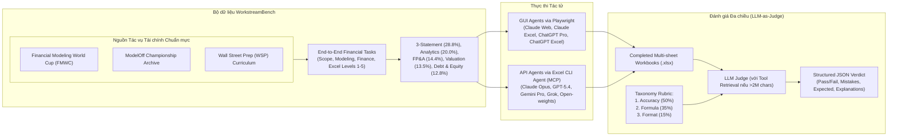

# WorkstreamBench: Evaluating LLM Agents on End-to-End Spreadsheet Tasks in Finance

| Thông tin | Chi tiết |
|---|---|
| **Tác giả** | Thomson Yen, Julian Poeltl, Harshith Srinivas Gear, Yilin Meng, Joshua Fan, Adam Shen, Yili Liu, Ali Bauyrzhan, Siri Du, Haoyang Liu, Daniel Guetta, Hongseok Namkoong |
| **Đơn vị** | Decision, Risk, and Operations Division, Columbia Business School; ESB Business School, Reutlingen University |
| **Năm / Venue** | arXiv:2605.22664v1 [cs.AI] (21/05/2026; Preprint) |
| **Loại bài** | Benchmark & Khung đánh giá tác tử Spreadsheet toàn trình (End-to-End Agent) |
| **Chủ đề** | End-to-End Spreadsheet Generation, Financial Modeling, 3-Statement Models, Scenario Analysis, LLM-as-Judge, Multi-Dimensional Evaluation (Accuracy, Formula, Format) |
| **File gốc** | [WorkstreamBench.pdf](../papers/WorkstreamBench.pdf) |

## 1. Tóm tắt nhanh (TL;DR)
**WorkstreamBench** là một trong những benchmark đầu tiên đánh giá các tác tử LLM (LLM Agents) trên các tác vụ xây dựng bảng tính Excel toàn trình (end-to-end spreadsheet workflows) trong lĩnh vực tài chính kinh doanh. Khác với các benchmark trước đây chỉ kiểm tra các tác vụ nguyên tử (sửa một ô, sinh một công thức đơn lẻ, hoặc Table QA), WorkstreamBench yêu cầu mô hình kiến tạo toàn bộ workbook hoàn chỉnh (gồm 3-Statement Model, DCF, LBO, Scenario Analysis) từ tài liệu mô tả tình huống. Nhóm tác giả đề xuất hệ thống tiêu chí đánh giá đa chiều chuẩn chuyên nghiệp gồm 3 trụ cột: **Accuracy (50%)**, **Formula (35%)**, và **Format (15%)**, được chấm điểm tự động thông qua pipeline LLM-as-Judge đã kiểm định chặt chẽ với chuyên gia tài chính. Kết quả cho thấy dòng mô hình Claude (dẫn đầu bởi Claude Web đạt 69.1/100) vượt trội so với các đối thủ, tuy nhiên hiệu năng của tất cả tác tử đều tụt dốc nghiêm trọng khi độ khó tăng lên chuỗi tính toán đa tầng, chứng minh LLM hiện nay vẫn chưa thể thay thế chuyên viên tài chính trong việc tạo lập bảng tính chuẩn mực doanh nghiệp.

## 2. Bối cảnh & Vấn đề nghiên cứu
- **Sự trỗi dậy của các tác tử bảng tính thương mại:** Các sản phẩm mới ra mắt như *Claude for Excel* và *ChatGPT for Excel* cho thấy xu hướng LLM tự động hóa xây dựng bảng tính trực tiếp từ chỉ dẫn ngôn ngữ tự nhiên.
- **Hạn chế của các benchmark hiện tại:**
  - Các benchmark như *SpreadsheetBench*, *SheetAgent*, hay *NL2Formula* chủ yếu đánh giá các tác vụ rời rạc (atomic tasks): điền một công thức vào một ô định trước, sửa giá trị ô, hoặc trích xuất câu trả lời đơn giản từ bảng.
  - Các benchmark tài chính hiện hành (*FinBen*, *BizBench*, *PIXIU*) chỉ xoay quanh bài toán hỏi đáp trắc nghiệm (QA) hoặc tính toán số học ngắn, không yêu cầu tạo lập sản phẩm bàn giao (deliverable).
- **Đặc thù công việc tài chính doanh nghiệp (Corporate Finance / Private Equity / FP&A):**
  - Trong thực tế, chuyên viên tài chính phải xây dựng các mô hình tài chính hoàn chỉnh (financial models): liên kết Báo cáo kết quả kinh doanh (P&L), Bảng cân đối kế toán (Balance Sheet), và Báo cáo lưu chuyển tiền tệ (Cash Flow Statement), kèm các kịch bản dự phóng (Scenario / Sensitivity Analysis).
  - Bảng tính tài chính không phải là file tính toán một lần rồi bỏ, mà là một **tài sản cộng tác (collaborative artifact)** được chuyển giao lên các cấp quản lý (Managers, VPs, Clients, Auditors) để thẩm định, chạy thử các giả định khác nhau và kiểm tra rủi ro.
  - Do đó, chất lượng bảng tính không chỉ dừng ở tính đúng số (computational accuracy) mà đòi hỏi tính đọc hiểu (readability), tính minh bạch của công thức (tránh mega-formula nguyên khối), cấu trúc logic (phân tách Assumptions, Workings, Outputs) và khả năng dễ dàng chỉnh sửa (không hardcode số chết).

## 3. Phương pháp / Nội dung chính

### 3.1 Nguồn dữ liệu & Quy mô nhiệm vụ
- **3 nguồn dữ liệu tài chính danh tiếng:** Financial Modeling World Cup (FMWC - giải đấu e-sport mô hình tài chính toàn cầu), ModelOff (giải vô địch mô hình tài chính thế giới giai đoạn 2012–2019), và giáo trình thực hành của Wall Street Prep (WSP - đơn vị đào tạo hàng đầu cho các ngân hàng đầu tư).
- **Quy mô vượt trội:** Bảng tính giải mẫu (golden solutions) của WorkstreamBench có số lượng ô tính lớn hơn gấp **33 lần** (trung bình 58,300 ô vs 1,800 ô) và số lượt gọi hàm lớn hơn gấp **93 lần** (trung vị 933 hàm vs 10 hàm) so với SpreadsheetBench.
- **Phân loại độ khó 5 cấp độ (Level 1–5):** Được tính điểm trọng số từ 4 khía cạnh:
  1. *Scope (Trọng số 1/3):* Quy mô và độ phức tạp cấu trúc (từ tác vụ đơn lẻ đến mô hình đa tab liên kết sâu).
  2. *General Modeling (Trọng số 1/3):* Độ phức tạp kỹ thuật định lượng và độ liên kết giữa các tầng tính toán.
  3. *Financial Knowledge (Trọng số 1/6):* Chiều sâu kiến thức tài chính (từ tính lãi cơ bản đến mô hình LBO, financing waterfall).
  4. *Implementation in Excel (Trọng số 1/6):* Mức độ thành thạo tính năng Excel (từ hàm số học đến nested formulas, dynamic arrays, data tables).

### 3.2 Hệ thống tiêu chí đánh giá đa chiều (Evaluation Taxonomy)
Tác giả thiết lập hệ thống chấm điểm gồm 3 trụ cột lớn:
1. **Accuracy (50% trọng số):**
   - *Final Calculations (35%):* Độ chính xác của các chỉ số đầu ra trọng yếu (IRR, NPV, Net Income, Cash balance).
   - *Starting Values (25%):* Sử dụng đúng các số liệu đầu vào từ đề bài.
   - *Task Completed (25%):* Hoàn thành đầy đủ các bảng và câu hỏi yêu cầu.
   - *Sign Consistency (15%):* Tính nhất quán về dấu (chi phí mang dấu âm hoặc dương đồng nhất).
2. **Formula (35% trọng số):**
   - *Logic Readability & Size (20%):* Tránh các "mega-formula" nguyên khối phức tạp; yêu cầu phân rã thành các bước trung gian có nhãn rõ ràng để dễ kiểm toán.
   - *Handle Edge Cases (20%):* Bọc hàm `IFERROR` hoặc bẫy lỗi để tránh lan truyền `#DIV/0!`, `#VALUE!`, `#N/A` khi thiếu dữ liệu đầu vào.
   - *Avoid Hardcoding (20%):* Không được gõ trực tiếp số chết ("magic numbers") vào công thức; bắt buộc phải tham chiếu tới ô giả định (Assumptions).
   - *Range Hygiene (20%):* Tránh tham chiếu bừa bãi toàn bộ cột (`SUM(B:B)`) làm chậm bảng tính; dùng phạm vi động hoặc cấu trúc Excel Table (`ListObject`).
   - *Using Absolute References (20%):* Khóa ô tuyệt đối (`$B$1`) chuẩn xác khi sao chép công thức kéo thả.
3. **Format (15% trọng số):**
   - *Workbook & Sheet Structure (20%):* Bố cục mạch lạc, phân tách rõ ràng các sheet Assumptions, Workings, Outputs.
   - *Number Notation (20%):* Định dạng số chuẩn tài chính (hiển thị số âm trong ngoặc đơn `(1,000)` thay vì `-1,000`, có nhãn đơn vị `[$K]`).
   - *Readability (10%):* Cố định dòng tiêu đề hợp lý (`Freeze Panes`), độ rộng cột vừa vặn không che khuất chữ.
   - *Color Standards, Alignment, Style Consistency, Borders, Output Presentation (mỗi tiêu chí 10%).*

### 3.3 Khung đánh giá LLM-as-Judge & Thẩm định chuyên gia
- **Đánh giá tự động qua LLM Judge:** LLM nhận rubric chi tiết, file mẫu và workbook do agent sinh ra để trả về JSON phân tích chi tiết. Với các workbook khổng lồ (>2 triệu ký tự), nhóm tác giả trang bị cho Judge các tool tìm kiếm và kiểm tra ô cục bộ (Agentic Judge) để tránh tràn ngữ cảnh.
- **Độ tin cậy được kiểm chứng:** 2 học viên MBA và 3 chuyên gia tài chính đã dành hơn **700 giờ** gắn nhãn 408 mẫu kiểm thử. LLM Judge đạt độ chính xác **0.92**, balanced accuracy **0.88** và F1-score **0.85**.
- **Bắt được lỗi mà Exact Match bỏ sót:**
  - *Lỗi lệch cận (Off-by-one Error):* Khi tính LTM EBITDA, Claude Web trượt khoảng thời gian tính toán nhưng vô tình cho ra kết quả trùng số; exact match sẽ cho điểm tối đa, nhưng LLM Judge bắt được lỗi logic trong công thức.
  - *Gian lận Hardcoding:* Mô hình tự tính toán bằng script Python bên ngoài rồi dán số chết vào Excel thay vì thiết lập công thức; Judge phát hiện và chấm Fail ngay lập tức vì phá vỡ tính audit của mô hình.

### 3.4 Cơ sở hạ tầng thực thi Agent
- **GUI Agents (tự động hóa qua Playwright):** Tương tác với giao diện thương mại của Claude Web, Claude for Excel, ChatGPT Pro, ChatGPT for Excel, ChatGPT Agent.
- **API Agents (Excel CLI Agent qua MCP):** Khung agent nội bộ dựa trên Model Context Protocol (MCP) với 19 công cụ quản lý file, đọc/ghi ô tính, định dạng và tích hợp LibreOffice ngầm để tự động tính toán lại công thức sau mỗi lượt gọi.

## 4. Thực nghiệm & Kết quả chính

### 4.1 Điểm số tổng hợp (Composite Scores - Figure 2)

| Xếp hạng | Tác tử / Mô hình | Giao diện | Composite Score (/100) | Điểm Accuracy | Điểm Formula | Điểm Format |
|---|---|---|---|---|---|---|
| **1** | **Claude Web** | GUI | **69.1** | Dẫn đầu | Dẫn đầu | Dẫn đầu |
| **2** | **ChatGPT (Excel)** | GUI Add-in | **60.4** | Cao | Trung bình | Khá |
| **3** | **Claude (Excel)** | GUI Add-in | **59.0** | Khá | Khá | Khá |
| **4** | **ChatGPT Pro** | GUI | **58.7** | Khá | Trung bình | Tốt |
| **5** | **ChatGPT Agent** | GUI | **31.2** | Trung bình | Thấp | Thấp |
| **6** | **Claude Opus 4.6** | API CLI (MCP) | **18.2** | Thấp | Trung bình | Thấp |
| **7** | **Gemini 3.1 Pro** | API CLI (MCP) | **16.1** | Thấp | Thấp | Thấp |
| **8** | **GPT-5.4** | API CLI (MCP) | **16.0** | Thấp | Thấp | Thấp |
| **9** | **Grok 4.2** | API CLI (MCP) | **15.5** | Thấp | Thấp | Thấp |
| **10** | **Qwen 3.6 Plus** | API CLI (MCP) | **14.7** | Thấp | Thấp | Thấp |
| **11** | **Kimi K2.5** | API CLI (MCP) | **14.4** | Thấp | Thấp | Thấp |
| **12** | **OLMo 3.1 Instruct** | API CLI (MCP) | **6.8** | Rất thấp | Rất thấp | Rất thấp |

### 4.2 Khoảng cách lớn giữa GUI và API Agents
Cùng sử dụng các mô hình frontier (như dòng Claude Opus hay GPT), các tác tử chạy trên giao diện đồ họa bản quyền (GUI Agents) đạt điểm từ 58–69, vượt trội hoàn toàn so với khi chạy qua framework API CLI tự xây dựng (chỉ đạt 14–18 điểm). Điều này cho thấy khung bao bọc (agentic harness) và công cụ nội bộ mà OpenAI/Anthropic tích hợp phía sau GUI đóng góp một phần rất lớn vào chất lượng sinh bảng tính.

### 4.3 Suy giảm nghiêm trọng theo độ khó (Difficulty Scaling - Figure 6)
- Tất cả các agent đều có xu hướng dành nhiều thời gian hơn khi độ khó tăng lên (từ vài phút ở Level 1 lên hàng chục phút ở Level 4-5).
- Tuy nhiên, điểm số lại sụt giảm thảm hại: Ở các bài toán Level 2 (Easy), nhiều mô hình đạt điểm khá tốt; nhưng khi bước sang Level 4–5 (đòi hỏi mô hình waterfall phức tạp, liên kết nhiều kịch bản), ngay cả Claude Web cũng tụt xuống mức 53.4/100.
- Các mô hình mã nguồn mở (OLMo 3.1, Qwen, Kimi) gần như bỏ cuộc ở các bài toán Hard: Kimi bỏ trống 62% số sheet trả lời; Grok tuyên bố hoàn thành sau 8 tool call nhưng không sinh ra một công thức nào và bịa đặt hoàn toàn số liệu kết quả.

### 4.4 Các phát hiện định tính chuyên sâu
1. **Thói quen Hardcoding của các Excel Add-ins:** Khi gặp tác vụ phức tạp, cả Claude Excel lẫn ChatGPT Excel đều có xu hướng gõ chết số liệu (hardcode) thay vì lập công thức Excel, khiến bảng tính mất hoàn toàn tính năng động khi thay đổi giả định.
2. **Vi phạm quy chuẩn tài chính:** Thường xuyên hiển thị số âm bằng dấu trừ (`-500`) thay vì mở ngoặc đơn `(500)`, quên cột đơn vị tiền tệ `[$K]`, hoặc đổi màu font chữ lộn xộn giữa các dòng liên tiếp.
3. **Điểm mù Circular References (Tham chiếu vòng):** Trong tài chính, các vòng lặp tính toán (lãi vay phụ thuộc nợ, nợ phụ thuộc dòng tiền sau lãi) là hoàn toàn chuẩn mực và Excel xử lý bằng tính toán lặp (iterative calculation). Tuy nhiên, các backend ngầm của tác tử (LibreOffice / OpenPyXL) không hỗ trợ tính năng này, dẫn tới hàng nghìn lỗi `#VALUE!` và làm crash phiên làm việc.
4. **Vòng xoáy kiểm tra (Inspection Spiral) của mô hình suy luận sâu:** GPT-5.4 khi bật reasoning tối đa ("xhigh") bị rơi vào vòng lặp kiểm tra vô tận trên bài toán khó: thực hiện liên tiếp 50 lệnh đọc ô tính (`get_cell_range`) mà không viết nổi một công thức nào.

## 5. Tính mới (Novelty & Đóng góp)
- **Tiên phong đánh giá End-to-End Spreadsheet:** Chuyển dịch toàn diện từ các bài toán đồ chơi nguyên tử (atomic cell-editing) sang quy trình xây dựng bảng tính tài chính hoàn chỉnh cấp doanh nghiệp.
- **Hệ thống tiêu chí 3 chiều chuẩn mực (Accuracy, Formula, Format):** Đưa ra định nghĩa định lượng đầu tiên về chất lượng bảng tính chuyên nghiệp, bao quát từ tính logic của công thức đến thẩm mỹ trình bày.
- **LLM-as-Judge có kiểm định thực nghiệm:** Chứng minh tính khả thi của việc dùng LLM làm giám khảo cho các sản phẩm phức tạp khó chấm bằng exact match, đạt độ tương đồng rất cao (>90%) với các chuyên gia tài chính.
- **Phát triển bộ công cụ Playwright & MCP CLI Agent:** Đóng góp mã nguồn mở cho cộng đồng để tự động hóa việc đánh giá cả tác tử giao diện web/add-in lẫn tác tử dòng lệnh.

## 6. Hạn chế

### 6.1 Hạn chế do tác giả thừa nhận
- **Tập trung vào miền tài chính:** Một số tiêu chí (định dạng số âm trong ngoặc, bố cục P&L/Balance Sheet) mang tính đặc thù tài chính, chưa đại diện cho mọi ngành nghề dùng Excel.
- **Thiếu tác vụ ở mức siêu khó (Level 5):** Chỉ có 7 tác vụ ở cấp độ khó nhất, tạo độ lệch chuẩn lớn khi thống kê ở cấp độ này.
- **Môi trường proprietary hộp đen:** Không thể biết chính xác bên trong Claude Web hay ChatGPT Excel có những prompt và công cụ hỗ trợ nào, hạn chế việc phân tích nguyên nhân gốc rễ của sự chênh lệch hiệu năng.

### 6.2 Nhận xét thêm của người review
- **Chi phí thực nghiệm rất đắt đỏ:** Mỗi vòng đánh giá toàn diện tiêu tốn khoảng **$7,400 USD** tiền chạy tác tử và **$1,700 USD** tiền chạy LLM Judge, là rào cản tài chính lớn đối với các nhóm nghiên cứu độc lập.
- **Sai lệch giữa LibreOffice backend và Microsoft Excel thật:** Việc dùng LibreOffice để tính toán lại công thức trong backend CLI dẫn đến việc không hỗ trợ các tính năng tối tân của Excel 365 (Dynamic Arrays, `LAMBDA`, `LET`, Iterative Calculation cho circular references), gây thiệt thòi cho các mô hình cố gắng sử dụng công thức hiện đại.
- **Thiếu tính năng tương tác đa lượt với con người (Human-in-the-loop):** Trong thực tế, chuyên viên tài chính luôn hỏi lại khách hàng/quản lý để làm rõ các giả định chưa rõ ràng trong bản case brief; WorkstreamBench hiện tại ép mô hình phải tự đoán toàn bộ giả định trong một lượt.

## 7. Ý nghĩa ứng dụng (cho hệ thống agent phân tích dữ liệu / Text-to-SQL)
- **Tách bạch cấu trúc bảng tính (Assumptions - Workings - Outputs):** Khi sinh bảng tính hoặc báo cáo tài chính, Agent phải tuân thủ nghiêm ngặt nguyên tắc: Gom toàn bộ hằng số vào sheet Assumptions, tính toán trung gian tại Workings, và chỉ hiển thị kết quả tổng hợp tại Outputs.
- **Quy tắc "Không Magic Numbers":** Bắt buộc Agent phải tham chiếu ô thay vì gõ chết số trong công thức, đảm bảo khi người dùng thay đổi tham số đầu vào thì toàn bộ mô hình tự động cập nhật.
- **Chống lỗi phân rã công thức (Formula Decomposition):** Cần hướng dẫn Agent chia nhỏ các phép tính phức tạp thành nhiều dòng/cột có diễn giải nghĩa thay vì tạo ra các biểu thức `IF(...)` lồng nhau dài dằng dặc khó kiểm toán.
- **Bọc bảo vệ lỗi phép tính:** Mọi phép chia hoặc hàm tìm kiếm (`VLOOKUP`, `XLOOKUP`) phải được tự động bọc trong hàm `IFERROR(...)` với thông báo lỗi dễ hiểu để ngăn chặn lỗi dây chuyền làm sập bảng tính.

## 8. Từ khóa
`WorkstreamBench`, `Spreadsheet Agents`, `Financial Modeling`, `3-Statement Model`, `LLM-as-Judge`, `Formula Hygiene`, `Format Standards`, `Claude Web`, `Model Context Protocol (MCP)`, `Playwright`